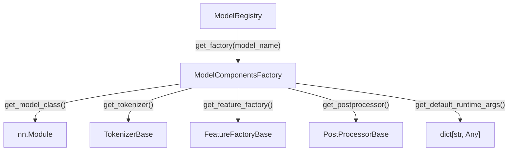
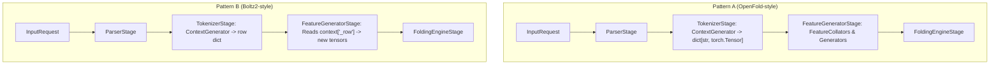

# Model Registry and Feature Factories

Relevant source files

The following files were used as context for generating this wiki page:

- [bionemo_ir/models/protenix/config.py](bionemo_ir/models/protenix/config.py)
- [bionemo_ir/models/protenix/modeling.py](bionemo_ir/models/protenix/modeling.py)
- [bionemo_ir/pipeline/engine.py](bionemo_ir/pipeline/engine.py)
- [bionemo_ir/pipeline/models/boltz2/feature_factory.py](bionemo_ir/pipeline/models/boltz2/feature_factory.py)
- [bionemo_ir/pipeline/stages/feature_generator_stage.py](bionemo_ir/pipeline/stages/feature_generator_stage.py)
- [bionemo_ir/pipeline/stages/tokenizer_stage.py](bionemo_ir/pipeline/stages/tokenizer_stage.py)
- [bionemo_ir/pipeline/utils/__init__.py](bionemo_ir/pipeline/utils/__init__.py)
- [bionemo_ir/registry.py](bionemo_ir/registry.py)
- [docs/ray.md](docs/ray.md)
- [docs/ref/architecture.md](docs/ref/architecture.md)
- [tests/_torch/test_protenix_contracts.py](tests/_torch/test_protenix_contracts.py)
- [tests/pipeline/feature_generator/test_feature_generator_udf.py](tests/pipeline/feature_generator/test_feature_generator_udf.py)
- [tests/pipeline/test_request_rng.py](tests/pipeline/test_request_rng.py)

## Purpose and Scope

This page covers the architectural routing mechanism via `ModelRegistry` and `ModelComponentsFactory`, the foundational base classes for feature extraction and transformation (`ContextGeneratorBase`, `FeatureGeneratorBase`, `FeatureCollatorBase`, and `TransformBase`), and the two primary data flow patterns (**Pattern A** and **Pattern B**) used across model pipelines.

For implementation-specific details, see the child pages:
- [OpenFold2/OpenFold3 Feature Pipelines](#2.2.1)
- [Boltz-1/Boltz-2 Feature Pipelines](#2.2.2)

Sources: [bionemo_ir/registry.py:30-118](), [bionemo_ir/pipeline/stages/tokenizer_stage.py:26-83]()

---

## 1. Model Registry and Components Factory

The BioNeMo Inference Runtime decouples model execution and featurization from concrete implementations through `ModelRegistry` and `ModelComponentsFactory` [bionemo_ir/registry.py:30-58](). 

Each supported model family implements `ModelComponentsFactory`, exposing class methods that return the PyTorch model class, tokenizer, feature factory, post-processor, default runtime arguments, and supported model name strings [bionemo_ir/registry.py:30-77](). The `ModelRegistry` maintains a global registry mapping model identifiers to their respective factories, allowing dynamic component resolution at runtime [bionemo_ir/registry.py:79-118]().

Title: Model Registry Routing Architecture

Sources: [bionemo_ir/registry.py:30-118]()

---

## 2. Pipeline Base Classes

Feature generation and tokenization rely on standardized abstract base classes implemented across tokenizer and feature generator stages [bionemo_ir/pipeline/stages/tokenizer_stage.py:26-83](), [bionemo_ir/pipeline/stages/feature_generator_stage.py:29-102]().

| Base Class | Role | Output Type |
| :--- | :--- | :--- |
| `ContextGeneratorBase` | Converts parsed input into initial tensors or row context [bionemo_ir/pipeline/stages/tokenizer_stage.py:63-71]() | `dict[str, torch.Tensor]` or `dict[str, Any]` |
| `TransformBase` | Applies non-ensembled modifications to the tensor dict in-place during tokenization [bionemo_ir/pipeline/stages/tokenizer_stage.py:72-74]() | `dict[str, torch.Tensor]` |
| `FeatureGeneratorBase` | Produces new feature tensors from existing batch and context [bionemo_ir/pipeline/stages/feature_generator_stage.py:81-89]() | `dict[str, torch.Tensor]` (new keys) |
| `FeatureCollatorBase` | Inherits from `FeatureGeneratorBase`; handles ensembled, stochastic, or deterministic feature collation [bionemo_ir/pipeline/stages/feature_generator_stage.py:94-96]() | `dict[str, torch.Tensor]` |

Sources: [bionemo_ir/pipeline/stages/tokenizer_stage.py:26-83](), [bionemo_ir/pipeline/stages/feature_generator_stage.py:29-102]()

---

## 3. Data Flow Patterns: Pattern A vs Pattern B

BioIR supports two distinct data flow architectures depending on whether upstream data handling maintains flat tensors or mixed-type intermediate structures [bionemo_ir/pipeline/stages/feature_generator_stage.py:66-101](), [bionemo_ir/pipeline/models/boltz2/feature_factory.py:15-107]():

- **Pattern A (OpenFold-style)**: The context generator produces a complete, flat tensor dictionary. All downstream tokenizers and feature generators operate exclusively on `dict[str, torch.Tensor]`. Examples: `openfold2/`, `boltz1/` [bionemo_ir/registry.py:134-178]().
- **Pattern B (Boltz2-style)**: The context generator returns a mixed context row (`context["_row"]`) containing non-tensor objects such as physical structures, molecule dictionaries, and per-chain MSAs. Feature generators read from `_row` incrementally to yield tensors [bionemo_ir/pipeline/stages/feature_generator_stage.py:66-74](). Examples: `boltz2/` [bionemo_ir/pipeline/models/boltz2/feature_factory.py:76-107]().

Title: Pattern A vs Pattern B Data Flow Comparison

Sources: [bionemo_ir/pipeline/stages/tokenizer_stage.py:26-83](), [bionemo_ir/pipeline/stages/feature_generator_stage.py:66-101](), [bionemo_ir/pipeline/models/boltz2/feature_factory.py:15-107]()

---

## 4. Child Page References

For granular details on feature pipelines, transformations, and postprocessing per model family, proceed to:
- [OpenFold2/OpenFold3 Feature Pipelines](#2.2.1)
- [Boltz-1/Boltz-2 Feature Pipelines](#2.2.2)

Sources: [bionemo_ir/registry.py:30-118]()

---