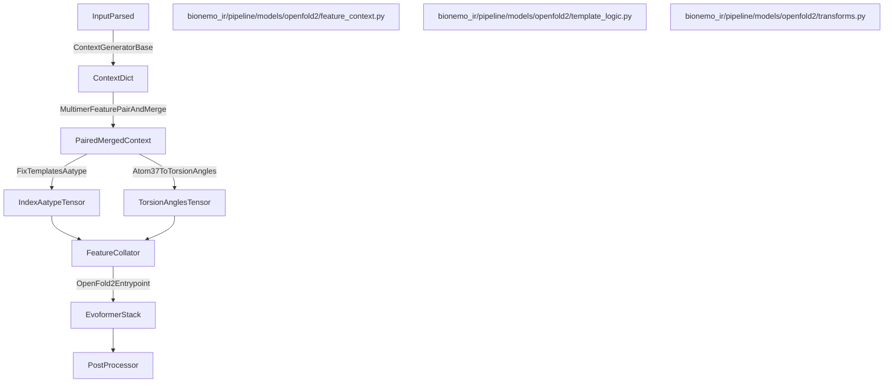
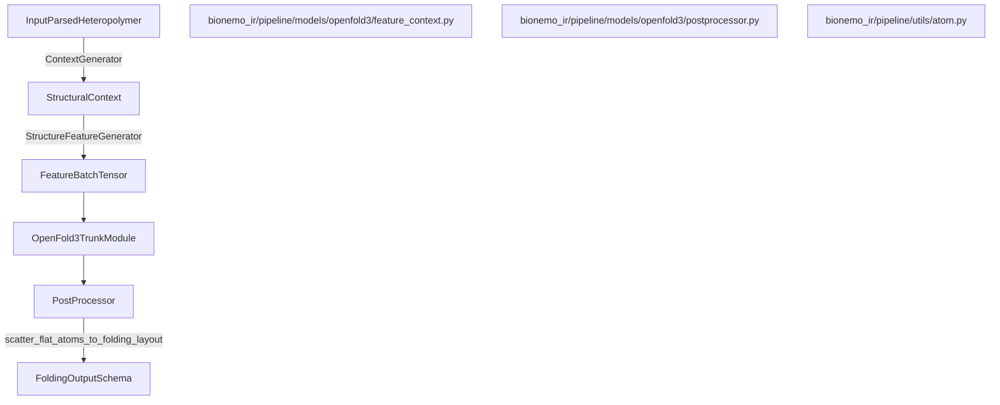

# OpenFold2/OpenFold3 Feature Pipelines

Relevant source files

The following files were used as context for generating this wiki page:

- [bionemo_ir/data/writers/base_writer.py](bionemo_ir/data/writers/base_writer.py)
- [bionemo_ir/data/writers/cif_writer.py](bionemo_ir/data/writers/cif_writer.py)
- [bionemo_ir/data/writers/pdb_writer.py](bionemo_ir/data/writers/pdb_writer.py)
- [bionemo_ir/pipeline/models/boltz2/postprocessor.py](bionemo_ir/pipeline/models/boltz2/postprocessor.py)
- [bionemo_ir/pipeline/models/openfold2/common.py](bionemo_ir/pipeline/models/openfold2/common.py)
- [bionemo_ir/pipeline/models/openfold2/feature_collators.py](bionemo_ir/pipeline/models/openfold2/feature_collators.py)
- [bionemo_ir/pipeline/models/openfold2/feature_factory.py](bionemo_ir/pipeline/models/openfold2/feature_factory.py)
- [bionemo_ir/pipeline/models/openfold2/template_logic.py](bionemo_ir/pipeline/models/openfold2/template_logic.py)
- [bionemo_ir/pipeline/models/openfold3/feature_context.py](bionemo_ir/pipeline/models/openfold3/feature_context.py)
- [bionemo_ir/pipeline/models/openfold3/postprocessor.py](bionemo_ir/pipeline/models/openfold3/postprocessor.py)
- [bionemo_ir/pipeline/utils/atom.py](bionemo_ir/pipeline/utils/atom.py)
- [tests/_torch/test_normalization.py](tests/_torch/test_normalization.py)
- [tests/common/test_utils/synthetic_folding_outputs.py](tests/common/test_utils/synthetic_folding_outputs.py)
- [tests/data/test_cif_writer.py](tests/data/test_cif_writer.py)
- [tests/data/test_pdb_writer.py](tests/data/test_pdb_writer.py)
- [tests/pipeline/models/boltz2/test_postprocessor.py](tests/pipeline/models/boltz2/test_postprocessor.py)
- [tests/pipeline/models/openfold2/test_feature_collators.py](tests/pipeline/models/openfold2/test_feature_collators.py)
- [tests/pipeline/models/openfold2/test_feature_factory.py](tests/pipeline/models/openfold2/test_feature_factory.py)
- [tests/pipeline/models/openfold3/test_parallel_nucleotide_conformers.py](tests/pipeline/models/openfold3/test_parallel_nucleotide_conformers.py)
- [tests/pipeline/models/openfold3/test_parallel_protein_conformers.py](tests/pipeline/models/openfold3/test_parallel_protein_conformers.py)
- [tests/pipeline/models/openfold3/test_postprocessor_confidence.py](tests/pipeline/models/openfold3/test_postprocessor_confidence.py)
- [tests/pipeline/utils/test_atom.py](tests/pipeline/utils/test_atom.py)

This page details the implementation, data flow, key classes, template logic, transforms, and postprocessors for **OpenFold2** and **OpenFold3** feature pipelines within the BioNeMo Inference Runtime (BioIR). These pipelines ingest parsed sequence, MSA, and template data (via direct-CIF flows) and construct tensor dictionaries optimized for GPU execution in the model trunks.

---

## 1. OpenFold2 Feature Pipeline Architecture

The OpenFold2 feature pipeline transforms input data through contextualization, template alignment, feature generation, transformation, and postprocessing.

### Context Generation and Multimer Pairing
The context generator parses monomer and multimer inputs. For multimers, `MultimerFeaturePairAndMerge` manages sequence pairing across chains, coordinate padding, and MSA cropping [bionemo_ir/pipeline/models/openfold2/feature_context.py:34-145]().
- **Monomer / Homomer Handling**: Monomer inputs extract single-chain features and pad or generate dummy MSAs if none are supplied [tests/pipeline/models/openfold2/test_context_generators.py:170-179]().
- **Multimer Pairing**: Aligns paired MSA sequences across interacting chains, enforcing strict validation checks on feature shapes and entity mapping.

### Direct-CIF Template Logic
OpenFold2 supports direct CIF file parsing for templates without external database lookups. 
- **`align_query_to_template_chain`**: Computes sequence alignment between the query sequence and candidate CIF chain sequences using `kalign` [bionemo_ir/pipeline/models/openfold2/template_logic.py:83-106]().
- **`ChainTemplateData` and `SelectedTemplate`**: Encapsulate canonical sequences, 1-based residue mappings, and author-chain identifiers [bionemo_ir/pipeline/models/openfold2/template_logic.py:52-72]().
- **Atom37 Packing**: Maps resolved backbone and side-chain atoms into the standard `[N_templ, N_res, 37, 3]` atom37 format.

### Transforms and Feature Generators
After context extraction, a sequence of feature generators and transforms prepares tensors for the model:
- **`FixTemplatesAatype`**: Converts template one-hot amino acid matrices into categorical index tensors [bionemo_ir/pipeline/models/openfold2/transforms.py:134]().
- **`Atom37ToTorsionAngles`**: Computes backbone ($\phi, \psi, \omega$) and side-chain ($\chi_{1-4}$) torsion angles from atom37 positions [bionemo_ir/pipeline/models/openfold2/common.py:102-170]().
- **`CastTo64BitInts` & `SqueezeFeatures`**: Cast integer tokens to 64-bit precision and strip singleton batch or channel dimensions prior to tensor collation [bionemo_ir/pipeline/models/openfold2/transforms.py:58-118]().

### Sources
- `bionemo_ir/pipeline/models/openfold2/feature_context.py:34-145`
- `bionemo_ir/pipeline/models/openfold2/template_logic.py:52-106`
- `bionemo_ir/pipeline/models/openfold2/transforms.py:58-134`
- `bionemo_ir/pipeline/models/openfold2/common.py:102-170`

---

## 2. OpenFold3 Feature Pipeline Architecture

OpenFold3 extends the feature pipeline paradigm to support heterogeneous macromolecular complexes, including proteins, DNA, RNA, and chemical ligands (CCD components).

### Context Generation and Biotite CCD Integration
`ContextGenerator` parses `InputParsed` objects into structural contexts [bionemo_ir/pipeline/models/openfold3/feature_context.py:15-20]().
- **MSA Character Dispatch**: `_resolve_msa_char` handles polymer-type-aware mapping for proteins, RNA, DNA, and ligands into the 32-class residue vocabulary [bionemo_ir/pipeline/models/openfold3/feature_context.py:70-115]().
- **CCD Conformer Embedding**: Utilizes Biotite CCD (`_get_residue_from_ccd`, `_get_nucleotide_from_ccd`) and RDKit (`_embed_conformer_inplace`) to generate 3D conformers and topologies for standard and modified residues [bionemo_ir/pipeline/models/openfold3/feature_context.py:122-192]().

### Structure and Atomized Feature Generation
`StructureFeatureGenerator` processes token-level and atom-level features for all supported polymer types [bionemo_ir/pipeline/models/openfold3/feature_generators.py:59-139]().
- **Molecule Type Encodings**: Computes binary masks (`is_protein`, `is_rna`, `is_dna`, `is_ligand`) and sets `is_atomized = 1` for ligand tokens [bionemo_ir/pipeline/models/openfold3/feature_generators.py:112-124]().
- **Token Bonds**: Reconstructs intra-ligand bonds from RDKit molecule objects associated with ligand chains, mapping local atom index pairs to symmetric token-level adjacency matrices (`token_bonds`) [bionemo_ir/pipeline/models/openfold3/feature_generators.py:147-172]().

### Postprocessing and Atom Layout Remapping
`PostProcessor` maps raw model outputs into standard `FoldingOutput` schemas [bionemo_ir/pipeline/models/openfold3/postprocessor.py:15-55]().
- **Sample Selection**: Selects the best diffusion sample based on mean pLDDT when multiple samples are generated [bionemo_ir/pipeline/models/openfold3/postprocessor.py:75-91]().
- **Layout Scatter**: `scatter_flat_atoms_to_folding_layout` remaps flat atom positions and decoded elements into the shared 37-atom-type layout [bionemo_ir/pipeline/models/openfold3/postprocessor.py:111-126]().

### Sources
- `bionemo_ir/pipeline/models/openfold3/feature_context.py:15-192`
- `bionemo_ir/pipeline/models/openfold3/feature_generators.py:59-172`
- `bionemo_ir/pipeline/models/openfold3/postprocessor.py:15-126`

---

## 3. Data Flow and Component Bridges

The diagrams below illustrate the bridge from natural language requirements and inputs to the underlying code entities in OpenFold2 and OpenFold3 pipelines.

### OpenFold2 Pipeline Data Flow

*Sources: `bionemo_ir/pipeline/models/openfold2/feature_context.py:34-145()`, `bionemo_ir/pipeline/models/openfold2/template_logic.py:52-106()`, `bionemo_ir/pipeline/models/openfold2/transforms.py:58-134()`*

### OpenFold3 Pipeline Data Flow

*Sources: `bionemo_ir/pipeline/models/openfold3/feature_context.py:15-192()`, `bionemo_ir/pipeline/models/openfold3/postprocessor.py:15-126()`, `bionemo_ir/pipeline/utils/atom.py:15-120()`*

---