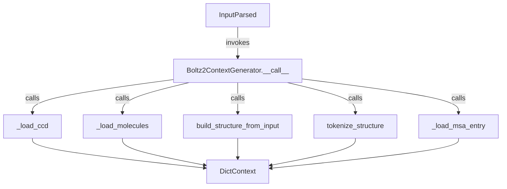
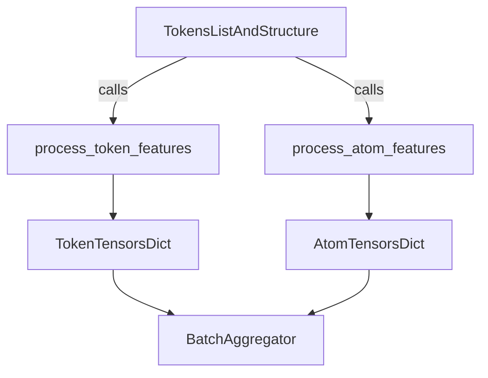
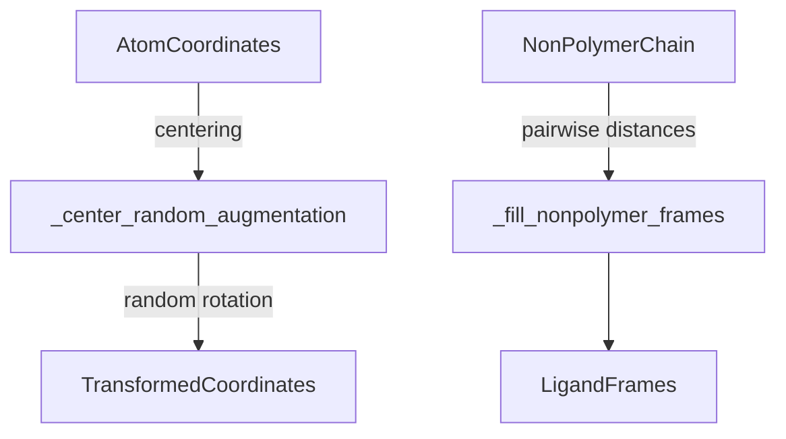
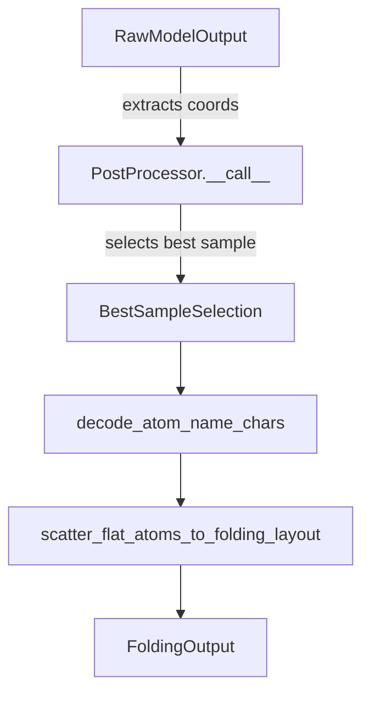

# Boltz-1/Boltz-2 Feature Pipelines

Relevant source files

The following files were used as context for generating this wiki page:

- [bionemo_ir/data/writers/base_writer.py](bionemo_ir/data/writers/base_writer.py)
- [bionemo_ir/data/writers/cif_writer.py](bionemo_ir/data/writers/cif_writer.py)
- [bionemo_ir/data/writers/pdb_writer.py](bionemo_ir/data/writers/pdb_writer.py)
- [bionemo_ir/pipeline/models/boltz2/featurizer.py](bionemo_ir/pipeline/models/boltz2/featurizer.py)
- [bionemo_ir/pipeline/models/boltz2/postprocessor.py](bionemo_ir/pipeline/models/boltz2/postprocessor.py)
- [bionemo_ir/pipeline/models/openfold3/common.py](bionemo_ir/pipeline/models/openfold3/common.py)
- [bionemo_ir/pipeline/models/openfold3/feature_generators.py](bionemo_ir/pipeline/models/openfold3/feature_generators.py)
- [bionemo_ir/pipeline/models/openfold3/postprocessor.py](bionemo_ir/pipeline/models/openfold3/postprocessor.py)
- [bionemo_ir/pipeline/utils/atom.py](bionemo_ir/pipeline/utils/atom.py)
- [bionemo_ir/pipeline/utils/msa.py](bionemo_ir/pipeline/utils/msa.py)
- [tests/common/test_utils/synthetic_folding_outputs.py](tests/common/test_utils/synthetic_folding_outputs.py)
- [tests/data/test_cif_writer.py](tests/data/test_cif_writer.py)
- [tests/data/test_pdb_writer.py](tests/data/test_pdb_writer.py)
- [tests/pipeline/models/boltz2/test_postprocessor.py](tests/pipeline/models/boltz2/test_postprocessor.py)
- [tests/pipeline/models/openfold3/test_postprocessor_confidence.py](tests/pipeline/models/openfold3/test_postprocessor_confidence.py)
- [tests/pipeline/models/openfold3/test_template_distogram.py](tests/pipeline/models/openfold3/test_template_distogram.py)
- [tests/pipeline/utils/test_atom.py](tests/pipeline/utils/test_atom.py)
- [tests/pipeline/utils/test_msa.py](tests/pipeline/utils/test_msa.py)

## Overview and Scope

The Boltz-1 and Boltz-2 feature pipelines in BioNeMo Inference Runtime (BioIR) handle the conversion of raw structural inputs (`InputParsed` schemas containing proteins, nucleic acids, and CCD/SMILES ligands) into tensorized feature dictionaries suitable for the Boltz-1 and Boltz-2 model engines. They also encompass downstream postprocessing logic that transforms raw model predictions into standardized `FoldingOutput` objects [bionemo_ir/data/schemas/__init__.py]().

This page details the context generation classes, tokenizers, featurizers, spatial transforms, structure frame handling, and postprocessing routines for both model families.

---

## 1. Context Generation and Structure Handling

Context generators orchestrate the initial loading of Chemical Component Dictionary (CCD) assets, molecule libraries, structural parsing, tokenization, and Multiple Sequence Alignment (MSA) association.

### Context Generation Classes

*   `Boltz2ContextGenerator`: Inherits from `ContextGeneratorBase` [bionemo_ir/pipeline/base.py](). It loads CCD dictionaries [bionemo_ir/pipeline/models/boltz2/feature_context.py](), caches binary-serialized RDKit molecules [bionemo_ir/pipeline/models/boltz2/feature_context.py](), builds a unified `Structure` representation [bionemo_ir/pipeline/models/boltz2/feature_context.py](), tokenizes the structure [bionemo_ir/pipeline/models/boltz2/feature_context.py](), and binds per-chain MSA entries [bionemo_ir/pipeline/models/boltz2/feature_context.py]().
*   `Boltz1ContextGenerator`: Subclasses `Boltz2ContextGenerator` [bionemo_ir/pipeline/models/boltz1/feature_context.py](), reusing structure construction and CCD molecule loading.

*Sources: [bionemo_ir/pipeline/models/boltz2/feature_context.py](), [bionemo_ir/pipeline/models/boltz1/feature_context.py]()*

---

## 2. Tokenization and Featurization

Once a context dictionary is established, model-specific featurizers transform tokens and atoms into neural network input tensors.

### Feature Computation Differences

| Feature Aspect | Boltz-1 Featurizer | Boltz-2 Featurizer |
| :--- | :--- | :--- |
| **MSA Representation** | One-hot `(N_MSA, L, 33)` [bionemo_ir/pipeline/models/boltz1/featurizer.py]() | Token indices `(N_MSA, L)` |
| **Frame Dimensions** | `(L, 3)` / `(L,)` without ensemble dim [bionemo_ir/pipeline/models/boltz1/featurizer.py]() | Ensemble dimension included |
| **Pocket Features** | Includes `pocket_feature` encoding [bionemo_ir/pipeline/models/boltz1/featurizer.py]() | Uses contact conditioning info |
| **Atomic Charges** | `int8` representation [bionemo_ir/pipeline/models/boltz1/featurizer.py]() | Float32 representation |

### Token and Atom Processing Functions

*   `process_token_features`: Computes token indices, residue indices, chain IDs (`asym_id`), entity IDs, molecular types, and bonded network matrices [bionemo_ir/pipeline/models/boltz1/featurizer.py](), [bionemo_ir/pipeline/models/boltz2/featurizer.py]().
*   `process_atom_features`: Computes reference space UIDs, atom names, element categories, coordinate conformers, and frame resolved masks [bionemo_ir/pipeline/models/boltz1/featurizer.py]().

*Sources: [bionemo_ir/pipeline/models/boltz1/featurizer.py](), [bionemo_ir/pipeline/models/boltz2/featurizer.py]()*

---

## 3. Spatial Transforms and Augmentations

Spatial routines handle rigid-body coordinate transformations, random augmentation seeding, and frame resolution masks for both polymer and non-polymer chains.

*   `_center_random_augmentation`: Implements Algorithm 19 for centering atom coordinates followed by random rotations and translations [bionemo_ir/pipeline/models/boltz2/featurizer.py:49-80]().
*   `_fill_nonpolymer_frames`: In-place computation of ligand-token frames using intra-chain pairwise distances preferring resolved atoms [bionemo_ir/pipeline/models/boltz2/featurizer.py:83-135]().
*   `_frame_resolved_mask_oss`: Computes per-token frame resolved boolean flags based on backbone presence (`N-CA-C` for proteins, `C1'-C3'-C4'` for nucleic acids) [bionemo_ir/pipeline/models/boltz2/featurizer.py:137-178]().

*Sources: [bionemo_ir/pipeline/models/boltz2/featurizer.py:49-178]()*

---

## 4. Postprocessing and Output Mapping

Postprocessors ingest raw tensor outputs from the model inference engine and convert them into structured `FoldingOutput` schemas [bionemo_ir/data/schemas/__init__.py]() compatible with PDB and mmCIF file writers.

*   `PostProcessor`: Implements model output parsing, sample selection based on confidence scores or mean pLDDT [bionemo_ir/pipeline/models/boltz2/postprocessor.py:77-112](), [bionemo_ir/pipeline/models/openfold3/postprocessor.py:46-80]().
*   `_BOLTZ_TO_FOLDING_MOL_TYPE`: Remaps internal Boltz chain type identifiers (`PROTEIN=0`, `DNA=1`, `RNA=2`, `NONPOLYMER=3`) to canonical molecular types (`PROTEIN=0`, `RNA=1`, `DNA=2`, `LIGAND=3`) [bionemo_ir/pipeline/models/boltz2/postprocessor.py:48-52]().
*   Atom remapping maps flat predicted atom coordinates into the shared slot layout using decoded atom names [bionemo_ir/pipeline/models/boltz2/postprocessor.py:119-142](), [bionemo_ir/pipeline/models/openfold3/postprocessor.py:96-126]().

*Sources: [bionemo_ir/pipeline/models/boltz2/postprocessor.py:77-154](), [bionemo_ir/pipeline/models/openfold3/postprocessor.py:46-126]()*, [bionemo_ir/pipeline/utils/atom.py:170-172]()

---