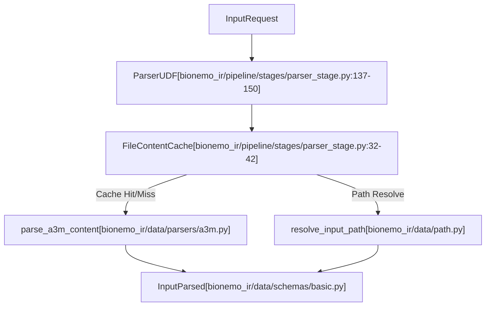
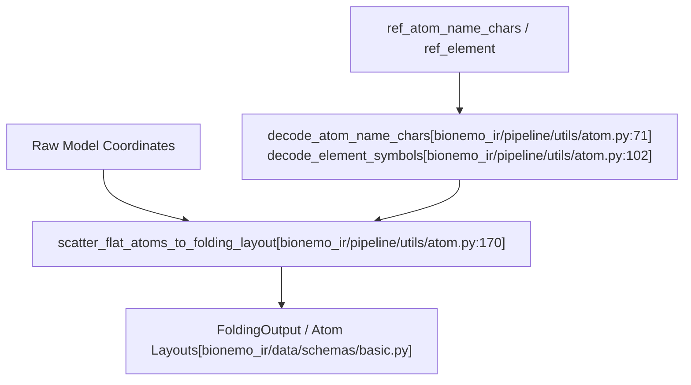

# Data I/O: Parsers, Schemas, and Writers

Relevant source files

The following files were used as context for generating this wiki page:

- [bionemo_ir/data/parsers/fasta.py](bionemo_ir/data/parsers/fasta.py)
- [bionemo_ir/data/schemas/basic.py](bionemo_ir/data/schemas/basic.py)
- [bionemo_ir/data/utils.py](bionemo_ir/data/utils.py)
- [bionemo_ir/data/writers/base_writer.py](bionemo_ir/data/writers/base_writer.py)
- [bionemo_ir/data/writers/cif_writer.py](bionemo_ir/data/writers/cif_writer.py)
- [bionemo_ir/data/writers/pdb_writer.py](bionemo_ir/data/writers/pdb_writer.py)
- [bionemo_ir/pipeline/models/boltz2/postprocessor.py](bionemo_ir/pipeline/models/boltz2/postprocessor.py)
- [bionemo_ir/pipeline/models/openfold3/postprocessor.py](bionemo_ir/pipeline/models/openfold3/postprocessor.py)
- [bionemo_ir/pipeline/models/openfold3/template_logic.py](bionemo_ir/pipeline/models/openfold3/template_logic.py)
- [bionemo_ir/pipeline/stages/parser_stage.py](bionemo_ir/pipeline/stages/parser_stage.py)
- [bionemo_ir/pipeline/utils/atom.py](bionemo_ir/pipeline/utils/atom.py)
- [tests/common/test_utils/synthetic_folding_outputs.py](tests/common/test_utils/synthetic_folding_outputs.py)
- [tests/data/parsers/test_a3m_parser.py](tests/data/parsers/test_a3m_parser.py)
- [tests/data/parsers/test_fasta_parser.py](tests/data/parsers/test_fasta_parser.py)
- [tests/data/test_basic.py](tests/data/test_basic.py)
- [tests/data/test_cif_writer.py](tests/data/test_cif_writer.py)
- [tests/data/test_pdb_writer.py](tests/data/test_pdb_writer.py)
- [tests/data/test_template_conversion.py](tests/data/test_template_conversion.py)
- [tests/pipeline/models/boltz2/test_postprocessor.py](tests/pipeline/models/boltz2/test_postprocessor.py)
- [tests/pipeline/models/boltz2/test_template_alignment.py](tests/pipeline/models/boltz2/test_template_alignment.py)
- [tests/pipeline/models/openfold2/data/minimal_template.pdb](tests/pipeline/models/openfold2/data/minimal_template.pdb)
- [tests/pipeline/models/openfold2/test_context_generators.py](tests/pipeline/models/openfold2/test_context_generators.py)
- [tests/pipeline/models/openfold2/test_template_logic.py](tests/pipeline/models/openfold2/test_template_logic.py)
- [tests/pipeline/models/openfold3/test_postprocessor_confidence.py](tests/pipeline/models/openfold3/test_postprocessor_confidence.py)
- [tests/pipeline/models/openfold3/test_template_logic.py](tests/pipeline/models/openfold3/test_template_logic.py)
- [tests/pipeline/parser/test_parser_udf.py](tests/pipeline/parser/test_parser_udf.py)
- [tests/pipeline/utils/test_atom.py](tests/pipeline/utils/test_atom.py)

## Purpose and Scope
This page details the Data I/O subsystem within the BioNeMo Inference Runtime (BioIR), responsible for ingesting biomolecular input files (FASTA, A3M, CIF, PDB), normalizing them into validated data schemas (`InputRequest`, `InputParsed`, `FoldingOutput`), managing residue/atom type constants and codecs, handling template conversion utilities, and serializing structural predictions into legacy PDB and modern mmCIF/ModelCIF formats via `PDBWriter` and `CIFWriter`.

Sources: `bionemo_ir/data/parsers/a3m.py`, `bionemo_ir/data/schemas/basic.py`, `bionemo_ir/data/utils.py`, `bionemo_ir/data/writers/pdb_writer.py`, `bionemo_ir/data/writers/cif_writer.py`, `bionemo_ir/pipeline/stages/parser_stage.py`

---

## 1. Input Parsers, Content Caching, and Template Conversion
The parsing stage ingests user requests containing raw sequences, multiple sequence alignments (MSAs), and structural templates. To eliminate redundant disk reads and deduplicate identical payloads across batch workers, BioIR employs content-hash caching via `FileContentCache` within `ParserUDF` (`[bionemo_ir/pipeline/stages/parser_stage.py:32-150]()`). Additionally, template files (PDB/CIF) are parsed and converted via utilities like `pdb_to_cif` (`[bionemo_ir/data/utils.py:173-173]()`) and `extract_template_chains` (`[bionemo_ir/pipeline/models/openfold3/template_logic.py:139-171]()`).

Title: "Parser Pipeline and Content Caching Data Flow"

*Figure 1: Mapping natural language inputs and file references to `InputParsed` objects using `ParserUDF` and `FileContentCache`.*

Sources: `bionemo_ir/pipeline/stages/parser_stage.py`, `bionemo_ir/data/utils.py`, `bionemo_ir/pipeline/models/openfold3/template_logic.py`, `tests/data/test_template_conversion.py`

---

## 2. Data Schemas and Core Types
BioIR defines strongly typed schemas and enumerations in `bionemo_ir/data/schemas/basic.py` to represent inputs, intermediate parsed entities, and model outputs.

| Schema / Enum | Role & Description |
| :--- | :--- |
| `PolymerType` | Polymer kind (`PROTEIN`, `RNA`, `DNA`, `CCD_LIGAND`, `SMILES_LIGAND`) defining sequence interpretation `[bionemo_ir/data/schemas/basic.py:30-51]()`. |
| `InputRequest` | Root container for inference inputs (`input_id`, list of `Polymer` instances) `[bionemo_ir/data/schemas/basic.py]()`. |
| `InputParsed` | Post-parser normalized intermediate format containing sequences, parsed MSAs, and templates `[bionemo_ir/data/schemas/basic.py:25-25]()`. |
| `FoldingOutput` | Output schema produced by model inference engines, containing `atom_positions`, `atom_mask`, `residue_types`, `residue_indices`, `chain_indices`, and optional metadata `[bionemo_ir/data/schemas/basic.py]()`. |
| `AtomTypes` | Enumeration/universe of atom names covering protein backbone/sidechain, nucleic acid sugars/phosphates, nucleobases, and common ligands `[bionemo_ir/data/schemas/basic.py:63-191]()`. |

Sources: `bionemo_ir/data/schemas/basic.py`, `tests/data/test_basic.py`

---

## 3. Residue Tables and Molecule Constants
Residue alphabets, element definitions, and molecule types vary across models (e.g., OpenFold2, OpenFold3, Boltz-2). BioIR centralizes these mappings in `bionemo_ir/data/utils.py` via functions like `get_all_residue_types` (`[bionemo_ir/data/utils.py:33-88]()`) and `get_all_atom_types` (`[bionemo_ir/data/utils.py:90-95]()`) to ensure strict parity during tokenization and structure writing.

* `get_all_residue_types("openfold2")`: Basic 20 amino acids + `X` + optional `GAP` (`[bionemo_ir/data/utils.py:41-45]()`).
* `get_all_residue_types("boltz")`: 33-entry token table including biological purine-first RNA/DNA orders (`[bionemo_ir/data/utils.py:46-64]()`).
* `get_all_residue_types("openfold3")`: 32-type RESTYPES_3 vocabulary (`[bionemo_ir/data/utils.py:65-85]()`).
* Safe component unpickling: `load_component_mol` uses `MoleculeUnpickler` to restrict globals to RDKit molecules and NumPy arrays (`[bionemo_ir/data/utils.py:118-170]()`).

Sources: `bionemo_ir/data/utils.py`, `bionemo_ir/pipeline/models/openfold3/const.py`

---

## 4. Atom Codecs and Layout Scattering
Model outputs are typically produced as flat per-atom coordinates or variable per-token layouts which must be remapped into standard 37-atom or extensible folding layouts (`[bionemo_ir/pipeline/utils/atom.py:15-37]()`).

Title: "Atom Decoding and Layout Scattering Data Flow"

*Figure 2: Translating raw model atom arrays and character buffers into normalized folding layouts via `scatter_flat_atoms_to_folding_layout`.*

Key utility functions in `bionemo_ir/pipeline/utils/atom.py`:
* `encode_atom_name_chars` / `encode_atom_name_chars_one_hot`: Converts atom names to 4-character padded code tensors (`[bionemo_ir/pipeline/utils/atom.py:39-68]()`).
* `decode_atom_name_chars`: Recovers string atom names from integer or one-hot tensors (`[bionemo_ir/pipeline/utils/atom.py:71-99]()`).
* `scatter_flat_atoms_to_folding_layout`: Maps flat atom arrays back to structured token-and-slot layouts while handling universe overflows (`[bionemo_ir/pipeline/utils/atom.py:170-336]()`).

Sources: `bionemo_ir/pipeline/utils/atom.py`, `bionemo_ir/pipeline/models/openfold3/postprocessor.py`, `bionemo_ir/pipeline/models/boltz2/postprocessor.py`

---

## 5. Structure Writers (PDB & mmCIF)
Structure writers (`PDBWriter` and `CIFWriter`) inherit from `BaseWriter` and convert `FoldingOutput` tensors back into standard file formats. They share chain-classification heuristics and name remapping dictionaries to maintain semantic parity between PDB and mmCIF outputs.

* **`BaseWriter`**: Base abstract class handling initialization checks for `res_type_mapping` and `atom_type_mapping` (`[bionemo_ir/data/writers/base_writer.py]`).
* **`PDBWriter`**: Formats legacy 80-column PDB text records (`ATOM`, `HETATM`, `TER`) (`[bionemo_ir/data/writers/pdb_writer.py]`).
* **`CIFWriter`**: Serializes atomic coordinates into Crystallographic Information File (mmCIF) syntax (`[bionemo_ir/data/writers/cif_writer.py]`).

Sources: `bionemo_ir/data/writers/base_writer.py`, `bionemo_ir/data/writers/pdb_writer.py`, `bionemo_ir/data/writers/cif_writer.py`

---