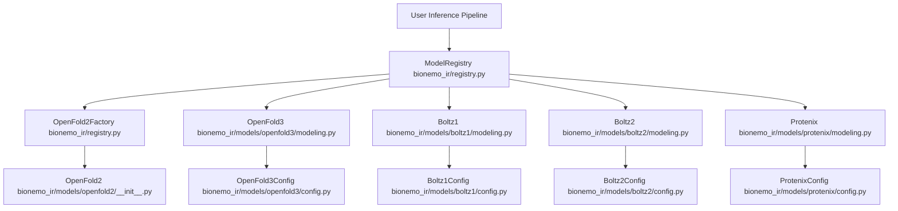
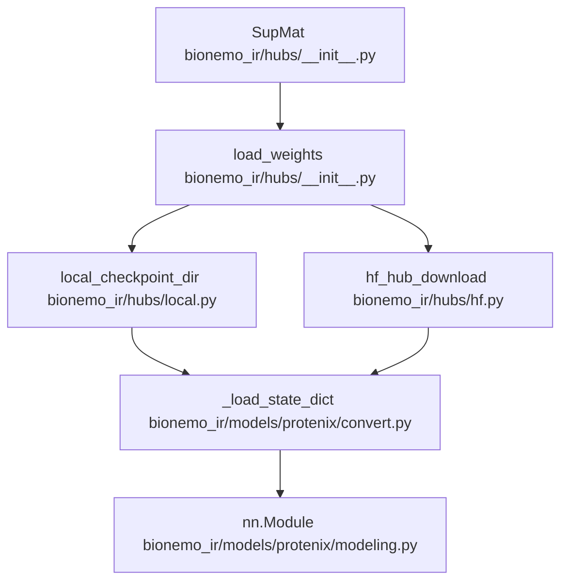

# Model Implementations

Relevant source files

The following files were used as context for generating this wiki page:

- [bionemo_ir/_torch/layers/conditioning.py](bionemo_ir/_torch/layers/conditioning.py)
- [bionemo_ir/models/boltz1/modeling.py](bionemo_ir/models/boltz1/modeling.py)
- [bionemo_ir/models/boltz2/modeling.py](bionemo_ir/models/boltz2/modeling.py)
- [bionemo_ir/models/openfold3/modeling.py](bionemo_ir/models/openfold3/modeling.py)
- [bionemo_ir/models/protenix/config.py](bionemo_ir/models/protenix/config.py)
- [bionemo_ir/models/protenix/modeling.py](bionemo_ir/models/protenix/modeling.py)
- [bionemo_ir/registry.py](bionemo_ir/registry.py)
- [docs/ref/architecture.md](docs/ref/architecture.md)
- [tests/_torch/test_openfold3_diffusion_conditioning_memory.py](tests/_torch/test_openfold3_diffusion_conditioning_memory.py)
- [tests/_torch/test_openfold3_trunk_lifetime.py](tests/_torch/test_openfold3_trunk_lifetime.py)
- [tests/_torch/test_prepared_token_pair_biases.py](tests/_torch/test_prepared_token_pair_biases.py)
- [tests/_torch/test_protenix_contracts.py](tests/_torch/test_protenix_contracts.py)
- [tests/_torch/test_query_to_keys_triton.py](tests/_torch/test_query_to_keys_triton.py)
- [tests/pipeline/test_request_rng.py](tests/pipeline/test_request_rng.py)

The Model Implementations module serves as the unifying runtime layer for diverse structural biology prediction architectures within BioIR. It bridges high-level model definitions with optimized PyTorch modules, configuration schemas, and Hugging Face or local checkpoint registries. BioIR natively supports prominent architecture families including OpenFold2, OpenFold3, Boltz-1, Boltz-2, and Protenix [bionemo_ir/models/__init__.py:16-21](), [bionemo_ir/models/protenix/__init__.py:16-24]().

### Diagram: Model Architecture Routing to Code Entities

*Sources: `bionemo_ir/registry.py:79-132`, `bionemo_ir/models/protenix/modeling.py:165-166`, `bionemo_ir/models/openfold3/modeling.py:69-70`, `bionemo_ir/models/boltz1/modeling.py:59-60`, `bionemo_ir/models/boltz2/modeling.py:72-73`*

---

## Model Configs, Modeling Entrypoints, and Weight Conversion {#3.1}

Model configurations are structured using Pydantic-based `BaseConfig` trees that define structural hyperparameters such as token dimensions (`token_s`, `token_z`), atom representations (`atom_s`, `atom_z`), bin counts, and transformer block depths [bionemo_ir/models/boltz2/config.py:41-93](). Each model family exposes standard modeling entrypoints (`modeling.py`) inheriting from `nn.Module` and utilizing mixing traits like `OptimizedModuleSetterMixin` for accelerated kernel integration [bionemo_ir/models/boltz1/modeling.py:61-75](), [bionemo_ir/models/boltz2/modeling.py:75-81](). 

Weight conversion utilities (`convert.py`) bridge upstream Open Source Software (OSS) checkpoints and Hugging Face weights into BioIR's optimized tensor layouts, ensuring structural parity and efficient memory footprint [bionemo_ir/models/boltz1/modeling.py:51-58](), [bionemo_ir/models/boltz2/modeling.py:60-69]().

For details, see [Model Configs, Modeling Entrypoints, and Weight Conversion](#3.1).

*Sources: `bionemo_ir/models/boltz1/modeling.py:51-75`, `bionemo_ir/models/boltz2/config.py:41-93`, `bionemo_ir/models/boltz2/modeling.py:60-81`*

---

## Checkpoint Hubs and Weight Staging {#3.2}

BioIR coordinates weight loading through unified hub abstractions supporting both local directories and the Hugging Face Hub (`bionemo_ir/hubs/hf.py`, `bionemo_ir/hubs/local.py`) [bionemo_ir/hubs/hf.py:37-122](), [bionemo_ir/hubs/local.py:51-172](). Checkpoints are tracked using support matrix mappings (`FoldingSupportMatrix` / `SupMat`) that resolve model identifiers to specific repository configurations, filename targets, and state dictionary extraction keys [bionemo_ir/hubs/hf.py:35-43](), [bionemo_ir/hubs/local.py:49-56](). Staging utilities check environment variables (e.g., `BIOIR_CHECKPOINTS` or model-specific overrides) and execute local MD5 verification for checkpoint integrity before runtime loading [bionemo_ir/hubs/hf.py:144-146](), [bionemo_ir/hubs/local.py:44-47](), [bionemo_ir/hubs/local.py:178-187]().

### Diagram: Checkpoint Hub and Loader Mapping

*Sources: `bionemo_ir/hubs/hf.py:35-184`, `bionemo_ir/hubs/local.py:44-199`, `bionemo_ir/models/protenix/modeling.py:52-54`*

For details, see [Checkpoint Hubs and Weight Staging](#3.2).

*Sources: `bionemo_ir/hubs/hf.py:35-184`, `bionemo_ir/hubs/local.py:44-199`*

---