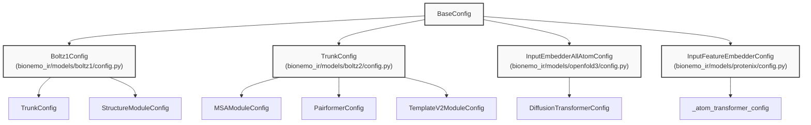
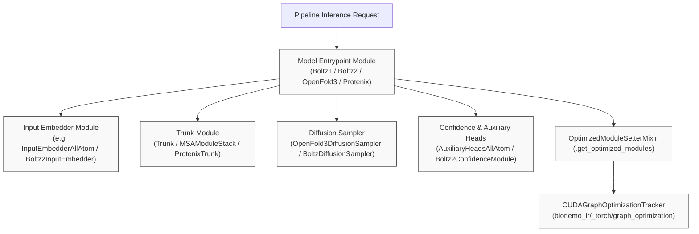
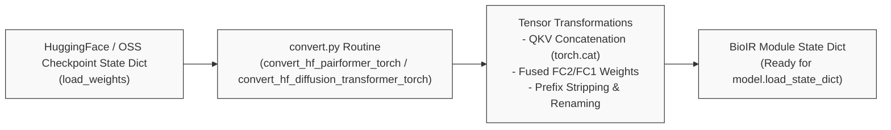

# Model Configs, Modeling Entrypoints, and Weight Conversion

Relevant source files

The following files were used as context for generating this wiki page:

- [bionemo_ir/_torch/layers/conditioning.py](bionemo_ir/_torch/layers/conditioning.py)
- [bionemo_ir/_torch/layers/transformers/evoformer.py](bionemo_ir/_torch/layers/transformers/evoformer.py)
- [bionemo_ir/_torch/layers/transformers/pairformer.py](bionemo_ir/_torch/layers/transformers/pairformer.py)
- [bionemo_ir/_torch/layers/triangle_nodes.py](bionemo_ir/_torch/layers/triangle_nodes.py)
- [bionemo_ir/_torch/modules/openfold2/template.py](bionemo_ir/_torch/modules/openfold2/template.py)
- [bionemo_ir/_torch/modules/openfold3/trunk.py](bionemo_ir/_torch/modules/openfold3/trunk.py)
- [bionemo_ir/_torch/modules/protenix/template.py](bionemo_ir/_torch/modules/protenix/template.py)
- [bionemo_ir/configs/modules.py](bionemo_ir/configs/modules.py)
- [bionemo_ir/models/boltz1/convert.py](bionemo_ir/models/boltz1/convert.py)
- [bionemo_ir/models/boltz1/modeling.py](bionemo_ir/models/boltz1/modeling.py)
- [bionemo_ir/models/boltz2/convert.py](bionemo_ir/models/boltz2/convert.py)
- [bionemo_ir/models/boltz2/modeling.py](bionemo_ir/models/boltz2/modeling.py)
- [bionemo_ir/models/openfold2/convert.py](bionemo_ir/models/openfold2/convert.py)
- [bionemo_ir/models/openfold3/convert.py](bionemo_ir/models/openfold3/convert.py)
- [bionemo_ir/models/openfold3/modeling.py](bionemo_ir/models/openfold3/modeling.py)
- [bionemo_ir/models/protenix/convert.py](bionemo_ir/models/protenix/convert.py)
- [docs/advanced/accelerate-custom-model.md](docs/advanced/accelerate-custom-model.md)
- [tests/_torch/test_cuequiv_attention.py](tests/_torch/test_cuequiv_attention.py)
- [tests/_torch/test_openfold3_diffusion_conditioning_memory.py](tests/_torch/test_openfold3_diffusion_conditioning_memory.py)
- [tests/_torch/test_openfold3_trunk_lifetime.py](tests/_torch/test_openfold3_trunk_lifetime.py)
- [tests/_torch/test_prepared_token_pair_biases.py](tests/_torch/test_prepared_token_pair_biases.py)
- [tests/_torch/test_query_to_keys_triton.py](tests/_torch/test_query_to_keys_triton.py)
- [tests/_torch/test_triangle_nodes.py](tests/_torch/test_triangle_nodes.py)
- [tests/pipeline/models/boltz2/test_convert.py](tests/pipeline/models/boltz2/test_convert.py)
- [tests/pipeline/models/openfold3/test_convert.py](tests/pipeline/models/openfold3/test_convert.py)

## Purpose and Scope
This page details the structural configuration hierarchies (`BaseConfig` trees), PyTorch modeling entrypoints (`modeling.py`), and open-source checkpoint conversion modules (`convert.py`) across supported folding model families in the BioNeMo Inference Runtime (BioIR): **Boltz-1**, **Boltz-2**, **OpenFold3**, and **ProtenixV2**.

---

## 1. BaseConfig Trees and Configuration Hierarchies

BioIR uses Pydantic-backed `BaseConfig` classes to define strongly-typed, nested configurations for every model family. These configs govern dimensional parameters (`token_s`, `token_z`, `atom_s`), architectural options (activation types, number of blocks), and precision dtypes.

### Boltz-1 and Boltz-2 Configurations
* **`Boltz1Config`**: Defines top-level settings including token dimensions, atom dimensions, number of bins, and references sub-configs `InputEmbedderConfig`, `TrunkConfig`, and `StructureModuleConfig` [bionemo_ir/models/boltz1/config.py:181-195]().
* **`TrunkConfig` (Boltz-1/2)**: Comprises `MSAModuleConfig` and `PairformerConfig`, controlling block depths (e.g., 48 blocks for Boltz-1 pairformer) and precision attributes [bionemo_ir/models/boltz1/config.py:54-78](), [bionemo_ir/models/boltz2/config.py:109-135]().
* **`TemplateV2ModuleConfig`**: Specific to Boltz-2, configuring template pairformers with bfloat16 triangle multiplication [bionemo_ir/models/boltz2/config.py:69-93]().

### OpenFold3 and Protenix Configurations
* **`InputEmbedderAllAtomConfig`**: Configures all-atom input embedding dimensions (`c_s_input=449`, `c_atom=128`, `c_token=384`) and atom transformer diffusion settings [bionemo_ir/models/openfold3/config.py:28-60]().
* **`MSAModuleStackConfig`**: Inherits from `EvoformerStackConfig` to configure OpenFold3 MSA blocks, transition types (`swiglu`), and head widths [bionemo_ir/models/openfold3/config.py:89-107]().
* **`InputFeatureEmbedderConfig` (Protenix)**: Sets Protenix input embedder defaults, disabling ESM by default and setting `c_s_inputs=449` [bionemo_ir/models/protenix/config.py:94-108]().

**Sources:**
- `bionemo_ir/models/boltz1/config.py:181-195`
- `bionemo_ir/models/boltz2/config.py:41-135`
- `bionemo_ir/models/openfold3/config.py:28-60`
- `bionemo_ir/models/protenix/config.py:94-108`

---

## 2. Modeling Entrypoints and Architecture Wires (`modeling.py`)

Each model family provides a top-level PyTorch `nn.Module` entrypoint that instantiates embedders, trunks, structure modules, and confidence heads. These modules mix in `OptimizedModuleSetterMixin` to enable automated CUDA graph tracking and accelerated kernel dispatch.

### Model Entrypoint Classes
* **`Boltz1`**: Defined in `bionemo_ir/models/boltz1/modeling.py:61` [bionemo_ir/models/boltz1/modeling.py:61](). Sets up `Boltz1InputEmbedder`, `Trunk`, `DistogramModule`, and `BoltzDiffusionSampler`. Registers optimized submodules via `GRAPH_OPT_ENABLED_MODULES` [bionemo_ir/models/boltz1/modeling.py:64-75]().
* **`Boltz2`**: Defined in `bionemo_ir/models/boltz2/modeling.py:75` [bionemo_ir/models/boltz2/modeling.py:75](). Integrates `Boltz2InputEmbedder`, `ContactConditioning`, `AffinityModule`, and structure/confidence modules.
* **`OpenFold3`**: Defined in `bionemo_ir/models/openfold3/modeling.py:69` [bionemo_ir/models/openfold3/modeling.py:69](). Wires `InputEmbedderAllAtom`, `TemplateEmbedderAllAtom`, `MSAModuleStack`, `PairformerModule`, and `OpenFold3DiffusionSampler`. Implements high-precision LayerNorm substitution [bionemo_ir/models/openfold3/modeling.py:135-147]().
* **`Protenix`**: Defined in `bionemo_ir/models/protenix/modeling.py:96` [bionemo_ir/models/protenix/modeling.py:96](). Configures inference precision via `_configure_inference_precision` [bionemo_ir/models/protenix/modeling.py:73-93]() and wires `ProtenixTrunk`, relative position encoding, and diffusion samplers. Excludes recycling pairformers from CUDA graph optimization to prevent NaN divergence [bionemo_ir/models/protenix/modeling.py:101-107]().

**Sources:**
- `bionemo_ir/models/boltz1/modeling.py:61-75`
- `bionemo_ir/models/boltz2/modeling.py:75-80`
- `bionemo_ir/models/openfold3/modeling.py:69-78`, `135-147`
- `bionemo_ir/models/protenix/modeling.py:73-119`

---

## 3. OSS Checkpoint Conversion and Weight Mapping (`convert.py`)

To achieve bit-for-bit parity or valid initialization from HuggingFace and open-source checkpoints, each model implements weight conversion routines in `convert.py`. These scripts map upstream parameter naming conventions and tensor shapes (such as chunking or fusing query/key/value projections) to BioIR's internal layer layouts.

### Key Conversion Utilities
* **Boltz-1 & Boltz-2 Converters**:
  * `convert_hf_pairformer_torch`: Maps HuggingFace pairformer layers, chunking QKV weights and fusing transition layers (`get_transition_weights`, `get_tri_mul_node_weights`) [bionemo_ir/models/boltz1/convert.py:23-110](), [bionemo_ir/models/boltz2/convert.py:23-63]().
  * `convert_hf_affinity_module_torch`: Parses affinity and conditional transition weights for Boltz-2 [bionemo_ir/models/boltz2/convert.py:79-162]().
* **OpenFold3 Converter**:
  * `convert_hf_pairformer_torch`: Translates OpenFold3 `pairformer_stack` checkpoints into BioIR `pairformer_module` expectations, converting `attn_pair_bias` into `attention` projections and concatenating split linear weights (`linear_a_p`, `linear_b_p`) into unified `p_in.weight` tensors [bionemo_ir/models/openfold3/convert.py:25-114]().

**Sources:**
- `bionemo_ir/models/boltz1/convert.py:23-110`
- `bionemo_ir/models/boltz2/convert.py:23-162`
- `bionemo_ir/models/openfold3/convert.py:25-114`

---