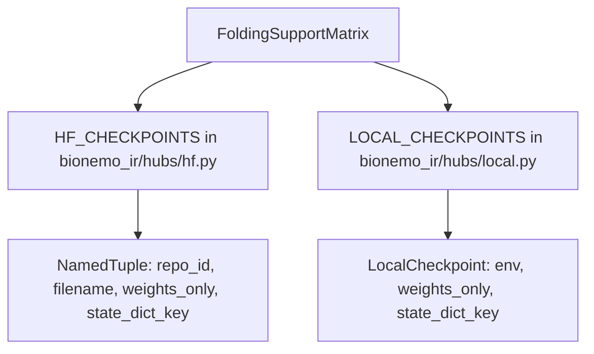
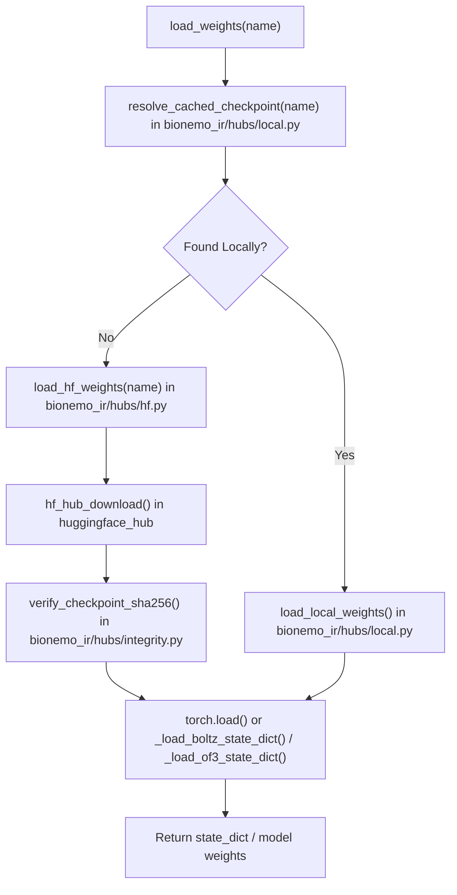

# Checkpoint Hubs and Weight Staging

<details>
<summary>Relevant source files</summary>

The following files were used as context for generating this wiki page:

- [.agents/skills/bench-perf-oss/models/protenix.md](.agents/skills/bench-perf-oss/models/protenix.md)
- [bionemo_ir/hubs/hf.py](bionemo_ir/hubs/hf.py)
- [bionemo_ir/hubs/integrity.py](bionemo_ir/hubs/integrity.py)
- [bionemo_ir/hubs/local.py](bionemo_ir/hubs/local.py)
- [bionemo_ir/hubs/metadata.py](bionemo_ir/hubs/metadata.py)
- [bionemo_ir/models/rfproteina/__init__.py](bionemo_ir/models/rfproteina/__init__.py)
- [bionemo_ir/models/rfproteina/convert.py](bionemo_ir/models/rfproteina/convert.py)
- [bionemo_ir/models/rfproteina/modeling.py](bionemo_ir/models/rfproteina/modeling.py)
- [docs/quickstart.md](docs/quickstart.md)
- [docs/ref/model-weights.md](docs/ref/model-weights.md)
- [scripts/fetch_weights.sh](scripts/fetch_weights.sh)
- [tests/_torch/test_rfd4_beam_search.py](tests/_torch/test_rfd4_beam_search.py)
- [tests/_torch/test_rfd4_modules.py](tests/_torch/test_rfd4_modules.py)
- [tests/hubs/test_integrity.py](tests/hubs/test_integrity.py)
- [tests/hubs/test_metadata.py](tests/hubs/test_metadata.py)

</details>


## Purpose and Scope
This page covers the checkpoint management architecture within the BioNeMo Inference Runtime (`bionemo_ir.hubs`). It details how model weights and metadata assets for OpenFold2, OpenFold3, Boltz-1/2, Protenix, and RFProteína are discovered, verified against cryptographic digests, downloaded from Hugging Face or public mirrors, loaded from local filesystem environments, and staged using `scripts/fetch_weights.sh`.

Sources: `docs/ref/model-weights.md:1-127](), `bionemo_ir/hubs/hf.py:1-186]()

---

## 1. Checkpoint Registries and Support Matrix
BioIR defines unified support matrices (`FoldingSupportMatrix` and `GenerativeSupportMatrix`) that enumerate all supported model architectures and specific fine-tuning checkpoints (`bionemo_ir/hubs/support_matrix.py`, `bionemo_ir/hubs/hf.py:32-115](), `bionemo_ir/hubs/local.py:53-178]()).

Each model variant maps to an entry in the Hugging Face hub registry (`HF_CHECKPOINTS` in `bionemo_ir/hubs/hf.py`) and a corresponding local environment variable mapping (`LOCAL_CHECKPOINTS` in `bionemo_ir/hubs/local.py`).

### Diagram: Checkpoint Registry Entities

Sources: `bionemo_ir/hubs/hf.py:32-115](), `bionemo_ir/hubs/local.py:53-178]()

---

## 2. Integrity Checks, Revisions, and SHA-256 Validation
Every Hub download in BioIR is strictly pinned to an immutable commit hash (`HF_REVISIONS` in `bionemo_ir/hubs/integrity.py`), ensuring upstream re-uploads do not alter loaded weights unexpectedly (`docs/ref/model-weights.md:65-71](), `bionemo_ir/hubs/integrity.py:24-29]()).

Before any checkpoint or asset is deserialized by PyTorch or model builders, its SHA-256 checksum is verified against the `CHECKPOINT_SHA256` dictionary (`bionemo_ir/hubs/integrity.py:33-47]()). If a file has no recorded digest or fails verification, `verify_checkpoint_sha256()` raises a `ValueError` (`bionemo_ir/hubs/integrity.py:57-71]()).

### Table: Key Checkpoint Digests and Revisions
| Model Family | Checkpoint File | Upstream Repo / Source | Pinned Commit / Digest |
|---|---|---|---|
| Boltz-1 | `boltz1_conf.ckpt` | `boltz-community/boltz-1` | `fea245d912c570ec...` [bionemo_ir/hubs/integrity.py:25,34]() |
| Boltz-2 | `boltz2_conf.ckpt` | `boltz-community/boltz-2` | `6fdef46d763fee...` [bionemo_ir/hubs/integrity.py:26,35]() |
| OpenFold2 | `finetuning_2.pt` | `nz/OpenFold` | `6344b2a680cbba...` [bionemo_ir/hubs/integrity.py:27,37]() |
| OpenFold3 | `of3-p2-155k.pt` | `OpenFold/OpenFold3` | `33ffa390314567...` [bionemo_ir/hubs/integrity.py:28,46]() |

Sources: `docs/ref/model-weights.md:65-71](), `bionemo_ir/hubs/integrity.py:1-71]()

---

## 3. Staging and Fetching Weights via `fetch_weights.sh`
The shell script `scripts/fetch_weights.sh` automates downloading checkpoints and metadata assets from upstream publishers or internal NGC mirrors (`scripts/fetch_weights.sh:1-120]()).

### Command Line Usage and Sources
```bash
scripts/fetch_weights.sh                    # Fetch everything
scripts/fetch_weights.sh --model boltz      # Fetch one family
scripts/fetch_weights.sh --model boltz-2    # Fetch one specific checkpoint
```
[docs/ref/model-weights.md:80-84]()

The `--source` argument controls asset retrieval:
- `auto` (default): Uses NVIDIA's internal NGC mirror when credentials and `BIOIR_NGC_ORG`/`BIOIR_NGC_TEAM` are configured, falling back to public upstreams otherwise (`docs/ref/model-weights.md:86-91](), `scripts/fetch_weights.sh:21-28]()).
- `public`: Uses direct upstream URLs (`PUBLIC_URLS` in `scripts/fetch_weights.sh`) requiring no credentials (`docs/ref/model-weights.md:23-24](), `scripts/fetch_weights.sh:23-24]()).
- `ngc`: Forces NGC mirror retrieval (`scripts/fetch_weights.sh:25-26]()).
- `none`: Stages nothing, only reporting what currently resolves locally (`docs/ref/model-weights.md:91]()).

Sources: `docs/ref/model-weights.md:72-121](), `scripts/fetch_weights.sh:1-120]()

---

## 4. Resolution Order and Loading Data Flow
When a model requests weights, `load_weights` (`bionemo_ir/hubs/checkpoint.py`) executes a resolution order checking local caches before attempting remote Hugging Face fetches (`docs/ref/model-weights.md:122-127](), `bionemo_ir/hubs/local.py:194-215](), `bionemo_ir/hubs/hf.py:161-186]()).

### Diagram: Resolution and Data Flow to Code Entities

Sources: `bionemo_ir/hubs/local.py:194-215](), `bionemo_ir/hubs/hf.py:125-186](), `bionemo_ir/hubs/integrity.py:57-71]()

---

## 5. Metadata Assets
Certain families (such as Boltz-1/2 and Protenix-v2) require additional non-checkpoint metadata assets like Chemical Component Dictionaries (CCD) and RDKit molecule pickles (`docs/ref/model-weights.md:14-15](), `bionemo_ir/hubs/metadata.py:15-187]()).

The `METADATA` table in `scripts/fetch_weights.sh` and `HF_MODEL_METADATA` in `bionemo_ir/hubs/metadata.py` register these files:
- `boltz`: `ccd.pkl` (`BOLTZ_CCD_PATH`) and `mols.tar` (`BOLTZ_MOL_DIR`) extracted into `MODEL_CACHE_DIR` (`scripts/fetch_weights.sh:100-101](), `bionemo_ir/hubs/metadata.py:188-199]()).
- `protenix-v2`: `components.cif.rdkit_mol.pkl` (`BIOIR_PROTENIX_CCD_MOLS_PATH`) loaded locally (`bionemo_ir/hubs/metadata.py:180-186]()).

Sources: `docs/ref/model-weights.md:14-15](), `scripts/fetch_weights.sh:94-102](), `bionemo_ir/hubs/metadata.py:15-187]()

---