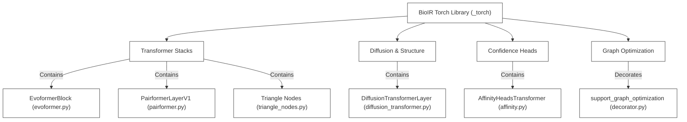

# Torch Model Architecture (_torch)

Relevant source files

The following files were used as context for generating this wiki page:

- [bionemo_ir/_torch/layers/transformers/evoformer.py](bionemo_ir/_torch/layers/transformers/evoformer.py)
- [bionemo_ir/_torch/layers/transformers/pairformer.py](bionemo_ir/_torch/layers/transformers/pairformer.py)
- [bionemo_ir/_torch/layers/triangle_nodes.py](bionemo_ir/_torch/layers/triangle_nodes.py)
- [bionemo_ir/_torch/modules/openfold2/template.py](bionemo_ir/_torch/modules/openfold2/template.py)
- [bionemo_ir/_torch/modules/openfold3/trunk.py](bionemo_ir/_torch/modules/openfold3/trunk.py)
- [bionemo_ir/_torch/modules/protenix/template.py](bionemo_ir/_torch/modules/protenix/template.py)
- [bionemo_ir/configs/modules.py](bionemo_ir/configs/modules.py)
- [bionemo_ir/models/boltz1/convert.py](bionemo_ir/models/boltz1/convert.py)
- [bionemo_ir/models/openfold2/convert.py](bionemo_ir/models/openfold2/convert.py)
- [bionemo_ir/models/openfold3/convert.py](bionemo_ir/models/openfold3/convert.py)
- [bionemo_ir/models/protenix/convert.py](bionemo_ir/models/protenix/convert.py)
- [tests/_torch/test_triangle_nodes.py](tests/_torch/test_triangle_nodes.py)

## Purpose and Scope

The `bionemo_ir/_torch/` library provides the GPU-accelerated PyTorch layer and module implementations powering BioIR structure-prediction inference models (such as OpenFold and Boltz variants). It encompasses modular transformer trunks, attention backends, diffusion machinery, structural confidence heads, and graph optimization utilities designed for high-throughput inference on NVIDIA GPUs.

This page serves as a high-level parent overview of the model architecture library. For fine-grained implementation details, please refer to the respective child pages:
- [Transformer Stacks: Evoformer, Pairformer, Triangle Ops](#4.1)
- [Diffusion, Structure, and Sampling](#4.2)
- [Confidence Heads and Geometry Utilities](#4.3)
- [Graph Optimization and CUDA Graphs](#4.4)

---

*Figure 1: Natural Language Space to Code Entity Space mapping for core `_torch` modules.*

Sources: [bionemo_ir/_torch/layers/transformers/evoformer.py:36-175](), [bionemo_ir/_torch/layers/transformers/pairformer.py:44-173](), [bionemo_ir/_torch/layers/triangle_nodes.py:117-168](), [bionemo_ir/_torch/layers/transformers/diffusion_transformer.py:103-176](), [bionemo_ir/_torch/modules/boltz/affinity.py:101-178]()

---

## 4.1 Transformer Stacks: Evoformer, Pairformer, Triangle Ops

The transformer module library builds the core relational representations for sequence alignments and pairwise structural distances. 

- **Evoformer Blocks**: Implemented in `EvoformerBlock` [bionemo_ir/_torch/layers/transformers/evoformer.py:42-168](), combining MSA attention, pair-biased representations, outer product mean calculations, and triangular update mechanisms.
- **Pairformer Layers**: Implemented in `PairformerLayerV1` [bionemo_ir/_torch/layers/transformers/pairformer.py:44-173](), providing an optimized sequence-free or sequence-reduced pair representation trunk with triangle multiplication and attention.
- **Triangle Operations**: Triangular multiplicative update nodes (`TriangleMultiplicationNode`) and starting/ending attention nodes (`TriangleAttentionNode`) defined in `bionemo_ir/_torch/layers/triangle_nodes.py:117-168]()` handle relational constraints across biological residue pairs.

For complete technical specifications, configuration parameters, and masking strategies, see [Transformer Stacks: Evoformer, Pairformer, Triangle Ops](#4.1).

Sources: [bionemo_ir/_torch/layers/transformers/evoformer.py:42-168](), [bionemo_ir/_torch/layers/transformers/pairformer.py:44-173](), [bionemo_ir/_torch/layers/triangle_nodes.py:117-168]()

---

## 4.2 Diffusion, Structure, and Sampling

Structure generation and refinement pipelines rely on diffusion transformer architectures and conditioned transition blocks.

- **Diffusion Transformers**: Implemented via `DiffusionTransformerLayer` [bionemo_ir/_torch/layers/transformers/diffusion_transformer.py:103-176]() with adaptive layer normalization (`AdaLN`) and precomputed pair biases.
- **Conditioned Transitions**: Integrates flow-matching, denoise integrators, atom attention encoders/decoders, and sampling hooks for coordinate generation.

For details on backbone integrators, conditioning vectors, and atom-level attention blocks, see [Diffusion, Structure, and Sampling](#4.2).

Sources: [bionemo_ir/_torch/layers/transformers/diffusion_transformer.py:103-176]()

---

## 4.3 Confidence Heads and Geometry Utilities

To evaluate structural quality and interaction affinity, BioIR incorporates dedicated confidence estimation networks and geometric transformation helpers.

- **Confidence Modules**: Includes pLDDT, PAE, PDE estimators, and interaction affinity modules such as `AffinityHeadsTransformer` [bionemo_ir/_torch/modules/boltz/affinity.py:101-178](), which pools cross-pair representations to predict binding affinity scores and logits.
- **Geometry Utilities**: Rigid body transformations, rotation utilities, and distance matrix computations (`compute_distogram` [bionemo_ir/_torch/modules/boltz/affinity.py:71-98]()).

For detailed breakdowns of loss metrics, head architectures, and geometry utilities, see [Confidence Heads and Geometry Utilities](#4.3).

Sources: [bionemo_ir/_torch/modules/boltz/affinity.py:71-178]()

---

## 4.4 Graph Optimization and CUDA Graphs

To minimize host overhead during repetitive inference steps (such as recycling and diffusion iterations), BioIR layers support CUDA Graph capture and execution.

- **Decorators and Trackers**: The `support_graph_optimization` decorator coordinates input acceptance dimension specifications, named tensor ties (`NamedDimTies`), and dynamic shape padding rules.
- **Runtime Execution**: Handles tensor copies, buffer reuse via `PreallocatedBuffers`, and fallback execution paths when shape mutations occur outside expected boundaries.

For implementation details on graph decorators, tracking logic, and graph execution runtimes, see [Graph Optimization and CUDA Graphs](#4.4).

Sources: [bionemo_ir/_torch/layers/transformers/pairformer.py:20-27](), [bionemo_ir/_torch/layers/transformers/diffusion_transformer.py:23-28]()

---