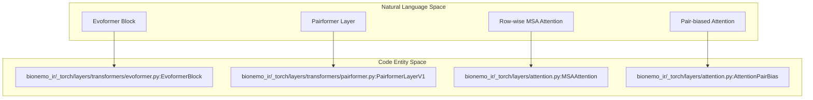
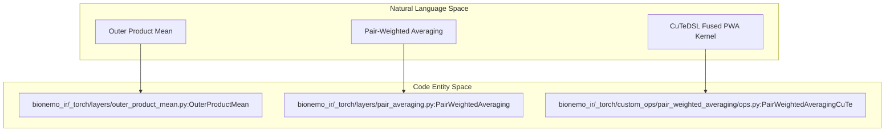

# Transformer Stacks: Evoformer, Pairformer, Triangle Ops

Relevant source files

The following files were used as context for generating this wiki page:

- [bionemo_ir/_torch/custom_ops/outer_product_mean/_config.py](bionemo_ir/_torch/custom_ops/outer_product_mean/_config.py)
- [bionemo_ir/_torch/custom_ops/outer_product_mean/configs/sm90.json](bionemo_ir/_torch/custom_ops/outer_product_mean/configs/sm90.json)
- [bionemo_ir/_torch/custom_ops/outer_product_mean/cutedsl.py](bionemo_ir/_torch/custom_ops/outer_product_mean/cutedsl.py)
- [bionemo_ir/_torch/custom_ops/outer_product_mean/ops.py](bionemo_ir/_torch/custom_ops/outer_product_mean/ops.py)
- [bionemo_ir/_torch/layers/normalization.py](bionemo_ir/_torch/layers/normalization.py)
- [bionemo_ir/_torch/layers/outer_product_mean.py](bionemo_ir/_torch/layers/outer_product_mean.py)
- [bionemo_ir/_torch/layers/transformers/evoformer.py](bionemo_ir/_torch/layers/transformers/evoformer.py)
- [bionemo_ir/_torch/layers/transformers/pairformer.py](bionemo_ir/_torch/layers/transformers/pairformer.py)
- [bionemo_ir/_torch/layers/triangle_nodes.py](bionemo_ir/_torch/layers/triangle_nodes.py)
- [bionemo_ir/_torch/modules/openfold2/template.py](bionemo_ir/_torch/modules/openfold2/template.py)
- [bionemo_ir/_torch/modules/openfold3/trunk.py](bionemo_ir/_torch/modules/openfold3/trunk.py)
- [bionemo_ir/_torch/modules/protenix/template.py](bionemo_ir/_torch/modules/protenix/template.py)
- [bionemo_ir/_torch/modules/protenix/trunk.py](bionemo_ir/_torch/modules/protenix/trunk.py)
- [bionemo_ir/_torch/utils/auto_chunk.py](bionemo_ir/_torch/utils/auto_chunk.py)
- [bionemo_ir/configs/modules.py](bionemo_ir/configs/modules.py)
- [bionemo_ir/dsl_kernels/triton/dense_outer_product.py](bionemo_ir/dsl_kernels/triton/dense_outer_product.py)
- [bionemo_ir/models/boltz1/convert.py](bionemo_ir/models/boltz1/convert.py)
- [bionemo_ir/models/openfold2/convert.py](bionemo_ir/models/openfold2/convert.py)
- [bionemo_ir/models/openfold3/convert.py](bionemo_ir/models/openfold3/convert.py)
- [bionemo_ir/models/protenix/convert.py](bionemo_ir/models/protenix/convert.py)
- [cpp/kernels/cutedsl_outer_product_mean/bindings.cpp](cpp/kernels/cutedsl_outer_product_mean/bindings.cpp)
- [tests/_torch/test_attention_pair_bias_epilogue.py](tests/_torch/test_attention_pair_bias_epilogue.py)
- [tests/_torch/test_auto_chunk.py](tests/_torch/test_auto_chunk.py)
- [tests/_torch/test_protenix_atom_transformer.py](tests/_torch/test_protenix_atom_transformer.py)
- [tests/_torch/test_protenix_msa_module.py](tests/_torch/test_protenix_msa_module.py)
- [tests/_torch/test_protenix_trunk.py](tests/_torch/test_protenix_trunk.py)
- [tests/_torch/test_triangle_nodes.py](tests/_torch/test_triangle_nodes.py)

## Purpose and Scope
This page covers the core transformer stacks and geometric operators implemented in the BioNeMo Inference Runtime (BioIR) PyTorch library (`bionemo_ir/_torch`). These components form the structural backbones of AlphaFold-2 (Evoformer), AlphaFold-3 / OpenFold-3 / Boltz (Pairformer), and associated geometric modules. We detail the implementation, data flows, key classes (`EvoformerBlock`, `PairformerLayerV1`, triangle nodes, outer product mean, pair-weighted averaging, and normalization layers), and their integration with custom fused CUDA/Triton kernels.

Sources: `[bionemo_ir/_torch/layers/transformers/evoformer.py:42-68]()`, `[bionemo_ir/_torch/layers/transformers/pairformer.py:44-81]()`

---

## 1. Evoformer and Pairformer Trunks and Blocks

The transformer backbone updates two primary representations iteratively: the single representation $s$ (tokens or residues/atoms) and the pair representation $z$ (residue-residue or token-token relations). 

* **Evoformer**: Implemented via `EvoformerBlock` `[bionemo_ir/_torch/layers/transformers/evoformer.py:42-179]()`, processing MSA representations $m$ and pair representations $z$ through row-wise MSA attention, MSA transition, outer product mean, outgoing/incoming triangle multiplication nodes, and triangle attention starting/ending nodes.
* **Pairformer**: Implemented via `PairformerLayerV1` `[bionemo_ir/_torch/layers/transformers/pairformer.py:44-174]()`, optimized for single-sequence and complex folding structures (OpenFold-3, Boltz-1/2). It replaces MSA attention with sequence-level attention conditioned on pair biases (`AttentionPairBias`), paired with triangle multiplication and triangle attention blocks.

### Diagram: Trunk Architecture to Code Entity Mapping

Sources: `[bionemo_ir/_torch/layers/transformers/evoformer.py:42-175]`, `[bionemo_ir/_torch/layers/transformers/pairformer.py:44-160]()`

---

## 2. Triangle Multiplication and Attention Nodes

Triangular operations enforce 3D consistency across pair representations $z \in \mathbb{R}^{[B, I, J, C_z]}$.

### Triangle Multiplication Nodes
`TriangleMultiplicationNode` `[bionemo_ir/_torch/layers/triangle_nodes.py:117-168]()` implements incoming and outgoing triangle updates. It projects the pair representation using layer normalization, gating, and tensor contractions across incoming or outgoing path routes:
* **Outgoing (`TriangleMultiplicationNodeType.OUTGOING`)**: Computes updates via $\sum_k a_{ikd} b_{jkd}$.
* **Incoming (`TriangleMultiplicationNodeType.INCOMING`)**: Computes updates via $\sum_k a_{kid} b_{kjd}$.

### Triangle Attention Nodes
`TriangleAttentionStartingNode` and `TriangleAttentionEndingNode` project pair features into attention queries, keys, and values, incorporating triangle biases derived from the pair representation. The underlying `TriangleAttention` handles multi-head attention execution using pluggable backends (VANILLA, SDPA, cuEquivariance, or CuTeDSL).

Sources: `[bionemo_ir/_torch/layers/triangle_nodes.py:117-168]`, `[bionemo_ir/_torch/layers/attention.py:31-111]()`

---

## 3. Outer Product Mean and Pair-Weighted Averaging

Pooling operations bridge sequence/MSA representations back into the pair representation graph.

* **Outer Product Mean (`OuterProductMean`)**: `[bionemo_ir/_torch/layers/transformers/evoformer.py:111-125]()` takes MSA representations $m$, projects them through two linear layers, applies gating, and computes an outer product along the sequence dimension to update the pair representation $z$.
* **Pair-Weighted Averaging (`PairWeightedAveraging`)**: `[bionemo_ir/_torch/modules/openfold3/trunk.py:99-108]()` computes attention-weighted averages over MSA rows using pair representations as attention biases, accelerated via custom CuTeDSL kernels on supported SM architectures.

### Diagram: Pooling and Averaging Operations to Code Entities

Sources: `[bionemo_ir/_torch/layers/transformers/evoformer.py:111-125]`, `[bionemo_ir/_torch/modules/openfold3/trunk.py:99-108]`, `[bionemo_ir/_torch/custom_ops/pair_weighted_averaging/ops.py]()`

---

## 4. Normalization Layers: AdaLN and FusedLayerNorm

BioIR provides specialized normalization modules optimized for conditional feature streams and high-throughput execution.

* **Adaptive Layer Normalization (`AdaLN`)**: Implements adaptive normalization where input $a$ is normalized and modulated by a sigmoid-gated affine transformation driven by a conditioning stream $s$:
  $$\text{out} = \text{sigmoid}(\gamma) \cdot \text{Norm}(a) + \beta$$
  where $[\gamma, \beta] = \text{Linear}(\text{NormCond}(s))$. It dispatches to fused CuTe DSL kernels (`adaln_layernorm_sigmoid`) when available (`[bionemo_ir/models/protenix/convert.py:80-92]()`).
* **Fused LayerNorm (`FusedLayerNorm`)**: Subclasses `nn.LayerNorm` to route execution through single-pass Triton or custom CUDA kernels while preserving parameter compatibility for weight loading (`[bionemo_ir/_torch/layers/normalization.py]()`).

Sources: `[bionemo_ir/models/protenix/convert.py:80-92]`, `[bionemo_ir/_torch/layers/normalization.py]()`

---