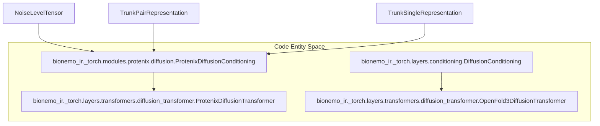
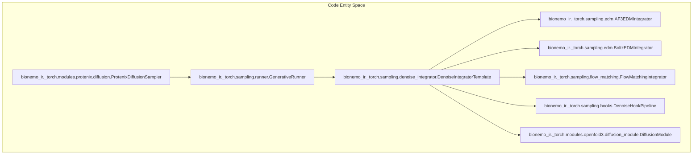
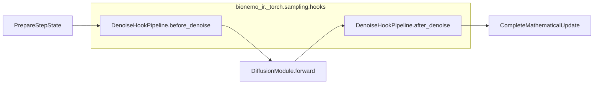

# Diffusion, Structure, and Sampling

Relevant source files

The following files were used as context for generating this wiki page:

- [bionemo_ir/_torch/layers/attention.py](bionemo_ir/_torch/layers/attention.py)
- [bionemo_ir/_torch/layers/random_augmentation.py](bionemo_ir/_torch/layers/random_augmentation.py)
- [bionemo_ir/_torch/layers/sequence_local_atom.py](bionemo_ir/_torch/layers/sequence_local_atom.py)
- [bionemo_ir/_torch/layers/transformers/atom.py](bionemo_ir/_torch/layers/transformers/atom.py)
- [bionemo_ir/_torch/layers/transformers/diffusion_transformer.py](bionemo_ir/_torch/layers/transformers/diffusion_transformer.py)
- [bionemo_ir/_torch/modules/boltz/structure.py](bionemo_ir/_torch/modules/boltz/structure.py)
- [bionemo_ir/_torch/modules/openfold3/diffusion_module.py](bionemo_ir/_torch/modules/openfold3/diffusion_module.py)
- [bionemo_ir/_torch/modules/openfold3/sequence_local_atom_attention.py](bionemo_ir/_torch/modules/openfold3/sequence_local_atom_attention.py)
- [bionemo_ir/_torch/modules/openfold3/utils/atomize_utils.py](bionemo_ir/_torch/modules/openfold3/utils/atomize_utils.py)
- [bionemo_ir/_torch/modules/protenix/atom_attention.py](bionemo_ir/_torch/modules/protenix/atom_attention.py)
- [bionemo_ir/_torch/modules/protenix/diffusion.py](bionemo_ir/_torch/modules/protenix/diffusion.py)
- [bionemo_ir/_torch/sampling/edm.py](bionemo_ir/_torch/sampling/edm.py)
- [bionemo_ir/_torch/sampling/frame_reuse.py](bionemo_ir/_torch/sampling/frame_reuse.py)
- [bionemo_ir/dsl_kernels/triton/atom_gather_kernel.py](bionemo_ir/dsl_kernels/triton/atom_gather_kernel.py)
- [docs/ref/oracles.md](docs/ref/oracles.md)
- [docs/ref/sampling.md](docs/ref/sampling.md)
- [tests/_torch/graph_optimization/cuda_graph/test_openfold3_diffusion_module_with_cuda_graph.py](tests/_torch/graph_optimization/cuda_graph/test_openfold3_diffusion_module_with_cuda_graph.py)
- [tests/_torch/test_atom_utils.py](tests/_torch/test_atom_utils.py)
- [tests/_torch/test_attention_pair_bias_padded_heads.py](tests/_torch/test_attention_pair_bias_padded_heads.py)
- [tests/_torch/test_boltz_atom_to_token.py](tests/_torch/test_boltz_atom_to_token.py)
- [tests/_torch/test_edm_prepared_schedule.py](tests/_torch/test_edm_prepared_schedule.py)
- [tests/_torch/test_frame_reuse.py](tests/_torch/test_frame_reuse.py)
- [tests/_torch/test_noise_scheduler.py](tests/_torch/test_noise_scheduler.py)
- [tests/_torch/test_openfold3_atom_reduction.py](tests/_torch/test_openfold3_atom_reduction.py)
- [tests/_torch/test_prepared_atom_key_mask.py](tests/_torch/test_prepared_atom_key_mask.py)
- [tests/_torch/test_protenix_atom_attention_decoder.py](tests/_torch/test_protenix_atom_attention_decoder.py)
- [tests/_torch/test_protenix_diffusion_atom_encoder.py](tests/_torch/test_protenix_diffusion_atom_encoder.py)
- [tests/_torch/test_protenix_diffusion_module.py](tests/_torch/test_protenix_diffusion_module.py)
- [tests/common/test_utils/boltz/create_and_load_weights.py](tests/common/test_utils/boltz/create_and_load_weights.py)
- [tests/common/test_utils/openfold3/batched_input_tools.py](tests/common/test_utils/openfold3/batched_input_tools.py)

## Purpose and Scope

This page documents the PyTorch implementation (`_torch`) of diffusion transformers, atom attention layers, conditioning modules, generative samplers, denoise integrators, and sampling hooks within BioNeMo Inference Runtime (BioIR). These components drive iterative structure prediction and generation for models such as OpenFold3, Boltz-1/2, and Protenix.

---

## 1. Diffusion Transformers and Conditioning

BioIR models condition backbone and pairwise representations on noise levels using Fourier embeddings and specialized transition modules before feeding them into diffusion transformer stacks.

- `DiffusionConditioning`: Implemented in `bionemo_ir/_torch/modules/boltz/structure.py:53-144` and `bionemo_ir/_torch/layers/conditioning.py:83-133`, providing pairwise and single conditioning for Boltz variants.
- `ProtenixDiffusionConditioning`: Implemented in `bionemo_ir/_torch/modules/protenix/diffusion.py:52-110`, handling AF3 Algorithm 21 diffusion conditioning for Protenix by fusing `z_trunk` with relative position encoders (`relpe`) and single features with Fourier noise embeddings.
- `DiffusionModule`: Implemented in `bionemo_ir/_torch/modules/openfold3/diffusion_module.py:49-122`, orchestrating OpenFold3 diffusion steps with graph optimization attributes.

### Bridge Diagram: Diffusion Conditioning & Transformer Architecture to Code Entities

Sources:
- `bionemo_ir/_torch/modules/boltz/structure.py:53-144`
- `bionemo_ir/_torch/modules/protenix/diffusion.py:52-110`
- `bionemo_ir/_torch/modules/openfold3/diffusion_module.py:49-122`
- `bionemo_ir/_torch/layers/conditioning.py:83-133`

---

## 2. Atom Attention Encoders and Decoders

To scale efficiently over large coordinate sets, BioIR implements windowed atom attention layers that map between token-level representations and atom-level coordinates.

- `AtomAttentionEncoder`: Encodes reference conformations and atom features via `bionemo_ir/_torch/modules/protenix/atom_attention.py:70-137` and OpenFold3 modules.
- `AtomAttentionDecoder`: Decodes atomic updates using windowed queries and keys (`atoms_per_window_queries`, `atoms_per_window_keys`) [bionemo_ir/_torch/modules/boltz/structure.py:59-68]().
- `convert_pair_atom_to_blocks`: Implemented in `bionemo_ir/_torch/modules/openfold3/sequence_local_atom_attention.py:80-152`, producing CUDA-graph-capturable block-local pair tensors from trunk pair representations without Python branching.

Sources:
- `bionemo_ir/_torch/modules/protenix/atom_attention.py:70-137`
- `bionemo_ir/_torch/modules/openfold3/sequence_local_atom_attention.py:80-152`
- `bionemo_ir/_torch/modules/boltz/structure.py:54-116`

---

## 3. Generative Sampling Architecture and Runners

BioIR uses a Torch-native runtime for iterative generative sampling. Model samplers own model-specific conditioning and prediction calls, while `_torch/sampling` manages reusable rollout contracts, iteration loops, and hook dispatch.

### Bridge Diagram: Sampling Architecture to Code Entities

This diagram bridges natural language sampling concepts to their concrete Python classes and modules in `bionemo_ir._torch.sampling`.

Sources:
- `bionemo_ir/_torch/sampling/edm.py:68-136`
- `bionemo_ir/_torch/sampling/frame_reuse.py:43-43`

---

## 4. Concrete Integrators and Flow Matching

Integrators follow the template method pattern defined by `DenoiseIntegratorTemplate`, enforcing a fixed step order: prepare step $\rightarrow$ hooks $\rightarrow$ predict $\rightarrow$ hooks $\rightarrow$ complete update.

| Integrator Class | Target Model / Algorithm | Key Characteristics |
| :--- | :--- | :--- |
| `AF3EDMIntegrator` | OpenFold3 / Protenix | First-order EDM algorithm over coordinate tensors (`EDMRolloutPlan`) [bionemo_ir/_torch/sampling/edm.py:106-136](). |
| `BoltzEDMIntegrator` | Boltz-1 / Boltz-2 | Structured state integration including atom masks, previous coordinates, and token representations. |
| `FlowMatchingIntegrator` | Multi-modal models | Deterministic product-space Euler updates over linear interpolants (`FlowMatchingRolloutPlan`). |

Sources:
- `bionemo_ir/_torch/sampling/edm.py:68-173`

---

## 5. Sampling Hooks, Random Augmentations, and Frame Reuse

### Bridge Diagram: Hook Pipeline Execution Map

`DenoiseHookPipeline` applies ordered extensions around each prediction call. Boltz and Protenix leverage these hooks for:
- Random rigid rotations and augmentations (`centre_random_augmentation` in `bionemo_ir/_torch/layers/random_augmentation.py:53`).
- Churn-noise injection and step scale modifications (`EDMIntegratorConfig` in `bionemo_ir/_torch/sampling/edm.py:106-136`).
- Frame reuse schedules via `FrameReuseEDMIntegrator` (`bionemo_ir/_torch/sampling/frame_reuse.py:43`).

Sources:
- `bionemo_ir/_torch/sampling/edm.py:106-136`
- `bionemo_ir/_torch/sampling/frame_reuse.py:43-43`
- `bionemo_ir/_torch/layers/random_augmentation.py:53-53`

---