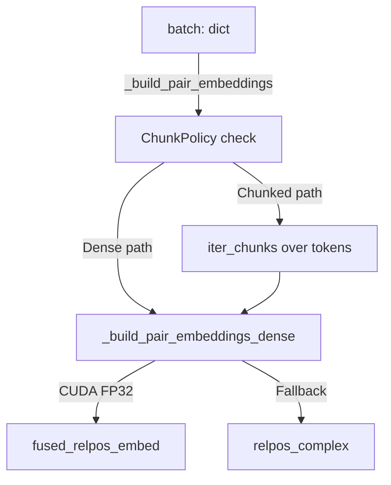

# Confidence Heads and Geometry Utilities

<details>
<summary>Relevant source files</summary>

The following files were used as context for generating this wiki page:

- [bionemo_ir/_torch/modules/boltz/affinity.py](bionemo_ir/_torch/modules/boltz/affinity.py)
- [bionemo_ir/_torch/modules/boltz/confidence.py](bionemo_ir/_torch/modules/boltz/confidence.py)
- [bionemo_ir/_torch/modules/boltz/confidence_utils.py](bionemo_ir/_torch/modules/boltz/confidence_utils.py)
- [bionemo_ir/_torch/modules/openfold2/confidence.py](bionemo_ir/_torch/modules/openfold2/confidence.py)
- [bionemo_ir/_torch/modules/openfold2/confidence_utils.py](bionemo_ir/_torch/modules/openfold2/confidence_utils.py)
- [bionemo_ir/_torch/modules/openfold2/embedders.py](bionemo_ir/_torch/modules/openfold2/embedders.py)
- [bionemo_ir/_torch/modules/openfold2/utils/all_atom_multimer.py](bionemo_ir/_torch/modules/openfold2/utils/all_atom_multimer.py)
- [bionemo_ir/_torch/modules/openfold2/utils/rigid_utils.py](bionemo_ir/_torch/modules/openfold2/utils/rigid_utils.py)
- [bionemo_ir/_torch/modules/openfold3/confidence.py](bionemo_ir/_torch/modules/openfold3/confidence.py)
- [bionemo_ir/_torch/modules/openfold3/embedders.py](bionemo_ir/_torch/modules/openfold3/embedders.py)
- [bionemo_ir/_torch/modules/protenix/confidence.py](bionemo_ir/_torch/modules/protenix/confidence.py)
- [bionemo_ir/_torch/modules/protenix/summary.py](bionemo_ir/_torch/modules/protenix/summary.py)
- [bionemo_ir/_torch/utils/confidence.py](bionemo_ir/_torch/utils/confidence.py)
- [bionemo_ir/dsl_kernels/triton/distance_embedding.py](bionemo_ir/dsl_kernels/triton/distance_embedding.py)
- [bionemo_ir/dsl_kernels/triton/fused_relpos_embed.py](bionemo_ir/dsl_kernels/triton/fused_relpos_embed.py)
- [bionemo_ir/dsl_kernels/triton/indexed_projection.py](bionemo_ir/dsl_kernels/triton/indexed_projection.py)
- [bionemo_ir/dsl_kernels/triton/quaternion_rotation.py](bionemo_ir/dsl_kernels/triton/quaternion_rotation.py)
- [bionemo_ir/dsl_kernels/triton/rotation_product.py](bionemo_ir/dsl_kernels/triton/rotation_product.py)
- [bionemo_ir/models/boltz1/config.py](bionemo_ir/models/boltz1/config.py)
- [bionemo_ir/models/openfold2/config.py](bionemo_ir/models/openfold2/config.py)
- [tests/_torch/test_boltz_confidence.py](tests/_torch/test_boltz_confidence.py)
- [tests/_torch/test_distance_embedding.py](tests/_torch/test_distance_embedding.py)
- [tests/_torch/test_fused_relpos_embed.py](tests/_torch/test_fused_relpos_embed.py)
- [tests/_torch/test_of2_rotation_product.py](tests/_torch/test_of2_rotation_product.py)
- [tests/_torch/test_openfold3_confidence_memory.py](tests/_torch/test_openfold3_confidence_memory.py)
- [tests/_torch/test_openfold3_input_embedder_memory.py](tests/_torch/test_openfold3_input_embedder_memory.py)
- [tests/_torch/test_protenix_confidence_summary.py](tests/_torch/test_protenix_confidence_summary.py)
- [tests/_torch/test_protenix_indexed_projection.py](tests/_torch/test_protenix_indexed_projection.py)
- [tests/_torch/test_protenix_summary_chain_index.py](tests/_torch/test_protenix_summary_chain_index.py)
- [tests/_torch/test_quaternion_kernel.py](tests/_torch/test_quaternion_kernel.py)

</details>


## Purpose and Scope

This page documents the confidence head modules, prediction summary utilities, rigid/rotation geometry classes, optimized Triton acceleration kernels, and all-atom multimer feature handlers in the BioNeMo Inference Runtime (`BioIR`). These components evaluate structural confidence metrics (such as pLDDT, PAE, PDE, distograms, and contact probabilities), execute SE(3) rigid transformations, perform fused quaternion and rotation operations, and process atomic coordinates across model families including OpenFold2, OpenFold3, Protenix, and Boltz.

---

## Confidence Modules and Summaries

Confidence heads convert trunk representations and predicted atomic coordinates into uncertainty and error estimates. To handle large sequence lengths and multi-sample diffusion outputs without excessive VRAM overhead, `BioIR` implements chunked reductions, memory-efficient per-sample pairformer embeddings, and indexed projections.

### OpenFold3 and Protenix Confidence Heads

In OpenFold3 and Protenix, confidence heads evaluate PAE, PDE, pLDDT, and resolved states (AF3 Algorithm 31). The module `ProtenixConfidenceHead` maintains non-persistent lower and upper distance bins (`lower_bins`, `upper_bins`) [bionemo_ir/_torch/modules/protenix/confidence.py:59-63]() and applies linear projections without bias (`linear_no_bias_s1`, `linear_no_bias_s2`, `linear_no_bias_d`, `linear_no_bias_pae`, `linear_no_bias_pde`) [bionemo_ir/_torch/modules/protenix/confidence.py:65-81](). 

Pair logits are projected and symmetrized in bounded chunks via helper routines such as `_project_pair_logits` and `_symmetrize_pair_logits_` [bionemo_ir/_torch/modules/openfold3/confidence.py:55-98](). Auxiliary outputs are finalized and offloaded using `_finalize_aux_output` and `_finalize_aux_outputs_` [bionemo_ir/_torch/modules/openfold3/confidence.py:101-146]().

### Boltz-2 Confidence Heads and Chunked Contact Probability Reduction

The `Boltz2ConfidenceHeads` module computes separate or unified intra- and inter-chain PAE/PDE logits alongside token-level or atom-level pLDDT and resolved logits [bionemo_ir/_torch/modules/boltz/confidence.py:59-128](). To avoid materializing transient `[B, N, N, num_bins]` distogram logits in dense memory, `compute_contact_prob` reduces predicted distogram logits into contact probabilities via `ChunkPolicy` and `_contact_prob_dense` [bionemo_ir/_torch/modules/boltz/confidence_utils.py:81-111]().

```mermaid
graph TD
    InputLogits[""logits: [B, N, N, num_bins]""] -->|"ChunkPolicy applied"| fn_compute[""compute_contact_prob""]
    fn_compute -->|"Row slices"| fn_dense[""_contact_prob_dense""]
    fn_dense -->|"Softmax and mask sum"| OutputProb[""Contact Probability: [B, N, N]""]
```
Sources: `bionemo_ir/_torch/modules/boltz/confidence_utils.py:69-112()`, `bionemo_ir/_torch/modules/openfold3/confidence.py:55-146()`

---

## Optimized Triton Kernels for Confidence and Geometry

`BioIR` leverages custom Triton kernels to accelerate indexing, quaternion conversions, and rotation matrix products during structural inference.

### Grouped FP32 Projection (`indexed_projection`)

To compute per-atom pLDDT projections without materializing full `[A, C, O]` weight matrices per row, `indexed_projection` groups token-atom mappings using `prepare_indexed_rows` and executes `_indexed_projection` via Triton [bionemo_ir/dsl_kernels/triton/indexed_projection.py:29-158](). Accumulation uses TF32 tensor-core instructions [bionemo_ir/dsl_kernels/triton/indexed_projection.py:92]().

### Quaternion Matrix and Rotation Products

The module `quaternion_matrix` converts aligned CUDA FP32 quaternions `[..., 4]` into rotation matrices `[..., 3, 3]` using `_quaternion_matrix` [bionemo_ir/dsl_kernels/triton/quaternion_rotation.py:31-86](). Similarly, `rotation_product` fuses rotation matrix multiplications (`rot_matmul`) and vector applications (`rot_vec_mul`) in FP32 via `_rotation_product` [bionemo_ir/dsl_kernels/triton/rotation_product.py:28-146]().

```mermaid
graph TD
    InputQuat[""quaternions: [..., 4]""] -->|"quaternion_matrix"| TritonQuat[""_quaternion_matrix""]
    TritonQuat --> OutputRot[""RotMatrices: [..., 3, 3]""]
    InputRot[""A: [..., 3, 3], B: [..., 3, 3]""] -->|"rotation_product"| TritonRot[""_rotation_product""]
    TritonRot --> OutputProd[""Fused Product: [..., 3, 3]""]
    InputIndex[""index: [A]""] -->|"prepare_indexed_rows"| IndexedRowsObj[""IndexedRows""]
    IndexedRowsObj --> TritonProj[""_indexed_projection""]
    TritonProj --> OutputProj[""Projected Tensor: [..., A, O]""]
```
Sources: `bionemo_ir/dsl_kernels/triton/indexed_projection.py:29-158()`, `bionemo_ir/dsl_kernels/triton/quaternion_rotation.py:31-86()`, `bionemo_ir/dsl_kernels/triton/rotation_product.py:28-146()`

---

## Rigid and Rotation Geometry Utilities

Spatial modeling relies on rigorous handling of rotation matrices, quaternions, and rigid body transformations in PyTorch.

### Rigid Transformations (`Rigid3Array`)

The `Rigid3Array` class represents elements of the Special Euclidean group $SE(3)$ by combining a rotation matrix array (`Rot3Array`) and a translation vector array (`Vec3Array`) [bionemo_ir/_torch/modules/openfold2/utils/geometry/rigid_matrix_vector.py:32-37](). It provides overloaded operators for composition (`__matmul__`), scalar scaling (`__mul__`), inversion (`inverse`), and point transformation (`apply_to_point`) [bionemo_ir/_torch/modules/openfold2/utils/geometry/rigid_matrix_vector.py:38-70]().

### Rotation and Quaternion Operations

Rotation math utilities (`rot_matmul`, `rot_vec_mul`, `quat_to_rot`, `rot_to_quat`) are explicitly written out to prevent Automatic Mixed Precision (AMP) downcasting artifacts [bionemo_ir/_torch/modules/openfold2/utils/rigid_utils.py:32-81]()]. Quaternion conversions map 4-dimensional quaternion tensors to $3 \times 3$ rotation matrices using precompiled lookup matrices (`_QTR_MAT`) [bionemo_ir/_torch/modules/openfold2/utils/rigid_utils.py:140-181]().

Sources: `bionemo_ir/_torch/modules/openfold2/utils/geometry/rigid_matrix_vector.py:32-156()`, `bionemo_ir/_torch/modules/openfold2/utils/rigid_utils.py:32-224()`

---

## Embedders and All-Atom Multimer Features

Distance calculations and metric evaluations for multimers utilize representative atom mappings, sequence-local attention, and embedding builders.

### All-Atom Input Embedder

The `InputEmbedderAllAtom` class implements AF3 Algorithm 1 (lines 1–5), incorporating `AtomAttentionEncoder`, linear projections (`linear_s`, `linear_z_ij`, `linear_relpos`, `linear_token_bonds`), and relative position encodings [bionemo_ir/_torch/modules/openfold3/embedders.py:44-103](). Pair embeddings are constructed either densely or in chunked query rows via `_build_pair_embeddings` and `_build_pair_embeddings_dense`, automatically engaging `fused_relpos_embed` when CUDA and FP32 conditions are met [bionemo_ir/_torch/modules/openfold3/embedders.py:113-164]().


Sources: `bionemo_ir/_torch/modules/openfold3/embedders.py:44-164()`

---