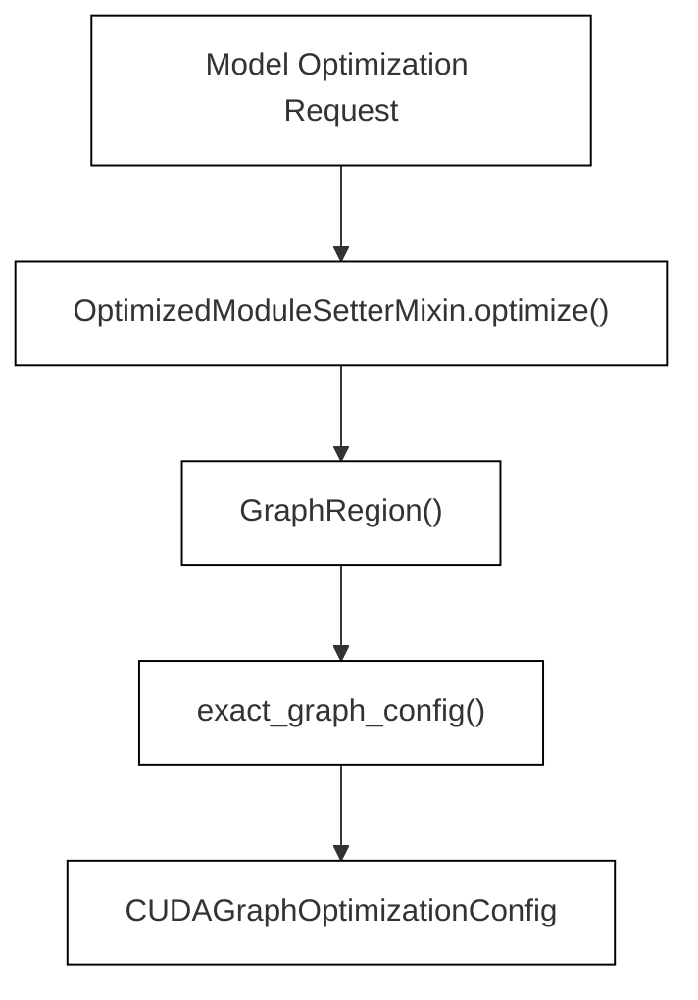
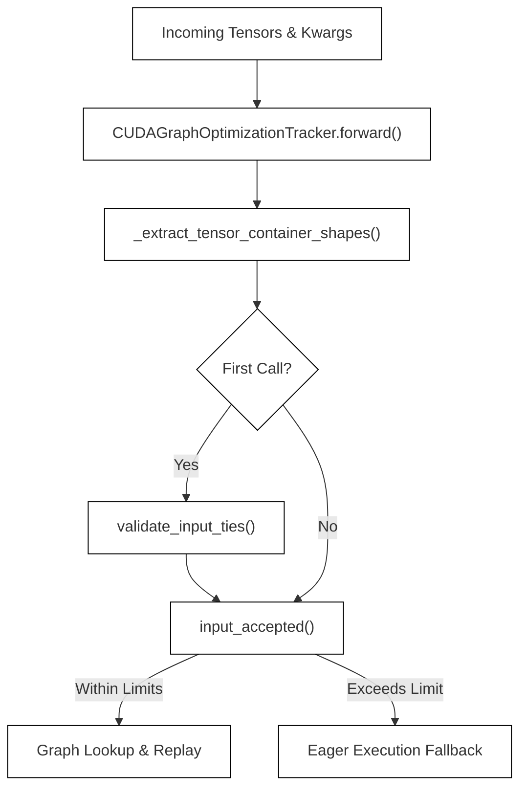
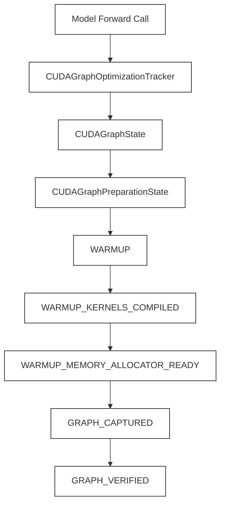

# Graph Optimization and CUDA Graphs

Relevant source files

The following files were used as context for generating this wiki page:

- [bionemo_ir/_torch/graph_optimization/config.py](bionemo_ir/_torch/graph_optimization/config.py)
- [bionemo_ir/_torch/graph_optimization/cuda_graph/runtime.py](bionemo_ir/_torch/graph_optimization/cuda_graph/runtime.py)
- [bionemo_ir/_torch/graph_optimization/cudnn_graph/ops.py](bionemo_ir/_torch/graph_optimization/cudnn_graph/ops.py)
- [bionemo_ir/_torch/graph_optimization/graph_policy.py](bionemo_ir/_torch/graph_optimization/graph_policy.py)
- [bionemo_ir/_torch/graph_optimization/region.py](bionemo_ir/_torch/graph_optimization/region.py)
- [bionemo_ir/_torch/graph_optimization/tensor_copy_utils.py](bionemo_ir/_torch/graph_optimization/tensor_copy_utils.py)
- [bionemo_ir/_torch/layers/transition.py](bionemo_ir/_torch/layers/transition.py)
- [bionemo_ir/configs/base.py](bionemo_ir/configs/base.py)
- [bionemo_ir/dsl_kernels/triton/fused_layer_norm_transpose.py](bionemo_ir/dsl_kernels/triton/fused_layer_norm_transpose.py)
- [bionemo_ir/models/openfold2/modeling.py](bionemo_ir/models/openfold2/modeling.py)
- [bionemo_ir/models/optimize_module_setter.py](bionemo_ir/models/optimize_module_setter.py)
- [docs/ref/config.md](docs/ref/config.md)
- [tests/_torch/graph_optimization/cuda_graph/test_capture_and_fallback.py](tests/_torch/graph_optimization/cuda_graph/test_capture_and_fallback.py)
- [tests/_torch/graph_optimization/cuda_graph/test_stable_input_kwargs.py](tests/_torch/graph_optimization/cuda_graph/test_stable_input_kwargs.py)
- [tests/_torch/graph_optimization/test_cudnn_graph.py](tests/_torch/graph_optimization/test_cudnn_graph.py)
- [tests/_torch/graph_optimization/test_region.py](tests/_torch/graph_optimization/test_region.py)
- [tests/_torch/model_forwards/test_model_forward_eager_determinism.py](tests/_torch/model_forwards/test_model_forward_eager_determinism.py)
- [tests/_torch/model_forwards/test_model_forward_with_cuda_graph.py](tests/_torch/model_forwards/test_model_forward_with_cuda_graph.py)
- [tests/_torch/test_diffusion_graph_cap.py](tests/_torch/test_diffusion_graph_cap.py)
- [tests/_torch/test_transition.py](tests/_torch/test_transition.py)
- [tests/common/test_utils/model_forwards.py](tests/common/test_utils/model_forwards.py)
- [tests/conftest.py](tests/conftest.py)
- [tests/ops/test_fused_layer_norm_transpose.py](tests/ops/test_fused_layer_norm_transpose.py)

## Purpose and Scope

Section 4.4 details the graph optimization and CUDA graph subsystem within BioNeMo Inference Runtime (`BioIR`). The subsystem eliminates CPU dispatch bottlenecks during repetitive inference steps (such as token transformer stacks and diffusion iterations) by capturing execution sequences into native `torch.cuda.CUDAGraph` objects. This page covers `GraphRegion` and graph policies (`bionemo_ir/_torch/graph_optimization/graph_policy.py`), the `CUDAGraphOptimizationTracker` base class (`bionemo_ir/_torch/graph_optimization/tracker.py`), recursive tensor copy utilities (`bionemo_ir/_torch/graph_optimization/tensor_copy_utils.py`), cuDNN graph operations (`bionemo_ir/_torch/graph_optimization/cudnn_graph/`), and the state-managed CUDA graph capture, warmup, replay, and eager fallback runtime (`bionemo_ir/_torch/graph_optimization/cuda_graph/runtime.py`).

---

## 1. Graph Regions, Policies, and Decorators

Model classes orchestrate CUDA graph optimization by defining region mappings (e.g., `GRAPH_REGIONS = {"trunk": "trunk_graph"}` in `OpenFold2`) and wrapping methods in `GraphRegion` instances [bionemo_ir/models/openfold2/modeling.py:67-105](). Graph regions bind a target method to a `CUDAGraphOptimizationConfig` policy constructed via helpers like `exact_graph_config`, `trunk_graph_config`, or `pairformer_graph_config` [bionemo_ir/_torch/graph_optimization/graph_policy.py:77-145]().

Policies declare named dimension ties (`NamedDimTies`), input acceptance constraints (such as `max_tokens`), and execution modes [bionemo_ir/_torch/graph_optimization/graph_policy.py:77-114]().

*Figure 4.4.1: Natural language optimization intent mapped to `GraphRegion`, `exact_graph_config`, and `CUDAGraphOptimizationConfig` code entities.*

### Sources
* `bionemo_ir/_torch/graph_optimization/graph_policy.py:77-146`
* `bionemo_ir/models/openfold2/modeling.py:67-105`
* `tests/_torch/graph_optimization/test_region.py:30-65`

---

## 2. Tracker Abstractions and Input Routing

The `CUDAGraphOptimizationTracker` serves as the runtime core managing cache key generation, input shape validation, and eager fallback [bionemo_ir/_torch/graph_optimization/cuda_graph/runtime.py:37-55]().

### Input Acceptance and Tie Validation
Before graph lookup or capture, incoming tensor arguments pass through validation checks:
1. **Input Tie Validation (`validate_input_ties`)**: Verifies that every tensor name and axis specified in `named_dim_ties` matches incoming tensor shapes [bionemo_ir/_torch/graph_optimization/tracker.py:144-162]().
2. **Input Acceptance (`input_accepted`)**: Evaluates whether active token counts or dimensions fall within configured inclusive limits (e.g., `max_tokens`). Exceeding limits routes the call to eager execution [bionemo_ir/_torch/graph_optimization/tracker.py:124-142]().

*Figure 4.4.2: Input validation and acceptance flow within `CUDAGraphOptimizationTracker`.*

### Sources
* `bionemo_ir/_torch/graph_optimization/tracker.py:45-162`
* `tests/_torch/graph_optimization/cuda_graph/test_capture_and_fallback.py:21-168`

---

## 3. Tensor Copy, Clone, and Memory Utilities

CUDA graph capture requires strict separation between live mutable inputs and static graph-owned buffers. The utilities in `tensor_copy_utils.py` support recursive walking of arbitrary nested containers (`dict`, `list`, `tuple`) [bionemo_ir/_torch/graph_optimization/tensor_copy_utils.py:15-116]().

| Utility Function | Module Path | Role |
| :--- | :--- | :--- |
| `_clone_tensors(value)` | `bionemo_ir/_torch/graph_optimization/tensor_copy_utils.py:22-30` | Recursively walks containers and returns an independent `.clone()` for every `torch.Tensor` leaf. |
| `_copy_tensors_into(dest, src)` | `bionemo_ir/_torch/graph_optimization/tensor_copy_utils.py:33-51` | Copies live tensor values into static graph-owned buffers in-place via `dest.copy_(src)`. |
| `_assert_equal_but_distinct(orig, clone)` | `bionemo_ir/_torch/graph_optimization/tensor_copy_utils.py:53-68` | Asserts numerical equality while ensuring memory addresses (`data_ptr()`) are distinct. |
| `_tensor_containers_are_byte_equal` | `bionemo_ir/_torch/graph_optimization/tensor_copy_utils.py:85-101` | Compares raw byte buffers across containers to verify parity. |
| `_delete_tensors_in_container(val)` | `bionemo_ir/_torch/graph_optimization/tensor_copy_utils.py:103-116` | Explicitly releases tensor references and clears mutable containers to prevent memory leaks. |

### Sources
* `bionemo_ir/_torch/graph_optimization/tensor_copy_utils.py:15-116`

---

## 4. cuDNN Graph Operations and Dynamic/Static Plans

The `cudnn_graph` subsystem (`bionemo_ir/_torch/graph_optimization/cudnn_graph/`) provides fused linear, mask, residual, and ReLU operations [bionemo_ir/_torch/layers/transition.py:25-34](). Modules like `Transition` leverage `CudnnGraphModule` and helper functions such as `_run_cudnn_linear` to execute dynamic-shape cuDNN plans when available, falling back to static plans otherwise [bionemo_ir/_torch/layers/transition.py:44-60]().

### Sources
* `bionemo_ir/_torch/layers/transition.py:25-60`
* `bionemo_ir/_torch/graph_optimization/cudnn_graph/ops.py:1-50`

---

## 5. CUDA Graph Capture, State Tracking, and Fallback Runtime

The runtime component (`bionemo_ir/_torch/graph_optimization/cuda_graph/runtime.py`) implements per-key warmup, cuBLAS workspace isolation (`graph_owned_cublas_workspace`), capture, verification, and replay [bionemo_ir/_torch/graph_optimization/cuda_graph/runtime.py:15-175]().

### Preparation States and Lifecycle
Each cache key maps to a `CUDAGraphState` tracking progression through `CUDAGraphPreparationState` [bionemo_ir/_torch/graph_optimization/cuda_graph/runtime.py:95-125]().

*Figure 4.4.3: Runtime execution and state progression mapping from `CUDAGraphOptimizationTracker` to `CUDAGraphPreparationState`.*

### Fallback and Resource Release
* **Memory Gates**: Before capture, memory headroom is evaluated via `check_capacity_for_capture` [bionemo_ir/_torch/graph_optimization/cuda_graph/runtime.py:38-42](). If capacity is insufficient, the key permanently reverts to eager execution.
* **LRU Eviction**: Caching is managed via an LRU structure sized by `num_graphs_max_for_this_module`. Eviction synchronizes the device and releases pinned static buffers and captured graphs [bionemo_ir/_torch/graph_optimization/cuda_graph/runtime.py:127-148]().

### Sources
* `bionemo_ir/_torch/graph_optimization/cuda_graph/runtime.py:15-175`
* `tests/_torch/graph_optimization/cuda_graph/test_capture_and_fallback.py:15-176`

---