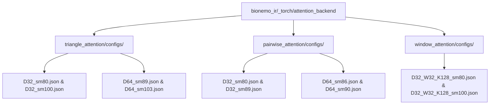
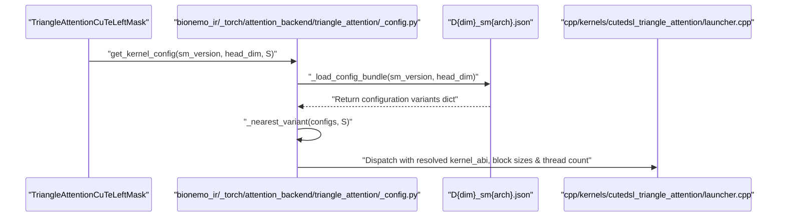

# Attention Kernel Tuning Configs

Relevant source files

The following files were used as context for generating this wiki page:

- [bionemo_ir/_torch/attention_backend/__init__.py](bionemo_ir/_torch/attention_backend/__init__.py)
- [bionemo_ir/_torch/attention_backend/triangle_attention/_config.py](bionemo_ir/_torch/attention_backend/triangle_attention/_config.py)
- [bionemo_ir/_torch/attention_backend/triangle_attention/configs/D32_sm100.json](bionemo_ir/_torch/attention_backend/triangle_attention/configs/D32_sm100.json)
- [bionemo_ir/_torch/attention_backend/triangle_attention/configs/D32_sm103.json](bionemo_ir/_torch/attention_backend/triangle_attention/configs/D32_sm103.json)
- [bionemo_ir/_torch/attention_backend/triangle_attention/configs/D32_sm90.json](bionemo_ir/_torch/attention_backend/triangle_attention/configs/D32_sm90.json)
- [bionemo_ir/_torch/attention_backend/triangle_attention/configs/D64_sm100.json](bionemo_ir/_torch/attention_backend/triangle_attention/configs/D64_sm100.json)
- [bionemo_ir/_torch/attention_backend/triangle_attention/configs/D64_sm103.json](bionemo_ir/_torch/attention_backend/triangle_attention/configs/D64_sm103.json)
- [bionemo_ir/_torch/attention_backend/triangle_attention/cutedsl.py](bionemo_ir/_torch/attention_backend/triangle_attention/cutedsl.py)
- [bionemo_ir/_torch/attention_backend/window_attention/__init__.py](bionemo_ir/_torch/attention_backend/window_attention/__init__.py)
- [bionemo_ir/_torch/attention_backend/window_attention/_config.py](bionemo_ir/_torch/attention_backend/window_attention/_config.py)
- [bionemo_ir/_torch/attention_backend/window_attention/_cubin.py](bionemo_ir/_torch/attention_backend/window_attention/_cubin.py)
- [bionemo_ir/_torch/attention_backend/window_attention/configs/D32_W32_K128_sm100.json](bionemo_ir/_torch/attention_backend/window_attention/configs/D32_W32_K128_sm100.json)
- [bionemo_ir/_torch/attention_backend/window_attention/configs/D32_W32_K128_sm103.json](bionemo_ir/_torch/attention_backend/window_attention/configs/D32_W32_K128_sm103.json)
- [bionemo_ir/_torch/attention_backend/window_attention/configs/D32_W32_K128_sm80.json](bionemo_ir/_torch/attention_backend/window_attention/configs/D32_W32_K128_sm80.json)
- [bionemo_ir/_torch/attention_backend/window_attention/configs/D32_W32_K128_sm86.json](bionemo_ir/_torch/attention_backend/window_attention/configs/D32_W32_K128_sm86.json)
- [bionemo_ir/_torch/attention_backend/window_attention/configs/D32_W32_K128_sm89.json](bionemo_ir/_torch/attention_backend/window_attention/configs/D32_W32_K128_sm89.json)
- [bionemo_ir/_torch/attention_backend/window_attention/configs/D32_W32_K128_sm90.json](bionemo_ir/_torch/attention_backend/window_attention/configs/D32_W32_K128_sm90.json)
- [cpp/kernels/cutedsl_triangle_attention/launcher.cpp](cpp/kernels/cutedsl_triangle_attention/launcher.cpp)
- [cpp/kernels/cutedsl_triangle_attention/launcher.h](cpp/kernels/cutedsl_triangle_attention/launcher.h)
- [cpp/kernels/cutedsl_window_attention/cubins/index.json](cpp/kernels/cutedsl_window_attention/cubins/index.json)
- [tests/_torch/test_triangle_attention.py](tests/_torch/test_triangle_attention.py)
- [tests/_torch/test_vanilla_attention.py](tests/_torch/test_vanilla_attention.py)

## Purpose and Scope
This page details the per-head-dimension and per-SM (Streaming Multiprocessor) JSON tuning tables used by triangle, pairwise, and window attention backends in the BioNeMo Inference Runtime (`BioIR`). These configuration files control low-level GPU execution parameters—including block sizes, thread counts, shared memory swizzling strategies, and sequence length buckets—to optimize memory bandwidth and compute throughput across diverse NVIDIA GPU architectures (Ampere `sm80`/`sm86`/`sm89`, Hopper `sm90`, and Blackwell `sm100`/`sm103`).

Sources: `bionemo_ir/_torch/attention_backend/triangle_attention/configs/D64_sm89.json:1-19` [], `bionemo_ir/_torch/attention_backend/pairwise_attention/configs/D64_sm86.json:1-19` []

---

## Configuration Schema and Parameters

Each attention kernel configuration file conforms to a strict JSON schema that exposes hardware tuning controls for specific tensor head dimensions (`D{dim}`) and GPU architectures (`sm{arch}`). 

### Key Schema Fields
- `kernel_abi`: Specifies the underlying kernel application binary interface target, typically `"sm80"` for Ampere-compatible binaries or `"sm100"` for Blackwell-accelerated targets [bionemo_ir/_torch/attention_backend/triangle_attention/configs/D32_sm80.json:1-3](), [bionemo_ir/_torch/attention_backend/triangle_attention/configs/D32_sm100.json:1-3]().
- `configs`: A dictionary mapping sequence length bucket identifiers (e.g., `"S=0"`, `"S=81"`, `"S=512"`) to specific tuning profiles [bionemo_ir/_torch/attention_backend/triangle_attention/configs/D64_sm89.json:3-18](), [bionemo_ir/_torch/attention_backend/triangle_attention/configs/D32_sm100.json:3-29]().
- `m_block_size`: The tile size along the M dimension for the thread block computation [bionemo_ir/_torch/attention_backend/triangle_attention/configs/D64_sm89.json:5]().
- `n_block_size`: The tile size along the N dimension for the thread block computation [bionemo_ir/_torch/attention_backend/triangle_attention/configs/D64_sm89.json:6]().
- `num_threads`: The total number of CUDA threads allocated per thread block (commonly `64`, `128`, or `256`) [bionemo_ir/_torch/attention_backend/triangle_attention/configs/D32_sm100.json:8-16]().
- `swizzle_b`: The swizzling factor applied to tensor memory layouts to mitigate shared memory bank conflicts (`3` or `4`) [bionemo_ir/_torch/attention_backend/pairwise_attention/configs/D64_sm89.json:8-15]().
- `load_bias_before_gemm`: A boolean flag determining whether attention bias tensors are fetched prior to matrix multiplication operations [bionemo_ir/_torch/attention_backend/triangle_attention/configs/D64_sm89.json:9]().

Sources: `bionemo_ir/_torch/attention_backend/triangle_attention/configs/D32_sm80.json:1-18` [], `bionemo_ir/_torch/attention_backend/triangle_attention/configs/D32_sm100.json:1-30]()

---

## Directory Taxonomy and Architecture Mapping

The tuning tables are separated into distinct directories for triangle attention, pairwise attention, and window attention. Within each directory, files are named following conventions such as `D{head_dim}_sm{arch}.json` or specialized suffixes like `D32_W32_K128_sm100.json`.

*Figure 1: Directory hierarchy mapping attention backends to architecture-specific JSON configuration files.*

Sources: `bionemo_ir/_torch/attention_backend/triangle_attention/configs/D32_sm100.json:1-30` [], `bionemo_ir/_torch/attention_backend/triangle_attention/configs/D64_sm103.json:1-14]()

---

## Head Dimension and Architecture Profiles

Different tensor head dimensions require distinct register and shared memory allocations. BioIR maintains specialized profiles ranging from small dimensions (`D32`) up to large representations (`D256`), adapting dynamically to newer architectures like SM100/SM103 where small sequence lengths leverage fallback kernel ABIs (`sm80`) embedded within configuration wrappers.

### Representative Tuning Configurations

| Backend | File Path | Head Dim (`D`) | Target SM | Sequence Bucket | `m_block_size` | `n_block_size` | `num_threads` | `swizzle_b` |
| :--- | :--- | :---: | :---: | :---: | :---: | :---: | :---: | :---: |
| Triangle | `D32_sm80.json` [] | 32 | sm80 | `S=0` | 64 | 64 | 128 | 3 |
| Triangle | `D32_sm100.json` [bionemo_ir/_torch/attention_backend/triangle_attention/configs/D32_sm100.json:4-11]() | 32 | sm100 | `S=81` | 32 | 32 | 64 | 3 |
| Triangle | `D64_sm103.json` [bionemo_ir/_torch/attention_backend/triangle_attention/configs/D64_sm103.json:4-11]() | 64 | sm103 | `S=64` | 32 | 64 | 64 | 3 |
| Pairwise | `D48_sm80.json` [] | 48 | sm80 | `S=512` | 64 | 64 | 128 | 3 |
| Window | `D32_W32_K128_sm100.json` [] | 32 | sm100 | `W=32` | 64 | 64 | 128 | 3 |

Sources: `bionemo_ir/_torch/attention_backend/triangle_attention/configs/D32_sm80.json:1-19` [], `bionemo_ir/_torch/attention_backend/triangle_attention/configs/D32_sm100.json:1-30` [], `bionemo_ir/_torch/attention_backend/triangle_attention/configs/D64_sm103.json:1-14]()

---

## Sequence Bucketing and Runtime Resolution

Sequence length bucketing allows the runtime engine to select optimal tile sizes depending on the input tensor dimensions. The resolution logic implemented in `bionemo_ir/_torch/attention_backend/triangle_attention/_config.py` uses `get_nearest_bucket` to map runtime input lengths `S` to closest pre-tuned JSON anchor keys [bionemo_ir/_torch/attention_backend/triangle_attention/_config.py:76-80]().

*Figure 2: Sequence bucket resolution flow mapping runtime tensor dimensions to JSON tuning parameters via `_config.py`.*

Sources: `bionemo_ir/_torch/attention_backend/triangle_attention/_config.py:49-106` [], `cpp/kernels/cutedsl_triangle_attention/launcher.cpp:69-127` []

---