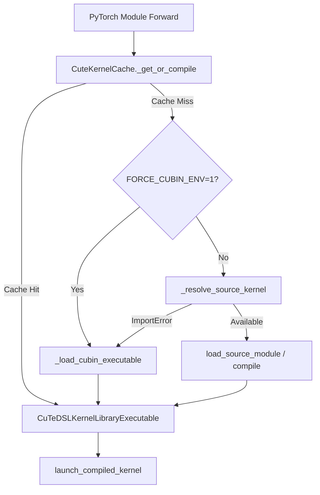

# Custom Fused Ops

Relevant source files

The following files were used as context for generating this wiki page:

- [bionemo_ir/_torch/custom_ops/__init__.py](bionemo_ir/_torch/custom_ops/__init__.py)
- [bionemo_ir/_torch/custom_ops/adaln_layernorm_sigmoid/_cubin.py](bionemo_ir/_torch/custom_ops/adaln_layernorm_sigmoid/_cubin.py)
- [bionemo_ir/_torch/custom_ops/adaln_layernorm_sigmoid/cutedsl.py](bionemo_ir/_torch/custom_ops/adaln_layernorm_sigmoid/cutedsl.py)
- [bionemo_ir/_torch/custom_ops/attn_epilogue/_config.py](bionemo_ir/_torch/custom_ops/attn_epilogue/_config.py)
- [bionemo_ir/_torch/custom_ops/attn_epilogue/configs/H4_D64_C256_sm80.json](bionemo_ir/_torch/custom_ops/attn_epilogue/configs/H4_D64_C256_sm80.json)
- [bionemo_ir/_torch/custom_ops/attn_epilogue/configs/H4_D64_C256_sm86.json](bionemo_ir/_torch/custom_ops/attn_epilogue/configs/H4_D64_C256_sm86.json)
- [bionemo_ir/_torch/custom_ops/attn_epilogue/configs/H4_D64_C256_sm89.json](bionemo_ir/_torch/custom_ops/attn_epilogue/configs/H4_D64_C256_sm89.json)
- [bionemo_ir/_torch/custom_ops/attn_epilogue/ops.py](bionemo_ir/_torch/custom_ops/attn_epilogue/ops.py)
- [bionemo_ir/_torch/custom_ops/dual_gemm_x0_x1/_config.py](bionemo_ir/_torch/custom_ops/dual_gemm_x0_x1/_config.py)
- [bionemo_ir/_torch/custom_ops/dual_gemm_x0_x1/_cubin.py](bionemo_ir/_torch/custom_ops/dual_gemm_x0_x1/_cubin.py)
- [bionemo_ir/_torch/custom_ops/dual_gemm_x0_x1/cutedsl.py](bionemo_ir/_torch/custom_ops/dual_gemm_x0_x1/cutedsl.py)
- [bionemo_ir/_torch/custom_ops/dual_gemm_x0_x1/ops.py](bionemo_ir/_torch/custom_ops/dual_gemm_x0_x1/ops.py)
- [bionemo_ir/_torch/custom_ops/dual_gemm_x_x/_config.py](bionemo_ir/_torch/custom_ops/dual_gemm_x_x/_config.py)
- [bionemo_ir/_torch/custom_ops/dual_gemm_x_x/_cubin.py](bionemo_ir/_torch/custom_ops/dual_gemm_x_x/_cubin.py)
- [bionemo_ir/_torch/custom_ops/dual_gemm_x_x/cutedsl.py](bionemo_ir/_torch/custom_ops/dual_gemm_x_x/cutedsl.py)
- [bionemo_ir/_torch/custom_ops/dual_gemm_x_x/ops.py](bionemo_ir/_torch/custom_ops/dual_gemm_x_x/ops.py)
- [bionemo_ir/_torch/custom_ops/fused_ln_proj_moveaxis_pad.py](bionemo_ir/_torch/custom_ops/fused_ln_proj_moveaxis_pad.py)
- [bionemo_ir/_torch/custom_ops/fused_masked_residual.py](bionemo_ir/_torch/custom_ops/fused_masked_residual.py)
- [bionemo_ir/_torch/custom_ops/fused_pair_injection.py](bionemo_ir/_torch/custom_ops/fused_pair_injection.py)
- [bionemo_ir/_torch/custom_ops/gated_sigmoid/_cubin.py](bionemo_ir/_torch/custom_ops/gated_sigmoid/_cubin.py)
- [bionemo_ir/_torch/custom_ops/pair_weighted_averaging/_cubin.py](bionemo_ir/_torch/custom_ops/pair_weighted_averaging/_cubin.py)
- [bionemo_ir/_torch/custom_ops/transition_mlp/_cubin.py](bionemo_ir/_torch/custom_ops/transition_mlp/_cubin.py)
- [bionemo_ir/_torch/custom_ops/transition_mlp/configs/W128_H512_sm86.json](bionemo_ir/_torch/custom_ops/transition_mlp/configs/W128_H512_sm86.json)
- [bionemo_ir/_torch/custom_ops/transition_mlp/configs/W128_H512_sm89.json](bionemo_ir/_torch/custom_ops/transition_mlp/configs/W128_H512_sm89.json)
- [bionemo_ir/_torch/custom_ops/transition_mlp/configs/W256_H1024_sm80.json](bionemo_ir/_torch/custom_ops/transition_mlp/configs/W256_H1024_sm80.json)
- [bionemo_ir/_torch/custom_ops/transition_mlp/configs/W256_H1024_sm86.json](bionemo_ir/_torch/custom_ops/transition_mlp/configs/W256_H1024_sm86.json)
- [bionemo_ir/_torch/custom_ops/transition_mlp/configs/W256_H1024_sm89.json](bionemo_ir/_torch/custom_ops/transition_mlp/configs/W256_H1024_sm89.json)
- [bionemo_ir/_torch/custom_ops/transition_mlp/configs/W256_H1024_sm90.json](bionemo_ir/_torch/custom_ops/transition_mlp/configs/W256_H1024_sm90.json)
- [bionemo_ir/_torch/custom_ops/transition_mlp/configs/W64_H128_sm80.json](bionemo_ir/_torch/custom_ops/transition_mlp/configs/W64_H128_sm80.json)
- [bionemo_ir/_torch/custom_ops/transition_mlp/configs/W64_H128_sm86.json](bionemo_ir/_torch/custom_ops/transition_mlp/configs/W64_H128_sm86.json)
- [bionemo_ir/_torch/custom_ops/transition_mlp/configs/W64_H128_sm89.json](bionemo_ir/_torch/custom_ops/transition_mlp/configs/W64_H128_sm89.json)
- [bionemo_ir/_torch/custom_ops/transition_mlp/configs/W64_H256_sm80.json](bionemo_ir/_torch/custom_ops/transition_mlp/configs/W64_H256_sm80.json)
- [bionemo_ir/_torch/custom_ops/transition_mlp/configs/W64_H256_sm86.json](bionemo_ir/_torch/custom_ops/transition_mlp/configs/W64_H256_sm86.json)
- [bionemo_ir/_torch/custom_ops/transition_mlp/configs/W64_H256_sm89.json](bionemo_ir/_torch/custom_ops/transition_mlp/configs/W64_H256_sm89.json)
- [bionemo_ir/_torch/custom_ops/trimul_kf_k1/configs/C384_D256_sm90.json](bionemo_ir/_torch/custom_ops/trimul_kf_k1/configs/C384_D256_sm90.json)
- [bionemo_ir/_torch/custom_ops/trimul_kf_k1/ops.py](bionemo_ir/_torch/custom_ops/trimul_kf_k1/ops.py)
- [bionemo_ir/_torch/custom_ops/trimul_kf_k3/configs/C384_D256_sm90.json](bionemo_ir/_torch/custom_ops/trimul_kf_k3/configs/C384_D256_sm90.json)
- [bionemo_ir/_torch/custom_ops/trimul_kf_k3/ops.py](bionemo_ir/_torch/custom_ops/trimul_kf_k3/ops.py)
- [bionemo_ir/_torch/graph_optimization/cuda_graph/memory.py](bionemo_ir/_torch/graph_optimization/cuda_graph/memory.py)
- [bionemo_ir/_torch/graph_optimization/tracker.py](bionemo_ir/_torch/graph_optimization/tracker.py)
- [bionemo_ir/_torch/layers/transformers/__init__.py](bionemo_ir/_torch/layers/transformers/__init__.py)
- [bionemo_ir/_torch/modules/boltz/trunk.py](bionemo_ir/_torch/modules/boltz/trunk.py)
- [cpp/kernels/cutedsl_attn_epilogue/launcher.cpp](cpp/kernels/cutedsl_attn_epilogue/launcher.cpp)
- [cpp/kernels/cutedsl_attn_epilogue/launcher.h](cpp/kernels/cutedsl_attn_epilogue/launcher.h)
- [cpp/kernels/cutedsl_dual_gemm_x0_x1/launcher.cpp](cpp/kernels/cutedsl_dual_gemm_x0_x1/launcher.cpp)
- [cpp/kernels/cutedsl_dual_gemm_x0_x1/launcher.h](cpp/kernels/cutedsl_dual_gemm_x0_x1/launcher.h)
- [cpp/kernels/cutedsl_dual_gemm_x_x/launcher.cpp](cpp/kernels/cutedsl_dual_gemm_x_x/launcher.cpp)
- [cpp/kernels/cutedsl_dual_gemm_x_x/launcher.h](cpp/kernels/cutedsl_dual_gemm_x_x/launcher.h)
- [cpp/kernels/cutedsl_trimul_kf_k1/launcher.cpp](cpp/kernels/cutedsl_trimul_kf_k1/launcher.cpp)
- [cpp/kernels/cutedsl_trimul_kf_k2/launcher.cpp](cpp/kernels/cutedsl_trimul_kf_k2/launcher.cpp)
- [cpp/kernels/cutedsl_trimul_kf_k2/launcher.h](cpp/kernels/cutedsl_trimul_kf_k2/launcher.h)
- [cpp/kernels/cutedsl_trimul_kf_k3/launcher.cpp](cpp/kernels/cutedsl_trimul_kf_k3/launcher.cpp)
- [tests/_torch/test_adaln_cutedsl.py](tests/_torch/test_adaln_cutedsl.py)
- [tests/ops/test_transition_mlp.py](tests/ops/test_transition_mlp.py)
- [tests/ops/test_trimul_kf.py](tests/ops/test_trimul_kf.py)
- [tests/ops/test_trimul_kf_variants.py](tests/ops/test_trimul_kf_variants.py)

## Purpose and Scope

The BioNeMo Inference Runtime (BioIR) utilizes a specialized set of GPU-accelerated fused operations implemented via CuTeDSL (CUTLASS Domain Specific Language) and Triton kernels. These operators optimize memory bandwidth and eliminate redundant global memory roundtrips in compute-intensive modules such as Evoformer, Pairformer, and attention epilogue layers. 

Python op wrappers coordinate device capability validation, configuration resolution, shared memory limit checks, and dynamic caching through base classes like `CuteKernelCache` [bionemo_ir/_torch/custom_ops/outer_product_mean/cutedsl.py:65](). When precompiled binary extensions are available, wrappers load embedded CUBIN executables directly via `populate_compiled_cache_from_library` [bionemo_ir/_torch/custom_ops/adaln_layernorm_sigmoid/cutedsl.py:102](); otherwise, they fall back to runtime source compilation or reference implementations.

For detailed information on the JSON configuration structures, per-N/per-K/per-SM tuning buckets, and parameter conventions, see [Custom Op Tuning Config Tables](#5.2.1).

Sources: `[bionemo_ir/_torch/custom_ops/outer_product_mean/cutedsl.py:65-167]()`, `[bionemo_ir/_torch/utils/kernel/_cutedsl_kernel_library.py:111-148]()`, `[bionemo_ir/_torch/custom_ops/adaln_layernorm_sigmoid/cutedsl.py:75-135]()`

---

## Fused Operator Families

### AdaLN LayerNorm Sigmoid (`adaln_layernorm_sigmoid`)
The `AdaLNLayerNormSigmoidCuTe` backend fuses adaptive layer normalization (or RMSNorm) with sigmoid gating [bionemo_ir/_torch/custom_ops/adaln_layernorm_sigmoid/cutedsl.py:55](). It validates dynamic shared memory requirements against device limits and supports both shipped CUBIN variants (`AdaLNLayerNormSigmoidCubinExecutable`) and JIT source compilation [bionemo_ir/_torch/custom_ops/adaln_layernorm_sigmoid/cutedsl.py:71-149](), [bionemo_ir/_torch/custom_ops/adaln_layernorm_sigmoid/_cubin.py:32]().

Sources: `[bionemo_ir/_torch/custom_ops/adaln_layernorm_sigmoid/cutedsl.py:55-149]()`, `[bionemo_ir/_torch/custom_ops/adaln_layernorm_sigmoid/_cubin.py:32-98]()`

### Gated Sigmoid (`gated_sigmoid`)
The `GatedSigmoidCuTe` class accelerates the operation $\text{sigmoid}(s W^T + \text{bias}) \odot \text{mha\_out}$ [bionemo_ir/_torch/custom_ops/gated_sigmoid/cutedsl.py:77](). It selects tile parameters across $M$, $N$, and $K$ dimensions from structured configuration bundles [bionemo_ir/_torch/custom_ops/gated_sigmoid/cutedsl.py:102-136]().

Sources: `[bionemo_ir/_torch/custom_ops/gated_sigmoid/cutedsl.py:77-136]()`

### Dual GEMM Variants (`dual_gemm_x_x` and `dual_gemm_x0_x1`)
`DualGemmXxCuTe` and `DualGemmX0X1CuTe` execute coupled matrix multiplications simultaneously to minimize scheduling overhead [bionemo_ir/_torch/custom_ops/dual_gemm_x_x/cutedsl.py:76](), [bionemo_ir/_torch/custom_ops/dual_gemm_x0_x1/cutedsl.py:87](). They automatically branch between architecture-specific calling conventions based on device capability and tensor dimensions.

Sources: `[bionemo_ir/_torch/custom_ops/dual_gemm_x_x/cutedsl.py:76-120]()`, `[bionemo_ir/_torch/custom_ops/dual_gemm_x0_x1/cutedsl.py:87-140]()`

### Trimul KF Chain (`trimul_kf_k1`, `trimul_kf_k2`, `trimul_kf_k3`)
The SM90 TriMul KF custom op chain executes a three-stage sequence (`K1`, `K2`, `K3`) for triangle multiplication blocks [tests/ops/test_trimul_kf.py:15](). `TrimulKFK1CuTe` folds input layer normalization and projects representations [bionemo_ir/_torch/custom_ops/trimul_kf_k1/ops.py:16](), `TrimulKFK2CuTe` computes the pairwise contraction product utilizing Tensor Memory Accelerator (TMA) asynchronous copies, and `TrimulKFK3CuTe` applies output projections and residual updates [bionemo_ir/_torch/custom_ops/trimul_kf_k3/ops.py:15]().

Sources: `[tests/ops/test_trimul_kf.py:15-45]`, `[bionemo_ir/_torch/custom_ops/trimul_kf_k1/ops.py:16-120]`, `[bionemo_ir/_torch/custom_ops/trimul_kf_k3/ops.py:15-115]`

### Outer Product Mean & Pair-Weighted Averaging
`OuterProductMeanCuTe` computes outer product mean projections over sequence representations without materializing large intermediate tensors in global memory [bionemo_ir/_torch/custom_ops/outer_product_mean/cutedsl.py:65](). Similarly, `PairWeightedAveragingCuTe` handles fused pair-weighted averaging operations by querying configuration buckets based on sequence dimensions $I$, $J$, and channel width $D$ [bionemo_ir/_torch/custom_ops/pair_weighted_averaging/cutedsl.py:69]().

Sources: `[bionemo_ir/_torch/custom_ops/outer_product_mean/cutedsl.py:65-140]()`, `[bionemo_ir/_torch/custom_ops/pair_weighted_averaging/cutedsl.py:69-180]()`

### Transition MLP and Attention Epilogue
The `transition_mlp` and `attn_epilogue` custom op families provide specialized Hopper (`SM90`) and Ampere optimized pathways. `attn_epilogue` fuses attention output transformations with scaling and bias terms, while `transition_mlp` combines channel-mixing layers and activation functions with embedded cubin execution paths.

Sources: `[bionemo_ir/_torch/custom_ops/transition_mlp/_cubin.py:1-40]()`, `[bionemo_ir/_torch/custom_ops/attn_epilogue/ops.py:1-50]()`

---

## Code Entity Hierarchy

```mermaid
graph TD
    Base[""CuteKernelCache""] --> OPM[""OuterProductMeanCuTe""]
    Base --> DXX[""DualGemmXxCuTe""]
    Base --> DX0X1[""DualGemmX0X1CuTe""]
    Base --> GS[""GatedSigmoidCuTe""]
    Base --> PWA[""PairWeightedAveragingCuTe""]
    Base --> ALN[""AdaLNLayerNormSigmoidCuTe""]
    Base --> K1[""TrimulKFK1CuTe""]
    Base --> K2[""TrimulKFK2CuTe""]
    Base --> K3[""TrimulKFK3CuTe""]
    OPM --> OPMCubin[""OuterProductMeanCubinExecutable""]
    DXX --> DXXCubin[""DualGemmXxCubinExecutable""]
    DX0X1 --> DX0X1Cubin[""DualGemmX0X1CubinExecutable""]
    GS --> GSCubin[""GatedSigmoidCubinExecutable""]
    PWA --> PWACubin[""PairWeightedAveragingCubinExecutable""]
    ALN --> ALNCubin[""AdaLNLayerNormSigmoidCubinExecutable""]
    K1 --> K1Cubin[""TrimulKFK1CubinExecutable""]
    K2 --> K2Cubin[""TrimulKFK2CubinExecutable""]
    K3 --> K3Cubin[""TrimulKFK3CubinExecutable""]
```

Sources: `[bionemo_ir/_torch/custom_ops/outer_product_mean/cutedsl.py:65]`, `[bionemo_ir/_torch/custom_ops/dual_gemm_x_x/cutedsl.py:76]`, `[bionemo_ir/_torch/custom_ops/dual_gemm_x0_x1/cutedsl.py:87]`, `[bionemo_ir/_torch/custom_ops/gated_sigmoid/cutedsl.py:77]`, `[bionemo_ir/_torch/custom_ops/pair_weighted_averaging/cutedsl.py:69]`, `[bionemo_ir/_torch/custom_ops/adaln_layernorm_sigmoid/cutedsl.py:55]`, `[bionemo_ir/_torch/custom_ops/trimul_kf_k1/cutedsl.py:24]`

---

## Related Documentation
- For detailed tuning configurations, see [Custom Op Tuning Config Tables](#5.2.1).

---