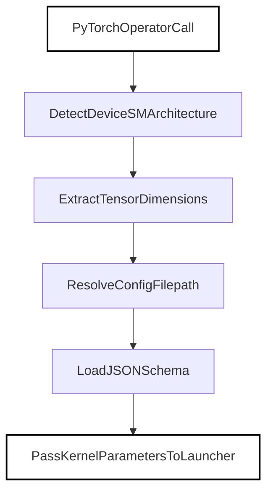
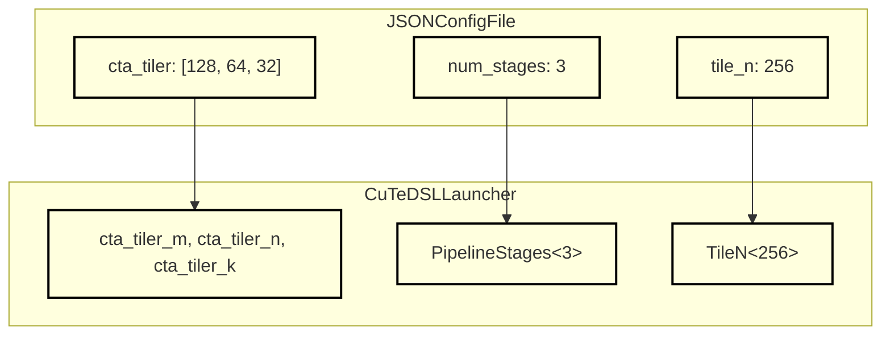

# Custom Op Tuning Config Tables

<details>
<summary>Relevant source files</summary>

The following files were used as context for generating this wiki page:

- [bionemo_ir/_torch/custom_ops/adaln_layernorm_sigmoid/_config.py](bionemo_ir/_torch/custom_ops/adaln_layernorm_sigmoid/_config.py)
- [bionemo_ir/_torch/custom_ops/adaln_layernorm_sigmoid/configs/N1024_sm100.json](bionemo_ir/_torch/custom_ops/adaln_layernorm_sigmoid/configs/N1024_sm100.json)
- [bionemo_ir/_torch/custom_ops/adaln_layernorm_sigmoid/configs/N1024_sm103.json](bionemo_ir/_torch/custom_ops/adaln_layernorm_sigmoid/configs/N1024_sm103.json)
- [bionemo_ir/_torch/custom_ops/adaln_layernorm_sigmoid/configs/N1024_sm120.json](bionemo_ir/_torch/custom_ops/adaln_layernorm_sigmoid/configs/N1024_sm120.json)
- [bionemo_ir/_torch/custom_ops/adaln_layernorm_sigmoid/configs/N1024_sm121.json](bionemo_ir/_torch/custom_ops/adaln_layernorm_sigmoid/configs/N1024_sm121.json)
- [bionemo_ir/_torch/custom_ops/adaln_layernorm_sigmoid/configs/N128_sm100.json](bionemo_ir/_torch/custom_ops/adaln_layernorm_sigmoid/configs/N128_sm100.json)
- [bionemo_ir/_torch/custom_ops/adaln_layernorm_sigmoid/configs/N128_sm103.json](bionemo_ir/_torch/custom_ops/adaln_layernorm_sigmoid/configs/N128_sm103.json)
- [bionemo_ir/_torch/custom_ops/adaln_layernorm_sigmoid/configs/N128_sm120.json](bionemo_ir/_torch/custom_ops/adaln_layernorm_sigmoid/configs/N128_sm120.json)
- [bionemo_ir/_torch/custom_ops/adaln_layernorm_sigmoid/configs/N128_sm121.json](bionemo_ir/_torch/custom_ops/adaln_layernorm_sigmoid/configs/N128_sm121.json)
- [bionemo_ir/_torch/custom_ops/adaln_layernorm_sigmoid/configs/N256_sm100.json](bionemo_ir/_torch/custom_ops/adaln_layernorm_sigmoid/configs/N256_sm100.json)
- [bionemo_ir/_torch/custom_ops/adaln_layernorm_sigmoid/configs/N256_sm103.json](bionemo_ir/_torch/custom_ops/adaln_layernorm_sigmoid/configs/N256_sm103.json)
- [bionemo_ir/_torch/custom_ops/outer_product_mean/_config.py](bionemo_ir/_torch/custom_ops/outer_product_mean/_config.py)
- [bionemo_ir/_torch/custom_ops/outer_product_mean/configs/sm90.json](bionemo_ir/_torch/custom_ops/outer_product_mean/configs/sm90.json)
- [bionemo_ir/_torch/custom_ops/outer_product_mean/cutedsl.py](bionemo_ir/_torch/custom_ops/outer_product_mean/cutedsl.py)
- [bionemo_ir/_torch/custom_ops/outer_product_mean/ops.py](bionemo_ir/_torch/custom_ops/outer_product_mean/ops.py)
- [bionemo_ir/_torch/custom_ops/trimul_kf_k1/__init__.py](bionemo_ir/_torch/custom_ops/trimul_kf_k1/__init__.py)
- [bionemo_ir/_torch/custom_ops/trimul_kf_k1/_config.py](bionemo_ir/_torch/custom_ops/trimul_kf_k1/_config.py)
- [bionemo_ir/_torch/custom_ops/trimul_kf_k1/_cubin.py](bionemo_ir/_torch/custom_ops/trimul_kf_k1/_cubin.py)
- [bionemo_ir/_torch/custom_ops/trimul_kf_k1/configs/C128_D128_sm90.json](bionemo_ir/_torch/custom_ops/trimul_kf_k1/configs/C128_D128_sm90.json)
- [bionemo_ir/_torch/custom_ops/trimul_kf_k1/configs/C256_D256_sm90.json](bionemo_ir/_torch/custom_ops/trimul_kf_k1/configs/C256_D256_sm90.json)
- [bionemo_ir/_torch/custom_ops/trimul_kf_k1/configs/C32_D32_sm90.json](bionemo_ir/_torch/custom_ops/trimul_kf_k1/configs/C32_D32_sm90.json)
- [bionemo_ir/_torch/custom_ops/trimul_kf_k1/configs/C64_D64_sm90.json](bionemo_ir/_torch/custom_ops/trimul_kf_k1/configs/C64_D64_sm90.json)
- [bionemo_ir/_torch/custom_ops/trimul_kf_k1/cutedsl.py](bionemo_ir/_torch/custom_ops/trimul_kf_k1/cutedsl.py)
- [bionemo_ir/_torch/custom_ops/trimul_kf_k2/_config.py](bionemo_ir/_torch/custom_ops/trimul_kf_k2/_config.py)
- [bionemo_ir/_torch/custom_ops/trimul_kf_k2/_cubin.py](bionemo_ir/_torch/custom_ops/trimul_kf_k2/_cubin.py)
- [bionemo_ir/_torch/custom_ops/trimul_kf_k2/configs/D128_sm90.json](bionemo_ir/_torch/custom_ops/trimul_kf_k2/configs/D128_sm90.json)
- [bionemo_ir/_torch/custom_ops/trimul_kf_k2/configs/D256_sm90.json](bionemo_ir/_torch/custom_ops/trimul_kf_k2/configs/D256_sm90.json)
- [bionemo_ir/_torch/custom_ops/trimul_kf_k2/cutedsl.py](bionemo_ir/_torch/custom_ops/trimul_kf_k2/cutedsl.py)
- [bionemo_ir/_torch/custom_ops/trimul_kf_k2/ops.py](bionemo_ir/_torch/custom_ops/trimul_kf_k2/ops.py)
- [bionemo_ir/_torch/layers/outer_product_mean.py](bionemo_ir/_torch/layers/outer_product_mean.py)
- [bionemo_ir/dsl_kernels/triton/dense_outer_product.py](bionemo_ir/dsl_kernels/triton/dense_outer_product.py)
- [cpp/kernels/cutedsl_outer_product_mean/bindings.cpp](cpp/kernels/cutedsl_outer_product_mean/bindings.cpp)

</details>


## Purpose and Scope
This page details the structure, organization, and conventions of the JSON tuning configuration files used by the GPU custom fused operations in the BioNeMo Inference Runtime (BioIR) [bionemo_ir/_torch/custom_ops/pair_weighted_averaging/configs/D32_cm64_sm100.json:1-10](). These configuration files store hardware-specific block shapes, tile sizes, pipeline stages, and atom layouts tailored for specific NVIDIA Streaming Multiprocessor (SM) architectures (`sm80`, `sm86`, `sm89`, `sm90`, `sm100`, `sm103`) [bionemo_ir/_torch/custom_ops/pair_weighted_averaging/configs/D32_cm64_sm80.json:1-3]().

---

## 1. Directory Layout and File Naming Conventions

Each custom operator maintains a dedicated `configs/` directory within its module path under `bionemo_ir/_torch/custom_ops/`. Filenames incorporate dimensional attributes and target architecture tokens to enable fast runtime resolution based on input tensor shapes and the active GPU's compute capability.

```
bionemo_ir/_torch/custom_ops/
├── adaln_layernorm_sigmoid/configs/
│   ├── N128_sm80.json
│   ├── N256_sm90.json
│   └── N512_sm103.json
├── gated_sigmoid/configs/
│   ├── K64_N256_sm90.json
│   └── K256_N256_sm89.json
├── dual_gemm_x0_x1/configs/
│   └── K256_N256_sm80.json
├── trimul_kf_k1/configs/
│   ├── C128_D128_sm90.json
│   └── C64_D64_sm90.json
├── trimul_kf_k2/configs/
│   ├── D128_sm90.json
│   └── D256_sm90.json
└── pair_weighted_averaging/configs/
    ├── D32_cm64_sm80.json
    └── D32_cm64_sm100.json
```

### Architectural Mapping & Resolution Flow


*Sources: [bionemo_ir/_torch/custom_ops/pair_weighted_averaging/configs/D32_cm64_sm100.json:1-8](), [bionemo_ir/_torch/custom_ops/adaln_layernorm_sigmoid/configs/N128_sm103.json:1-9]()*

---

## 2. Config Schema Structures by Operator Family

### 2.1. AdaLN / LayerNorm Sigmoid
AdaLN operators use vector-length-based configuration files where keys represent feature dimension thresholds or exact feature sizes (`N`), mapping to thread-override policies [bionemo_ir/_torch/custom_ops/adaln_layernorm_sigmoid/configs/N128_sm103.json:1-9]().

```json
{
  "kernel_abi": "sm80",
  "configs": {
    "0": {
      "num_threads_override": 256
    },
    "257": {}
  }
}
```
*Sources: [bionemo_ir/_torch/custom_ops/adaln_layernorm_sigmoid/configs/N128_sm103.json:1-9](), [bionemo_ir/_torch/custom_ops/adaln_layernorm_sigmoid/configs/N256_sm90.json:1-9]()*

### 2.2. Gated Sigmoid and Dual GEMM (`x_x`, `x0_x1`)
GEMM-based custom ops index configurations by sequence length buckets (`S=...`) or block dimensions (`K`, `N`) [bionemo_ir/_torch/custom_ops/dual_gemm_x0_x1/configs/K256_N256_sm80.json:1-17](), [bionemo_ir/_torch/custom_ops/gated_sigmoid/configs/K64_N256_sm90.json:1-15](). Each entry specifies CTA tiling, pipelining stages, atom layouts, and rasterization factors.

```json
{
  "kernel_abi": "sm80",
  "configs": {
    "S=128|b=0": {
      "cta_tiler": [128, 64, 32],
      "num_stages": 3,
      "atom_layout_mnk": [4, 2, 1],
      "raster_factor": 2
    }
  }
}
```
*Sources: [bionemo_ir/_torch/custom_ops/dual_gemm_x0_x1/configs/K256_N256_sm80.json:1-17](), [bionemo_ir/_torch/custom_ops/gated_sigmoid/configs/K64_N256_sm90.json:1-15]()*

### 2.3. Trimul KF Chains (`trimul_kf_k1`, `trimul_kf_k2`)
Triangle multiplication kernel chains specify inputs/outputs via sequence anchors (`S=<anchor>`) mapping to specific `kernel_variant` selections (e.g., `K1_0`, `K1_1`, `K1_2`, `K2_0`, `K2_1`, `K2_2`), layout modifiers (`ab_layout`), tile sizes (`tile_n`), cluster metrics (`cluster_m`), and dynamic work counters [bionemo_ir/_torch/custom_ops/trimul_kf_k1/configs/C128_D128_sm90.json:1-8](), [bionemo_ir/_torch/custom_ops/trimul_kf_k2/configs/D256_sm90.json:1-44]().

```json
{
  "kernel_abi": "sm90",
  "configs": {
    "S=128": {
      "out": [
        {"kernel_variant": "K2_0", "tile_n": 224, "cluster_m": 2, "defer_kmin": 3, "split_epi": true, "dynamic": true},
        {"kernel_variant": "K2_1", "tile_n": 128}
      ],
      "in": [
        {"kernel_variant": "K2_0", "tile_n": 256, "cluster_m": 2, "defer_kmin": 4, "split_epi": true, "dynamic": true}
      ]
    }
  }
}
```
*Sources: [bionemo_ir/_torch/custom_ops/trimul_kf_k1/configs/C128_D128_sm90.json:1-8](), [bionemo_ir/_torch/custom_ops/trimul_kf_k2/configs/D256_sm90.json:1-44]()*

### 2.4. Pair Weighted Averaging & Outer Product Mean
Complex tensor contraction ops define explicit dimensional headers (`H`, `D`, `c_m`) alongside performance metrics (`tf_s`, `speedup_vs_eager`) and fine-grained tile parameters (`TILE_I`, `TILE_S`, `TILE_J`, `KO_TILE`) [bionemo_ir/_torch/custom_ops/pair_weighted_averaging/configs/D32_cm64_sm100.json:1-37]().

```json
{
  "kernel_abi": "sm80",
  "dims": {
    "H": 8,
    "D": 32,
    "c_m": 64
  },
  "configs": {
    "N=256|S=512|dt=bf16": {
      "label": "TS2 TI32 TJ64 ns3 nsw4 KO32",
      "tf_s": 65.2,
      "speedup_vs_eager": 3.348,
      "params": {
        "ab_dtype": "bf16",
        "H": 8,
        "D": 32,
        "c_m": 64,
        "TILE_I": 32,
        "TILE_S": 2,
        "TILE_J": 64,
        "KO_TILE": 32,
        "num_threads": 64,
        "atom_v": [2, 1, 1],
        "atom_p": [1, 2, 1],
        "num_stages": 3,
        "num_stages_w": 4,
        "swizzle": true
      }
    }
  }
}
```
*Sources: [bionemo_ir/_torch/custom_ops/pair_weighted_averaging/configs/D32_cm64_sm100.json:1-37](), [bionemo_ir/_torch/custom_ops/pair_weighted_averaging/configs/D32_cm64_sm80.json:1-38]()*

---

## 3. Parameter Field Definitions

The tuning parameters encapsulated within the JSON files map directly to CuTeDSL template arguments and hardware execution configurations:

| Parameter Name | Target Entity / Scope | Description |
| :--- | :--- | :--- |
| `kernel_abi` | Global / File Header | Target minimum CUDA ABI baseline (e.g., `"sm80"`, `"sm90"`) [bionemo_ir/_torch/custom_ops/pair_weighted_averaging/configs/D32_cm64_sm100.json:2-2](), [bionemo_ir/_torch/custom_ops/trimul_kf_k2/configs/D256_sm90.json:2-2]() |
| `dims` | Header Block | Core tensor channel and dimension metadata (`H`, `D`, `c_m`) [bionemo_ir/_torch/custom_ops/pair_weighted_averaging/configs/D32_cm64_sm100.json:3-7]() |
| `kernel_variant` | Trimul KF Chains | Specific variant version of K1/K2 kernels (e.g., `K1_0`, `K2_0`) [bionemo_ir/_torch/custom_ops/trimul_kf_k1/configs/C128_D128_sm90.json:4-4](), [bionemo_ir/_torch/custom_ops/trimul_kf_k2/configs/D256_sm90.json:6-6]() |
| `tile_n` / `tile_k` | Trimul KF / GEMM | Tile sizes along the N and K contraction dimensions [bionemo_ir/_torch/custom_ops/trimul_kf_k2/configs/D256_sm90.json:6-6]() |
| `cluster_m` | Trimul KF K2 | CTA cluster size along the M dimension sharing operand blocks [bionemo_ir/_torch/custom_ops/trimul_kf_k2/configs/D256_sm90.json:6-6]() |
| `defer_kmin` | Trimul KF K2 | Pipeline scheduling optimization delay parameter for K-reduction loops [bionemo_ir/_torch/custom_ops/trimul_kf_k2/configs/D256_sm90.json:6-6]() |
| `split_epi` | Trimul KF K2 | Boolean flag controlling epilogue stage work splitting [bionemo_ir/_torch/custom_ops/trimul_kf_k2/configs/D256_sm90.json:6-6]() |
| `dynamic` | Trimul KF K2 | Enables dynamic counter-based work scheduling across CTAs [bionemo_ir/_torch/custom_ops/trimul_kf_k2/configs/D256_sm90.json:6-6]() |
| `cta_tiler` | GEMM / Dual GEMM | Cooperative Thread Array (CTA) tile dimensions `[M, N, K]` [bionemo_ir/_torch/custom_ops/dual_gemm_x0_x1/configs/K256_N256_sm80.json:5-9]() |
| `atom_layout_mnk` | GEMM / Attention | Thread block atom layout distribution across M, N, and K dimensions [bionemo_ir/_torch/custom_ops/gated_sigmoid/configs/K64_N256_sm90.json:9-13]() |
| `num_stages` | Pipeline Architecture | Number of software pipelining stages for asynchronous global-to-shared memory copies [bionemo_ir/_torch/custom_ops/dual_gemm_x0_x1/configs/K256_N256_sm80.json:10-10]() |
| `raster_factor` | Scheduler | L2 cache persistence and cluster-level task rasterization scheduling factor [bionemo_ir/_torch/custom_ops/dual_gemm_x0_x1/configs/K256_N256_sm80.json:16-16]() |
| `TILE_I` / `TILE_J` / `TILE_S` | Pairwise Ops | Iteration space tile dimensions for token and pair channels [bionemo_ir/_torch/custom_ops/pair_weighted_averaging/configs/D32_cm64_sm100.json:19-22]() |
| `swizzle` | Shared Memory | Boolean flag enabling shared memory bank conflict avoidance swizzling [bionemo_ir/_torch/custom_ops/pair_weighted_averaging/configs/D32_cm64_sm100.json:36-36]() |

### Parameter to Code Mapping


*Sources: [bionemo_ir/_torch/custom_ops/dual_gemm_x0_x1/configs/K256_N256_sm80.json:5-15](), [bionemo_ir/_torch/custom_ops/trimul_kf_k2/configs/D256_sm90.json:1-10]()*

---

## Sources
- [bionemo_ir/_torch/custom_ops/pair_weighted_averaging/configs/D32_cm64_sm100.json]()
- [bionemo_ir/_torch/custom_ops/pair_weighted_averaging/configs/D32_cm64_sm80.json]()
- [bionemo_ir/_torch/custom_ops/adaln_layernorm_sigmoid/configs/N128_sm103.json]()
- [bionemo_ir/_torch/custom_ops/adaln_layernorm_sigmoid/configs/N256_sm90.json]()
- [bionemo_ir/_torch/custom_ops/dual_gemm_x0_x1/configs/K256_N256_sm80.json]()
- [bionemo_ir/_torch/custom_ops/gated_sigmoid/configs/K64_N256_sm90.json]()
- [bionemo_ir/_torch/custom_ops/trimul_kf_k1/configs/C128_D128_sm90.json]()
- [bionemo_ir/_torch/custom_ops/trimul_kf_k2/configs/D256_sm90.json]()

---