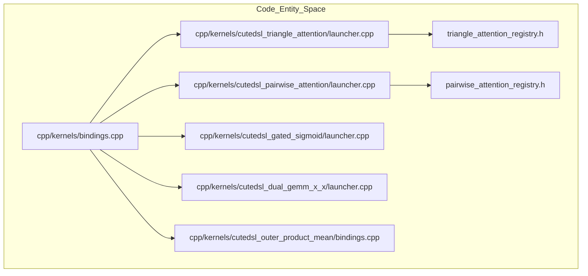
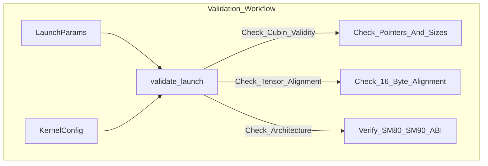
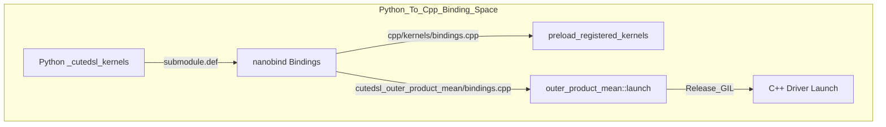

# C++ CuTeDSL Launchers and Bindings

Relevant source files

The following files were used as context for generating this wiki page:

- [THIRD_PARTY_NOTICES.md](THIRD_PARTY_NOTICES.md)
- [bionemo_ir/_torch/attention_backend/pairwise_attention/_cubin.py](bionemo_ir/_torch/attention_backend/pairwise_attention/_cubin.py)
- [bionemo_ir/_torch/attention_backend/pairwise_attention/cutedsl.py](bionemo_ir/_torch/attention_backend/pairwise_attention/cutedsl.py)
- [bionemo_ir/_torch/attention_backend/triangle_attention/_cubin.py](bionemo_ir/_torch/attention_backend/triangle_attention/_cubin.py)
- [bionemo_ir/_torch/custom_ops/outer_product_mean/_cubin.py](bionemo_ir/_torch/custom_ops/outer_product_mean/_cubin.py)
- [bionemo_ir/_torch/utils/kernel/__init__.py](bionemo_ir/_torch/utils/kernel/__init__.py)
- [bionemo_ir/_torch/utils/kernel/_cutedsl_kernel_library.py](bionemo_ir/_torch/utils/kernel/_cutedsl_kernel_library.py)
- [cpp/CMakeLists.txt](cpp/CMakeLists.txt)
- [cpp/kernels/CMakeLists.txt](cpp/kernels/CMakeLists.txt)
- [cpp/kernels/bindings.cpp](cpp/kernels/bindings.cpp)
- [cpp/kernels/cutedsl_launch_utils.h](cpp/kernels/cutedsl_launch_utils.h)
- [cpp/kernels/cutedsl_outer_product_mean/launcher.cpp](cpp/kernels/cutedsl_outer_product_mean/launcher.cpp)
- [cpp/kernels/cutedsl_outer_product_mean/launcher.h](cpp/kernels/cutedsl_outer_product_mean/launcher.h)
- [cpp/kernels/cutedsl_pairwise_attention/launcher.cpp](cpp/kernels/cutedsl_pairwise_attention/launcher.cpp)
- [docker/Dockerfile](docker/Dockerfile)
- [docs/dev.md](docs/dev.md)
- [pyproject.toml](pyproject.toml)
- [scripts/ci/contract.sh](scripts/ci/contract.sh)
- [setup.py](setup.py)
- [tests/_torch/test_cutedsl_kernel_library.py](tests/_torch/test_cutedsl_kernel_library.py)
- [tests/_torch/test_outer_product_mean.py](tests/_torch/test_outer_product_mean.py)
- [tests/_torch/test_pairwise_attention_cutedsl.py](tests/_torch/test_pairwise_attention_cutedsl.py)
- [tests/contract/test_build_contract.py](tests/contract/test_build_contract.py)
- [tests/contract/test_launcher_free.py](tests/contract/test_launcher_free.py)
- [uv.lock](uv.lock)

The `cpp/kernels/` directory houses the C++ and CUDA Driver runtime infrastructure for BioNeMo Inference Runtime (BioIR) custom CuTeDSL kernels. This subsystem provides zero-overhead host launchers, argument packaging, configuration resolution, tensor metadata validation, SM80 (Ampere) and SM90 (Hopper) target dispatch, TMA (Tensor Memory Accelerator) descriptor construction, and `nanobind`-based Python bindings. 

This page provides a high-level overview of the C++ launcher architecture. For details on how precompiled cubin tarballs are packed, indexed, and materialized, see [Embedded Cubin Packs and the Kernel Registry](#5.3.1).

Sources: `[cpp/kernels/bindings.cpp:1-40](), [cpp/kernels/cutedsl_launch_utils.h:1-30]()`

---

## 1. Launcher Architecture and Directory Structure

Each fused kernel family maintains a dedicated subdirectory under `cpp/kernels/` containing a `launcher.h`, `launcher.cpp`, a bindings file, and a generated registry header. These components bridge high-level PyTorch tensor structures with low-level CUDA driver API launches (`cuLaunchKernel`).

Sources: `[cpp/kernels/bindings.cpp:1-160](), [cpp/kernels/cutedsl_triangle_attention/launcher.cpp:1-40](), [cpp/kernels/cutedsl_outer_product_mean/bindings.cpp:1-68]()`

---

## 2. Configuration Resolution and Validation

Launch configurations are validated prior to execution to ensure tensor alignment, correct device placement, and compatibility between the compiled CUBIN variant and runtime dimensions. The validation functions ensure that pointers are non-null, strides and shapes adhere to constraints, and target SM capabilities match runtime expectations.

Sources: `[cpp/kernels/cutedsl_triangle_attention/launcher.cpp:42-125](), [cpp/kernels/cutedsl_gated_sigmoid/launcher.cpp:37-89]()`

---

## 3. SM80 and SM90 Target Dispatch

The launchers handle architecture-specific dispatch depending on whether the target GPU is based on the NVIDIA Ampere (`sm_80`) or Hopper (`sm_90a`) architecture. For Hopper kernels, launch configurations compute persistent grid sizes, tile bounds, and rasterization factors using dedicated setup routines.

Sources: `[cpp/kernels/cutedsl_triangle_attention/launcher.cpp:127-158](), [cpp/kernels/cutedsl_pairwise_attention/launcher.cpp:126-160]()`

---

## 4. TMA Descriptors and Kernel Parameters

For Hopper (`sm_90a`) kernels utilizing hardware-accelerated asynchronous copy engines, the host encodes Tensor Memory Accelerator (`CUtensorMap`) descriptors. These descriptors, along with coordinate mappings, are passed directly into the kernel parameter block. Static asserts verify descriptor struct sizes and alignments.

Sources: `[cpp/kernels/cutedsl_triangle_attention/launcher.h:109-160]()`

---

## 5. Nanobind Python Bindings

The extension module `_cutedsl_kernels` is exposed to Python via `nanobind` in `cpp/kernels/bindings.cpp`. Each kernel family defines its own submodule (e.g., `triangle_attention`, `outer_product_mean`), registering enums like `DType`, spec classes, launch parameter structs, and GIL-releasing launch wrappers.

Sources: `[cpp/kernels/bindings.cpp:1-160](), [cpp/kernels/cutedsl_outer_product_mean/bindings.cpp:67-132]()`

---

## 6. Embedded Cubins and Kernel Registry

Precompiled binaries are embedded directly into the compiled library. 

For complete details on how cubin tarballs are packed, indexed via `index.json`, materialized at build time, and preloaded at runtime, see [Embedded Cubin Packs and the Kernel Registry](#5.3.1).

Sources: `[cpp/kernels/bindings.cpp:142-150]()`

---