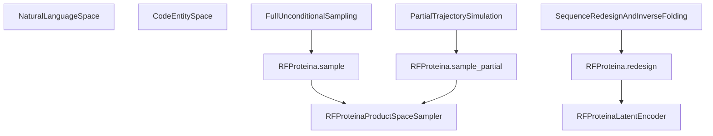
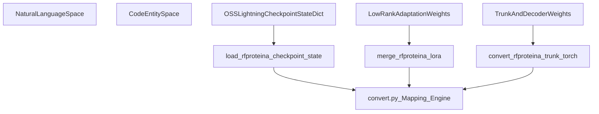

# RFProteina Model and Product-Space Flow Matching

Relevant source files

The following files were used as context for generating this wiki page:

- [bionemo_ir/models/rfproteina/__init__.py](bionemo_ir/models/rfproteina/__init__.py)
- [bionemo_ir/models/rfproteina/convert.py](bionemo_ir/models/rfproteina/convert.py)
- [bionemo_ir/models/rfproteina/modeling.py](bionemo_ir/models/rfproteina/modeling.py)
- [scripts/fetch_weights.sh](scripts/fetch_weights.sh)
- [tests/_torch/test_rfd4_beam_search.py](tests/_torch/test_rfd4_beam_search.py)
- [tests/_torch/test_rfd4_modules.py](tests/_torch/test_rfd4_modules.py)
- [tests/_torch/test_rfd4_sampling.py](tests/_torch/test_rfd4_sampling.py)

## Purpose and Scope

This page covers the technical architecture, generative entrypoints, weight conversion workflows, configuration inference utilities, and CUDA graph optimizations for the **RFProteina** model family within BioNeMo Inference Runtime (BioIR). RFProteina implements product-space flow matching for generative protein design, supporting full and partial sampling, redesign, and inverse folding tasks.

Sources:
- `bionemo_ir/models/rfproteina/modeling.py:1-115` [bionemo_ir/models/rfproteina/modeling.py:1-115]()
- `bionemo_ir/models/rfproteina/convert.py:1-42` [bionemo_ir/models/rfproteina/convert.py:1-42]()

---

## 1. Modeling Entrypoints: Sample, Sample Partial, Redesign, and Inverse Fold

The `RFProteina` class serves as the primary PyTorch module implementing generative workflows [bionemo_ir/models/rfproteina/modeling.py:111-1695](). It integrates representation building, the trunk transformer network, autoencoder components, and product-space samplers.

### Key Generative Contract Methods

- **`sample()`**: Performs unconditional or motif-conditioned product-space flow matching over backbone coordinates and local latents. Driven by `RFProteinaProductSpaceSampler` [bionemo_ir/models/rfproteina/modeling.py:46]().
- **`sample_partial()`**: Initiates diffusion or flow matching from a partially specified trajectory step or custom time state using `RFProteinaPartialSimulationConfig` [bionemo_ir/models/rfproteina/modeling.py:88]().
- **`redesign()` / `inverse_fold()`**: Executes sequence design tasks over fixed or flexible backbone frames, resolving unindexed tokens and handling nucleic acid or atomized chemical constraints [bionemo_ir/models/rfproteina/modeling.py:33-65]().

*Diagram 1: Natural Language generative workflows mapped to `RFProteina` methods and samplers.*

Sources:
- `bionemo_ir/models/rfproteina/modeling.py:32-79` [bionemo_ir/models/rfproteina/modeling.py:32-79]()
- `bionemo_ir/models/rfproteina/modeling.py:111-1696` [bionemo_ir/models/rfproteina/modeling.py:111-1695]()

---

## 2. Weight Conversion and LoRA Merging

RFProteina checkpoints released as Lightning or OSS state dicts store weights under an `nn.` prefix representing the score network [bionemo_ir/models/rfproteina/convert.py:16-18](). Conversion is a forward mapping process that reads known source keys and writes TRT-BNM parameter names based on component configurations (`RFProteinaTrunkConfig`, `RFProteinaEncoderConfig`, `RFProteinaDecoderConfig`) [bionemo_ir/models/rfproteina/convert.py:18-20]().

### Major Parameter Remaps and Fusions

1. **Adaptive LayerNorm (`AdaptiveLayerNorm`)**: Mapped to shared `AdaLN`, fusing `to_gamma` and `to_beta` into `fused_s_scale_s_bias` [bionemo_ir/models/rfproteina/convert.py:25-27,128-145]().
2. **Attention Mechanisms**: OSS `PairBiasAttention` mapped to `AttentionPairBias` with fused `to_qkv` and gate projections (`to_g`) packed into `in_proj` (`[q; g; k; v]`) [bionemo_ir/models/rfproteina/convert.py:28-31,156-174]().
3. **Transitions**: `Transition` layers mapped to shared `Transition` modules using `fused_fc2_fc1` and `fc3` [bionemo_ir/models/rfproteina/convert.py:32-33]().
4. **LoRA Merging**: Low-Rank Adaptation weights are fused directly into checkpoint parameters via `merge_rfproteina_lora()` using scaling factors such as `RELEASED_LORA_ALPHA` [bionemo_ir/models/rfproteina/convert.py:85]().

*Diagram 2: Checkpoint loading, LoRA merging, and torch weight conversion data flow.*

Sources:
- `bionemo_ir/models/rfproteina/convert.py:15-42` [bionemo_ir/models/rfproteina/convert.py:15-42]()
- `bionemo_ir/models/rfproteina/convert.py:128-174` [bionemo_ir/models/rfproteina/convert.py:128-174]()
- `scripts/fetch_weights.sh:90-91` [scripts/fetch_weights.sh:90-91]()

---

## 3. Autoencoder and Trunk Config Inference

Configurations for the trunk, encoders, and decoders can be inferred directly from serialized checkpoint tensor shapes or explicit weight mappings rather than hardcoded defaults [bionemo_ir/models/rfproteina/convert.py:72-110]().

### Configuration Inference Functions

- **`rfproteina_trunk_config_from_weights()`**: Infers structural dimensions (`token_dim`, `pair_dim`, `latent_dim`, `num_layers`, `num_heads`, etc.) from state dict tensor shapes [bionemo_ir/models/rfproteina/convert.py:74-92]().
- **`rfproteina_encoder_config_from_checkpoint()`**: Resolves encoder schema parameters and residue type ranges [bionemo_ir/models/rfproteina/convert.py:93-110]().
- **`rfproteina_decoder_config_from_weights()`**: Reconstructs autoencoder decoder topologies [bionemo_ir/models/rfproteina/convert.py:77]().

| Architecture Field | Description | Inferred From |
| :--- | :--- | :--- |
| `token_dim` | Hidden dimension of single representations | Weight tensor shapes (`token_dim`) [bionemo_ir/models/rfproteina/convert.py:75]() |
| `pair_dim` | Hidden dimension of pair representations | Weight tensor shapes (`pair_dim`) [bionemo_ir/models/rfproteina/convert.py:76]() |
| `latent_dim` | Latent space dimensionality for product-space flow | Weight tensor shapes (`latent_dim`) [bionemo_ir/models/rfproteina/convert.py:78]() |
| `num_layers` | Number of transformer/trunk blocks | Layer index counting in checkpoint keys [bionemo_ir/models/rfproteina/convert.py:79]() |

Sources:
- `bionemo_ir/models/rfproteina/convert.py:72-110` [bionemo_ir/models/rfproteina/convert.py:72-110]()

---

## 4. CUDA Graph Configuration

To minimize CPU launch overhead during iterative flow-matching integration steps, RFProteina supports CUDA graph capture and execution configured via `trunk_graph_config` [bionemo_ir/models/rfproteina/config.py:90]().

### Graph Optimization Tracking

The runtime uses `CUDAGraphOptimizationTracker` and `CUDAGraphPreparationState` to manage graph warmup, static memory allocation buffers (`PreallocatedBuffers`), and conditional fallback execution [bionemo_ir/models/rfproteina/modeling.py:25-28](). Graph policies restrict capture regions to pure velocity network forward passes while keeping stochastic noise sampling and schedule updates on the host stream.

Sources:
- `bionemo_ir/models/rfproteina/modeling.py:25-28` [bionemo_ir/models/rfproteina/modeling.py:25-28]()
- `bionemo_ir/models/rfproteina/config.py:84-91` [bionemo_ir/models/rfproteina/config.py:84-91]()

---