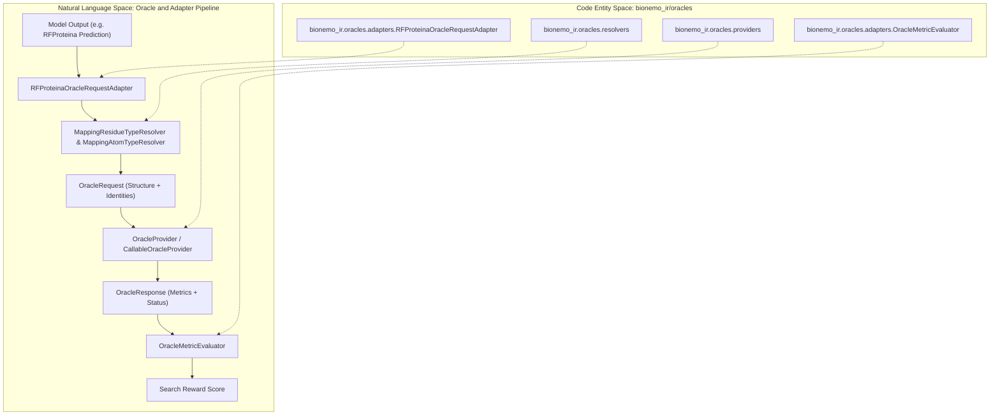
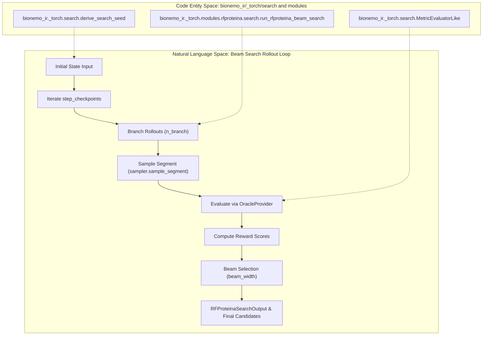

# Oracles and Beam Search

<details>
<summary>Relevant source files</summary>

The following files were used as context for generating this wiki page:

- [bionemo_ir/_torch/layers/random_augmentation.py](bionemo_ir/_torch/layers/random_augmentation.py)
- [bionemo_ir/_torch/sampling/edm.py](bionemo_ir/_torch/sampling/edm.py)
- [bionemo_ir/_torch/sampling/frame_reuse.py](bionemo_ir/_torch/sampling/frame_reuse.py)
- [bionemo_ir/models/rfproteina/__init__.py](bionemo_ir/models/rfproteina/__init__.py)
- [bionemo_ir/models/rfproteina/convert.py](bionemo_ir/models/rfproteina/convert.py)
- [bionemo_ir/models/rfproteina/modeling.py](bionemo_ir/models/rfproteina/modeling.py)
- [docs/ref/oracles.md](docs/ref/oracles.md)
- [docs/ref/sampling.md](docs/ref/sampling.md)
- [scripts/fetch_weights.sh](scripts/fetch_weights.sh)
- [tests/_torch/test_frame_reuse.py](tests/_torch/test_frame_reuse.py)
- [tests/_torch/test_rfd4_beam_search.py](tests/_torch/test_rfd4_beam_search.py)
- [tests/_torch/test_rfd4_modules.py](tests/_torch/test_rfd4_modules.py)

</details>


## Purpose and Scope

This page details the implementation of structure oracle providers, type resolvers, adapters, and metric-weighted beam search over generative protein design rollouts within the BioNeMo Inference Runtime (BioIR). BioIR separates external structure scoring (such as folding runtimes or custom evaluators) from beam search orchestration, using strict data contracts defined in `bionemo_ir.oracles` and `bionemo_ir._torch.search`.

---

## 1. Structure Oracle Providers, Resolvers, and Adapters

BioIR exposes a dependency-light mechanism for invoking structure oracles independently of beam search orchestration. Callers can apply the same provider across search rewards, best-of-$N$ selection, post-hoc scoring, and evaluation benchmarks [docs/ref/oracles.md:7-13]().

The oracle framework relies on four primary components:
1. `OracleProvider`: The base class and lifecycle contract defining `name`, `run()`, and optional context manager semantics [docs/ref/oracles.md:24-26, 56-121]().
2. `OracleRequest` / `OracleResponse`: The batch boundary structures carrying sequence data, coordinate tensors, atom masks, and evaluation metrics [docs/ref/oracles.md:25-26, 137-175]().
3. Residue and atom type resolvers (`ResidueTypeResolver`, `AtomTypeResolver`): Mappings that translate source-model integer vocabularies into canonical identities (`ResType`, `AtomType`, `PolymerType`) [docs/ref/oracles.md:26-29, 176-193]().
4. Adapters (`RFProteinaOracleRequestAdapter`, `OracleMetricEvaluator`): Translators that convert model outputs into oracle requests and oracle responses into consumer metrics [docs/ref/oracles.md:29-32]().


*Diagram 1: Bridging natural language oracle concepts to code entities in `bionemo_ir/oracles`.*

Sources: [docs/ref/oracles.md:20-53](), [tests/_torch/test_rfd4_beam_search.py:54-59]()

---

## 2. Metric Evaluation and Search Rewards

Metrics returned by `OracleResponse` are processed by `OracleMetricEvaluator` or `CompositeMetricEvaluator` to construct scalar reward values used during beam search [tests/_torch/test_rfd4_beam_search.py:25-59](). 

Weights are configured via reward configurations such as `RFProteinaSearchRewardConfig`, which associates metric keys (e.g., clash penalties, motif RMSD, sequence adherence) with scalar coefficients [tests/_torch/test_rfd4_beam_search.py:86-94]()`:

```python
RFProteinaSearchRewardConfig(weights={CLASH_METRIC_KEY: -1.0})
```

Statuses such as `OracleStatus.OK` permit metrics to participate in reward calculations, while `UNSUPPORTED`, `FAILED`, `TIMEOUT`, and `SKIPPED` statuses handle error and omission boundaries [docs/ref/oracles.md:168-175]().

Sources: [docs/ref/oracles.md:168-175](), [tests/_torch/test_rfd4_beam_search.py:25-94]()

---

## 3. Beam Search Execution and RNG Contracts

Beam search over generative rollouts is orchestrated via functions such as `run_rfproteina_beam_search` [bionemo_ir/models/rfproteina/modeling.py:77]() and evaluated against step checkpoints, branching factors (`n_branch`), and beam widths (`beam_width`) [tests/_torch/test_rfd4_beam_search.py:86-94]().


*Diagram 2: Bridging beam search concepts to code entities in `bionemo_ir/_torch/search` and `rfproteina` modules.*

RNG reproducibility across beam branches and chunked oracle scoring calls is maintained via explicit seed derivation (`derive_search_seed`) and isolated `torch.Generator` instances [bionemo_ir/models/rfproteina/modeling.py:80](), ensuring deterministic search outputs regardless of scoring chunk sizes [tests/_torch/test_rfd4_beam_search.py:161-177]().

Sources: [bionemo_ir/models/rfproteina/modeling.py:77-80](), [tests/_torch/test_rfd4_beam_search.py:86-177]()

---

## 4. Reference Documentation and Testing Coverage

Detailed usage guides, provider implementation examples, and integration patterns are documented in reference files:
- `docs/ref/oracles.md`: Complete specification of `OracleProvider`, request/response schemas, resolvers, and custom callable provider patterns [docs/ref/oracles.md:1-193]().
- `tests/_torch/test_rfd4_beam_search.py`: Comprehensive test suite verifying seed reproducibility, chunk-order independence, and segment rollout parity [tests/_torch/test_rfd4_beam_search.py:112-177]().

Sources: [docs/ref/oracles.md:1-193](), [tests/_torch/test_rfd4_beam_search.py:112-177]()

---