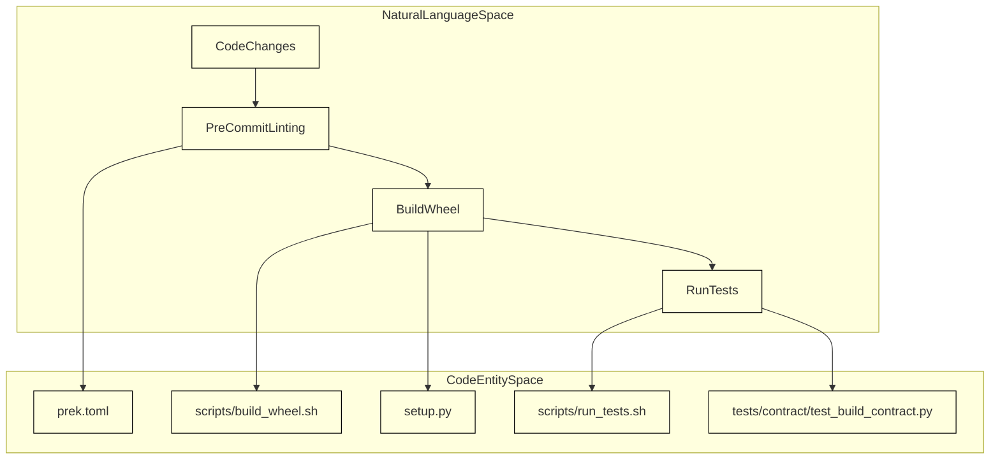
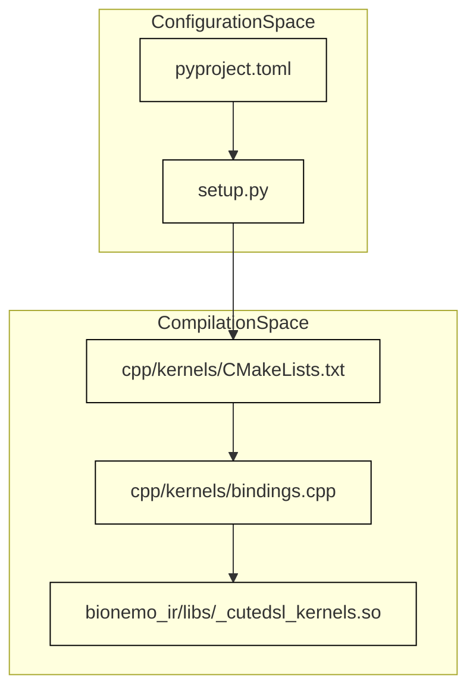

# Build, Testing, and Developer Workflow

Relevant source files

The following files were used as context for generating this wiki page:

- [.gitignore](.gitignore)
- [THIRD_PARTY_NOTICES.md](THIRD_PARTY_NOTICES.md)
- [cpp/CMakeLists.txt](cpp/CMakeLists.txt)
- [cpp/kernels/CMakeLists.txt](cpp/kernels/CMakeLists.txt)
- [cpp/kernels/bindings.cpp](cpp/kernels/bindings.cpp)
- [docker/Dockerfile](docker/Dockerfile)
- [docs/dev.md](docs/dev.md)
- [prek.toml](prek.toml)
- [pyproject.toml](pyproject.toml)
- [scripts/ci/contract.sh](scripts/ci/contract.sh)
- [scripts/coverage_aggregate.sh](scripts/coverage_aggregate.sh)
- [scripts/coverage_summary.sh](scripts/coverage_summary.sh)
- [scripts/run_tests.sh](scripts/run_tests.sh)
- [setup.py](setup.py)
- [tests/common/test_utils/openfold3/test_batched_input_tools.py](tests/common/test_utils/openfold3/test_batched_input_tools.py)
- [tests/contract/test_build_contract.py](tests/contract/test_build_contract.py)
- [tests/pipeline/test_engine_stage.py](tests/pipeline/test_engine_stage.py)
- [uv.lock](uv.lock)

This page provides a high-level overview of how BioNeMo Inference Runtime (BioIR) is built, tested, documented, and released. It serves as a parent page, linking to more detailed child pages for in-depth information on each topic.

## Build System and Packaging (#7.1)

BioIR's build process integrates CMake for C++ kernel compilation and `setuptools` for Python wheel packaging [pyproject.toml:4-7](), [setup.py:1-40](). The native extension `bionemo_ir.libs._cutedsl_kernels` is compiled from C++ translation units in `cpp/kernels/CMakeLists.txt` [cpp/kernels/CMakeLists.txt:16-22](), incorporating precompiled CUBIN materialization scripts and `nanobind` bindings [cpp/kernels/bindings.cpp:173-240](). Python packaging metadata is managed centrally in `pyproject.toml` [pyproject.toml:30-76](), while setup shims handle dynamic versioning and local CUDA toolkit indicators [setup.py:15-25](). Docker images provide isolated containerized environments for reproducible builds and testing [docker/Dockerfile:26-32]().

For details, see [Build System and Packaging](#7.1).

Sources:
- [pyproject.toml:1-105]()
- [setup.py:1-40]()
- [cpp/kernels/CMakeLists.txt:1-22]()
- [cpp/kernels/bindings.cpp:173-240]()
- [docker/Dockerfile:26-32]()

## Test Suite and Reference Implementations (#7.2)

The BioIR test suite validates build contracts, operational pipelines, and numerical equivalence against open-source reference implementations [tests/contract/test_build_contract.py:15-30](), [scripts/run_tests.sh:17-33](). Tests are organized into contract validation, engine stages, and full model parity checks [tests/contract/test_build_contract.py:30-70](), [scripts/run_tests.sh:60-70](). Coverage instrumentation and execution scripts handle multi-phase test runs that share a common caching backend [scripts/run_tests.sh:17-30]().

For details, see [Test Suite and Reference Implementations](#7.2).

Sources:
- [tests/contract/test_build_contract.py:15-70]()
- [scripts/run_tests.sh:17-70]()

## CI, Docs Site, and Agent Skills (#7.3)

Continuous integration pipelines automate PR checks, link validation, and code linting via `prek` hooks [docs/dev.md:9-12](), [tests/contract/test_build_contract.py:138-150](). Documentation is structured around Fern [THIRD_PARTY_NOTICES.md:92-96](), and the repository includes specialized `.agents` playbook skills (`make-data-pipeline`, `module-onboard`, `scan-mem-opt-patterns`) to assist developers with onboarding new modules and data pipelines.

For details, see [CI, Docs Site, and Agent Skills](#7.3).

Sources:
- [docs/dev.md:9-12]()
- [THIRD_PARTY_NOTICES.md:92-96]()
- [tests/contract/test_build_contract.py:138-150]()

## Benchmarking Against OSS Implementations (#7.4)

Benchmarking workflows use harness scripts under the `bench-perf-oss` skill to measure throughput, latency, peak memory consumption, and scientific scoring metrics such as lDDT and DockQ against upstream implementations. Results and hardware support matrices are tracked in documentation [docs/dev.md:15-22]().

For details, see [Benchmarking Against OSS Implementations](#7.4).

Sources:
- [docs/dev.md:15-22]()

---

### Developer Workflow Overview

The following diagram bridges natural language development tasks to concrete code entities and scripts in the repository (`docs/dev.md`, `scripts/build_wheel.sh`, `scripts/run_tests.sh`, `tests/contract/test_build_contract.py`).

Title: Developer Workflow and Script Execution

Sources:
- [docs/dev.md:90-150]()
- [scripts/run_tests.sh:45-75]()
- [tests/contract/test_build_contract.py:40-60]()
- [setup.py:15-30]()

### Build System Components

The build architecture coordinates project dependency specifications (`pyproject.toml`), packaging scripts (`setup.py`), and CMake compilation targets (`cpp/kernels/CMakeLists.txt`, `cpp/kernels/bindings.cpp`).

Title: Build System Architecture and Code Entities

Sources:
- [pyproject.toml:4-7]()
- [setup.py:15-40]()
- [cpp/kernels/CMakeLists.txt:16-25]()
- [cpp/kernels/bindings.cpp:173-240]()

---