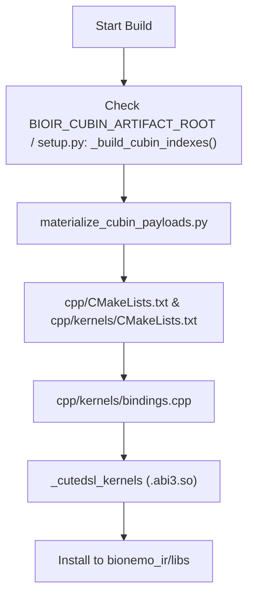
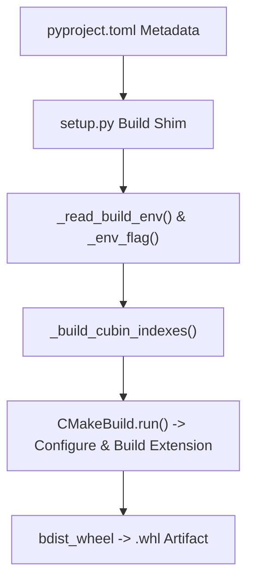
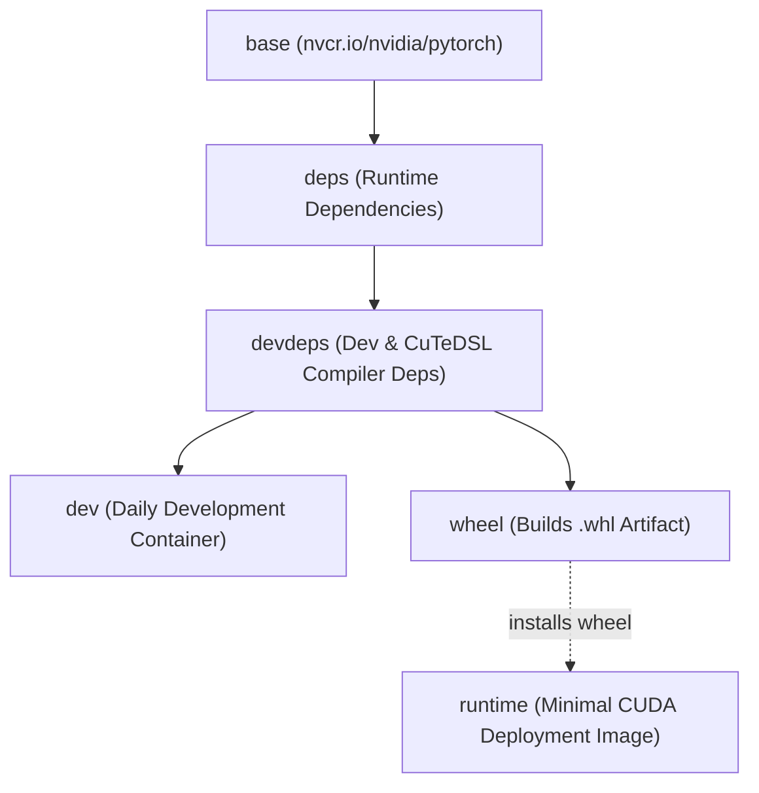

# Build System and Packaging

Relevant source files

The following files were used as context for generating this wiki page:

- [.gitmodules](.gitmodules)
- [.nspect-allowlist.toml](.nspect-allowlist.toml)
- [MANIFEST.in](MANIFEST.in)
- [THIRD_PARTY_NOTICES.md](THIRD_PARTY_NOTICES.md)
- [bionemo_ir/_torch/attention_backend/pairwise_attention/configs/__init__.py](bionemo_ir/_torch/attention_backend/pairwise_attention/configs/__init__.py)
- [bionemo_ir/_torch/attention_backend/pairwise_attention/sdpa.py](bionemo_ir/_torch/attention_backend/pairwise_attention/sdpa.py)
- [bionemo_ir/_torch/attention_backend/pairwise_attention/vanilla.py](bionemo_ir/_torch/attention_backend/pairwise_attention/vanilla.py)
- [bionemo_ir/_torch/attention_backend/triangle_attention/configs/__init__.py](bionemo_ir/_torch/attention_backend/triangle_attention/configs/__init__.py)
- [bionemo_ir/_torch/custom_ops/adaln_layernorm_sigmoid/configs/__init__.py](bionemo_ir/_torch/custom_ops/adaln_layernorm_sigmoid/configs/__init__.py)
- [bionemo_ir/_torch/custom_ops/attn_epilogue/cutedsl.py](bionemo_ir/_torch/custom_ops/attn_epilogue/cutedsl.py)
- [bionemo_ir/_torch/custom_ops/dual_gemm_x0_x1/__init__.py](bionemo_ir/_torch/custom_ops/dual_gemm_x0_x1/__init__.py)
- [bionemo_ir/_torch/custom_ops/gated_sigmoid/cutedsl.py](bionemo_ir/_torch/custom_ops/gated_sigmoid/cutedsl.py)
- [bionemo_ir/_torch/custom_ops/gated_sigmoid/ops.py](bionemo_ir/_torch/custom_ops/gated_sigmoid/ops.py)
- [bionemo_ir/_torch/custom_ops/transition_mlp/cutedsl.py](bionemo_ir/_torch/custom_ops/transition_mlp/cutedsl.py)
- [cpp/CMakeLists.txt](cpp/CMakeLists.txt)
- [cpp/kernels/CMakeLists.txt](cpp/kernels/CMakeLists.txt)
- [cpp/kernels/bindings.cpp](cpp/kernels/bindings.cpp)
- [docker/Dockerfile](docker/Dockerfile)
- [docs/dev.md](docs/dev.md)
- [docs/ref/docker-images.md](docs/ref/docker-images.md)
- [pyproject.toml](pyproject.toml)
- [scripts/ci/contract.sh](scripts/ci/contract.sh)
- [setup.py](setup.py)
- [tests/_torch/test_attention_pair_bias_broadcast.py](tests/_torch/test_attention_pair_bias_broadcast.py)
- [tests/_torch/test_prepared_atom_pair_biases.py](tests/_torch/test_prepared_atom_pair_biases.py)
- [tests/contract/test_build_contract.py](tests/contract/test_build_contract.py)
- [tests/contract/test_release_wheel.py](tests/contract/test_release_wheel.py)
- [tests/contract/test_wheel_dependencies.py](tests/contract/test_wheel_dependencies.py)
- [tests/ops/test_gated_sigmoid.py](tests/ops/test_gated_sigmoid.py)
- [uv.lock](uv.lock)

This page details the build system and packaging mechanisms used in the BioNeMo Inference Runtime (BioIR) project. It covers the CMake-based kernel build process, the `setup.py`/`pyproject.toml` wheel packaging, dependency configuration, build contract tests, Docker images, and git submodules.

## CMake Kernel Build

The custom CUDA kernels, implemented using CuTeDSL and C++, are built using CMake. The primary CMake configuration for these kernels is located at `cpp/kernels/CMakeLists.txt`, and the overall C++ project is configured in `cpp/CMakeLists.txt`.

The extension `_cutedsl_kernels` is a Python extension module bound via nanobind (`cpp/kernels/bindings.cpp`) [cpp/kernels/bindings.cpp:173-238](). It embeds precompiled CUBIN images and exposes runtime loading and launching functions.

### CMake Dependency Management
C++ dependencies are managed via modular CMake files under `cpp/cmake/`:
- **CUDA Toolkit**: Located via `find_package(CUDAToolkit REQUIRED)`.
- **Nanobind**: Pinned build dependency specified in `pyproject.toml` [pyproject.toml:6]() and resolved through the Python interpreter to avoid hidden network requests.

### CMake Build Flow Diagram
The diagram below bridges natural language concepts to the exact code files and functions involved in building the kernel extension.

**Title**: CMake Kernel Build and CUBIN Integration Flow

Sources:
- `cpp/kernels/bindings.cpp` [cpp/kernels/bindings.cpp:1-240]()
- `setup.py` [setup.py:1-543]()
- `pyproject.toml` [pyproject.toml:1-176]()

---

## `setup.py`/`pyproject.toml` Wheel Packaging

BioIR uses `setuptools` with `pyproject.toml` as the primary metadata source [pyproject.toml:4-78](), accompanied by `setup.py` as a build-time shim [setup.py:15-25]().

### `pyproject.toml` Configuration
`pyproject.toml` defines python dependencies, optional dependency groups (`build`, `cutedsl`, `test`, `dev`, `release`), and build system requirements:
- **Build System**: Requires `cmake>=3.27`, `nanobind==2.10.2`, and `setuptools>=77` [pyproject.toml:6]().
- **Dependencies**: Includes `cuda-python`, `torch`, `cuequivariance`, `triton`, `biopython`, `ray`, `modelcif`, `rdkit`, etc. [pyproject.toml:35-72]().
- **Package Data**: Includes JSON configuration files for custom ops and attention backends [pyproject.toml:24-28]().

### `setup.py` Build Shim
`setup.py` coordinates environment variable resolution (`build.env` or `os.environ`), CUBIN payload materialization, and CMake invocation:
- **Version Suffixes**: Manages local version tags such as `+cu131` and appends git commit hashes (e.g., `+cu131.g1a2b3c4`) for traceability [setup.py:18-21](). When `BIOIR_PUBLIC_WHEEL=1` is set, local version segments are dropped for compatibility with public index restrictions [setup.py:22]().

### Packaging Flow Diagram

**Title**: Wheel Packaging Flow

Sources:
- `pyproject.toml` [pyproject.toml:1-176]()
- `setup.py` [setup.py:1-543]()

---

## Build Contract Tests

Build contract tests validate packaging invariants, dependency constraints, wheel structures, and CUBIN image integrity without requiring full hardware execution:
- `tests/contract/test_build_contract.py`: Enforces metadata constraints, `setup.py` version formatting, long description rendering for PyPI indices, and package discovery pruning [tests/contract/test_build_contract.py:1-150]().
- `tests/contract/test_wheel_dependencies.py`: Validates wheel dependency checks and platforms [tests/contract/test_wheel_dependencies.py:1-95]().
- `tests/contract/test_release_wheel.py`: Checks stable ABI compliance, loader path safety (`RUNPATH`/`RPATH`), external driver linkages, and CUBIN payload identity [tests/contract/test_release_wheel.py:1-120]().

Sources:
- `tests/contract/test_build_contract.py` [tests/contract/test_build_contract.py:1-371]()
- `tests/contract/test_wheel_dependencies.py` [tests/contract/test_wheel_dependencies.py:1-95]()
- `tests/contract/test_release_wheel.py` [tests/contract/test_release_wheel.py:1-120]()

---

## Docker Images and Git Submodules

### Docker Image Stages
`docker/Dockerfile` serves as the single source of truth for building BioIR container images [docker/Dockerfile:1-318](). It is structured into multiple stages:
1. **`base`**: Digest-pinned `nvcr.io/nvidia/pytorch` base image containing the curated framework and CUDA stack [docker/Dockerfile:26-32]().
2. **`deps`**: Installs locked runtime and build dependencies via `uv pip install` with hash verification [docker/Dockerfile:86-105]().
3. **`devdeps`**: Adds development and CuTeDSL compiler dependencies (`nvidia-cutlass-dsl`) [docker/Dockerfile:118-138]().
4. **`dev`**: Configures a development user mapped to the host UID/GID for bind-mounted worktree development [docker/Dockerfile:141-149]().
5. **`wheel`**: Copies the source repository and builds the Python wheel into `/dist` [docs/ref/docker-images.md:29-30]().
6. **`runtime`**: Minimal runtime container bundling the wheel on top of `nvidia/cuda` base images [docs/ref/docker-images.md:31-32]().

### Git Submodules
The project relies on external repositories included as git submodules defined in `.gitmodules` [.gitmodules:1-12](), such as:
- `3rdparty/openfold-3` [.gitmodules:1-3]()
- `3rdparty/protenix` [.gitmodules:4-6]()
- `3rdparty/cutlass` [.gitmodules:7-9]()
- `3rdparty/RFD4-Proteina` [.gitmodules:10-12]()

### Docker Stages Flow Diagram

**Title**: Dockerfile Stages Flow

Sources:
- `docker/Dockerfile` [docker/Dockerfile:1-318]()
- `docs/ref/docker-images.md` [docker/Dockerfile:1-166]()
- `.gitmodules` [.gitmodules:1-12]()

---