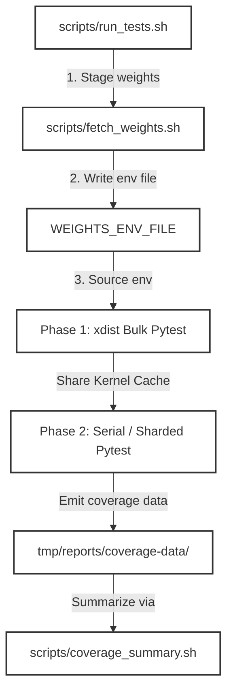
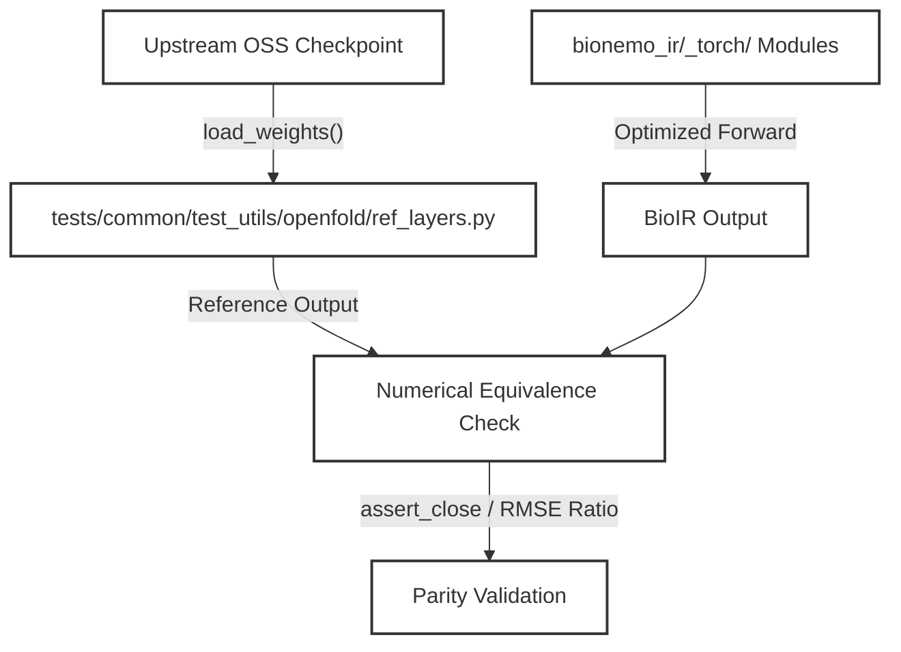

# Test Suite and Reference Implementations

Relevant source files

The following files were used as context for generating this wiki page:

- [.gitignore](.gitignore)
- [bionemo_ir/_torch/layers/position_encoders.py](bionemo_ir/_torch/layers/position_encoders.py)
- [bionemo_ir/_torch/modules/boltz/loss/diffusion.py](bionemo_ir/_torch/modules/boltz/loss/diffusion.py)
- [bionemo_ir/utils.py](bionemo_ir/utils.py)
- [prek.toml](prek.toml)
- [scripts/coverage_aggregate.sh](scripts/coverage_aggregate.sh)
- [scripts/coverage_summary.sh](scripts/coverage_summary.sh)
- [scripts/run_tests.sh](scripts/run_tests.sh)
- [tests/_torch/model_forwards/test_model_forward_eager_determinism.py](tests/_torch/model_forwards/test_model_forward_eager_determinism.py)
- [tests/_torch/model_forwards/test_model_forward_with_cuda_graph.py](tests/_torch/model_forwards/test_model_forward_with_cuda_graph.py)
- [tests/_torch/test_boltz_rigid_align.py](tests/_torch/test_boltz_rigid_align.py)
- [tests/common/test_utils/model_forwards.py](tests/common/test_utils/model_forwards.py)
- [tests/common/test_utils/openfold3/test_batched_input_tools.py](tests/common/test_utils/openfold3/test_batched_input_tools.py)
- [tests/pipeline/test_engine_stage.py](tests/pipeline/test_engine_stage.py)

The purpose of the BioNeMo Inference Runtime (BioIR) test suite is to guarantee functional correctness, numerical equivalence, end-to-end pipeline integrity, and hardware-accelerated performance parity. It combines multi-phase test orchestration (`scripts/run_tests.sh`), Open Source Software (OSS) reference implementations for parity testing, rigorous numerical equivalence conventions for geometric modules, model forward checks (eager determinism and CUDA-graph parity), and automated code quality hooks (`prek.toml`).

## Test Suite Layout and Execution Orchestration

The BioIR test hierarchy divides responsibilities across specialized directories, driven by `scripts/run_tests.sh` [scripts/run_tests.sh:17-35]() which automates weight staging, two-phase pytest execution, xdist scaling, and branch coverage instrumentation via `scripts/coverage_summary.sh` [scripts/coverage_summary.sh:17-33]().

*   `tests/pipeline/` [tests/pipeline/__init__.py:1-14]() — End-to-end pipeline checks, parser/tokenizer validation, and processor engine integration tests (e.g., `tests/pipeline/test_engine_stage.py` [tests/pipeline/test_engine_stage.py:40-162]()).
*   `tests/_torch/` — PyTorch module libraries, layer-level parity tests, diffusion schedulers, and model forwards.
  *   `tests/_torch/model_forwards/test_model_forward_with_cuda_graph.py` [tests/_torch/model_forwards/test_model_forward_with_cuda_graph.py:15-42]() — CUDA-graph capture, verification, and replay parity against eager baselines.
  *   `tests/_torch/model_forwards/test_model_forward_eager_determinism.py` [tests/_torch/model_forwards/test_model_forward_eager_determinism.py:15-40]() — Run-to-run eager determinism baseline verification.
  *   `tests/_torch/test_boltz_rigid_align.py` [tests/_torch/test_boltz_rigid_align.py:15-154]() — Numerical guards and SVD reference comparisons for sync-free Boltz rigid alignment.
*   `tests/ops/` — Custom CUDA operations, CuTeDSL launchers, and dual GEMM numerical tests.
*   `tests/common/test_utils/` — Shared helpers, reference model configs, request loaders (`tests/common/test_utils/model_forwards.py` [tests/common/test_utils/model_forwards.py:15-20]()), and batched diffusion input constructors.

**Diagram 1: Test Execution and Orchestration Flow (`scripts/run_tests.sh`)**

Sources:
* [scripts/run_tests.sh:17-35]()
* [scripts/run_tests.sh:107-115]()
* [scripts/coverage_summary.sh:17-33]()

## OSS Reference Layers and Weight Loaders for Parity Testing

BioIR maintains strict parity with upstream model definitions through reference implementations. For instance, OpenFold and Boltz reference layers (`tests/common/test_utils/openfold/ref_layers.py`) mirror upstream calculation paths. These reference components include weight loading hooks (`load_weights`) to ingest official checkpoints directly into reference structures for comparative evaluation against optimized BioIR modules.

**Diagram 2: Parity Testing Architecture mapping OSS Reference Layers to BioIR Modules**

Sources:
* [tests/common/test_utils/openfold/ref_layers.py:16-17]()
* [tests/common/test_utils/openfold/ref_layers.py:32-32]()
* [tests/common/test_utils/openfold/ref_layers.py:119-119]()

## Numerical Equivalence Conventions and Precision Guards

Numerical verification ensures that optimizations (such as mixed-precision arithmetic, kernel fusion, and CUDA graph capture) do not compromise scientific accuracy. Tests enforce numerical bounds using relative error metrics and root-mean-square error ratios against high-precision (`float64` or unoptimized `float32`) reference computations.

For example, rigid alignment algorithms in Boltz (`bionemo_ir/_torch/modules/boltz/loss/diffusion.py`) compare the fused Triton/CUDA kernel path against an SVD reference implementation (`_svd_reference`) evaluated in `float64` (`tests/_torch/test_boltz_rigid_align.py`) [tests/_torch/test_boltz_rigid_align.py:58-76]().

Key numerical evaluation utilities include:
*   `weighted_rigid_align` [bionemo_ir/_torch/modules/boltz/loss/diffusion.py:68-140]() and `horn_rotation` [bionemo_ir/_torch/modules/boltz/loss/diffusion.py:28-65]() tested across edge-case geometries (planar, collinear, ill-conditioned, and empty masks) [tests/_torch/test_boltz_rigid_align.py:79-117]() using `torch.testing.assert_close` [tests/_torch/test_boltz_rigid_align.py:136-136]().
*   RMSE ratio calculations and maximum relative error metrics across tensor outputs.

Sources:
* [tests/_torch/test_boltz_rigid_align.py:58-76]()
* [tests/_torch/test_boltz_rigid_align.py:79-117]()
* [tests/_torch/test_boltz_rigid_align.py:136-136]()
* [bionemo_ir/_torch/modules/boltz/loss/diffusion.py:28-65]()
* [bionemo_ir/_torch/modules/boltz/loss/diffusion.py:68-140]()

## Pipeline, Model Forward, and CUDA-Graph Parity Tests

End-to-end model behavior is validated via model forward test suites (`tests/_torch/model_forwards/`) which exercise the public pipeline entry points under different execution contexts.

### Eager Determinism Baselines
`tests/_torch/model_forwards/test_model_forward_eager_determinism.py` [tests/_torch/model_forwards/test_model_forward_eager_determinism.py:15-40]() verifies run-to-run reproducibility of unoptimized (eager) forward passes for models like OpenFold3 and Boltz-2 over bundled CASP14 monomers (`T1031`, `T1033`). It establishes that downstream optimization tests rely on deterministic underlying kernels.

### CUDA-Graph Parity Testing
`tests/_torch/model_forwards/test_model_forward_with_cuda_graph.py` [tests/_torch/model_forwards/test_model_forward_with_cuda_graph.py:15-42]() runs input requests through the public `build_processor` API [tests/_torch/model_forwards/test_model_forward_with_cuda_graph.py:20-22]() on the serial backend using bundled targets (`T1038`, `T1047s1`). It compares unoptimized eager runs against CUDA-graph accelerated regions (such as trunks or diffusion modules) using CA lDDT parity tolerances (`LDDT_GT_PARITY_TOL`) [tests/_torch/model_forwards/test_model_forward_with_cuda_graph.py:26-41]().

Sources:
* [tests/_torch/model_forwards/test_model_forward_eager_determinism.py:15-40]()
* [tests/_torch/model_forwards/test_model_forward_with_cuda_graph.py:15-42]()
* [tests/_torch/model_forwards/test_model_forward_with_cuda_graph.py:58-74]()

## Code Quality and Style Enforcement (`prek.toml`)

Local developer workflows and CI pipelines enforce styling, license compliance, and documentation links through `prek.toml` [prek.toml:1-141](). This configuration runs pre-commit and commit-msg hooks across new and changed files:
*   `ruff-check` and `ruff-format` for Python source files [prek.toml:23-29]().
*   `clang-format` for C++ and CUDA source files in `cpp/` [prek.toml:31-41]().
*   `shellcheck` and `shfmt` for shell scripts [prek.toml:50-63]().
*   `insert-license` to ensure NVIDIA SPDX Apache headers are present on all source files [prek.toml:66-96]().
*   `docs-check` (`fern/src/check.py`) for Fern navigation coverage, link policies, and math block style [prek.toml:116-130]().
*   `commitizen` for Conventional Commits subject checking [prek.toml:137-141]().

Sources:
* [prek.toml:1-141]()
* [prek.toml:23-41]()
* [prek.toml:50-96]()
* [prek.toml:116-141]()

---