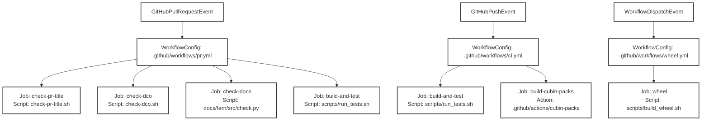
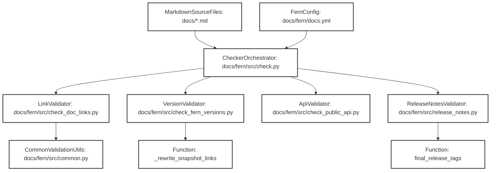
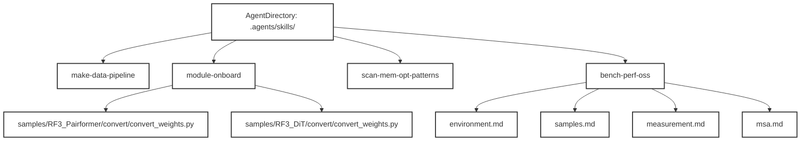

# CI, Docs Site, and Agent Skills

Relevant source files

The following files were used as context for generating this wiki page:

- [.agents/skills/make-data-pipeline/SKILL.md](.agents/skills/make-data-pipeline/SKILL.md)
- [.agents/skills/module-onboard/SKILL.md](.agents/skills/module-onboard/SKILL.md)
- [.github/actions/cubin-packs/action.yml](.github/actions/cubin-packs/action.yml)
- [.github/workflows/ci.yml](.github/workflows/ci.yml)
- [.github/workflows/wheel.yml](.github/workflows/wheel.yml)
- [AGENTS.md](AGENTS.md)
- [CHANGELOG.md](CHANGELOG.md)
- [README.md](README.md)
- [docs/README.md](docs/README.md)
- [docs/advanced/port-data-pipeline.md](docs/advanced/port-data-pipeline.md)
- [docs/coding.md](docs/coding.md)
- [docs/contributing.md](docs/contributing.md)
- [docs/install.md](docs/install.md)
- [docs/overview.mdx](docs/overview.mdx)
- [docs/ref/api.md](docs/ref/api.md)
- [docs/ref/support-matrix.md](docs/ref/support-matrix.md)
- [docs/release-notes/index.md](docs/release-notes/index.md)
- [fern/docs.yml](fern/docs.yml)
- [fern/fern.config.json](fern/fern.config.json)
- [fern/index.yml](fern/index.yml)
- [fern/src/check.py](fern/src/check.py)
- [fern/src/check_fern_versions.py](fern/src/check_fern_versions.py)
- [fern/src/common.py](fern/src/common.py)
- [fern/src/release_notes.py](fern/src/release_notes.py)
- [fern/src/test_check_fern_versions.py](fern/src/test_check_fern_versions.py)
- [fern/src/test_release_notes.py](fern/src/test_release_notes.py)
- [scripts/ci/fetch_cubin_packs.sh](scripts/ci/fetch_cubin_packs.sh)
- [scripts/ci/style.sh](scripts/ci/style.sh)
- [scripts/ci/uv_env.sh](scripts/ci/uv_env.sh)

This page details the continuous integration (CI) pipelines, Fern documentation site generation and validation checkers, and the `.agents` skills utilized within the BioNeMo Inference Runtime (BioIR) codebase. It explains implementation details for GitHub workflows, documentation link and API testing utilities, and structured agent playbooks for onboarding custom modules and benchmarking.

## GitHub Actions Workflows and PR Checks

BioIR uses GitHub Actions workflows to enforce code quality, sign-offs, license compliance, documentation correctness, and kernel packaging. The primary pipeline definitions reside in `.github/workflows/ci.yml` and `.github/workflows/wheel.yml`.

### Workflow Architecture and PR Gates

Pull requests trigger validation steps across multiple jobs, verifying conventional commit messages, developer certificate of origin (DCO) sign-offs, documentation links, and C++/Python test suites.

Sources: [.github/workflows/ci.yml](), [.github/workflows/wheel.yml]()

- **Wheel Building (`wheel.yml`)**: Triggered via `workflow_dispatch`, pushes to `main`, or pull requests. It provisions an Ubuntu-24.04 runner, fetches CUTLASS headers, builds custom CUDA kernels via `.github/actions/cubin-packs`, and executes `scripts/build_wheel.sh` [.github/workflows/wheel.yml:9-89](). It verifies extension loading by launching Python against the packaged `.so` artifact using a CUDA stub driver library [.github/workflows/wheel.yml:102-121]().

Sources: [.github/workflows/ci.yml](), [.github/workflows/wheel.yml](), [.github/actions/cubin-packs/action.yml]()

---

## Fern Docs Site and Link/API Checkers

Documentation source files reside in `docs/` and are published via Fern using the configuration defined in `docs/fern/docs.yml`.

### Documentation Validation Infrastructure

The documentation check pipeline verifies Markdown link targets, public API consistency, and version snapshots.

Sources: [fern/src/check_fern_versions.py](), [fern/src/release_notes.py](), [fern/src/common.py]()

- **Version Management & Rewriting**: `fern/src/check_fern_versions.py` implements snapshot replacement (`_replace_snapshot`) and link rewriting (`_rewrite_snapshot_links`) to map relative documentation paths into versioned Fern routes or pinned GitHub blob/tree URLs [fern/src/check_fern_versions.py:66-169]().
- **Changelog & Release Verification**: `fern/src/release_notes.py` validates `CHANGELOG.md` sections, mapping internal release tags to public GitHub commits using git metadata trailers like `GitOrigin-RevId` [fern/src/release_notes.py:17-41](). Functions such as `final_release_tags` and `_parse_section` enforce formatting constraints and check for sensitive content [fern/src/release_notes.py:127-157]().

Sources: [fern/src/check_fern_versions.py](), [fern/src/release_notes.py](), [fern/src/common.py]()

---

## Agent Skills and Onboarding Framework

Task-specific playbooks and automation scripts reside in `.agents/skills/`. They instruct automated agents and developers on setting up benchmark environments, converting weights, and integrating custom modules [AGENTS.md:83-102]().

### Skill Categories and File Layout

Sources: [AGENTS.md](), [.agents/skills/make-data-pipeline/SKILL.md](), [.agents/skills/module-onboard/SKILL.md]()

- **`make-data-pipeline`**: Automates porting external open-source data parsing and featurization pipelines into BioIR's parser-tokenizer-feature-generator architecture. Detailed in `docs/advanced/port-data-pipeline.md` and validated via `docs/advanced/validate-data-pipeline.md` [AGENTS.md:87-90]().
- **`module-onboard`**: Guides the migration of external modules (such as RoseTTAFold3 Pairformer and Diffusion Transformer blocks) onto BioIR's optimized layers. It provides weight conversion script samples under `.agents/skills/module-onboard/samples/` that handle QKV fusion, KV pair-bias merging, and gate+input fusion [AGENTS.md:91-93]().
- **`scan-mem-opt-patterns`**: Provides diagnostic patterns for cutting activation memory and preventing out-of-memory (OOM) errors during large-`N` inference across pairwise representation models [AGENTS.md:94-95]().
- **`bench-perf-oss`**: Establishes rigorous benchmarking protocols comparing BioIR against OSS implementations. It defines measurement windows, CUDA graph capture constraints, dataset reconstruction via `rebuild_dataset.py`, and OpenStructure lDDT/DockQ evaluation suites [AGENTS.md:96-101]().

Sources: [AGENTS.md](), [.agents/skills/make-data-pipeline/SKILL.md](), [.agents/skills/module-onboard/SKILL.md]()

---