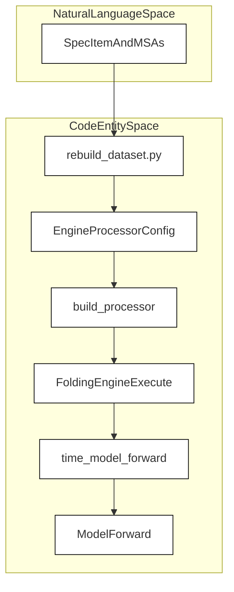
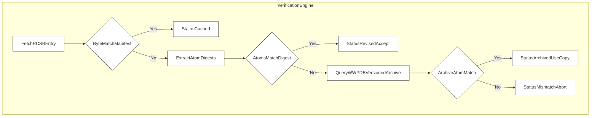

# Benchmarking Against OSS Implementations

<details>
<summary>Relevant source files</summary>

The following files were used as context for generating this wiki page:

- [.agents/skills/bench-perf-oss/SKILL.md](.agents/skills/bench-perf-oss/SKILL.md)
- [.agents/skills/bench-perf-oss/bundle.md](.agents/skills/bench-perf-oss/bundle.md)
- [.agents/skills/bench-perf-oss/dataset/rebuild_dataset.py](.agents/skills/bench-perf-oss/dataset/rebuild_dataset.py)
- [.agents/skills/bench-perf-oss/deepspeed-evoformer.md](.agents/skills/bench-perf-oss/deepspeed-evoformer.md)
- [.agents/skills/bench-perf-oss/environment.md](.agents/skills/bench-perf-oss/environment.md)
- [.agents/skills/bench-perf-oss/harness/check_results.py](.agents/skills/bench-perf-oss/harness/check_results.py)
- [.agents/skills/bench-perf-oss/harness/gpu_telemetry.py](.agents/skills/bench-perf-oss/harness/gpu_telemetry.py)
- [.agents/skills/bench-perf-oss/harness/plot_latency.py](.agents/skills/bench-perf-oss/harness/plot_latency.py)
- [.agents/skills/bench-perf-oss/harness/scoring.py](.agents/skills/bench-perf-oss/harness/scoring.py)
- [.agents/skills/bench-perf-oss/harness/summarize_speedup.py](.agents/skills/bench-perf-oss/harness/summarize_speedup.py)
- [.agents/skills/bench-perf-oss/harness/timing.py](.agents/skills/bench-perf-oss/harness/timing.py)
- [.agents/skills/bench-perf-oss/measurement.md](.agents/skills/bench-perf-oss/measurement.md)
- [.agents/skills/bench-perf-oss/models/boltz2.md](.agents/skills/bench-perf-oss/models/boltz2.md)
- [.agents/skills/bench-perf-oss/models/of2.md](.agents/skills/bench-perf-oss/models/of2.md)
- [.agents/skills/bench-perf-oss/msa.md](.agents/skills/bench-perf-oss/msa.md)
- [.agents/skills/bench-perf-oss/no-pipeline.md](.agents/skills/bench-perf-oss/no-pipeline.md)
- [.agents/skills/bench-perf-oss/samples.md](.agents/skills/bench-perf-oss/samples.md)
- [.agents/skills/bench-perf-oss/templates.md](.agents/skills/bench-perf-oss/templates.md)
- [.agents/skills/bench-perf-oss/workflow.md](.agents/skills/bench-perf-oss/workflow.md)
- [docs/assets/speedup-vs-residues.png](docs/assets/speedup-vs-residues.png)
- [docs/ref/benchmark.md](docs/ref/benchmark.md)
- [tests/skills/test_bench_perf_oss_dataset.py](tests/skills/test_bench_perf_oss_dataset.py)
- [tests/skills/test_bench_perf_oss_harness.py](tests/skills/test_bench_perf_oss_harness.py)

</details>


## Purpose and Scope

This section covers Section 7.4 of the BioNeMo Inference Runtime (BioIR) wiki, documenting the technical architecture, execution protocols, harness scripts, dataset staging engines, GPU telemetry, and quality-scoring environments provided by the `.agents/skills/bench-perf-oss` skill and referenced in `docs/ref/benchmark.md`. The benchmarking suite evaluates end-to-end (e2e) `model.forward()` performance, peak GPU memory utilization, and structural fidelity (lDDT and DockQ) against upstream Open Source Software (OSS) implementations (such as Boltz-1/2, OpenFold2, OpenFold3, and Protenix) [.agents/skills/bench-perf-oss/SKILL.md:1-67]().

---

## 1. Benchmarking Architecture and Pathways

BioIR provides two primary pathways for comparative performance analysis depending on whether a dedicated BioIR processor factory exists for the target model family [.agents/skills/bench-perf-oss/SKILL.md:82-94]():

1. **Processor Path (`build_processor`)**: Used for models with native pipeline factories (Boltz-1/2, OpenFold2/AlphaFold2, OpenFold3, and `protenix-v2`). BioIR runs via serial `build_processor()` executions (`executor_backend=None`), while the OSS baseline executes its native inference pipeline [.agents/skills/bench-perf-oss/SKILL.md:85-88](). 
2. **OSS Feature Path (No Pipeline)**: Used when a model compute path lacks a built-in BioIR data pipeline factory. The OSS data pipeline featurizes inputs once into shared `.pt` tensors, which are then evaluated by both the OSS `nn.Module` and the BioIR module [.agents/skills/bench-perf-oss/SKILL.md:89-94]().

Serial execution (`executor_backend=None`) ensures that one sample is processed per `processor()` call to prevent host-RAM out-of-memory errors and isolate execution latency [.agents/skills/bench-perf-oss/SKILL.md:78-81]().



Sources: [.agents/skills/bench-perf-oss/SKILL.md:1-115](), [.agents/skills/bench-perf-oss/no-pipeline.md:1-50]()

---

## 2. Dataset Staging and Verification (`rebuild_dataset.py`)

To eliminate dataset redistribution license hurdles and ensure deterministic provenance, the benchmarking framework relies on an internal dataset builder located at `.agents/skills/bench-perf-oss/dataset/rebuild_dataset.py` [.agents/skills/bench-perf-oss/samples.md:19-49]().

### Dataset Structure
The builder consumes three bundled JSON files:
- `spec_full.json`: 17 mixed protein/complex specifications [.agents/skills/bench-perf-oss/samples.md:27-28]()
- `spec_monomer.json`: 15 protein monomer specifications [.agents/skills/bench-perf-oss/samples.md:29-30]()
- `MANIFEST.json`: cryptographic hashes, expected file sizes, and structural depths for expected outputs [.agents/skills/bench-perf-oss/samples.md:30-36]()

It reconstructs an input tree containing RCSB ground-truth mmCIF files (`ground_truth/*.cif`), template structures (`templates/*.cif`), and alignments fetched from the NVIDIA MSA Search NIM (`msa/*.a3m`) [.agents/skills/bench-perf-oss/samples.md:38-45]().

### Verification Logic
Because RCSB periodically updates entry metadata without modifying atomic coordinates, a standard byte hash check is insufficient. The script parses atomic records using an atom-level digest function `atoms_digest()` [tests/skills/test_bench_perf_oss_dataset.py:53](), classifying downloads into distinct states:
- `ok` / `cached`: Byte-identical to the manifest [.agents/skills/bench-perf-oss/samples.md:110-111]()
- `revised`: File bytes differ, but coordinates (`ATOM` / `HETATM` records) are identical; accepted [.agents/skills/bench-perf-oss/samples.md:111-112]()
- `archived`: RCSB moved the entry to a new major version. The script queries the wwPDB versioned archive (`WWPDB_VERSIONED`) to retrieve the matching major/minor historical release [.agents/skills/bench-perf-oss/samples.md:112-116]()
- `MISMATCH`: Coordinates changed and no matching archive copy exists; execution aborts [.agents/skills/bench-perf-oss/samples.md:117-119]()



Sources: [.agents/skills/bench-perf-oss/samples.md:1-144](), [.agents/skills/bench-perf-oss/dataset/rebuild_dataset.py:1-120](), [tests/skills/test_bench_perf_oss_dataset.py:1-146]()

---

## 3. Measurement Protocol, Timing Window, and Telemetry

Timing measurements isolate the model execution kernel path from preprocessing, host-to-device (H2D) transfers, tokenization, and output writing [.agents/skills/bench-perf-oss/measurement.md:61-77]().

### The Timing Window (`time_model_forward`)
Implemented in `harness/timing.py` [.agents/skills/bench-perf-oss/measurement.md:79-80](), the timing loop guarantees GPU synchronization around `model.forward()`:

```python
def time_model_forward(
    model: Any, device_batch: Any, runtime_args: Mapping[str, Any]
) -> tuple[Any, float, float, float]:
    import torch

    torch.cuda.reset_peak_memory_stats()
    torch.cuda.synchronize()
    t0 = time.perf_counter()
    with torch.inference_mode():
        output = model(device_batch, **runtime_args)
    torch.cuda.synchronize()
    elapsed_s = time.perf_counter() - t0
    peak_alloc_gb = torch.cuda.max_memory_allocated() / (1024**3)
    peak_reserved_gb = torch.cuda.max_memory_reserved() / (1024**3)
    return output, elapsed_s, peak_alloc_gb, peak_reserved_gb
```
Sources: [.agents/skills/bench-perf-oss/harness/timing.py:31-55]()

### Allocator and CUDA Graph Constraints
- **PyTorch Allocator**: PyTorch's default allocator configuration must be maintained. Setting `PYTORCH_CUDA_ALLOC_CONF=expandable_segments:True` is prohibited during timed benchmarks, as remapping virtual address ranges alters allocation overhead on the hot path [.agents/skills/bench-perf-oss/measurement.md:93-110]().
- **CUDA Graphs**: Default BioIR models capture graph regions up to token limits (1024 tokens standard, 2048 for diffusion on >=64 GiB devices) [.agents/skills/bench-perf-oss/measurement.md:136-141](). Eager comparison arms explicitly disable graph capture via `config.disable_cuda_graphs()` [.agents/skills/bench-perf-oss/measurement.md:146-148]().
- **CUBIN Enforcement**: To ensure deterministic launch performance, the environment variable `CUTEDSL_FORCE_CUBIN=1` must be exported before executing any BioIR imports or benchmarks, disabling JIT compilation overhead [.agents/skills/bench-perf-oss/environment.md:123-136]().

Sources: [.agents/skills/bench-perf-oss/measurement.md:1-162](), [.agents/skills/bench-perf-oss/environment.md:1-183]()

---

## 4. Quality Scoring: lDDT and DockQ

Every predicted structure is evaluated against ground-truth depositions using two mandatory quality metrics [.agents/skills/bench-perf-oss/SKILL.md:55-63]():

1. **OpenStructure lDDT (Local Distance Difference Test)**: Measures local atomic distance stability across the entire predicted structure, providing an independent score of stereochemical and global fold quality [.agents/skills/bench-perf-oss/SKILL.md:55-59]().
2. **DockQ**: Evaluates the interface quality of protein-protein and protein-small-molecule multi-chain complexes. Every result row logs DockQ applicability status, as DockQ 2.1.3 does not natively support nucleic acid (RNA/DNA) interfaces [.agents/skills/bench-perf-oss/SKILL.md:58-63]().

Sources: [.agents/skills/bench-perf-oss/SKILL.md:37-67]()

---

## 5. Summary of Results and Hardware Profiles (`docs/ref/benchmark.md`)

Published performance results compare BioIR against two OSS baselines (OSS PyTorch eager and OSS `torch.compile`) across a diverse matrix of NVIDIA Data Center and workstation GPU architectures (e.g., H100, H200, A100, B200, GB200, L40S, and GB10) [docs/ref/benchmark.md:57-75]().

### Methodology Highlights
- **Geometric Mean Reporting**: All speedup summaries are computed as the geometric mean of per-sample speedups (`OSS forward / BioIR forward`), ensuring every sample carries equal weight regardless of absolute runtime [docs/ref/benchmark.md:96-101]().
- **Residue Bins**: Speedups are stratified across residue count brackets (`<512`, `512-1024`, `>1024`) because launch overhead dominates shorter sequences, while fused CUDA kernels and graph execution provide substantial speedups on larger inputs [docs/ref/benchmark.md:39-45, 103-106]().

Sources: [docs/ref/benchmark.md:1-124]()

---