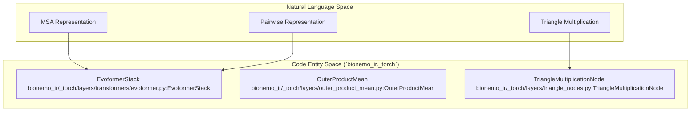
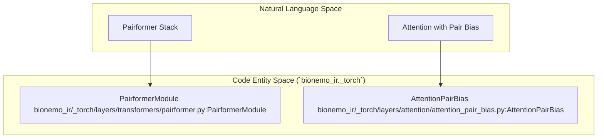

# Glossary

Relevant source files

The following files were used as context for generating this wiki page:

- [CHANGELOG.md](CHANGELOG.md)
- [README.md](README.md)
- [bionemo_ir/models/protenix/config.py](bionemo_ir/models/protenix/config.py)
- [bionemo_ir/models/protenix/modeling.py](bionemo_ir/models/protenix/modeling.py)
- [bionemo_ir/registry.py](bionemo_ir/registry.py)
- [cpp/kernels/cutedsl_adaln_layernorm_sigmoid/cubins/index.json](cpp/kernels/cutedsl_adaln_layernorm_sigmoid/cubins/index.json)
- [cpp/kernels/cutedsl_attn_epilogue/cubins/index.json](cpp/kernels/cutedsl_attn_epilogue/cubins/index.json)
- [cpp/kernels/cutedsl_dual_gemm_x0_x1/cubins/index.json](cpp/kernels/cutedsl_dual_gemm_x0_x1/cubins/index.json)
- [cpp/kernels/cutedsl_dual_gemm_x_x/cubins/index.json](cpp/kernels/cutedsl_dual_gemm_x_x/cubins/index.json)
- [cpp/kernels/cutedsl_gated_sigmoid/cubins/index.json](cpp/kernels/cutedsl_gated_sigmoid/cubins/index.json)
- [cpp/kernels/cutedsl_outer_product_mean/cubins/index.json](cpp/kernels/cutedsl_outer_product_mean/cubins/index.json)
- [cpp/kernels/cutedsl_pair_weighted_averaging/cubins/index.json](cpp/kernels/cutedsl_pair_weighted_averaging/cubins/index.json)
- [cpp/kernels/cutedsl_pairwise_attention/cubins/index.json](cpp/kernels/cutedsl_pairwise_attention/cubins/index.json)
- [cpp/kernels/cutedsl_transition_mlp/cubins/index.json](cpp/kernels/cutedsl_transition_mlp/cubins/index.json)
- [cpp/kernels/cutedsl_triangle_attention/cubins/index.json](cpp/kernels/cutedsl_triangle_attention/cubins/index.json)
- [docs/install.md](docs/install.md)
- [docs/ref/api.md](docs/ref/api.md)
- [docs/ref/architecture.md](docs/ref/architecture.md)
- [docs/ref/support-matrix.md](docs/ref/support-matrix.md)
- [fern/src/check_fern_versions.py](fern/src/check_fern_versions.py)
- [fern/src/release_notes.py](fern/src/release_notes.py)
- [fern/src/test_check_fern_versions.py](fern/src/test_check_fern_versions.py)
- [tests/_torch/test_protenix_contracts.py](tests/_torch/test_protenix_contracts.py)
- [tests/pipeline/test_request_rng.py](tests/pipeline/test_request_rng.py)

This page provides definitions for BioNeMo Inference Runtime (BioIR)-specific terms, covering core concepts, architectural patterns, key components, and GPU kernel details. The purpose is to clarify terminology used throughout the BioIR documentation and codebase.

## BioIR

BioNeMo Inference Runtime (BioIR) is NVIDIA's Python library designed for accelerating biomolecular structure model inference on NVIDIA GPUs. It provides a five-stage GPU pipeline to convert FASTA/MSA inputs into PDB/mmCIF structures with confidence scores. BioIR supports both end-to-end structure prediction workflows and offers optimized modules for custom model acceleration. Models are implemented as standard `nn.Module`s, eliminating the need for separate engine builds or export steps.

Sources: [README.md:20-26](), [docs/ref/architecture.md:11-20]()

## Pattern A/B

These terms refer to two distinct data flow patterns within the BioIR pipeline, primarily differentiating how `ContextGenerator` and `FeatureGenerator` components interact with intermediate data.

*   **Pattern A (OpenFold-style, flat tensor dict)**: In this pattern, the `ContextGenerator` produces a complete dictionary of NumPy arrays, which are then converted into a flat `dict[str, torch.Tensor]`. All subsequent stages operate on this tensor dictionary. This pattern is suitable when the original model's feature generation has a single entry point and all intermediate data are tensors.
    *   **Data Flow**: `ContextGenerator(parsed) -> dict[str, np.ndarray] -> np_to_tensor_dict -> dict[str, torch.Tensor] -> TransformSpec[] -> context dict`.
    *   **Examples**: `openfold2/`, `boltz1/`.
*   **Pattern B (Boltz2-style, mixed context row)**: This pattern is used for models with multi-step featurization and non-tensor intermediate data. The `ContextGenerator` returns a row dictionary containing both tensor and non-tensor data (e.g., structure objects, molecule dictionaries, parsed MSAs). `FeatureGenerator`s then read from `context["_row"]` and incrementally produce tensors.
    *   **Data Flow**: `ContextGenerator(parsed) -> row dict (mixed tensor/non-tensor) -> TransformSpec[] -> context dict`. `FeatureGeneratorSpec[]` then reads `context["_row"]` to produce new tensors.
    *   **Examples**: `boltz2/`.

Sources: [.agents/skills/make-data-pipeline/file-templates.md:23-26](), [.agents/skills/make-data-pipeline/architecture-reference.md:48-67](), [.agents/skills/make-data-pipeline/architecture-reference.md:71-105]()

## ContextGenerator

A `ContextGenerator` is a component in the BioIR pipeline responsible for converting parsed input data into an initial set of features. It is an implementation of `ContextGeneratorBase` [bionemo_ir/pipeline/base.py:113-129]().

*   **Purpose**: To bridge the gap between raw parsed input (often NumPy arrays or other data structures) and the initial tensor representation required by subsequent feature generation and model stages.
*   **Implementation**:
    *   For **Pattern A** models (e.g., OpenFold2, Boltz-1), the `ContextGenerator` directly produces a `dict[str, torch.Tensor]` [bionemo_ir/pipeline/models/openfold2/feature_context.py:99-141]().
    *   For **Pattern B** models (e.g., Boltz-2), it returns a `dict[str, Any]` which can contain a mix of tensor and non-tensor data, with the non-tensor data often stored in a `_row` key for later processing by `FeatureGenerator`s [bionemo_ir/pipeline/models/boltz2/feature_context.py:158-178]().
*   **Location**: Typically found in `bionemo_ir/pipeline/models/<model_name>/feature_context.py`.

Sources: [.agents/skills/make-data-pipeline/file-templates.md:83-141](), [.agents/skills/make-data-pipeline/file-templates.md:143-178](), [.agents/skills/make-data-pipeline/architecture-reference.md:109-130]()

## FeatureFactory

A `FeatureFactory` is a central component that orchestrates the feature generation process for a specific model. It is an implementation of `FeatureFactoryBase` [bionemo_ir/pipeline/base.py:200-205]().

*   **Purpose**: To define the sequence of `FeatureGenerator`s and `FeatureCollator`s, and to manage any pre-initialization steps (like seeding RNGs).
*   **Components**:
    *   `pre_init`: A callable function that runs before feature generation, often used for seeding random number generators [bionemo_ir/pipeline/models/boltz2/feature_factory.py:55-76]().
    *   `feature_generator_specs`: A list of `FeatureGeneratorSpec` objects, each specifying a `FeatureGenerator` functor and its arguments [bionemo_ir/pipeline/models/boltz2/feature_factory.py:81-101]().
    *   `features_merger_func`: A callable that merges the outputs of different feature generators.
    *   `feature_collator_specs`: A list of `FeatureCollatorSpec` objects, defining `FeatureCollator` functors and their arguments [bionemo_ir/pipeline/models/boltz2/feature_factory.py:103-107]().
*   **Location**: Typically found in `bionemo_ir/pipeline/models/<model_name>/feature_factory.py`.

Sources: [bionemo_ir/pipeline/models/boltz2/feature_factory.py:79-107](), [.agents/skills/make-data-pipeline/architecture-reference.md:196-202]()

## Evoformer

The Evoformer is a core transformer block used in AlphaFold-lineage models, designed to jointly process MSA (Multiple Sequence Alignment) and pairwise residue information.

*   **Purpose**: To refine both the MSA representation (`m`) and the pairwise representation (`z`) through a series of attention and multiplication operations.
*   **Key Components**:
    *   `MSAAttention`: Processes the MSA representation, allowing information flow between sequences.
    *   `MSATransition`: A feed-forward network applied to the MSA representation.
    *   `OuterProductMean`: Updates the pairwise representation (`z`) based on the MSA representation (`m`).
    *   `TriangleMultiplicationNode`: Performs triangular multiplication on the pairwise representation (`OUTGOING` and `INCOMING`) [bionemo_ir/_torch/layers/triangle_nodes.py:10-11]().
    *   `TriangleAttentionStartingNode` and `TriangleAttentionEndingNode`: Apply triangular attention to the pairwise representation.
    *   `PairTransition`: A feed-forward network applied to the pairwise representation.
*   **Data Flow**: An `EvoformerBlock` [bionemo_ir/_torch/layers/transformers/evoformer.py:36-175]() takes `m` and `z` as input and outputs refined versions of both.

### Evoformer Natural Language to Code Entity Mapping

Sources: [bionemo_ir/_torch/layers/transformers/evoformer.py:36-175](), [bionemo_ir/_torch/layers/triangle_nodes.py:10-11]()

## Pairformer

The Pairformer is a transformer block similar to the Evoformer, designed to process pairwise residue and single sequence information, featured prominently in Boltz-1, Boltz-2, and OpenFold3.

*   **Purpose**: To refine the pairwise representation (`z`) and single representation (`s`) via attention with pair biases, triangular operations, and transitions.
*   **Implementation**: `PairformerLayerV1` [bionemo_ir/_torch/layers/transformers/pairformer.py:49-176]().

### Pairformer Natural Language to Code Entity Mapping

Sources: [bionemo_ir/_torch/layers/transformers/pairformer.py:49-176]()

## triangle attention/multiplication

Fundamental operations within Evoformer and Pairformer blocks that process the pairwise residue representation (`z`).

*   **Triangle Multiplication Node (`TriangleMultiplicationNode`)**: Propagates information across the pairwise matrix using outgoing or incoming edges. Optimized via CuTeDSL kernels.
*   **Triangle Attention Node**: Applies triangular attention starting and ending nodes over rows/columns.

Sources: [bionemo_ir/_torch/layers/triangle_nodes.py:10-11](), [tests/common/test_utils/boltz/ref_layers.py:33-96]()

## trimul KF chain

The trimul KF chain refers to the chained kernel fusion patterns (e.g., triangle multiplication combined with layer norms or gating mechanisms) optimized via C++ CuTeDSL launchers and embedded cubin packs to eliminate intermediate global memory roundtrips.

Sources: [docs/ref/gpu-stack.md:100](), [cpp/kernels/cutedsl_dual_gemm_x0_x1/cubins/index.json:1-102]()

## AdaLN

AdaLN (Adaptive Layer Normalization) is a normalization technique that adaptively scales and shifts normalized features based on external conditioning vectors (e.g., noise embeddings in diffusion models). BioIR provides a custom fused kernel for `adaln_layernorm_sigmoid`.

Sources: [docs/ref/gpu-stack.md:100]()

## MSA

Multiple Sequence Alignment (MSA) is a collection of homologous protein or nucleic acid sequences aligned to highlight conserved regions and evolutionary relationships. It serves as primary input for many structure prediction models in BioIR via `ParserStage` and `TokenizerStage`.

Sources: [docs/ref/architecture.md:98](), [bionemo_ir/pipeline/models/openfold2/feature_collators.py:33-39]()

## pLDDT/PAE/PDE

Confidence metrics generated by structure prediction models:
*   **pLDDT**: Predicted Local Distance Difference Test; measures local residue prediction confidence.
*   **PAE**: Predicted Alignment Error; estimates expected positional error upon optimal superposition between residues.
*   **PDE**: Predicted Distance Error; estimates expected inter-residue distance error.

Sources: [docs/fern/pages/overview.mdx:10](), [docs/ref/architecture.md:120-122]()

## CuTeDSL

CuTeDSL (CUDA Template Library for Domain-Specific Languages) is a C++ template library used in BioIR to write high-performance custom fused CUDA kernels (such as attention backends, dual GEMMs, gated sigmoid, and outer product mean) embedded as cubin packs.

Sources: [docs/ref/gpu-stack.md:100](), [cpp/kernels/cutedsl_triangle_attention/launcher.cpp:33-34]()

## cubin pack

Precompiled CUDA binary (cubin) files embedded within the BioIR library, indexed via `index.json`, and dispatched at runtime based on GPU architecture (SM80, SM90, SM100, SM103).

Sources: [docs/ref/gpu-stack.md:100](), [cpp/kernels/cutedsl_dual_gemm_x0_x1/cubins/index.json:1-102]()

## TMA

Tensor Memory Access (TMA) is an asynchronous hardware copy feature introduced in NVIDIA Hopper (SM90) architecture that enables efficient data movement between global memory and shared memory for CuTeDSL kernels.

Sources: [cpp/kernels/cutedsl_dual_gemm_x_x/launcher.cpp:77-97]()

## swizzle

Memory access pattern optimization technique used in GPU kernels to reorder data in shared/global memory, improving cache locality and avoiding bank conflicts.

Sources: [docs/ref/gpu-stack.md:100]()

## SM80/90/100/103

NVIDIA GPU Streaming Multiprocessor (SM) architecture generations:
*   **SM80**: Ampere (e.g., A100).
*   **SM90**: Hopper (e.g., H100, H200, featuring TMA).
*   **SM100/SM103**: Blackwell (e.g., GB200, L40S).

Sources: [cpp/kernels/cutedsl_triangle_attention/launcher.cpp:55-56](), [scripts/print_gpu_system_category.sh:1-10]()

## CUDA graph capture

A technique to record a sequence of CUDA kernel launches and memory operations into an executable graph, reducing CPU launch overhead and accelerating repetitive workloads like diffusion sampling loops.

Sources: [README.md:152](), [bionemo_ir/_torch/graph_optimization/decorator.py:10-11]()

## recycling

The iterative process where a model feeds its intermediate predictions back as input features for subsequent passes, refining structural accuracy (e.g., via `SampleRepeater` in OpenFold2).

Sources: [bionemo_ir/pipeline/models/openfold2/feature_collators.py:500-540]()

## EDM/flow matching

Score-based diffusion frameworks (such as Elucidating the Design Space of Diffusion Models - EDM, or flow matching) used in generative models like RFProteina and Boltz/Protenix to iteratively denoise structural coordinates from random noise distributions.

Sources: [bionemo_ir/models/protenix/modeling.py:15-20]()

## product space

The joint geometric or sequence-structure space searched during generative protein design workflows (e.g., RFProteina flow matching over combined sequence and coordinate spaces).

Sources: [README.md:20-26]()

## LoRA merge

Low-Rank Adaptation merging technique used during checkpoint loading or fine-tuned weight integration in generative models like RFProteina.

Sources: [bionemo_ir/models/protenix/modeling.py:15-20]()

## oracle

Scoring providers or evaluation metrics modules (`bionemo_ir/oracles`) used during generative design and beam search to evaluate candidate structures or sequences.

Sources: [README.md:170-174]()

## beam search

A heuristic search algorithm (`bionemo_ir/_torch/search/beam.py`) that explores multiple generation paths simultaneously, weighted by oracle scores or log-probabilities during protein design rollouts.

Sources: [README.md:170-174]()

## hub/checkpoint staging

The mechanism of fetching, validating, and resolving model weights from HuggingFace Hub or local directories using metadata checks and scripts like `scripts/fetch_weights.sh`.

Sources: [README.md:97](), [docs/ref/model-weights.md:1-20]()