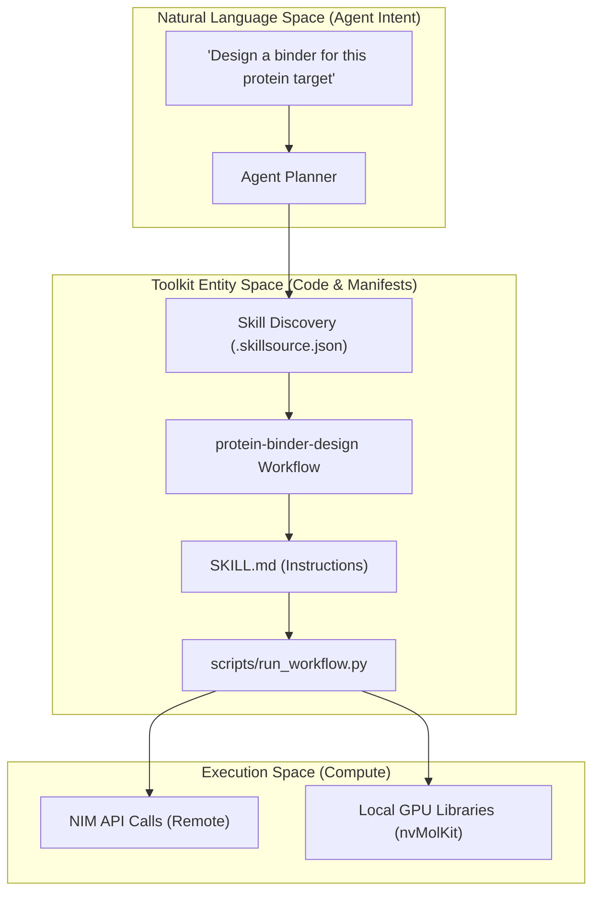
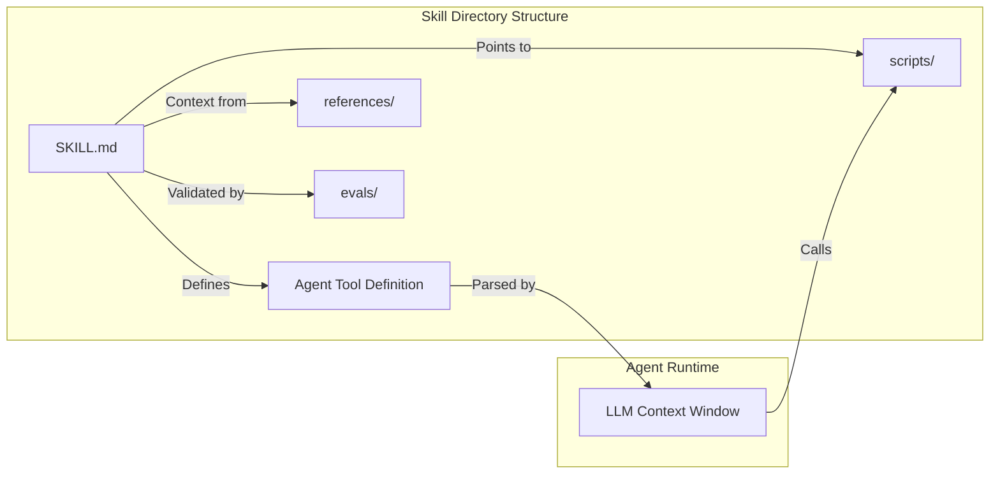

# Overview

Relevant source files

The following files were used as context for generating this wiki page:

- [LICENSE](LICENSE)
- [NOTICE](NOTICE)
- [README.md](README.md)
- [assets/image.jpg](assets/image.jpg)

The **NVIDIA BioNeMo Agent Toolkit** is a collection of agent-ready skills designed to transform general-purpose LLM agents into life science experts. It packages a decade of NVIDIA’s accelerated life sciences libraries, AI models, and inference microservices (NIMs) into structured, executable units.

Each skill provides an agent with the necessary context to select tools, prepare biological data (e.g., SMILES, FASTA, PDB), execute computations, and interpret scientific results within a multi-step workflow.

### Core Architecture

The toolkit is organized into four primary categories of skills based on their execution environment and underlying technology:

1.  **NIM Skills:** High-performance inference skills wrapping remote or local NVIDIA Inference Microservices (e.g., Boltz2, OpenFold3, DiffDock).
2.  **Open-Model Skills:** Skills for running and fine-tuning open-source models locally within specialized containers (e.g., KERMT for ADMET prediction, Proteina-Complexa for binder design).
3.  **Library Skills:** GPU-accelerated local Python libraries for cheminformatics and genomics (e.g., nvMolKit, Parabricks).
4.  **Workflow Skills:** High-level orchestration skills that chain multiple tools together to solve complex scientific objectives like de novo protein binder design.

### Skill Execution Model

The toolkit bridges the gap between natural language intent and code execution. Agents discover skills through manifests and invoke them by executing Python scripts or CLI commands defined within the skill's directory structure.

**Natural Language to Code Entity Mapping**

**Sources:** [README.md:5-13](), [README.md:39-60](), [README.md:62-64]()

---

### Skill Discovery and Invocation

Agents interact with the toolkit through standardized interfaces. The toolkit supports multiple agent environments including **Claude Code**, **Codex**, and **Nemotron**.

*   **CLI Integration:** The toolkit uses the `skills` CLI for interactive installation and management. [README.md:15-31]()
*   **Plugin Marketplaces:** Pre-configured manifests allow for native plugin installation in supported agent platforms.
    *   **Codex:** Managed via [.agents/plugins/marketplace.json]().
    *   **Claude Code:** Managed via [.claude-plugin/marketplace.json]().
*   **Skill Structure:** Every skill follows a strict convention to ensure predictability:
    *   `SKILL.md`: Contains YAML frontmatter for metadata and natural language instructions for the agent.
    *   `scripts/`: Executable Python/Shell kernels.
    *   `references/`: Documentation and API specs.
    *   `evals/`: Benchmarks and validation logic.

For details on installation and environment setup, see **[Getting Started & Installation](#1.1)**.
For details on the directory layout and manifest specifications, see **[Skill Architecture & Conventions](#1.2)**.

**Skill Components Relationship**

**Sources:** [README.md:33-37](), [README.md:62-64]()

---

### Major Skill Categories

#### NIM Skills
NVIDIA Inference Microservices (NIM) provide optimized containers for biology and chemistry models. Skills in this category handle authentication (via `NGC_API_KEY`) and data formatting for remote or local Docker endpoints.
*   **Key Skills:** Structure prediction (Boltz2, OpenFold3), Molecular Docking (DiffDock), and Sequence Generation (ProteinMPNN, GenMol).
*   For details, see **[NIM Skills](#2)**.

#### Open-Model & Library Skills
These skills run locally on GPU-enabled hardware. **Open-Model skills** often involve complex containerized environments for training and inference, while **Library skills** wrap high-performance C++/CUDA Python bindings.
*   **Key Skills:** KERMT (ADMET prediction), Proteina-Complexa (Binder design), nvMolKit (Cheminformatics), and Parabricks (Genomics).
*   For details, see **[Open-Model Skills](#3)** and **[Library Skills](#4)**.

#### Scientific Workflows
Workflows are "meta-skills" that provide agents with the logic to handle data handoffs between different tools. For example, the `drug-discovery-pipeline` orchestrates `GenMol` for molecule generation, `DiffDock` for pose prediction, and `Boltz2` for affinity scoring.
*   For details, see **[Workflow Skills: Generative Protein Binder Design](#5)**.

---

### Evaluation and Licensing

The toolkit includes a rigorous evaluation framework located in the `evals/` directory of each skill. This allows developers to benchmark agent performance with and without specific skills using `evals.json` task definitions.

**Licensing Summary:**
The toolkit uses a dual-licensing model:
*   **Source Code:** [Apache-2.0](LICENSE-APACHE-2.0) (scripts, tests, build tooling). [LICENSE:3-4](), [NOTICE:6-8]()
*   **Content:** [CC-BY-4.0](LICENSE-CC-BY-4.0) (SKILL.md, workflow definitions, documentation). [LICENSE:6-9](), [NOTICE:10-13]()

For details on evaluation, see **[Skill Evaluation Framework](#7)**.
For details on contributing and legal requirements, see **[Contributing, Licensing & Security](#8)**.

**Sources:** [LICENSE:1-11](), [NOTICE:1-15](), [README.md:68-74]()

---