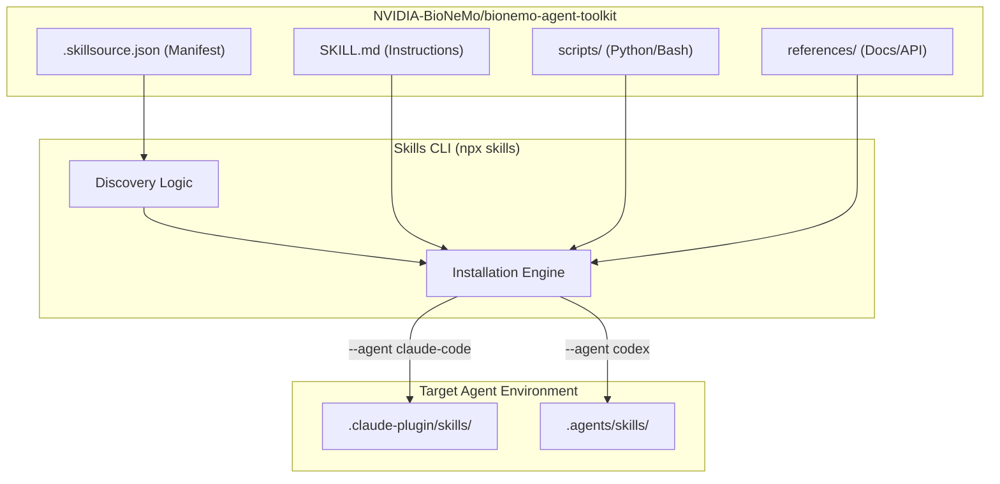
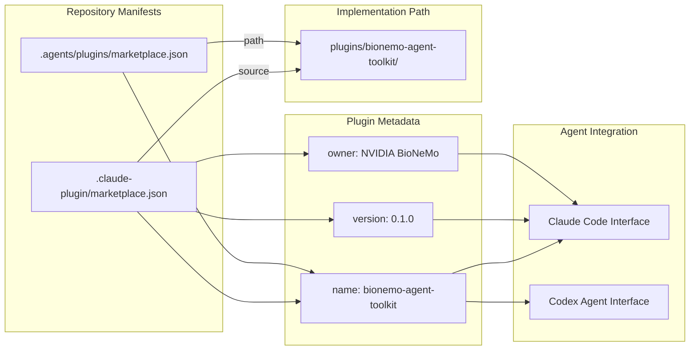

# Getting Started & Installation

Relevant source files

The following files were used as context for generating this wiki page:

- [.agents/plugins/marketplace.json](.agents/plugins/marketplace.json)
- [.claude-plugin/marketplace.json](.claude-plugin/marketplace.json)
- [README.md](README.md)

This page provides a technical guide for installing the NVIDIA BioNeMo Agent Toolkit, configuring supported agent environments, and understanding the underlying plugin marketplace architecture. The toolkit is designed to be consumed either as individual atomic skills or as a comprehensive plugin for platforms like Claude Code and Codex.

## Installation via the Skills CLI

The primary method for installing specific skills into a development environment is the `skills` CLI. This tool allows for interactive selection or automated deployment of skills into target agent directories.

### CLI Commands and Data Flow

The `skills` CLI interacts with the repository to fetch skill definitions and assets (scripts, instructions, and references).

| Command | Purpose | Key Parameters |
|:---|:---|:---|
| `npx skills add <repo>` | Interactive installation | Prompts for skill and destination. |
| `npx skills add <repo> --skill <id>` | Non-interactive install | Installs a specific skill (e.g., `boltz2-nim`). |
| `npx skills add <repo> --agent <type>` | Agent-specific targeting | Configures skill for `claude-code` or `codex`. |
| `npx skills add <repo> --list` | Discovery | Lists all available skills in the toolkit. |

### Skill Installation Workflow

The following diagram illustrates how the `skills` CLI bridges the "Natural Language Space" (the `SKILL.md` instructions) and the "Code Entity Space" (the local agent environment).

**Diagram: Skill Deployment via CLI**

**Sources:**
- [README.md:15-31]()
- [README.md:62-64]()

---

## Agent Environments & Marketplace Integration

Beyond individual skill installation, the toolkit provides integrated plugin manifests for native agent discovery. This allows agents to treat the entire toolkit as a single "Science" plugin.

### Supported Platforms

The toolkit ships with two primary marketplace manifests:
1.  **Claude Code**: Configured via `.claude-plugin/marketplace.json`.
2.  **Codex**: Configured via `.agents/plugins/marketplace.json`.

### Marketplace Manifest Structure

The manifests define how the agent discovers the toolkit and the requirements for installation, such as authentication policies.

| Field | Codex Policy | Claude Code Policy |
|:---|:---|:---|
| **Installation** | `AVAILABLE` | Native discovery |
| **Authentication** | `ON_INSTALL` | Managed via agent config |
| **Source Path** | `./plugins/bionemo-agent-toolkit` | `./plugins/bionemo-agent-toolkit` |
| **Category** | `Science` | N/A |

### Plugin Marketplace Data Flow

This diagram shows how the marketplace manifests map repository structures to agent-readable plugin interfaces.

**Diagram: Marketplace Manifest Mapping**

**Sources:**
- [.agents/plugins/marketplace.json:1-20]()
- [.claude-plugin/marketplace.json:1-18]()
- [README.md:33-37]()

---

## Skill Categories and Discovery

The toolkit organizes skills into several functional categories, which are reflected in the directory structure and the `SKILL.md` frontmatter.

### Core Categories

1.  **NIM Skills**: Wrappers for NVIDIA Inference Microservices (e.g., `boltz2-nim`, `diffdock-nim`).
2.  **Open-Model Skills**: Locally executable models requiring specific environments (e.g., `kermt-setup`, `complexa-design`).
3.  **Library Skills**: GPU-accelerated libraries for cheminformatics and genomics (e.g., `nvmolkit-usage`, `parabricks`).
4.  **Workflow Skills**: High-level orchestration of multiple tools (e.g., `protein-binder-design`).

### Skill Directory Layout
Each skill is encapsulated in a directory containing:
-   `SKILL.md`: Contains the YAML frontmatter (metadata) and the natural language instructions for the agent.
-   `scripts/`: Python or Bash scripts that the agent executes to perform the scientific task.
-   `references/`: Supplementary documentation or API specifications.

**Sources:**
- [README.md:41-60]()
- [README.md:62-64]()

---

## Authentication and Security

Installation of the toolkit, particularly for NIM-based skills, often requires authentication.

-   **Codex Auth**: The policy is set to `ON_INSTALL` in [.agents/plugins/marketplace.json:15-15](), requiring the user to provide credentials (typically an `NGC_API_KEY`) during the plugin setup.
-   **Security Reporting**: Vulnerabilities should be reported via the NVIDIA PSIRT process as outlined in the project's security policy.

**Sources:**
- [.agents/plugins/marketplace.json:13-16]()
- [README.md:73-74]()

---