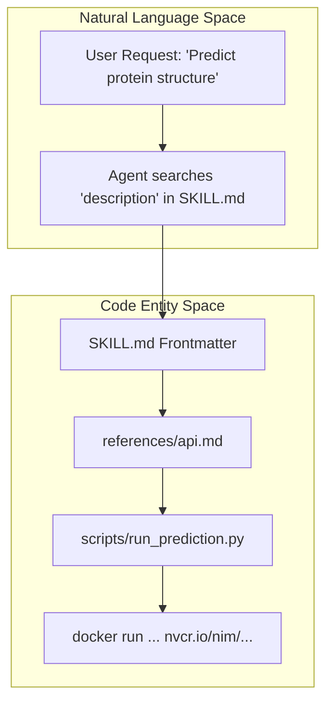
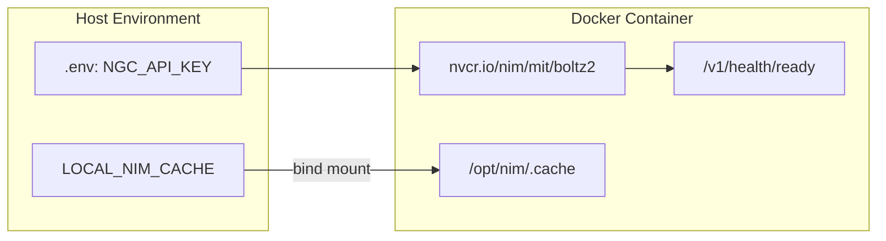

# Skill Architecture & Conventions

Relevant source files

The following files were used as context for generating this wiki page:

- [README.md](README.md)
- [nim-skills/.skillsource.json](nim-skills/.skillsource.json)
- [nim-skills/README.md](nim-skills/README.md)
- [nim-skills/boltz2-nim/SKILL.md](nim-skills/boltz2-nim/SKILL.md)

The NVIDIA BioNeMo Agent Toolkit follows a strict, token-efficient architecture designed for discovery and execution by Large Language Model (LLM) agents. Skills are structured as portable directories containing a combination of natural language instructions, machine-readable manifests, and deterministic script kernels.

## Skill Directory Layout

Each skill is encapsulated in a self-contained directory. This structure ensures that an agent can ingest the primary instruction set (`SKILL.md`) and only fetch supplemental technical details (from `references/`) or execution logic (from `scripts/`) when necessary to complete a task.

| Component | Path | Purpose |
| :--- | :--- | :--- |
| **Primary Manifest** | `SKILL.md` | Contains YAML frontmatter and the core system prompt/instructions for the agent. |
| **Reference Docs** | `references/` | Technical deep-dives (API schemas, science background, validation logic) kept separate to save context window tokens. |
| **Script Kernels** | `scripts/` | Deterministic Python or Bash scripts that handle complex data transformations or environment setups. |
| **Evaluation Suite** | `evals/` | Task definitions and triggers used to benchmark the skill's performance and reliability. |

### The `SKILL.md` Specification
The `SKILL.md` file is the entry point for any agent. It must include a YAML frontmatter block that defines the skill's identity and constraints [nim-skills/boltz2-nim/SKILL.md:1-8]().

**Frontmatter Fields:**
*   `name`: Unique identifier for the skill.
*   `description`: A concise summary used by agents during skill discovery.
*   `license`: Dual-licensing identifiers (e.g., `Apache-2.0 AND CC-BY-4.0`).
*   `compatibility`: Python package requirements (e.g., `"requests>=2.28"`).
*   `allowed-tools`: A whitelist of agent capabilities required (e.g., `Bash`, `Read`, `Write`).

**Sources:** [README.md:62-64](), [nim-skills/README.md:6-12](), [nim-skills/boltz2-nim/SKILL.md:1-21]()

---

## Skill Discovery & Manifests

The toolkit uses a hierarchical manifest system to allow agents and CLI tools to discover available skills without scanning the entire filesystem.

### `.skillsource.json`
Located at the root of skill collections (e.g., `nim-skills/`), this file acts as a registry. It is typically autogenerated and contains a mapping of all functional files within that category [nim-skills/.skillsource.json:1-90]().

### Marketplace Integration
For platforms like **Claude Code** and **Codex**, the toolkit provides top-level marketplace manifests. These files allow the toolkit to be installed as a native plugin [README.md:33-37]().
*   **Codex:** `.agents/plugins/marketplace.json`
*   **Claude Code:** `.claude-plugin/marketplace.json`

### Agent-to-Skill Mapping
The following diagram illustrates how an agent moves from a natural language request to executing a specific code entity within a skill.

**Skill Invocation Flow**

**Sources:** [README.md:11-13](), [nim-skills/boltz2-nim/SKILL.md:1-8](), [nim-skills/boltz2-nim/SKILL.md:60-66]()

---

## Design Philosophy: Token Efficiency

A core convention of the BioNeMo Agent Toolkit is the **"Lazy Loading" of Context**. Agents are instructed to read the `SKILL.md` first and only access files in `references/` if they encounter specific gaps in knowledge, such as exact API payload schemas or scientific validation criteria [nim-skills/boltz2-nim/SKILL.md:12-20]().

### Reference Conventions
To maintain consistency across dozens of skills, the `references/` directory follows a standard naming convention:
*   `api.md`: Endpoints, authentication, and JSON schemas.
*   `science.md`: Theoretical background, model limitations, and biological context.
*   `parameters.md`: Detailed breakdown of optional flags and tuning knobs.
*   `validation.md`: Expected output formats (e.g., mmCIF) and confidence score interpretations.
*   `examples.md`: Minimal, copy-pasteable code snippets for hosted and local execution.

**Sources:** [nim-skills/README.md:9-10](), [nim-skills/boltz2-nim/SKILL.md:16-20]()

---

## Implementation Patterns: NIM Skills

NIM (NVIDIA Inference Microservice) skills follow a specific pattern for handling both hosted API calls and local containerized deployment.

### Authentication and Environment
Skills must support two primary modes of operation, gated by the `NGC_API_KEY` [nim-skills/boltz2-nim/SKILL.md:22-36]():
1.  **Hosted Mode:** Uses `https://health.api.nvidia.com` with a Bearer token.
2.  **Local Mode:** Uses `http://localhost:8000` with no auth header (post-readiness).

### Local Deployment Preflight
Skills include a standardized Bash "preflight" block for local Docker execution. This ensures consistent volume mounting for model caches and GPU allocation [nim-skills/boltz2-nim/SKILL.md:44-66]().

**Data Flow: Local NIM Execution**

**Sources:** [nim-skills/boltz2-nim/SKILL.md:44-71]()

---

## Evaluation Framework

Every skill directory contains an `evals/` folder. This sub-structure is critical for the `agentskills.io` specification, allowing the toolkit to be validated across different LLM backends [nim-skills/README.md:11-12]().

*   `evals.json`: Defines the "Golden" tasks, including the prompt, expected tool calls, and grading assertions.
*   `trigger_evals.json`: Contains natural language triggers that should activate the skill during a benchmark run.

**Sources:** [nim-skills/.skillsource.json:10-11](), [nim-skills/README.md:11-12]()

---