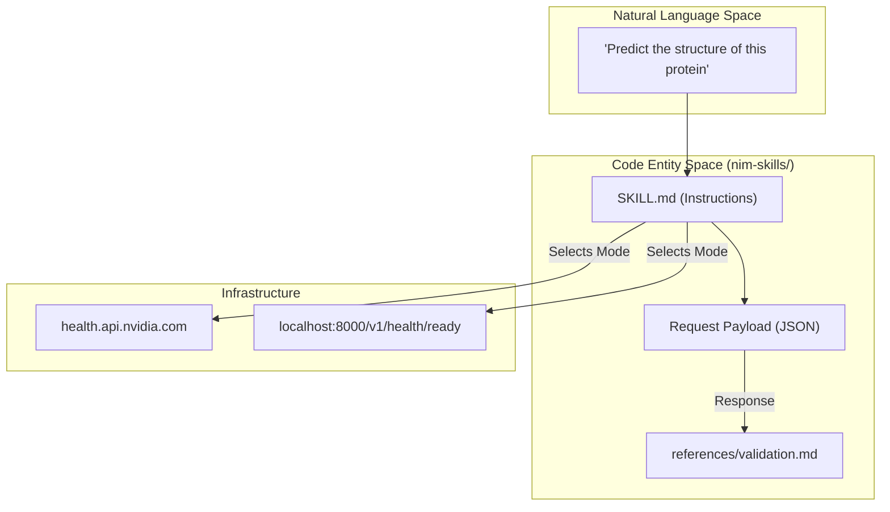
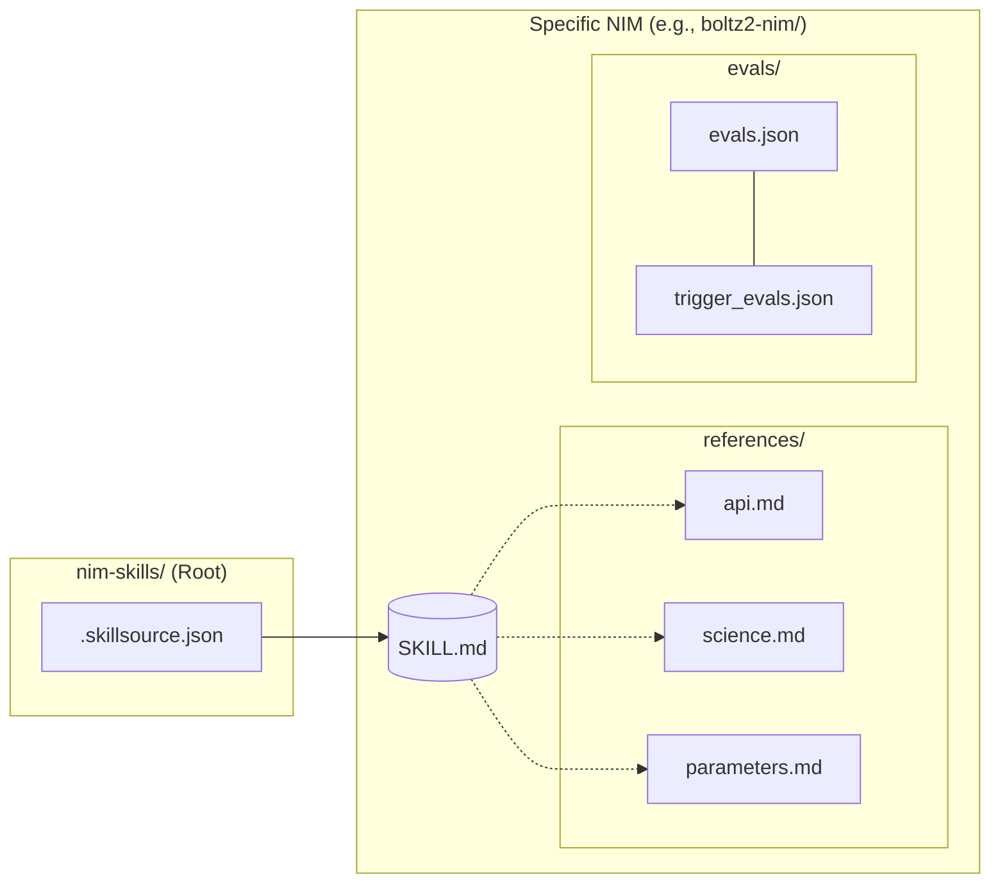

# NIM Skills

Relevant source files

The following files were used as context for generating this wiki page:

- [nim-skills/.skillsource.json](nim-skills/.skillsource.json)
- [nim-skills/README.md](nim-skills/README.md)
- [nim-skills/boltz2-nim/SKILL.md](nim-skills/boltz2-nim/SKILL.md)

NVIDIA Inference Microservices (NIM) are optimized cloud-native containers designed to provide the fastest and most efficient way to deploy AI models. The `bionemo-agent-toolkit` provides a collection of individual "NIM Skills" located under `nim-skills/` that allow agents to interact with these microservices for biological and chemical discovery.

## Overview of NIM Skill Bundles

Each NIM skill is a portable runtime bundle that follows a strict directory convention to ensure consistency across different biological domains. These skills support both hosted NVIDIA API endpoints (via `health.api.nvidia.com`) and local Docker deployments for on-premises execution.

### Common Skill Structure
Every NIM skill directory contains the following components:
*   `SKILL.md`: The primary entry point containing runtime workflow instructions for the agent, including endpoint selection and authentication logic [nim-skills/README.md:8-8]().
*   `references/*.md`: Supplemental technical documentation covering `api.md` (endpoints/schemas), `science.md` (limitations/handoffs), `parameters.md` (tuning), and `validation.md` (output verification) [nim-skills/README.md:9-10]().
*   `evals/`: Packaged task definitions (`evals.json`) and trigger descriptions (`trigger_evals.json`) used for benchmarking and compatibility testing [nim-skills/README.md:11-12]().

### Authentication and Deployment Patterns
NIM skills implement a "Choose Mode" pattern where agents can switch between hosted and local environments.
*   **Hosted Mode**: Requires an `NGC_API_KEY` passed via the `Authorization: Bearer` header [nim-skills/boltz2-nim/SKILL.md:31-31]().
*   **Local Mode**: Involves a preflight check to ensure the `NGC_API_KEY` is available for registry login and model download, followed by a `docker run` command with specific GPU and shared memory (`--shm-size=16G`) requirements [nim-skills/boltz2-nim/SKILL.md:44-66]().

### NIM Skill Mapping: Natural Language to Code Space

The following diagram illustrates how an agent transitions from a natural language request to invoking specific NIM code entities and artifacts.

**NIM Skill Invocation Flow**

Sources: [nim-skills/README.md:1-15](), [nim-skills/boltz2-nim/SKILL.md:12-36]()

## NIM Skill Categories

The toolkit organizes NIM skills into functional categories based on their scientific application.

### [Structure Prediction NIMs](#2.1)
These skills predict the 3D geometry of biomolecules. They include **Boltz2**, **OpenFold2**, **OpenFold3**, and **MSA-Search**. They handle protein-ligand complexes, DNA, and RNA, typically outputting results in `mmCIF` format with associated confidence scores (pLDDT).
For details, see [Structure Prediction NIMs](#2.1).

### [Protein Design NIMs](#2.2)
Skills focused on the creation of novel proteins. **RFdiffusion** is used for backbone generation (diffusion), while **ProteinMPNN** performs inverse folding to design sequences that fit a specific backbone. These skills use specific syntax for "contigs" and "hotspots" to guide the design process.
For details, see [Protein Design NIMs](#2.2).

### [Generative Chemistry NIMs](#2.3)
This category covers small molecule discovery. **GenMol** uses SAFE-notation for de novo generation, **MolMIM** provides latent-space optimization (CMA-ES), and **DiffDock** performs molecular docking to predict how small molecules bind to proteins.
For details, see [Generative Chemistry NIMs](#2.3).

### [Genomics NIM — Evo 2](#2.4)
The **Evo 2** NIM is designed for DNA sequence modeling. It supports long-context generation and the extraction of layer-wise embeddings for downstream genomic analysis.
For details, see [Genomics NIM — Evo 2](#2.4).

### [Meta-Skills: Multi-NIM Pipelines](#2.5)
Meta-skills are higher-level orchestrators that chain multiple individual NIMs into a unified workflow. Examples include the **Drug Discovery Pipeline** (GenMol → DiffDock → Boltz2) and the **MSA Structure Prediction Pipeline**.
For details, see [Meta-Skills: Multi-NIM Pipelines](#2.5).

## Directory Architecture

The directory structure reflects the standardized manifest defined in `.skillsource.json`.

**NIM Skill File Relationships**

Sources: [nim-skills/.skillsource.json:1-90](), [nim-skills/README.md:1-15]()

## Reference Table: Core NIM Skills

| Skill Name | Primary Function | Input Types | Output Formats |
| :--- | :--- | :--- | :--- |
| `boltz2-nim` | Structure Prediction | Sequence, SMILES, CCD | mmCIF, pLDDT, pIC50 |
| `diffdock-nim` | Molecular Docking | PDB (Protein), SMILES (Ligand) | PDB (Complex), Confidence |
| `genmol-nim` | Molecule Generation | SAFE, SMILES | SAFE, SMILES, QED/LogP |
| `rfdiffusion-nim` | Backbone Design | Contigs, Hotspots | PDB |
| `proteinmpnn-nim` | Sequence Design | PDB Backbone | Multi-FASTA |

Sources: [nim-skills/boltz2-nim/SKILL.md:1-8](), [nim-skills/.skillsource.json:7-89]()

---