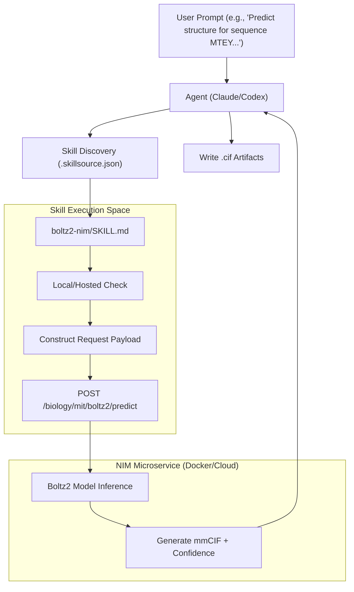
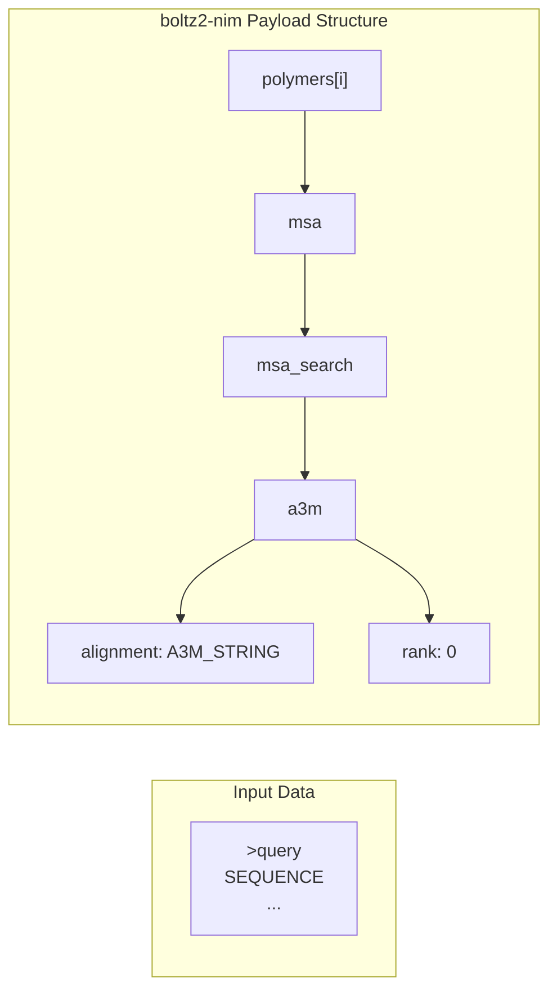

# Structure Prediction NIMs

<details>
<summary>Relevant source files</summary>

The following files were used as context for generating this wiki page:

- [nim-skills/boltz2-nim/SKILL.md](nim-skills/boltz2-nim/SKILL.md)
- [nim-skills/boltz2-nim/references/api.md](nim-skills/boltz2-nim/references/api.md)
- [nim-skills/boltz2-nim/references/examples.md](nim-skills/boltz2-nim/references/examples.md)
- [nim-skills/boltz2-nim/references/parameters.md](nim-skills/boltz2-nim/references/parameters.md)
- [nim-skills/boltz2-nim/references/science.md](nim-skills/boltz2-nim/references/science.md)
- [nim-skills/boltz2-nim/references/validation.md](nim-skills/boltz2-nim/references/validation.md)

</details>


This page covers the Structure Prediction NVIDIA Inference Microservices (NIMs) within the BioNeMo Agent Toolkit. These skills enable agents to predict the 3D geometry of proteins, nucleic acids, and small-molecule complexes, as well as estimate binding affinities. The primary focus is on **Boltz2**, **OpenFold2**, **OpenFold3**, and **MSA-Search**.

## Overview of Structure Prediction Skills

The toolkit provides a standardized interface for biomolecular structure prediction. These NIMs can be deployed in two patterns:
1.  **Hosted NVIDIA API**: High-availability endpoints managed by NVIDIA.
2.  **Local Docker Deployment**: Self-hosted microservices for local GPU execution, requiring an `NGC_API_KEY` for image pull and entitlement [nim-skills/boltz2-nim/SKILL.md:22-36]().

### Structure Prediction Workflow

The following diagram illustrates the data flow from a Natural Language request to the execution of a structure prediction task using the `boltz2-nim` skill.

**Natural Language to NIM Execution Flow**

Sources: [nim-skills/boltz2-nim/SKILL.md:10-36](), [nim-skills/boltz2-nim/references/api.md:1-9]()

---

## Boltz2 NIM

Boltz2 is a versatile deep learning model for predicting the structures of biomolecular complexes, including proteins, DNA, RNA, and small molecule ligands. It also supports binding affinity estimation (pIC50) [nim-skills/boltz2-nim/references/science.md:1-6]().

### Input Configuration
Boltz2 requests require a list of `polymers` and optional `ligands`.

| Component | Field | Description |
| :--- | :--- | :--- |
| **Polymer** | `molecule_type` | `"protein"`, `"dna"`, or `"rna"` [nim-skills/boltz2-nim/references/api.md:39](). |
| **Polymer** | `sequence` | Amino acid or nucleotide sequence (max 4,096) [nim-skills/boltz2-nim/references/api.md:40](). |
| **Ligand** | `smiles` / `ccd` | SMILES string or 3-character Chemical Component Dictionary code [nim-skills/boltz2-nim/references/api.md:91-92](). |
| **Affinity** | `predict_affinity` | Boolean to enable pIC50 estimation (max 1 ligand) [nim-skills/boltz2-nim/references/api.md:93](). |

### MSA Integration
Boltz2 can accept precomputed Multiple Sequence Alignments (MSAs), typically generated by the **MSA-Search NIM**. The toolkit enforces a specific nested schema for A3M data [nim-skills/boltz2-nim/references/api.md:58-80]().

**Boltz2 MSA Schema Mapping**

Sources: [nim-skills/boltz2-nim/references/api.md:64-80](), [nim-skills/boltz2-nim/references/parameters.md:37-53]()

---

## Technical Implementation: Local Deployment

Local deployment requires a specific Docker configuration to handle model weights (approx. 30 GB) and GPU acceleration [nim-skills/boltz2-nim/SKILL.md:38-75]().

### Deployment Requirements
- **GPU**: `--gpus all`
- **Shared Memory**: `--shm-size=16G`
- **Cache Mount**: `-v "${LOCAL_NIM_CACHE}:/opt/nim/.cache"`
- **Auth**: `NGC_API_KEY` passed as an environment variable [nim-skills/boltz2-nim/SKILL.md:60-65]().

### Readiness Check
Before sending inference requests, the agent must poll the health endpoint:
`GET http://localhost:8000/v1/health/ready` [nim-skills/boltz2-nim/SKILL.md:71]().

---

## Output Formats and Confidence Scores

Structure prediction NIMs return results in `mmCIF` format. The agent is responsible for parsing the JSON response and persisting these artifacts [nim-skills/boltz2-nim/SKILL.md:132-143]().

### Response Structure
```json
{
  "structures": [
    {
      "structure": "data_conf_...\n_entry.id...",
      "format": "mmcif"
    }
  ],
  "confidence_scores": [0.875],
  "affinities": {
    "L1": {
      "affinity_pic50": [6.2],
      "affinity_probability_binary": [0.94]
    }
  }
}
```
Sources: [nim-skills/boltz2-nim/references/api.md:124-156]()

### Validation Metrics
1.  **Confidence Score**: A float (0-1) representing the model's certainty in the predicted coordinates. Higher is better [nim-skills/boltz2-nim/references/api.md:149]().
2.  **Affinity pIC50**: Predicted negative log of the half-maximal inhibitory concentration.
3.  **Binary Probability**: The probability (0-1) that the ligand binds to the protein [nim-skills/boltz2-nim/references/api.md:151-153]().

---

## Science and Handoff Patterns

Structure Prediction NIMs are often used as validation steps in larger pipelines.

| Pipeline Step | NIM Skill | Role |
| :--- | :--- | :--- |
| **MSA Generation** | `msa-search` | Provides A3M alignments to improve structure accuracy [nim-skills/boltz2-nim/references/science.md:33-34](). |
| **Ligand Generation** | `genmol` | Creates SMILES strings for docking/affinity prediction [nim-skills/boltz2-nim/references/science.md:35-36](). |
| **Validation** | `boltz2` / `openfold3` | Validates sequences generated by ProteinMPNN or Evo 2. |

### Constraints
Boltz2 allows users to guide the prediction using:
- **Pocket Constraints**: Guides a ligand toward specific residue indices [nim-skills/boltz2-nim/references/api.md:99-109]().
- **Bond Constraints**: Enforces covalent bonds between specific atoms (e.g., for post-translational modifications or covalent inhibitors) [nim-skills/boltz2-nim/references/api.md:111-119]().

Sources: [nim-skills/boltz2-nim/references/science.md:8-39](), [nim-skills/boltz2-nim/references/api.md:97-122]()

---