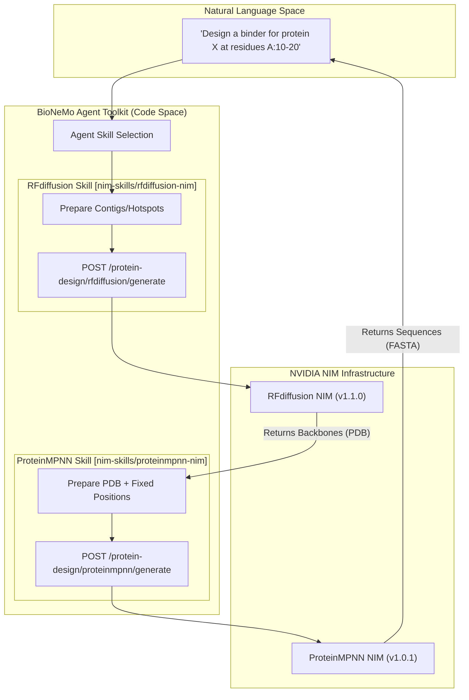
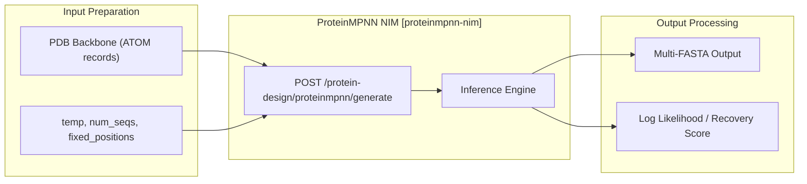

# Protein Design NIMs

<details>
<summary>Relevant source files</summary>

The following files were used as context for generating this wiki page:

- [nim-skills/diffdock-nim/SKILL.md](nim-skills/diffdock-nim/SKILL.md)
- [nim-skills/diffdock-nim/references/api.md](nim-skills/diffdock-nim/references/api.md)
- [nim-skills/diffdock-nim/references/examples.md](nim-skills/diffdock-nim/references/examples.md)
- [nim-skills/diffdock-nim/references/parameters.md](nim-skills/diffdock-nim/references/parameters.md)
- [nim-skills/diffdock-nim/references/science.md](nim-skills/diffdock-nim/references/science.md)
- [nim-skills/diffdock-nim/references/validation.md](nim-skills/diffdock-nim/references/validation.md)

</details>


The Protein Design NIM skills provide access to state-of-the-art generative models for protein backbone diffusion and sequence design. These skills leverage NVIDIA Inference Microservices (NIM) to perform de novo protein design, binder design, and inverse folding tasks.

## 1. Overview and Implementation

The Protein Design suite primarily consists of two core models:
1.  **RFdiffusion**: A diffusion-based model used for generating novel protein backbones. It supports motif scaffolding, partial diffusion, and binder design using "contigs" and "hotspots" syntax.
2.  **ProteinMPNN**: An inverse folding model that generates amino acid sequences for a given protein backbone.

These skills follow the toolkit's standard NIM pattern, offering both a **Hosted NVIDIA API** and a **Local Docker** deployment mode.

### Data Flow and Request Lifecycle

The following diagram illustrates the lifecycle of a protein design request, from natural language intent to the invocation of specific NIM endpoints.

**Protein Design Workflow: Intent to NIM**

**Sources:** [nim-skills/diffdock-nim/SKILL.md:10-36](), [nim-skills/diffdock-nim/references/api.md:3-11]()

---

## 2. RFdiffusion (Backbone Design)

RFdiffusion is used to generate 3D protein structures. In the toolkit, it is frequently used for binder design against a target receptor.

### Contigs and Hotspots Syntax
The model uses a specific syntax to define which parts of a protein are fixed (target) and which are to be generated (binder):
*   **Contigs**: Define the chain and residue ranges. For example, `A1-100/0 20-40` specifies residues 1-100 of chain A are fixed, followed by a gap (`/0`), and then 20-40 residues of new binder backbone should be generated.
*   **Hotspots**: Specific residues on the target protein that the generated binder should contact (e.g., `A15,A17,A22`).

### Request Implementation
Requests to RFdiffusion require the target protein in PDB format, but the NIM is strict about input formatting.

| Requirement | Implementation Detail |
| :--- | :--- |
| **PDB Format** | Must contain **ATOM records only**. Headers, water, and HETATM must be stripped. |
| **Hosted Endpoint** | `https://health.api.nvidia.com/v1/biology/nvidia/rfdiffusion` |
| **Local Endpoint** | `http://localhost:8000/protein-design/rfdiffusion/generate` |
| **Auth** | Hosted requires `Authorization: Bearer $NGC_API_KEY`. |

**Sources:** [nim-skills/diffdock-nim/SKILL.md:79-89](), [nim-skills/diffdock-nim/references/api.md:17-25](), [nim-skills/diffdock-nim/references/validation.md:3-14]()

---

## 3. ProteinMPNN (Sequence Design)

Once a backbone is generated (by RFdiffusion or experimental methods), ProteinMPNN is used for "inverse folding"—predicting the sequence of amino acids that will fold into that specific 3D shape.

### Key Functions and Parameters
The ProteinMPNN NIM skill manages the handoff from PDB structures to sequence outputs.

*   **Inputs**: A PDB string (backbone) and optional `fixed_positions` to prevent certain residues from being redesigned.
*   **Sampling**: The `temp` (temperature) parameter controls the diversity of the generated sequences.
*   **Output**: Returns a multi-FASTA format containing the designed sequences and their associated scores (recovery rate and sequence loss).

**Sequence Generation Data Flow**

**Sources:** [nim-skills/diffdock-nim/SKILL.md:91-98](), [nim-skills/diffdock-nim/references/api.md:33-43](), [nim-skills/diffdock-nim/references/parameters.md:3-19]()

---

## 4. Input/Output and PDB Handling

Both design NIMs require clean PDB inputs. The toolkit provides standard logic for preparing these files.

### PDB Sanitization
The NIMs expect only `ATOM` records. The following logic is implemented across the design skills to ensure compatibility:

```python
# Implementation for cleaning PDBs for NIM consumption
from pathlib import Path
raw_pdb = Path("target.pdb").read_text()
# Filter for ATOM records and join back into a string
clean_pdb = "\n".join(line for line in raw_pdb.splitlines() if line.startswith("ATOM"))
if not clean_pdb:
    raise ValueError("Input PDB has no ATOM records; NIM will reject request.")
```
**Sources:** [nim-skills/diffdock-nim/SKILL.md:83-89](), [nim-skills/diffdock-nim/references/api.md:57-62]()

### Multi-FASTA Handling
ProteinMPNN typically generates multiple sequence candidates for a single backbone. The toolkit parses the NIM response to provide:
1.  **Top Sequence**: The sequence with the highest recovery/lowest loss.
2.  **Diversity Pool**: A list of alternative sequences for validation (e.g., via Boltz2 or OpenFold3).

---

## 5. Local Deployment (Docker)

For production or private workflows, these NIMs can be run locally. The toolkit provides a standard `preflight` pattern for container orchestration.

| Flag | Value | Purpose |
| :--- | :--- | :--- |
| `--runtime` | `nvidia` | Enables GPU access. |
| `--shm-size` | `2G` | Required for inter-process communication. |
| `-v` | `${LOCAL_NIM_CACHE}:/opt/nim/.cache` | Persists model weights (~40GB). |
| `--ulimit` | `memlock=-1` | Prevents memory paging for performance. |

**Local Readiness Check:**
The agent confirms the service is healthy before sending design payloads:
`until curl -sf http://localhost:8000/v1/health/ready; do sleep 5; done`

**Sources:** [nim-skills/diffdock-nim/SKILL.md:44-71](), [nim-skills/diffdock-nim/references/api.md:88-124](), [nim-skills/diffdock-nim/references/validation.md:36-44]()

---