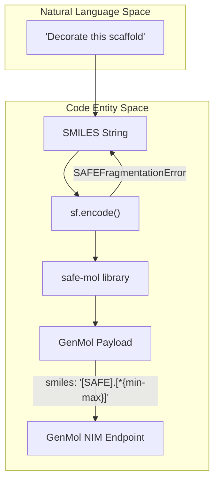
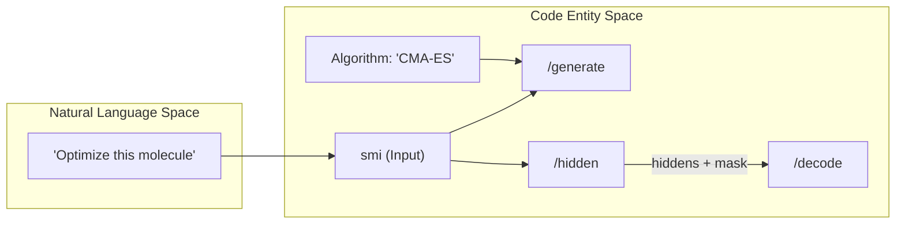

# Generative Chemistry NIMs

<details>
<summary>Relevant source files</summary>

The following files were used as context for generating this wiki page:

- [nim-skills/diffdock-nim/SKILL.md](nim-skills/diffdock-nim/SKILL.md)
- [nim-skills/genmol-nim/SKILL.md](nim-skills/genmol-nim/SKILL.md)
- [nim-skills/genmol-nim/references/api.md](nim-skills/genmol-nim/references/api.md)
- [nim-skills/genmol-nim/references/science.md](nim-skills/genmol-nim/references/science.md)
- [nim-skills/molmim-nim/SKILL.md](nim-skills/molmim-nim/SKILL.md)
- [nim-skills/molmim-nim/evals/evals.json](nim-skills/molmim-nim/evals/evals.json)

</details>


Generative Chemistry NIMs provide microservices for the *de novo* design, optimization, and spatial docking of small molecules. These tools enable agents to transition from abstract chemical requirements (e.g., "design a drug-like molecule with high lipophilicity") to concrete 3D binding poses.

## GenMol: *De Novo* Generation

GenMol is a molecular design NIM that utilizes **SAFE (Sequential Attachment-based Fragment Embedding)** notation rather than standard SMILES for its generation process `[nim-skills/genmol-nim/SKILL.md:10-13]()`. It is optimized for scaffold decoration, motif extension, and lead optimization `[nim-skills/genmol-nim/references/science.md:7-14]()`.

### Implementation Details
GenMol expects input in the `smiles` field, but the content must be SAFE notation `[nim-skills/genmol-nim/references/api.md:19-21]()`. For scaffold-based workflows, the `safe-mol` library is used to encode SMILES into the fragmented SAFE format `[nim-skills/genmol-nim/SKILL.md:92-101]()`.

### GenMol Request Flow
The following diagram illustrates the translation from a SMILES scaffold to a SAFE-masked generation request.

**Diagram: SMILES to GenMol SAFE Workflow**

Sources: `[nim-skills/genmol-nim/SKILL.md:80-101]()`, `[nim-skills/genmol-nim/references/api.md:31-67]()`

| Parameter | Type | Description |
| :--- | :--- | :--- |
| `smiles` | string | SAFE notation with `[*{min-max}]` masked fragments `[nim-skills/genmol-nim/references/api.md:21-21]()`. |
| `scoring` | string | `"QED"` (drug-likeness) or `"LogP"` (lipophilicity) `[nim-skills/genmol-nim/SKILL.md:126-126]()`. |
| `temperature` | **string** | Must be a string (e.g., `"1.0"`) due to API quirks `[nim-skills/genmol-nim/references/api.md:23-23]()`. |

Sources: `[nim-skills/genmol-nim/SKILL.md:120-128]()`, `[nim-skills/genmol-nim/references/api.md:17-28]()`

---

## MolMIM: Latent-Space Optimization

MolMIM (Molecular Machine Interactive Model) provides a controlled latent space for small molecules. Unlike GenMol's fragment-based approach, MolMIM allows for unguided sampling or property-guided optimization using the **CMA-ES** (Covariance Matrix Adaptation Evolution Strategy) algorithm `[nim-skills/molmim-nim/SKILL.md:106-108]()`.

### Latent Space Operations
While the hosted API primarily exposes the `/generate` endpoint, local Docker deployments provide a full latent-space workflow `[nim-skills/molmim-nim/SKILL.md:36-38]()`:
1.  **/embedding**: Converts SMILES to continuous vectors `[nim-skills/molmim-nim/SKILL.md:163-172]()`.
2.  **/hidden**: Extracts hidden states and masks for reconstruction `[nim-skills/molmim-nim/SKILL.md:174-184]()`.
3.  **/decode**: Reverts hidden states back to SMILES `[nim-skills/molmim-nim/SKILL.md:185-191]()`.
4.  **/sampling**: Performs unguided sampling using a `scaled_radius` parameter `[nim-skills/molmim-nim/SKILL.md:193-200]()`.

**Diagram: MolMIM Latent Workflow**

Sources: `[nim-skills/molmim-nim/SKILL.md:123-132]()`, `[nim-skills/molmim-nim/SKILL.md:150-200]()`, `[nim-skills/molmim-nim/evals/evals.json:125-144]()`

---

## DiffDock: Molecular Docking

DiffDock performs blind docking to predict the 3D binding pose of a ligand within a protein receptor `[nim-skills/diffdock-nim/SKILL.md:10-12]()`. It returns a ranked list of poses with associated confidence scores `[nim-skills/diffdock-nim/SKILL.md:130-131]()`.

### Input Preparation
DiffDock requires strict protein formatting:
*   **Protein**: Must contain only `ATOM` records. Headers, water molecules, and `HETATM` records must be stripped `[nim-skills/diffdock-nim/SKILL.md:81-89]()`.
*   **Ligand**: Supports SMILES (passed as `ligand_file_type: "txt"`), SDF, or MOL2 `[nim-skills/diffdock-nim/SKILL.md:91-97]()`.

### Output and Scoring
The NIM returns two parallel lists: `ligand_positions` (SDF strings) and `position_confidence` (floats) `[nim-skills/diffdock-nim/SKILL.md:130-135]()`. Poses are ranked such that index 0 represents the highest confidence prediction `[nim-skills/diffdock-nim/SKILL.md:141-141]()`.

| Feature | Limit / Value |
| :--- | :--- |
| Max Poses | 100 `[nim-skills/diffdock-nim/SKILL.md:149-149]()` |
| VRAM (Local) | ~24 GB `[nim-skills/diffdock-nim/SKILL.md:150-150]()` |
| Local Path | `/molecular-docking/diffdock/generate` `[nim-skills/diffdock-nim/SKILL.md:28-28]()` |

Sources: `[nim-skills/diffdock-nim/SKILL.md:105-125]()`, `[nim-skills/diffdock-nim/SKILL.md:147-154]()`

---

## Deployment and Infrastructure

All Generative Chemistry NIMs follow a standard Docker deployment pattern using `NGC_API_KEY` for authentication and model weight downloads.

### Container Configuration
Local deployment requires the NVIDIA Container Toolkit and specific resource limits to ensure inference stability.

```bash
# Example Startup Pattern for GenMol
docker run --rm -it --name genmol-nim \
  --runtime=nvidia --gpus=all \
  -e NVIDIA_VISIBLE_DEVICES="0" \
  --shm-size=2G \
  --ulimit memlock=-1 \
  --ulimit stack=67108864 \
  -v "${LOCAL_NIM_CACHE}:/opt/nim/.cache" \
  -p 8000:8000 \
  nvcr.io/nim/nvidia/genmol:1.0.1
```
Sources: `[nim-skills/genmol-nim/SKILL.md:44-71]()`, `[nim-skills/genmol-nim/references/api.md:136-159]()`

### Hardware Requirements
| NIM | Min GPU Memory | Disk Space | Key Image |
| :--- | :--- | :--- | :--- |
| GenMol | 16 GB `[nim-skills/genmol-nim/references/api.md:176-176]()` | 20 GB `[nim-skills/genmol-nim/references/api.md:177-177]()` | `nvidia/genmol:1.0.1` |
| MolMIM | 16 GB | 20 GB | `nvidia/molmim:1.0.0` |
| DiffDock | 24 GB `[nim-skills/diffdock-nim/SKILL.md:150-150]()` | 20 GB | `mit/diffdock:2.2.0` |

Sources: `[nim-skills/genmol-nim/references/api.md:173-181]()`, `[nim-skills/molmim-nim/SKILL.md:70-77]()`, `[nim-skills/diffdock-nim/SKILL.md:61-71]()`

---