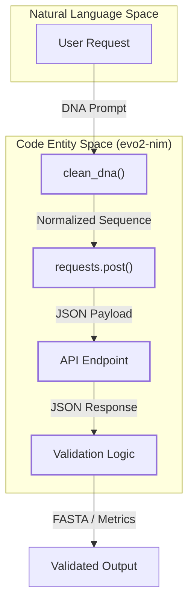
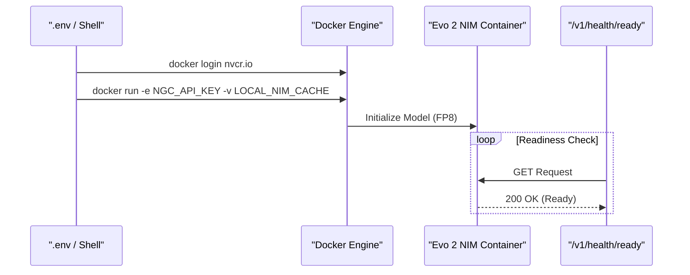

# Genomics NIM — Evo 2

Relevant source files

The following files were used as context for generating this wiki page:

- [nim-skills/evo2-nim/SKILL.md](nim-skills/evo2-nim/SKILL.md)
- [nim-skills/evo2-nim/references/api.md](nim-skills/evo2-nim/references/api.md)
- [nim-skills/evo2-nim/references/examples.md](nim-skills/evo2-nim/references/examples.md)
- [nim-skills/evo2-nim/references/parameters.md](nim-skills/evo2-nim/references/parameters.md)
- [nim-skills/evo2-nim/references/science.md](nim-skills/evo2-nim/references/science.md)
- [nim-skills/evo2-nim/references/validation.md](nim-skills/evo2-nim/references/validation.md)

Evo 2 is a genomic foundation model designed for DNA sequence generation and representation extraction. The Evo 2 NIM (NVIDIA Inference Microservice) provides a standardized interface for interacting with both the 7B and 40B model variants, supporting hosted API generation and local Docker deployment for advanced `/forward` pass layer-output extraction [nim-skills/evo2-nim/SKILL.md:1-13]().

## System Architecture & Data Flow

The toolkit distinguishes between **Hosted** and **Local** modes. Hosted access is limited to the `/generate` endpoint, while local Docker deployments enable the `/forward` endpoint for extracting internal model representations (embeddings, attention maps, etc.) [nim-skills/evo2-nim/SKILL.md:21-32]().

### DNA Generation Workflow
DNA generation involves normalizing input prompts to the standard ACGT alphabet before submission to the microservice [nim-skills/evo2-nim/SKILL.md:93-111]().

**Sources:** [nim-skills/evo2-nim/SKILL.md:98-142](), [nim-skills/evo2-nim/references/api.md:7-14]()

## Local Deployment & Hardware Requirements

Local deployment requires FP8-capable GPUs (Compute Capability 8.9+). Older architectures like A100 (CC 8.0) are incompatible due to the lack of native FP8 support required by the Transformer Engine backend [nim-skills/evo2-nim/SKILL.md:41-43]().

### Hardware Matrix
| Model Variant | Recommended GPU(s) | VRAM Required | Disk Space |
| :--- | :--- | :--- | :--- |
| **40B (Default)** | 2x H100 (80GB) or 1x H200 (141GB) | ~160GB - 141GB | ~110 GB |
| **7B** | 1x H100, H200, RTX 6000 Ada, or L40S | ~48GB+ | ~50 GB |

**Sources:** [nim-skills/evo2-nim/SKILL.md:45-50](), [nim-skills/evo2-nim/references/api.md:195-202]()

### Docker Orchestration
The local container requires an `NGC_API_KEY` for registry authentication and model entitlement checks during the first run [nim-skills/evo2-nim/SKILL.md:32-37]().

**Sources:** [nim-skills/evo2-nim/SKILL.md:54-88](), [nim-skills/evo2-nim/references/api.md:156-182]()

## API Reference & Parameters

### Generation Parameters
The `/generate` endpoint accepts parameters to control the stochasticity and verbosity of the DNA sequence continuation [nim-skills/evo2-nim/references/api.md:24-37]().

*   `sequence`: The DNA prompt (Required) [nim-skills/evo2-nim/references/api.md:28]().
*   `num_tokens`: Number of nucleotides to generate (Default: 100) [nim-skills/evo2-nim/references/api.md:29]().
*   `temperature`: Sampling randomness; values up to 1.3 [nim-skills/evo2-nim/references/api.md:30]().
*   `top_k`: Limits sampling to top $K$ tokens (0-6). DNA focus is typically A, C, G, T [nim-skills/evo2-nim/references/api.md:31]().
*   `enable_sampled_probs`: Returns the probability for each generated token [nim-skills/evo2-nim/references/api.md:35]().

### Local Forward Pass
The `/forward` endpoint captures internal activations. It returns a base64-encoded NPZ (NumPy) structure containing the requested layers [nim-skills/evo2-nim/SKILL.md:147-175]().

**Key Layer Names:**
*   `embedding`: Initial token embeddings.
*   `decoder.layers.<index>.self_attention`: Attention maps (Indices 0-31 for 7B; 0-49 for 40B).
*   `output_layer`: Final model logits before softmax.

**Sources:** [nim-skills/evo2-nim/references/api.md:90-143](), [nim-skills/evo2-nim/references/parameters.md:19-25]()

## Validation & Interpretation

Generated sequences must undergo mechanical and biological validation before downstream use [nim-skills/evo2-nim/references/validation.md:1-5]().

| Check Type | Criteria | Action |
| :--- | :--- | :--- |
| **Alphabet** | Sequence must only contain ACGT | Hard Failure if invalid [nim-skills/evo2-nim/SKILL.md:136-137]() |
| **Complexity** | Long homopolymers or extreme GC content | Warning [nim-skills/evo2-nim/references/validation.md:18-25]() |
| **Tensors** | All values in NPZ must be finite (`np.isfinite`) | Hard Failure if NaN/Inf [nim-skills/evo2-nim/SKILL.md:174-175]() |
| **Timing** | `elapsed_ms` must be non-negative | Reporting [nim-skills/evo2-nim/references/validation.md:16]() |

**Sources:** [nim-skills/evo2-nim/SKILL.md:177-183](), [nim-skills/evo2-nim/references/validation.md:6-34]()

---