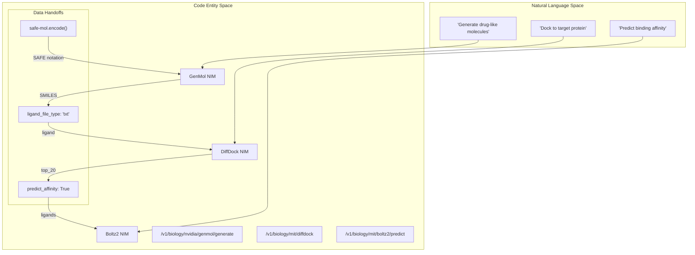

# Meta-Skills: Multi-NIM Pipelines

Relevant source files

The following files were used as context for generating this wiki page:

- [nim-skills/meta-skills/README.md](nim-skills/meta-skills/README.md)
- [nim-skills/meta-skills/drug-discovery-pipeline/SKILL.md](nim-skills/meta-skills/drug-discovery-pipeline/SKILL.md)
- [nim-skills/meta-skills/drug-discovery-pipeline/evals/evals.json](nim-skills/meta-skills/drug-discovery-pipeline/evals/evals.json)
- [nim-skills/meta-skills/msa-structure-prediction-pipeline/SKILL.md](nim-skills/meta-skills/msa-structure-prediction-pipeline/SKILL.md)
- [nim-skills/meta-skills/msa-structure-prediction-pipeline/evals/evals.json](nim-skills/meta-skills/msa-structure-prediction-pipeline/evals/evals.json)

Meta-skills are portable composition skills that orchestrate multiple NVIDIA BioNeMo NIM skills into common scientific workflows [nim-skills/meta-skills/README.md:1-5](). Unlike individual NIM skills that target specific model endpoints, meta-skills manage the orchestration, data handoff, and logical sequencing required to solve complex problems like de novo drug discovery or high-accuracy structure prediction.

## Drug Discovery Pipeline

The Drug Discovery Pipeline meta-skill provides an end-to-end workflow for screening drug candidates by chaining three specific NIMs: **GenMol** for molecule generation, **DiffDock** for molecular docking, and **Boltz2** for binding affinity prediction [nim-skills/meta-skills/drug-discovery-pipeline/SKILL.md:19-24]().

### Workflow Orchestration
The pipeline follows a linear data flow where outputs from one microservice are transformed and passed as inputs to the next.

1.  **Generation (GenMol):** Generates novel molecules or analogs. It requires SAFE notation (Sequence-based Augmented Fragment Embedding) rather than raw SMILES [nim-skills/meta-skills/drug-discovery-pipeline/SKILL.md:51-53]().
2.  **Docking (DiffDock):** Predicts the 3D pose of generated molecules against a target protein. It requires the protein PDB to be filtered to `ATOM` records only [nim-skills/meta-skills/drug-discovery-pipeline/SKILL.md:103-109]().
3.  **Affinity Prediction (Boltz2):** Scores the top docking hits to predict structure-based binding affinity (pIC50) [nim-skills/meta-skills/drug-discovery-pipeline/SKILL.md:153-156]().

### Data Handoff and Implementation Details
The following diagram illustrates the transition from natural language intent to the specific code entities and data transformations required for the pipeline.

**Diagram: Drug Discovery Pipeline Entity Mapping**

Sources: [nim-skills/meta-skills/drug-discovery-pipeline/SKILL.md:63-66](), [nim-skills/meta-skills/drug-discovery-pipeline/SKILL.md:111-112](), [nim-skills/meta-skills/drug-discovery-pipeline/SKILL.md:158-159](), [nim-skills/meta-skills/drug-discovery-pipeline/evals/evals.json:11-39]()

### Technical Constraints
*   **GenMol Payload:** Fields `temperature` and `noise` must be passed as strings (e.g., `"1.0"`) [nim-skills/meta-skills/drug-discovery-pipeline/SKILL.md:83-84]().
*   **DiffDock Filtering:** Protein input must strip `HETATM` lines to prevent docking failures [nim-skills/meta-skills/drug-discovery-pipeline/SKILL.md:106-109]().
*   **Boltz2 Input:** Uses the `polymers` field for protein sequences and requires the `predict_affinity` flag within the `ligands` list to return pIC50 values [nim-skills/meta-skills/drug-discovery-pipeline/SKILL.md:169-174]().

Sources: [nim-skills/meta-skills/drug-discovery-pipeline/SKILL.md:51-198](), [nim-skills/meta-skills/drug-discovery-pipeline/evals/evals.json:9-79]()

---

## MSA Structure Prediction Pipeline

The MSA Structure Prediction Pipeline chains **MSA-Search** (ColabFold) and **OpenFold3** to provide high-accuracy protein structure predictions informed by evolutionary context [nim-skills/meta-skills/msa-structure-prediction-pipeline/SKILL.md:4-12]().

### Pipeline Components
1.  **MSA-Search:** Utilizes GPU-accelerated MMSeqs2 to search UniRef30 and ColabFold environmental databases for homologous sequences [nim-skills/meta-skills/msa-structure-prediction-pipeline/SKILL.md:31-33]().
2.  **OpenFold3:** Consumes the retrieved Multiple Sequence Alignment (MSA) in `.a3m` format to predict the 3D structure [nim-skills/meta-skills/msa-structure-prediction-pipeline/SKILL.md:97-100]().

### Data Flow and Nested Structures
The handoff between these NIMs requires strict adherence to nested JSON schemas. The A3M alignment string retrieved from MSA-Search must be wrapped in a three-level nested structure for OpenFold3 [nim-skills/meta-skills/msa-structure-prediction-pipeline/SKILL.md:107-115]().

**Diagram: MSA Pipeline Data Flow**

Sources: [nim-skills/meta-skills/msa-structure-prediction-pipeline/SKILL.md:54-150](), [nim-skills/meta-skills/msa-structure-prediction-pipeline/evals/evals.json:45-57]()

### Implementation Specifications
| Requirement | Detail |
| :--- | :--- |
| **Database Keys** | Must use exact case: `Uniref30_2302` and `colabfold_envdb_202108` [nim-skills/meta-skills/msa-structure-prediction-pipeline/evals/evals.json:16-18]() |
| **MSA Nesting** | `msa` -> `db_key` (e.g., `uniref30`) -> `a3m` -> `alignment` & `format` [nim-skills/meta-skills/msa-structure-prediction-pipeline/SKILL.md:108-115]() |
| **Output Format** | Set `output_format` to `"pdb"` or `"mmcif"` in the `inputs` list [nim-skills/meta-skills/msa-structure-prediction-pipeline/SKILL.md:124]() |

Sources: [nim-skills/meta-skills/msa-structure-prediction-pipeline/SKILL.md:54-150](), [nim-skills/meta-skills/msa-structure-prediction-pipeline/evals/evals.json:45-111]()

---

## Evaluation Definitions

Meta-skills include an `evals/` directory containing `evals.json`, which defines the expected behavior and technical assertions for agents invoking these pipelines [nim-skills/meta-skills/README.md:9-11]().

### Key Assertion Patterns
*   **Handoff Validation:** Ensures the agent correctly pipes the `smiles` field from GenMol to the `ligand` field in DiffDock [nim-skills/meta-skills/drug-discovery-pipeline/evals/evals.json:36-39]().
*   **Endpoint Correctness:** Verifies the agent uses the exact hosted URLs (e.g., `/v1/biology/mit/diffdock` vs. legacy paths) [nim-skills/meta-skills/drug-discovery-pipeline/evals/evals.json:64-67]().
*   **Type Safety:** Checks that parameters like GenMol's `temperature` are passed as strings, as required by the NIM API contract [nim-skills/meta-skills/drug-discovery-pipeline/evals/evals.json:15-19]().
*   **Score Interpretation:** Validates that the agent understands `position_confidence` in DiffDock (where higher/less negative is better) [nim-skills/meta-skills/drug-discovery-pipeline/evals/evals.json:86-90]().

Sources: [nim-skills/meta-skills/drug-discovery-pipeline/evals/evals.json:1-100](), [nim-skills/meta-skills/msa-structure-prediction-pipeline/evals/evals.json:1-115]()

---