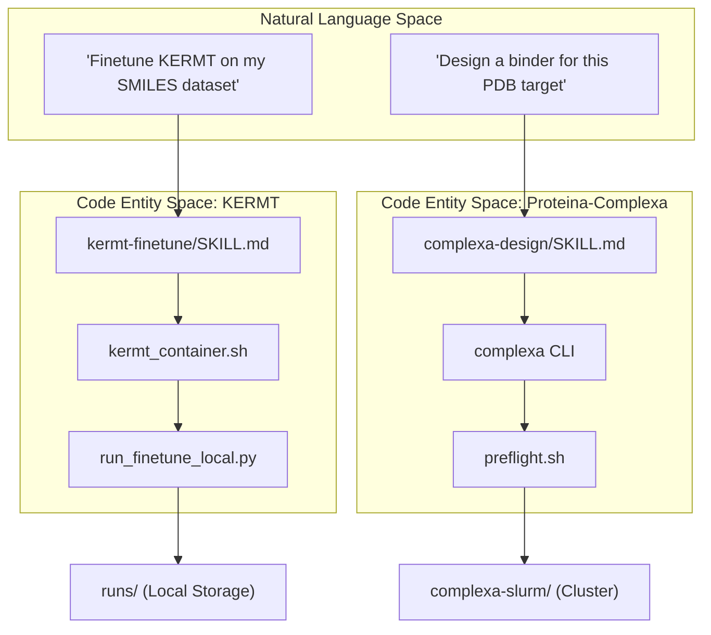
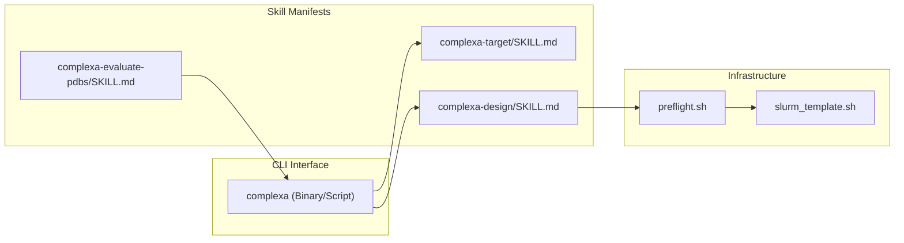

# Open-Model Skills

Relevant source files

The following files were used as context for generating this wiki page:

- [README.md](README.md)

The **Open-Model Skills** section of the BioNeMo Agent Toolkit focuses on skills that utilize locally-run, open-source models rather than remote NVIDIA Inference Microservices (NIM). These skills provide agents with the capability to perform heavy computational tasks—such as molecular property prediction and de novo protein binder design—directly on local infrastructure or private clusters.

The toolkit currently supports two primary open-model suites:
1.  **KERMT**: A Knowledge-Enhanced Residue-level Molecular Transformer for ADMET property prediction.
2.  **Proteina-Complexa**: A flow-based generative model for designing protein binders for both protein and small-molecule targets.

### Architectural Overview

Unlike NIM skills which interact with REST endpoints, Open-Model skills often involve containerized environments and local script execution to manage complex dependencies and hardware requirements.

#### Skill-to-Code Mapping: Open Models
The following diagram illustrates how natural language requests for local model operations are mapped to specific script kernels and container entrypoints within the codebase.

**Diagram: Open-Model Skill Execution Flow**

Sources: [README.md:56-57](), [open-models-skills/kermt/skills/kermt-finetune/SKILL.md:1-20](), [open-models-skills/proteina-complexa/complexa-design/SKILL.md:1-20]()

---

## KERMT: Molecular Property Prediction (#3.1)

**KERMT** (Knowledge-Enhanced Residue-level Molecular Transformer) is a pretrained graph neural network optimized for predicting ADMET (Absorption, Distribution, Metabolism, Excretion, and Toxicity) properties. It extends the GROVER architecture with accelerated data loading via `cuik-molmaker` and achieves state-of-the-art results on real-world datasets [README.md:57]().

The KERMT skill suite is composed of seven distinct skills that handle the full lifecycle of a molecular transformer model:
*   **Setup & Monitoring**: Environment preparation and training progress tracking.
*   **Pretraining**: Training from scratch, continuing pretraining, or adding Chemical Motif Information Maximization (CMIM).
*   **Finetuning & Inference**: Adapting the model to specific tasks and generating predictions for new SMILES.
*   **Embedding**: Extracting latent representations for downstream analysis.

For technical details on the container-first architecture and script kernels, see [KERMT: Molecular Property Prediction](#3.1).

| Skill | Purpose | Key Script |
|:---|:---|:---|
| `kermt-setup` | Pulls container and prepares vocab | `kermt_container.sh` |
| `kermt-finetune` | Trains on labeled SMILES data | `run_finetune_local.py` |
| `kermt-infer` | Generates property predictions | `run_inference.py` |
| `kermt-embed` | Extracts molecular embeddings | `run_extract_embeddings.py` |

Sources: [README.md:57](), [open-models-skills/kermt/skills/kermt-setup/SKILL.md:1-10]()

---

## Proteina-Complexa: Protein Binder Design (#3.2)

**Proteina-Complexa** is a suite of skills for high-quality protein binder generation. It utilizes a flow-based generative model (built on La-Proteina) combined with inference-time optimization to target both protein-protein interfaces and small-molecule ligands [README.md:56]().

The suite is organized into six functional skills:
*   **complexa-setup**: Handles environment readiness and `preflight.sh` checks.
*   **complexa-target**: Prepares the target structure and defines hotspots.
*   **complexa-design**: Executes the core generation pipelines (Protein Binder, Ligand Binder, or AME).
*   **complexa-evaluate-pdbs**: Provides post-generation metrics and validation.
*   **complexa-sweep**: Manages hyperparameter optimization for design runs.
*   **complexa-slurm**: Facilitates submission to high-performance computing (HPC) clusters.

For details on the `complexa` CLI and SLURM integration, see [Proteina-Complexa: Protein Binder Design](#3.2).

**Diagram: Proteina-Complexa Workflow Entities**

Sources: [README.md:56](), [open-models-skills/proteina-complexa/complexa-setup/SKILL.md:1-15]()

---

## Summary of Open-Model Skills

| Suite | Domain | Primary Model Type | Deployment Mode |
|:---|:---|:---|:---|
| **KERMT** | Cheminformatics | Graph Transformer | Local Docker Container |
| **Proteina-Complexa** | Protein Engineering | Flow-based Generative | Local / SLURM Cluster |

Sources: [README.md:56-57]()

---