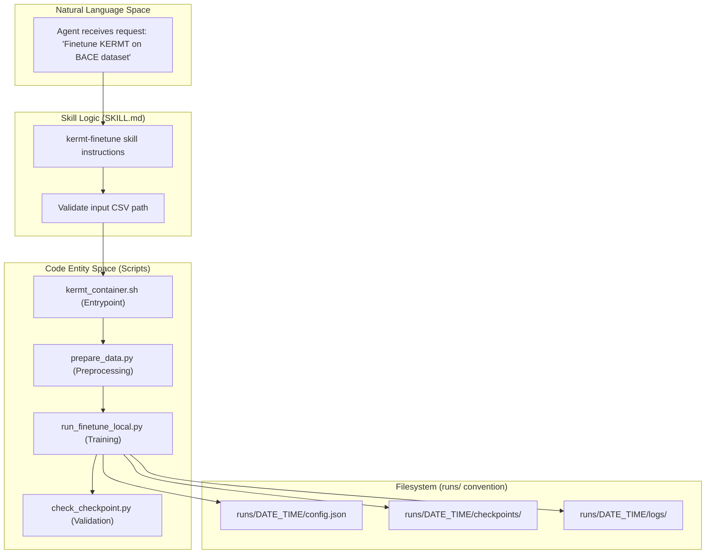
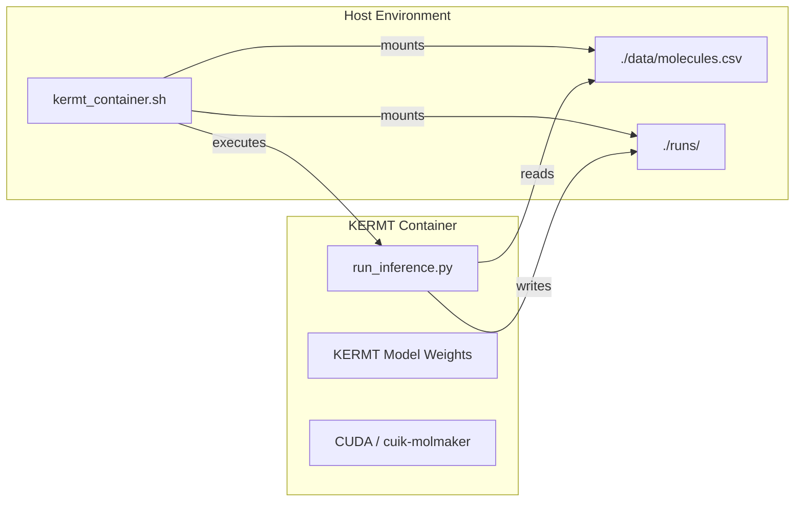

# KERMT: Molecular Property Prediction

Relevant source files

The following files were used as context for generating this wiki page:

- [README.md](README.md)

KERMT (Knowledge-Enhanced Residue-level Molecular Transformer) is a suite of skills designed for high-performance molecular property prediction (ADMET). It utilizes a pretrained graph neural network, serving as a multi-task extension of GROVER, and incorporates accelerated data loading via `cuik-molmaker` [README.md:57-57]().

The KERMT architecture is container-first, relying on a dedicated Docker environment to ensure deterministic execution of its Python script kernels. The suite follows a standardized directory convention where all outputs, checkpoints, and logs are stored within a `runs/` directory [open-models-skills/kermt/skills/kermt-setup/SKILL.md:1-20]().

### Skill Suite Overview

The KERMT functionality is partitioned into seven distinct skills that cover the entire lifecycle of a molecular model, from environment setup to inference and embedding extraction.

| Skill | Role | Key Code Entities |
|:---|:---|:---|
| **Setup** | Environment and container initialization | `kermt_container.sh` |
| **Pretrain (Scratch)** | Training from a blank state | `run_pretrain_local.py` |
| **Continue Pretrain** | Resuming pretraining from a checkpoint | `run_pretrain_local.py` |
| **Add CMIM Pretrain** | Contextual Masked Interaction Modeling | `upgrade_to_hybrid.py` |
| **Finetune** | Task-specific optimization (e.g., ADMET) | `run_finetune_local.py` |
| **Infer** | Predicting properties for new SMILES | `run_inference.py` |
| **Embed** | Extracting latent vector representations | `run_extract_embeddings.py` |
| **Monitor** | Progress tracking and checkpoint validation | `check_checkpoint.py` |

For a deep dive into the specific workflow steps and hardware requirements for each, see [KERMT Skills Reference](#3.1.1).

### Architecture & Script Kernels

KERMT operates by bridging Natural Language instructions provided to the agent with low-level Python "kernels" executed inside a container. This ensures that complex dependencies (like CUDA-accelerated graph processing) do not conflict with the agent's host environment.

#### Logic Flow: NL Space to Code Entity Space

The following diagram illustrates how an agent request translates into the execution of specific KERMT script kernels and the management of the `runs/` directory.

**KERMT Execution Workflow**

Sources: [README.md:57-57](), [open-models-skills/kermt/skills/kermt-setup/SKILL.md:1-20]().

### Configuration & Data Conventions

KERMT skills rely on a strict data and configuration contract to ensure reproducibility:
*   **Runs Directory:** Every execution creates a timestamped sub-directory within `runs/` to prevent data collisions.
*   **Vocab Bundles:** Pretraining and finetuning require specific vocabulary files that define the atom and bond features.
*   **Deterministic Kernels:** The Python scripts (e.g., `prepare_data.py`, `check_data.py`) return structured JSON outputs, allowing the agent to parse success or failure programmatically.

For detailed documentation on the script kernels, JSON contracts, and the pytest suite, see [KERMT Scripts & Testing](#3.1.2).

### Container Management

The `kermt_container.sh` script acts as the primary interface between the host and the KERMT environment. It handles:
1.  **Bind-Mounting:** Mapping the local `runs/` and data directories into the container.
2.  **GPU Selection:** Managing DDP-aware (Distributed Data Parallel) GPU allocation for training tasks.
3.  **Environment Parity:** Ensuring the `kermt:latest` image is used for both development and production inference.

**Container Interaction Model**

Sources: [README.md:57-57](), [open-models-skills/kermt/skills/kermt-setup/SKILL.md:1-20]().

---