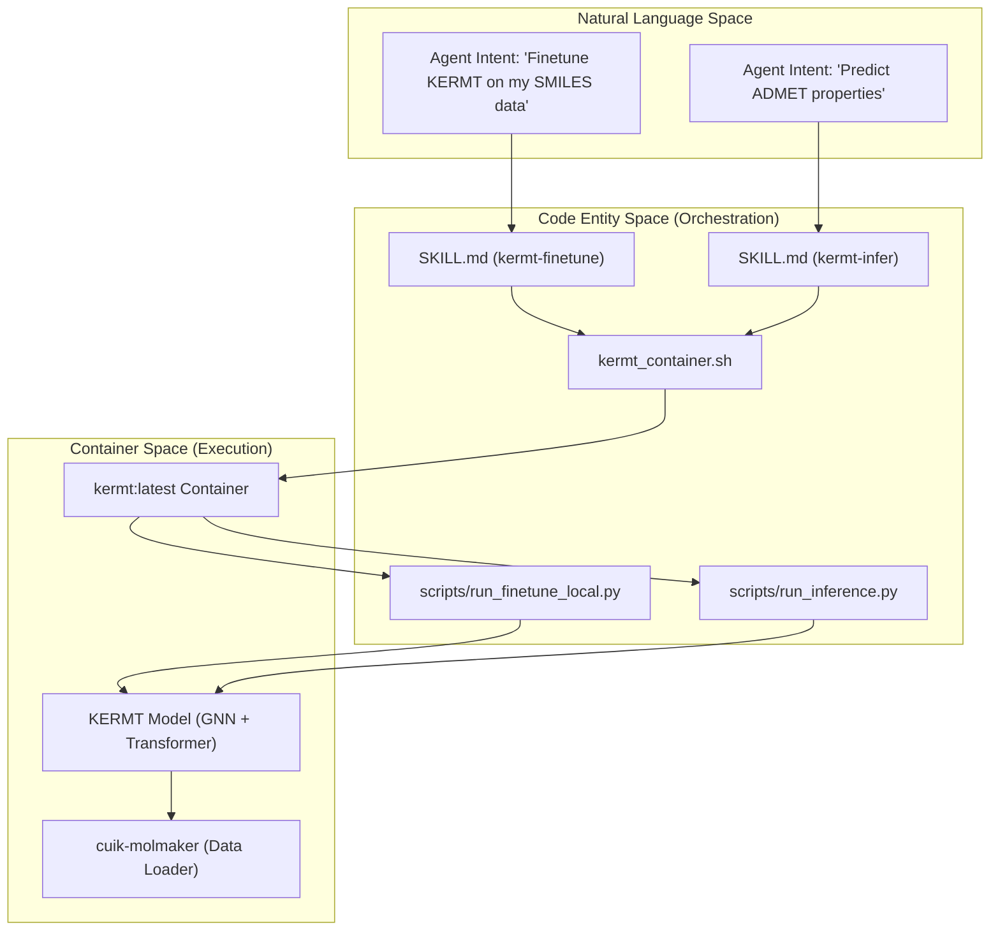
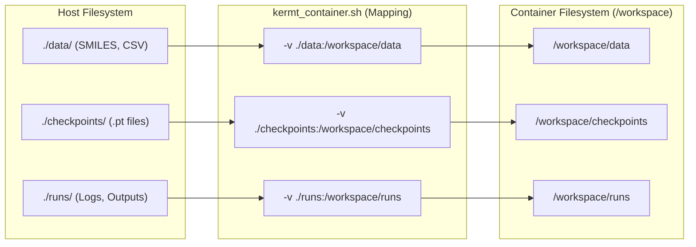

# KERMT Skills Reference

Relevant source files

The following files were used as context for generating this wiki page:

- [README.md](README.md)

The **KERMT** (Knowledge-Enhanced Residue-level Molecular Transformer) skill suite provides a comprehensive set of tools for molecular property prediction (ADMET), pretraining, and embedding extraction. KERMT extends the GROVER architecture with multi-task capabilities and utilizes `cuik-molmaker` for accelerated data loading [README.md:57-57](). These skills are designed to run within a containerized environment to ensure deterministic execution and dependency isolation.

### Skill Architecture and Data Flow

KERMT skills follow a standardized execution pattern centered around the `kermt_container.sh` script. This script manages Docker/Apptainer container invocation and handles the complex bind-mounting required to map local project directories, data, and model checkpoints into the container's internal filesystem.

The following diagram illustrates the transition from the Natural Language intent (invoked by an agent) to the specific code entities and containerized execution flow.

**Diagram: KERMT Natural Language to Code Entity Mapping**

**Sources:** [README.md:57-57](), [open-models-skills/kermt/skills/kermt-setup/SKILL.md:1-10]()

---

### Individual Skill Reference

The KERMT suite is divided into eight specialized skills that cover the full lifecycle of molecular machine learning, from environment setup to production inference.

| Skill Name | Purpose | Key Script Kernel |
|:---|:---|:---|
| `kermt-setup` | Initializes environment and downloads vocab bundles. | `kermt_container.sh` |
| `kermt-pretrain-scratch` | Trains a new KERMT model from random initialization. | `run_pretrain_local.py` |
| `kermt-continue-pretrain` | Resumes pretraining from an existing checkpoint. | `run_pretrain_local.py` |
| `kermt-add-cmim-pretrain` | Upgrades a model to the Hybrid (CMIM) architecture. | `upgrade_to_hybrid.py` |
| `kermt-finetune` | Supervised training on specific molecular properties. | `run_finetune_local.py` |
| `kermt-infer` | High-throughput property prediction for SMILES. | `run_inference.py` |
| `kermt-embed` | Extracts high-dimensional molecular descriptors. | `run_extract_embeddings.py` |
| `kermt-monitor` | Tracks training progress and validation metrics. | `check_checkpoint.py` |

**Sources:** [README.md:57-57]()

---

### Hardware and VRAM Requirements

KERMT is a GPU-accelerated model. Performance and feasibility depend on the specific skill being executed. All skills are DDP (Distributed Data Parallel) aware and can utilize multiple GPUs.

| Skill | GPU VRAM (Min) | Disk Space | Estimated Time |
|:---|:---|:---|:---|
| `kermt-setup` | N/A | ~5GB (Container + Vocab) | 5-10 mins |
| `kermt-infer` | 8GB | < 1GB | Seconds per 1k molecules |
| `kermt-embed` | 12GB | Variable (Output size) | Seconds per 1k molecules |
| `kermt-finetune` | 16GB+ | 1GB - 5GB | 1-4 hours (dataset dependent) |
| `kermt-pretrain` | 32GB+ (A100/H100) | 50GB+ | Days/Weeks |

**Sources:** [README.md:57-57]()

---

### The `kermt_container.sh` Bind-Mount Pattern

To maintain data persistence and allow the container to access local files, `kermt_container.sh` implements a strict bind-mount convention. This pattern ensures that the agent's workspace is reflected inside the container at predictable paths.

**Data Flow and Filesystem Mapping**

**Sources:** [README.md:57-57]()

---

### Vocabulary Bundle Conventions

KERMT relies on specific vocabulary files for its atom and bond tokenization. These bundles are typically managed by the `kermt-setup` skill.

1.  **Atom Vocabulary:** Defines the valid atom types and environments the model can process.
2.  **Bond Vocabulary:** Defines the valid bond types and connectivity patterns.
3.  **Fragment Vocabulary:** (For Hybrid/CMIM models) Contains predefined molecular substructures used for higher-level reasoning.

When invoking `run_pretrain_local.py` or `run_finetune_local.py`, the `--vocab_path` argument must point to a directory containing these standardized bundles.

**Sources:** [README.md:57-57]()

---