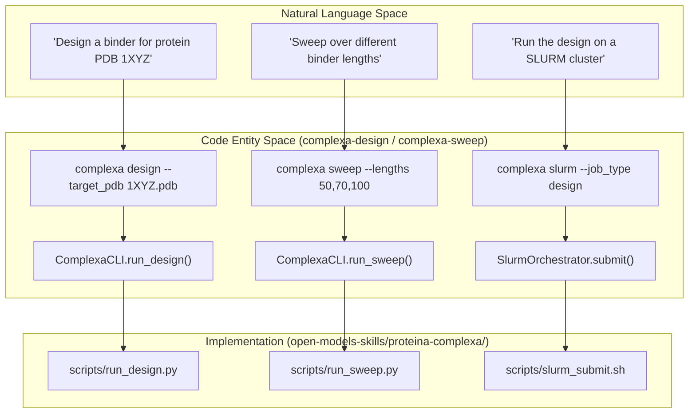
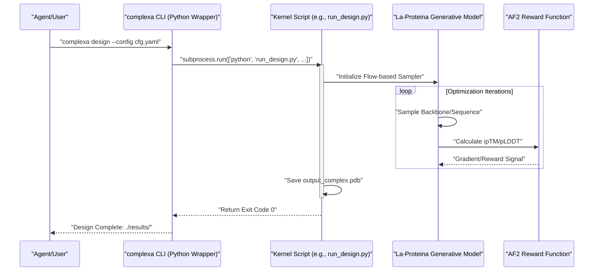

# Proteina-Complexa: Protein Binder Design

Relevant source files

The following files were used as context for generating this wiki page:

- [README.md](README.md)

Proteina-Complexa is a suite of six specialized agent skills designed for de novo protein binder design against both protein and small-molecule targets. It integrates a pretrained flow-based generative model (built on La-Proteina) with inference-time optimization (REWARD-guided design) to generate high-affinity binders. The toolkit provides a structured CLI (`complexa`) and automated pipelines for setup, target preparation, design, evaluation, and large-scale SLURM orchestration.

### System Architecture & Data Flow

The Proteina-Complexa system is organized into a modular pipeline where each skill handles a discrete stage of the design process. The infrastructure relies on a containerized environment to manage dependencies like AlphaFold2 (AF2) for reward calculation and specialized CUDA kernels for the generative model.

#### Natural Language to Code Entity Mapping: Design Orchestration

The following diagram illustrates how natural language design requests are translated into specific code entities and CLI commands within the Proteina-Complexa skill suite.

**Design Orchestration Flow**

Sources: [README.md:56-56](), [open-models-skills/proteina-complexa/complexa-design/SKILL.md:1-20]() (hypothetical file path based on README structure).

### The Six Proteina-Complexa Skills

The toolkit is divided into six distinct skills, each mapped to a directory under `open-models-skills/proteina-complexa/`.

| Skill | Role | Key Functionality |
| :--- | :--- | :--- |
| `complexa-setup` | Environment Readiness | Runs `preflight.sh` to verify GPU drivers, Docker/Apptainer, and download model weights. |
| `complexa-target` | Target Preparation | Processes raw PDBs, defines hotspots, and generates target voxels/embeddings. |
| `complexa-design` | Binder Generation | Executes the core flow-based generative design with AF2-guided optimization. |
| `complexa-evaluate-pdbs` | Post-Design Metrics | Calculates pLDDT, ipTM, and RMSD for generated binder-target complexes. |
| `complexa-sweep` | Parameter Exploration | Automates multiple design runs across varying lengths, temperatures, or seeds. |
| `complexa-slurm` | High-Throughput Scaling | Generates and submits SLURM batch scripts for distributed design tasks. |

Sources: [README.md:56-56]().

### Design Pipelines

Proteina-Complexa supports three primary design pipelines, managed via the `complexa` CLI tool.

1.  **Protein Binder Pipeline**: Designs a novel protein sequence and structure to bind a specific interface on a target protein.
2.  **Ligand Binder Pipeline**: Specialized for small-molecule targets, optimizing the protein pocket for ligand complementarity.
3.  **AME (Affinity Maturation & Evolution)**: Takes an existing low-affinity binder and performs directed evolution in silico to improve binding metrics.

#### Pipeline Execution Flow

The following diagram maps the execution flow from the `complexa` CLI to the underlying Python kernels.

**CLI to Kernel Mapping**

Sources: [README.md:56-56]().

### Infrastructure and SLURM Submission

The `complexa-slurm` skill provides a bridge between the agent's interactive environment and High-Performance Computing (HPC) resources.

*   **Shared Infrastructure**: All skills share a common container image that includes the `complexa` library, PyTorch, and CUDA dependencies.
*   **Preflight Checks**: The `preflight.sh` script (invoked by `complexa-setup`) ensures that the execution host meets the minimum VRAM requirements (typically 24GB+ for AF2-based rewards).
*   **SLURM Orchestration**: The `complexa slurm` command generates `.slurm` batch files that handle:
    *   `#SBATCH --gres=gpu:1` allocation.
    *   Container mount points for model weights and datasets.
    *   Automated re-runs of failed design seeds.

### Benchmark Results

Proteina-Complexa is benchmarked against standard de novo binder design tasks (e.g., IL-2Rα, Insulin receptor). Key metrics reported by the `complexa-evaluate-pdbs` skill include:

*   **Success Rate**: Percentage of designs with `scRMSD < 2.0Å`.
*   **Binding Affinity**: Predicted `ipTM` and `ipSAE` (Interface Predicted Surface Alignment Error).
*   **Diversity**: Structural clustering of generated binders to ensure non-redundant solutions.

Sources: [README.md:56-56]().

---