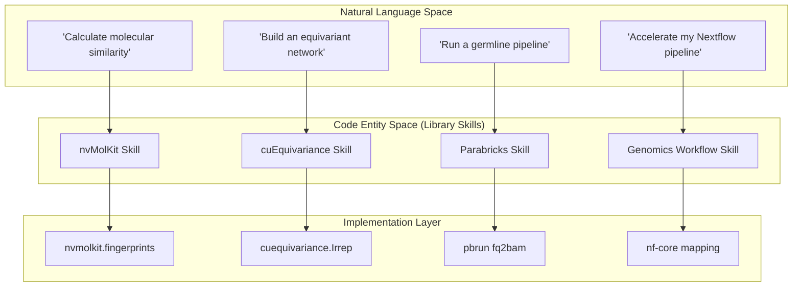

# Library Skills

Relevant source files

The following files were used as context for generating this wiki page:

- [library-skills/cuEquivariance/.skillsource.json](library-skills/cuEquivariance/.skillsource.json)
- [library-skills/cuEquivariance/SKILL.md](library-skills/cuEquivariance/SKILL.md)
- [library-skills/nvMolKit/.skillsource.json](library-skills/nvMolKit/.skillsource.json)
- [library-skills/nvMolKit/SKILL.md](library-skills/nvMolKit/SKILL.md)
- [library-skills/parabricks/.skillsource.json](library-skills/parabricks/.skillsource.json)
- [library-skills/parabricks/SKILL.md](library-skills/parabricks/SKILL.md)

Library Skills wrap GPU-accelerated local Python libraries and command-line tools. Unlike NIM Skills, which interact with remote microservices, Library Skills execute logic directly on the local infrastructure where the agent or its task-runner is active. These skills are designed for high-throughput batch processing and complex mathematical operations that benefit from direct GPU memory access.

### High-Level Skill Mapping

The following diagram illustrates the relationship between the natural language intent, the high-level library skill, and the underlying code entities.

**Library Skill Entity Map**

**Sources:** [library-skills/nvMolKit/SKILL.md:64-78](), [library-skills/cuEquivariance/SKILL.md:10-15](), [library-skills/parabricks/SKILL.md:68-98]().

---

## 4.1 nvMolKit: GPU-Accelerated Cheminformatics
`nvMolKit` provides GPU-accelerated, batched implementations of common RDKit operations. It is optimized for high-throughput scenarios where thousands of molecules need to be processed simultaneously. Key capabilities include:
*   **Fingerprinting**: `MorganFingerprintGenerator` for circular fingerprints [library-skills/nvMolKit/SKILL.md:66]().
*   **Similarity**: `crossTanimotoSimilarity` and `crossCosineSimilarity` for bulk comparisons [library-skills/nvMolKit/SKILL.md:67]().
*   **Conformers**: `EmbedMolecules` using ETKDG and optimization via `MMFF94` or `UFF` [library-skills/nvMolKit/SKILL.md:68-70]().
*   **Clustering**: `fused_butina` for memory-efficient clustering [library-skills/nvMolKit/SKILL.md:74]().

For details, see [nvMolKit: GPU-Accelerated Cheminformatics](#4.1).

**Sources:** [library-skills/nvMolKit/SKILL.md:13-35]().

---

## 4.2 cuEquivariance: Equivariant Neural Networks
The `cuEquivariance` skill facilitates the definition and execution of equivariant operations for Lie groups (SO3, O3, SU2). It manages the mathematical complexity of group theory in neural networks through:
*   **Group Theory Abstractions**: `Irrep` subclasses and `Irreps` collections [library-skills/cuEquivariance/SKILL.md:10-12]().
*   **Segmented Polynomials**: `SegmentedTensorProduct` and `EquivariantPolynomial` for tensor contractions [library-skills/cuEquivariance/SKILL.md:13-15]().
*   **Coefficients**: Automated handling of Clebsch-Gordan coefficients [library-skills/cuEquivariance/SKILL.md:52-58]().

For details, see [cuEquivariance: Equivariant Neural Networks](#4.2).

**Sources:** [library-skills/cuEquivariance/SKILL.md:1-20]().

---

## 4.3 Parabricks: GPU-Accelerated Genomics
The `parabricks` skill routes NVIDIA Parabricks `pbrun` tools for secondary genomic analysis. It handles tool discovery and command generation for:
*   **Alignment**: `fq2bam` (DNA) and `rna_fq2bam` (RNA-seq) [library-skills/parabricks/SKILL.md:74,79]().
*   **Variant Calling**: `haplotypecaller`, `deepvariant`, and `mutectcaller` [library-skills/parabricks/SKILL.md:83-86]().
*   **Specialized Assays**: Methylation (`fq2bam_meth`) and Pangenome-aware pipelines (`giraffe`) [library-skills/parabricks/SKILL.md:75-76]().

For details, see [Parabricks: GPU-Accelerated Genomics](#4.3).

**Sources:** [library-skills/parabricks/SKILL.md:17-45]().

---

## 4.4 Genomics Workflow Acceleration
This skill focuses on the architectural optimization of existing genomic pipelines (Nextflow, Snakemake, WDL). It maps CPU-intensive steps to their Parabricks GPU equivalents to reduce wall-clock time and cost. It provides:
*   **Pipeline Inspection**: Analyzing existing DAGs for acceleration opportunities.
*   **GPU Branching**: Adding runtime toggles to switch between CPU and GPU implementations.
*   **Benchmarking**: Methodology for A/B comparison of results and performance.

For details, see [Genomics Workflow Acceleration](#4.4).

**Sources:** [library-skills/parabricks/SKILL.md:25-27]().

---

### Execution Model Comparison

| Feature | nvMolKit | cuEquivariance | Parabricks |
| :--- | :--- | :--- | :--- |
| **Primary Interface** | Python API | Python API | CLI (`pbrun`) |
| **Data Handling** | `AsyncGpuResult` (Tensors) | `SegmentedTensorProduct` | Files (BAM/VCF/FASTQ) |
| **Concurrency** | `torch.cuda.Stream` | Internal JAX/PyTorch | Docker/Process level |
| **Requirement** | CUDA 12.6+ | Python 3.10+ | NVIDIA Container Toolkit |

**Sources:** [library-skills/nvMolKit/SKILL.md:79-104](), [library-skills/cuEquivariance/SKILL.md:138-140](), [library-skills/parabricks/SKILL.md:117-125]().

---