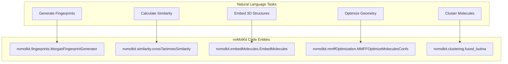
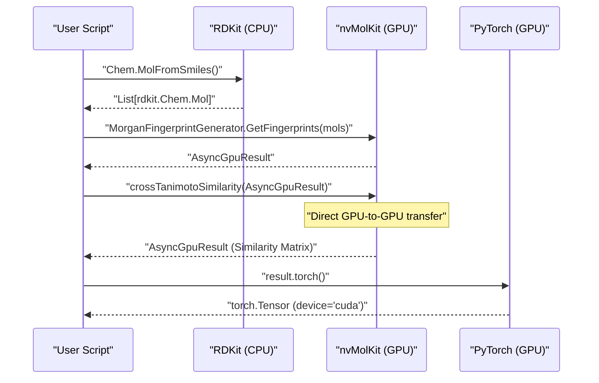

# nvMolKit: GPU-Accelerated Cheminformatics

Relevant source files

The following files were used as context for generating this wiki page:

- [library-skills/nvMolKit/.skillsource.json](library-skills/nvMolKit/.skillsource.json)
- [library-skills/nvMolKit/SKILL.md](library-skills/nvMolKit/SKILL.md)

The `nvMolKit` library is a GPU-accelerated cheminformatics toolkit designed to provide high-throughput, batched implementations of common RDKit operations. It is specifically engineered for workloads involving large batches of molecules (typically thousands or more) where the primary metric is total wall-clock throughput across the batch rather than per-molecule latency [library-skills/nvMolKit/SKILL.md:15-25]().

## Overview and Purpose

`nvMolKit` provides Python APIs that mirror RDKit conventions but are optimized for parallel execution on NVIDIA GPUs using CUDA. It links against RDKit at build time, allowing it to accept and return standard RDKit `Mol` objects while performing heavy computations—such as conformer generation, forcefield optimization, and fingerprinting—on the GPU [library-skills/nvMolKit/SKILL.md:15-18]().

### Key Features
*   **Morgan Fingerprints:** High-speed generation of circular fingerprints.
*   **Similarity Metrics:** Batched Tanimoto and Cosine similarity calculations.
*   **3D Conformer Generation:** GPU-accelerated ETKDG embedding.
*   **Forcefield Optimization:** MMFF94 and UFF support for batch minimization.
*   **Clustering:** Memory-efficient Butina clustering.
*   **Substructure Search:** Parallelized matching across large molecule sets.

### System Requirements
*   **Hardware:** NVIDIA GPU with compute capability 7.0 (V100) or higher [library-skills/nvMolKit/SKILL.md:31-31]().
*   **Software:** CUDA 12.6+ compatible driver and `torch` with CUDA support [library-skills/nvMolKit/SKILL.md:32-33]().
*   **Execution:** There is no CPU fallback; if CUDA is unavailable, the library will raise an exception [library-skills/nvMolKit/SKILL.md:35-35]().

---

## Technical Architecture and Data Flow

The library is designed around a "batch-first" philosophy. Data typically flows from RDKit `Mol` objects into GPU-resident tensors, where kernels perform bulk operations before optionally returning results to the host or passing them to other GPU-aware libraries like PyTorch.

### Bridge: Natural Language to Code Entities (Core Modules)

The following diagram maps high-level cheminformatics tasks to the specific `nvmolkit` modules and entry points used in the codebase.

**Task to Module Mapping**

Sources: [library-skills/nvMolKit/SKILL.md:62-77]()

### Result Types and Execution Model

`nvMolKit` uses specialized result objects to manage GPU memory and asynchronous execution.

1.  **`AsyncGpuResult`**: Used for flat tensors (fingerprints, similarity matrices). These operations are often asynchronous, returning a handle immediately while the GPU continues work [library-skills/nvMolKit/SKILL.md:83-87]().
    *   `.torch()`: Returns a zero-copy `torch.Tensor` on the GPU [library-skills/nvMolKit/SKILL.md:88-88]().
    *   `.numpy()`: Synchronizes the GPU and returns a CPU-side array [library-skills/nvMolKit/SKILL.md:89-89]().
2.  **`Device3DResult`**: Used for 3D coordinates (ETKDG/MMFF). It stores coordinates as a single flat tensor of shape `(total_atoms, 3)` to maximize memory efficiency [library-skills/nvMolKit/SKILL.md:124-128]().

**Data Flow: Fingerprinting and Similarity**

Sources: [library-skills/nvMolKit/SKILL.md:83-101](), [library-skills/nvMolKit/SKILL.md:107-122]()

---

## Key Functional Areas

### 1. Fingerprints and Similarity
`nvMolKit` implements Morgan (Circular) fingerprints. The `GetFingerprints` method returns bits packed into `int32` tensors to save space [library-skills/nvMolKit/SKILL.md:52-57](). Similarity functions like `crossTanimotoSimilarity` can take these `AsyncGpuResult` objects directly [library-skills/nvMolKit/SKILL.md:90-90]().

### 2. Conformer Generation (ETKDG)
The `EmbedMolecules` function handles batched 3D embedding. It utilizes `HardwareOptions` to tune batch sizes and GPU IDs for maximum performance [library-skills/nvMolKit/SKILL.md:68-68](), [library-skills/nvMolKit/SKILL.md:76-76]().

### 3. Forcefield Optimization
The toolkit provides two modes for forcefield work:
*   **One-shot:** `MMFFOptimizeMoleculesConfs` or `UFFOptimizeMoleculesConfs` for simple minimization [library-skills/nvMolKit/SKILL.md:69-70]().
*   **Interactive:** `MMFFBatchedForcefield` allows adding constraints (distance, position, angle, torsion) and manually stepping through minimization via `.minimize(maxIters, forceTol)` [library-skills/nvMolKit/SKILL.md:71-71]().

### 4. Clustering and Substructure Search
*   **`fused_butina`**: A memory-efficient implementation that calculates similarities on-the-fly to avoid $O(N^2)$ memory bottlenecks [library-skills/nvMolKit/SKILL.md:74-74]().
*   **Substructure**: Functions like `hasSubstructMatch` and `getSubstructMatches` allow for rapid filtering of molecular libraries [library-skills/nvMolKit/SKILL.md:75-75]().

---

## Usage Patterns and Stream Control

To enable overlapping of computation and data transfer, several `nvMolKit` APIs accept a `stream` argument. This allows users to integrate `nvMolKit` into complex PyTorch pipelines without blocking the default CUDA stream.

| Module | Function/Class | Stream Support |
| :--- | :--- | :--- |
| `fingerprints` | `MorganFingerprintGenerator.GetFingerprints` | Yes |
| `similarity` | `crossTanimotoSimilarity` | Yes |
| `clustering` | `butina`, `fused_butina` | Yes |
| `conformerRmsd` | `GetConformerRMSMatrix` | Yes |

Sources: [library-skills/nvMolKit/SKILL.md:96-101]()

### Example: Stream-Aware Workflow
Users should follow this pattern to ensure asynchronous execution:
1. Create a `torch.cuda.Stream()`.
2. Wrap calls in `with torch.cuda.stream(stream):`.
3. Pass the `stream` object to the `nvMolKit` function.
4. Call `stream.synchronize()` before accessing data on the CPU.

Sources: [library-skills/nvMolKit/SKILL.md:113-122]()

---