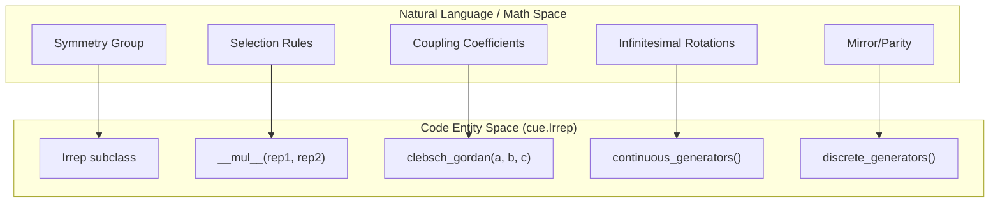
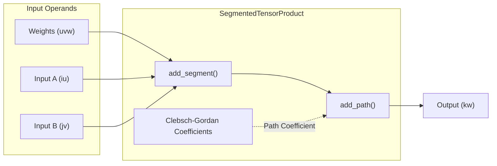

# cuEquivariance: Equivariant Neural Networks

<details>
<summary>Relevant source files</summary>

The following files were used as context for generating this wiki page:

- [library-skills/cuEquivariance/.skillsource.json](library-skills/cuEquivariance/.skillsource.json)
- [library-skills/cuEquivariance/SKILL.md](library-skills/cuEquivariance/SKILL.md)

</details>


`cuEquivariance` (imported as `cue`) is a library for building equivariant neural networks, focusing on group theory abstractions and high-performance segmented tensor operations. It provides the mathematical foundation for processing geometric data (like protein structures or molecular graphs) where physical symmetries (rotations, reflections) must be preserved.

## Overview and Core Abstractions

The library is organized into two primary layers:
1.  **Group Theory**: Defines irreducible representations (irreps) for Lie groups (SO3, O3, SU2) and provides tools for managing collections of these irreps.
2.  **Segmented Polynomials**: Implements high-performance tensor contractions over segmented data. This allows for efficient execution of operations where different parts of a tensor represent different symmetry blocks.

### Key Classes

| Class | Purpose |
| :--- | :--- |
| `Irrep` | Abstract base class for irreducible representations of a group. |
| `Irreps` | A collection of irreps with multiplicities (e.g., `16x0e + 4x1o`). |
| `SegmentedTensorProduct` | Describes tensor contractions over segments of varying shapes linked by paths. |
| `SegmentedPolynomial` | A collection of `SegmentedTensorProduct` objects forming a polynomial with named inputs. |
| `EquivariantPolynomial` | A wrapper for dense operands using `IrrepsAndLayout` metadata. |
| `IrDictPolynomial` | A wrapper for operands split into dictionaries of irreps (`dict[Irrep, Array]`). |

Sources: `[library-skills/cuEquivariance/SKILL.md:8-16]()`

---

## Group Theory and Irreps

The `Irrep` class is the fundamental unit of symmetry. It is a frozen dataclass that defines how a specific representation behaves under group operations.

### System Mapping: Group Theory to Code
The following diagram shows how mathematical group concepts map to specific class methods in `cue.Irrep`.

**Group Representation Mapping**

Sources: `[library-skills/cuEquivariance/SKILL.md:29-87]()`

### Built-in Groups
`cuEquivariance` includes several pre-defined groups commonly used in structural biology and physics:
*   **`cue.SO3(l)`**: 3D rotations. Represented by integer `l` (angular momentum). Dimension is $2l+1$. [library-skills/cuEquivariance/SKILL.md:111-111]()
*   **`cue.O3(l, p)`**: 3D rotations plus parity (reflections). `p` is +1 (even) or -1 (odd). [library-skills/cuEquivariance/SKILL.md:112-112]()
*   **`cue.SU2(j)`**: The double cover of SO(3), used for spin. `j` is a non-negative half-integer. [library-skills/cuEquivariance/SKILL.md:113-113]()

### Irreps Collections and Layouts
The `Irreps` class manages groups of irreps. Memory layout is critical for GPU performance and is controlled by `IrrepsLayout`:
*   **`cue.ir_mul`**: Data ordered as `(ir.dim, mul)`. This is the internal format for all descriptors. [library-skills/cuEquivariance/SKILL.md:127-127]()
*   **`cue.mul_ir`**: Data ordered as `(mul, ir.dim)`. This is the standard format for PyTorch and `dict[Irrep, Array]` workflows. [library-skills/cuEquivariance/SKILL.md:128-128]()

---

## Segmented Tensor Products (STP)

The `SegmentedTensorProduct` (STP) is the engine for equivariant operations. It uses Einstein notation to define contractions across segments.

### Data Flow in Segmented Operations
The following diagram illustrates how raw tensors are processed through segments and paths to produce an equivariant output.

**STP Execution Flow**

Sources: `[library-skills/cuEquivariance/SKILL.md:137-183]()`

### Key STP Functions
*   **`from_subscripts(subscripts)`**: Initializes an STP using Einstein notation. Subscripts starting with `uvw` imply a weights operand. [library-skills/cuEquivariance/SKILL.md:139-142]()
*   **`add_segment(operand_index, shape)`**: Defines a block of data within an operand. [library-skills/cuEquivariance/SKILL.md:143-146]()
*   **`add_path(*segment_indices, c)`**: Connects specific segments across operands with a scalar or tensor coefficient `c`. [library-skills/cuEquivariance/SKILL.md:147-147]()

---

## High-Level Descriptors

`cuEquivariance` provides built-in descriptors that automatically construct the complex `SegmentedTensorProduct` structures required for standard equivariant layers.

### Equivariant Linear
The `linear` descriptor creates a map between two `Irreps` sets. It handles the weight segments and paths for every matching irrep in the input and output.
```python
# Example: Mapping 4 scalars to 2 scalars
d = cue.descriptors.linear(irreps_in, irreps_out)
```
Sources: `[library-skills/cuEquivariance/SKILL.md:158-169]()`

### Spherical Harmonics
The `spherical_harmonics` descriptor generates an STP that computes $Y_{lm}(\hat{r})$. This is a fundamental operation for encoding 3D relative positions into an equivariant basis.
Sources: `[library-skills/cuEquivariance/SKILL.md:3-3]()`

### Tensor Product
The `fully_connected_tensor_product` (FCTP) combines two equivariant inputs into an equivariant output. It automatically calculates all valid Clebsch-Gordan paths based on the selection rules defined in the `Irrep.__mul__` method.
Sources: `[library-skills/cuEquivariance/SKILL.md:179-183]()`

---

## Polynomial Wrappers

To simplify the usage of STPs in neural networks, the library provides two polynomial wrappers:

1.  **`EquivariantPolynomial`**: Used for "dense" tensors where all irreps are concatenated into a single array. It requires `IrrepsAndLayout` metadata to correctly slice the segments during execution. [library-skills/cuEquivariance/SKILL.md:14-14]()
2.  **`IrDictPolynomial`**: Designed for the `dict[Irrep, Array]` workflow. It allows users to pass a dictionary where keys are `Irrep` objects and values are the corresponding data arrays. This is often more intuitive for debugging and model logic. [library-skills/cuEquivariance/SKILL.md:15-15]()

Sources: `[library-skills/cuEquivariance/SKILL.md:13-16]()`

---