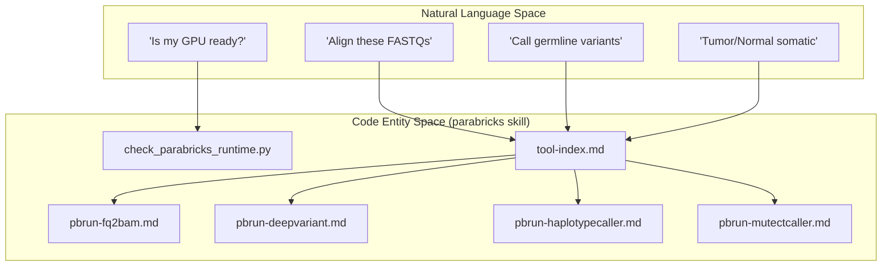
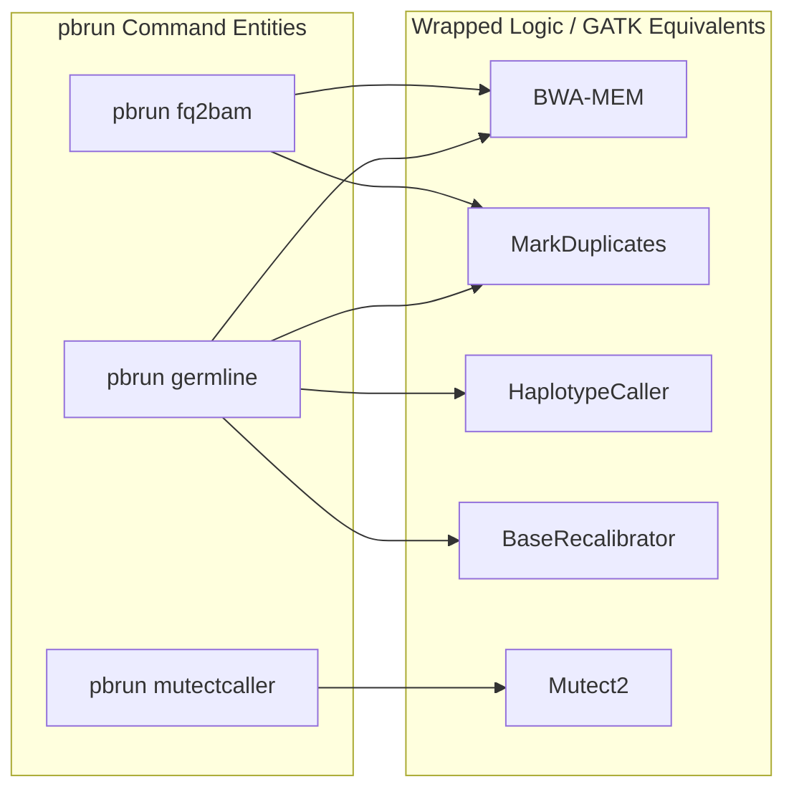

# Parabricks: GPU-Accelerated Genomics

<details>
<summary>Relevant source files</summary>

The following files were used as context for generating this wiki page:

- [library-skills/parabricks/.skillsource.json](library-skills/parabricks/.skillsource.json)
- [library-skills/parabricks/SKILL.md](library-skills/parabricks/SKILL.md)
- [library-skills/parabricks/references/pbrun-deepvariant.md](library-skills/parabricks/references/pbrun-deepvariant.md)
- [library-skills/parabricks/references/pbrun-fq2bam.md](library-skills/parabricks/references/pbrun-fq2bam.md)
- [library-skills/parabricks/references/pbrun-germline.md](library-skills/parabricks/references/pbrun-germline.md)
- [library-skills/parabricks/references/pbrun-haplotypecaller.md](library-skills/parabricks/references/pbrun-haplotypecaller.md)
- [library-skills/parabricks/references/pbrun-mutectcaller.md](library-skills/parabricks/references/pbrun-mutectcaller.md)
- [library-skills/parabricks/references/pbrun-somatic.md](library-skills/parabricks/references/pbrun-somatic.md)
- [library-skills/parabricks/references/runtime-environment.md](library-skills/parabricks/references/runtime-environment.md)
- [library-skills/parabricks/references/tool-index.md](library-skills/parabricks/references/tool-index.md)
- [library-skills/parabricks/scripts/check_parabricks_runtime.py](library-skills/parabricks/scripts/check_parabricks_runtime.py)

</details>


The Parabricks library skill provides an interface for routing and executing NVIDIA Parabricks `pbrun` tools. It enables agents to assess GPU/runtime readiness, select appropriate genomic analysis tools, and generate version-aware command guidance for tasks including FASTQ/BAM processing, RNA-seq analysis, variant calling (Germline and Somatic), and GVCF workflows.

## 1. System Architecture

The skill is structured as a collection of reference documentation and a diagnostic script that bridge the gap between high-level genomic analysis goals and the specific CLI requirements of the Parabricks container suite.

### Data Flow and Tool Routing
When a user provides a genomic analysis request, the system follows a hierarchical discovery path:
1. **Runtime Verification**: Checks if the host environment (GPU, Driver, Docker) is capable of running Parabricks using `check_parabricks_runtime.py` [library-skills/parabricks/SKILL.md:103-110]().
2. **Tool Classification**: Uses the `tool-index.md` to map data types (e.g., FASTQ, BAM) and goals (e.g., germline calling, methylation) to a specific `pbrun` tool [library-skills/parabricks/references/tool-index.md:57-77]().
3. **Command Generation**: Loads tool-specific references (e.g., `pbrun-fq2bam.md`) to map standard GATK/BWA-MEM arguments to their accelerated `pbrun` equivalents [library-skills/parabricks/references/pbrun-fq2bam.md:63-103]().

### Natural Language to Code Entity Mapping

The following diagram illustrates how natural language concepts are mapped to specific reference files and scripts within the toolkit.

**Diagram: Genomic Intent Mapping**

Sources: [library-skills/parabricks/SKILL.md:52-64](), [library-skills/parabricks/references/tool-index.md:57-77]()

## 2. Runtime Readiness & Diagnostics

Before executing Parabricks tools, the system must verify the hardware and software stack. The primary utility for this is `check_parabricks_runtime.py` [library-skills/parabricks/scripts/check_parabricks_runtime.py:1-45]().

### Key Checks Performed
- **Hardware**: Verifies NVIDIA GPU presence via `nvidia-smi`, checking for at least 16 GB VRAM [library-skills/parabricks/scripts/check_parabricks_runtime.py:21-21](), [library-skills/parabricks/scripts/check_parabricks_runtime.py:192-207]().
- **Software**: Validates Docker version (>= 20.10) and NVIDIA Container Toolkit installation [library-skills/parabricks/scripts/check_parabricks_runtime.py:20-20](), [library-skills/parabricks/scripts/check_parabricks_runtime.py:236-258]().
- **Storage**: Checks for available disk space (warning at < 100 GB) for large genomic files [library-skills/parabricks/scripts/check_parabricks_runtime.py:25-25]().
- **Container**: Optionally pulls the `clara-parabricks` image to verify `pbrun` availability [library-skills/parabricks/scripts/check_parabricks_runtime.py:125-133]().

Sources: [library-skills/parabricks/references/runtime-environment.md:1-55](), [library-skills/parabricks/scripts/check_parabricks_runtime.py:88-139]()

## 3. Tool Reference Reference

The toolkit provides detailed mapping between traditional CPU-based tools (GATK, BWA, Google DeepVariant) and the GPU-accelerated Parabricks counterparts.

### 3.1 Alignment and Preprocessing
The `fq2bam` tool is the primary entry point for short-read DNA processing. It combines BWA-MEM alignment, coordinate sorting, and duplicate marking into a single GPU-accelerated pipeline [library-skills/parabricks/references/pbrun-fq2bam.md:1-3]().

| Baseline Tool | `pbrun fq2bam` Equivalent | Notes |
| :--- | :--- | :--- |
| `bwa mem` | `--ref` + `--in-fq` | Alignment stage [library-skills/parabricks/references/pbrun-fq2bam.md:73-74]() |
| `SortSam` | Implicit / `--out-bam` | Coordinate sorting is default [library-skills/parabricks/references/pbrun-fq2bam.md:81-82]() |
| `MarkDuplicates` | Implicit / `--out-duplicate-metrics` | Enabled by default; use `--no-markdups` to skip [library-skills/parabricks/references/pbrun-fq2bam.md:83-90]() |
| `BaseRecalibrator`| `--knownSites` + `--out-recal-file` | BQSR report generation [library-skills/parabricks/references/pbrun-fq2bam.md:91-92]() |

### 3.2 Variant Calling
Parabricks supports multiple variant calling paradigms:
- **Germline**: `pbrun germline` (end-to-end GATK-style) [library-skills/parabricks/references/pbrun-germline.md:1-3](), `pbrun deepvariant` (DeepVariant) [library-skills/parabricks/references/pbrun-deepvariant.md:1-3](), and `pbrun haplotypecaller` [library-skills/parabricks/references/pbrun-haplotypecaller.md:1-3]().
- **Somatic**: `pbrun somatic` (end-to-end tumor-normal) [library-skills/parabricks/references/pbrun-somatic.md:1-3]() and `pbrun mutectcaller` (GATK Mutect2-compatible) [library-skills/parabricks/references/pbrun-mutectcaller.md:1-3]().

**Diagram: Command Entity Space Mapping**
This diagram shows how `pbrun` command entities encapsulate multiple traditional GATK/BWA tools.


Sources: [library-skills/parabricks/references/pbrun-fq2bam.md:63-103](), [library-skills/parabricks/references/pbrun-germline.md:38-68](), [library-skills/parabricks/references/pbrun-mutectcaller.md:36-63]()

## 4. Implementation Details

### Diagnostic Implementation
The `check_parabricks_runtime.py` script utilizes `subprocess.run` to interact with the host OS and NVIDIA drivers. It defines a `CommandResult` dataclass to standardize the output of various system checks [library-skills/parabricks/scripts/check_parabricks_runtime.py:47-54]().

Key function: `build_report` [library-skills/parabricks/scripts/check_parabricks_runtime.py:88-139]()
1. Initializes a report dictionary with schema versioning.
2. Calls `check_os()` to verify Linux compatibility [library-skills/parabricks/scripts/check_parabricks_runtime.py:142-163]().
3. Calls `check_nvidia_smi()` to parse GPU metrics into structured JSON [library-skills/parabricks/scripts/check_parabricks_runtime.py:192-233]().
4. Aggregates results into an `assessment` field (e.g., `ready`, `hardware-constrained`) [library-skills/parabricks/references/runtime-environment.md:173-185]().

### Command Execution Pattern
The skill recommends executing Parabricks via Docker to ensure environment consistency. The standard command shape includes explicit volume mounts for input/output and the `--gpus all` flag [library-skills/parabricks/SKILL.md:115-125]().

```bash
docker run --rm --gpus all \
  --volume /host/input:/workdir \
  --volume /host/output:/outputdir \
  --workdir /workdir \
  nvcr.io/nvidia/clara/clara-parabricks:<version> \
  pbrun <tool> [options]
```
Sources: [library-skills/parabricks/references/pbrun-fq2bam.md:25-39](), [library-skills/parabricks/references/pbrun-deepvariant.md:20-32]()

## 5. Summary of Supported Tools
The following table summarizes the primary tools indexed in the Parabricks skill.

| Category | Tools | Reference File |
| :--- | :--- | :--- |
| **Primary DNA** | `fq2bam`, `germline`, `somatic` | [pbrun-fq2bam.md](), [pbrun-germline.md](), [pbrun-somatic.md]() |
| **Variant Callers** | `deepvariant`, `haplotypecaller`, `mutectcaller`, `deepsomatic` | [pbrun-deepvariant.md](), [pbrun-haplotypecaller.md](), [pbrun-mutectcaller.md](), [pbrun-deepsomatic.md]() |
| **RNA/Specialized** | `rna_fq2bam`, `starfusion`, `fq2bam_meth` | [pbrun-rna_fq2bam.md](), [pbrun-starfusion.md](), [pbrun-fq2bam_meth.md]() |
| **Long Read** | `minimap2`, `ont_germline`, `pacbio_germline` | [pbrun-minimap2.md](), [pbrun-ont_germline.md](), [pbrun-pacbio_germline.md]() |
| **Pangenome** | `giraffe`, `prepon`, `postpon`, `pangenome_germline` | [pbrun-giraffe.md](), [pbrun-prepon.md](), [pbrun-postpon.md](), [pbrun-pangenome_germline.md]() |

Sources: [library-skills/parabricks/SKILL.md:68-98](), [library-skills/parabricks/references/tool-index.md:7-55]()

---