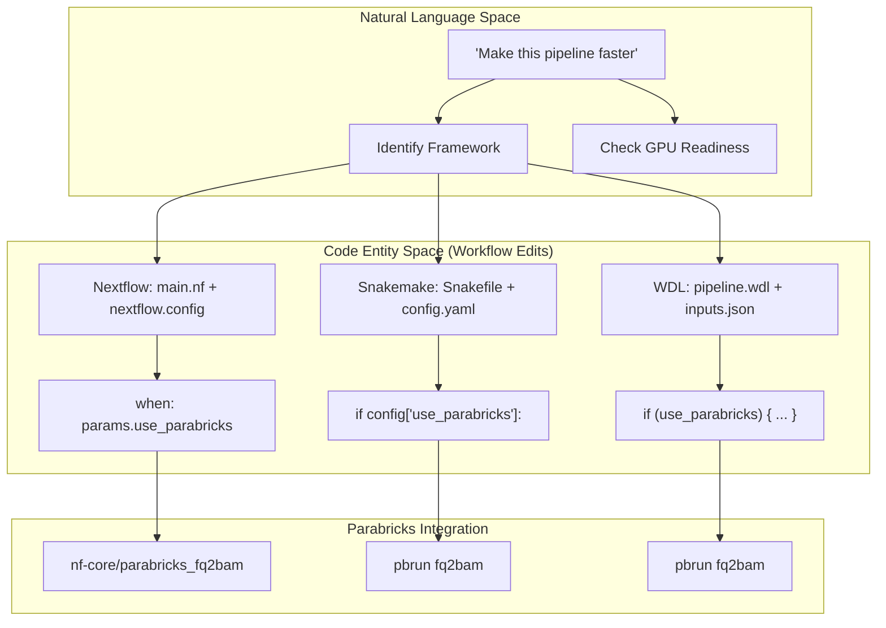
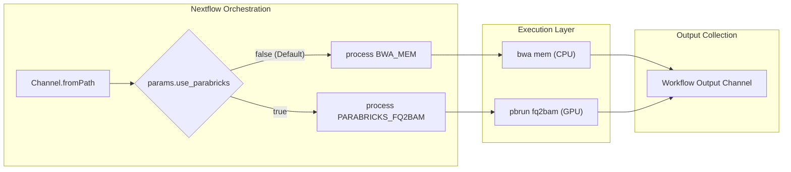

# Genomics Workflow Acceleration

Relevant source files

The following files were used as context for generating this wiki page:

- [library-skills/genomics-workflow-acceleration/.skillsource.json](library-skills/genomics-workflow-acceleration/.skillsource.json)
- [library-skills/genomics-workflow-acceleration/SKILL.md](library-skills/genomics-workflow-acceleration/SKILL.md)
- [library-skills/genomics-workflow-acceleration/references/comparison-checklist.md](library-skills/genomics-workflow-acceleration/references/comparison-checklist.md)
- [library-skills/genomics-workflow-acceleration/references/nf-core-parabricks-map.md](library-skills/genomics-workflow-acceleration/references/nf-core-parabricks-map.md)
- [library-skills/genomics-workflow-acceleration/references/parabricks-runtime-readiness.md](library-skills/genomics-workflow-acceleration/references/parabricks-runtime-readiness.md)
- [library-skills/genomics-workflow-acceleration/references/step-consolidation.md](library-skills/genomics-workflow-acceleration/references/step-consolidation.md)
- [library-skills/genomics-workflow-acceleration/references/workflow-frameworks.md](library-skills/genomics-workflow-acceleration/references/workflow-frameworks.md)
- [library-skills/genomics-workflow-acceleration/references/workflow-layout.md](library-skills/genomics-workflow-acceleration/references/workflow-layout.md)

The `genomics-workflow-acceleration` skill provides a systematic methodology for inspecting existing genomics pipelines (Nextflow, Snakemake, WDL, or Python) and integrating NVIDIA Parabricks GPU acceleration [library-skills/genomics-workflow-acceleration/SKILL.md:1-8](). Unlike the `parabricks` skill which focuses on individual tool execution, this skill is designed for architectural transformation: mapping CPU-bound steps to GPU equivalents, implementing in-place runtime toggles, and consolidating redundant pipeline stages [library-skills/genomics-workflow-acceleration/SKILL.md:24-34]().

## Core Methodology: The In-Place Toggle

The fundamental design philosophy of this skill is the **optional, in-place acceleration**. Rather than creating a separate "GPU version" of a pipeline, the agent modifies the existing workflow tree to include parallel GPU branches that are controlled by a runtime parameter (e.g., `use_parabricks`) [library-skills/genomics-workflow-acceleration/references/workflow-layout.md:1-8]().

### Workflow Execution Logic
The system follows a strict state transition for every acceleration project:
1.  **Intake & Scope:** Identify the workflow entrypoint and framework [library-skills/genomics-workflow-acceleration/SKILL.md:72-83]().
2.  **Runtime Readiness:** Verify if the local environment (or target HPC/Cloud) is capable of running Parabricks [library-skills/genomics-workflow-acceleration/references/parabricks-runtime-readiness.md:1-18]().
3.  **Mapping:** Inventory CPU steps and find Parabricks equivalents using the tool map [library-skills/genomics-workflow-acceleration/references/workflow-frameworks.md:23-29]().
4.  **Implementation:** Edit the workflow to add `if/else` or `when:` blocks for GPU steps [library-skills/genomics-workflow-acceleration/references/workflow-layout.md:74-82]().
5.  **A/B Comparison:** Run the pipeline twice (toggle off vs. on) and validate concordance [library-skills/genomics-workflow-acceleration/references/comparison-checklist.md:1-4]().

### Natural Language to Code Entity Mapping
This diagram illustrates how user intent for "acceleration" is translated into specific code structures within the target workflow.

**Intent to Implementation Mapping**

Sources: [library-skills/genomics-workflow-acceleration/references/workflow-frameworks.md:1-18](), [library-skills/genomics-workflow-acceleration/references/workflow-layout.md:13-25](), [library-skills/genomics-workflow-acceleration/references/nf-core-parabricks-map.md:11-19]()

## Framework-Specific Integration

The skill supports four primary genomics workflow frameworks, each with specific conventions for adding acceleration.

| Framework | Marker Files | Implementation Pattern | Toggle Default |
| :--- | :--- | :--- | :--- |
| **Nextflow** | `main.nf`, `nextflow.config` | `when: params.use_parabricks` | `false` |
| **Snakemake** | `Snakefile`, `config.yaml` | `if config["use_parabricks"]:` | `false` |
| **WDL** | `*.wdl` | `Boolean use_parabricks` | `false` |
| **Python** | `*.py`, `pyproject.toml` | `argparse` flag `--use-parabricks` | `off` |

Sources: [library-skills/genomics-workflow-acceleration/SKILL.md:108-118](), [library-skills/genomics-workflow-acceleration/references/workflow-layout.md:13-25]()

### Nextflow & nf-core Mapping
For Nextflow, the skill prioritizes the use of standard `nf-core` modules. A critical technical requirement for the `parabricks_fq2bam` module is that input files must be **copied** into the work directory (using `stageInMode 'copy'`) rather than symlinked, as Parabricks requires direct file access [library-skills/genomics-workflow-acceleration/references/nf-core-parabricks-map.md:11-14, 27-32]().

**Nextflow Acceleration Data Flow**

Sources: [library-skills/genomics-workflow-acceleration/references/nf-core-parabricks-map.md:20-40](), [library-skills/genomics-workflow-acceleration/references/workflow-layout.md:83-90]()

## Step Consolidation

A major benefit of Parabricks is the ability to merge multiple CPU steps into a single GPU pass. The `fq2bam` tool is the primary consolidation target, as it replaces BWA-MEM, Samtools sort, and Picard MarkDuplicates in one execution [library-skills/genomics-workflow-acceleration/references/step-consolidation.md:1-9, 28-34]().

**Consolidation Pattern Table**

| Original CPU Sequence | Consolidated Parabricks Tool | Nextflow Module |
| :--- | :--- | :--- |
| BWA-MEM + Sort + MarkDuplicates | `pbrun fq2bam` | `parabricks_fq2bam` |
| BWA-MEM + Sort + MarkDuplicates + BQSR | `pbrun fq2bam --bqsr` | `parabricks_fq2bam` |
| GATK HaplotypeCaller | `pbrun haplotypecaller` | `parabricks_haplotypecaller` |

Sources: [library-skills/genomics-workflow-acceleration/SKILL.md:130-143](), [library-skills/genomics-workflow-acceleration/references/step-consolidation.md:28-34]()

## Validation & A/B Comparison

To ensure scientific parity, the skill mandates an A/B comparison methodology. This involves running the same workflow with the toggle `off` and `on` against the same input datasets and comparing the results [library-skills/genomics-workflow-acceleration/references/comparison-checklist.md:1-5]().

### Comparison Checklist
- **Run Setup:** Use identical samplesheets and reference genomes; output to distinct directories (e.g., `results-cpu/` vs `results-gpu/`) [library-skills/genomics-workflow-acceleration/references/comparison-checklist.md:6-11]().
- **Concordance Metrics:** Use `bcftools isec` for VCF concordance and `samtools flagstat` for alignment verification [library-skills/genomics-workflow-acceleration/references/comparison-checklist.md:22-30]().
- **Documentation:** All findings, including runtime improvements and parity risks, must be recorded in an `ACCELERATION.md` file at the workflow root [library-skills/genomics-workflow-acceleration/references/workflow-layout.md:9-12](), [library-skills/genomics-workflow-acceleration/references/comparison-checklist.md:37-50]().

Sources: [library-skills/genomics-workflow-acceleration/references/comparison-checklist.md:1-50]()

---