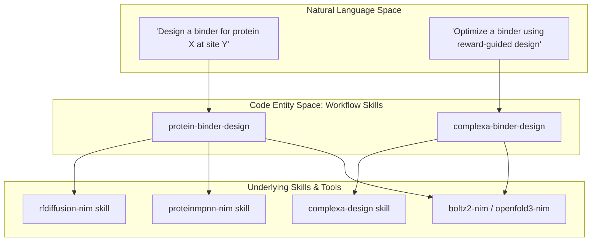
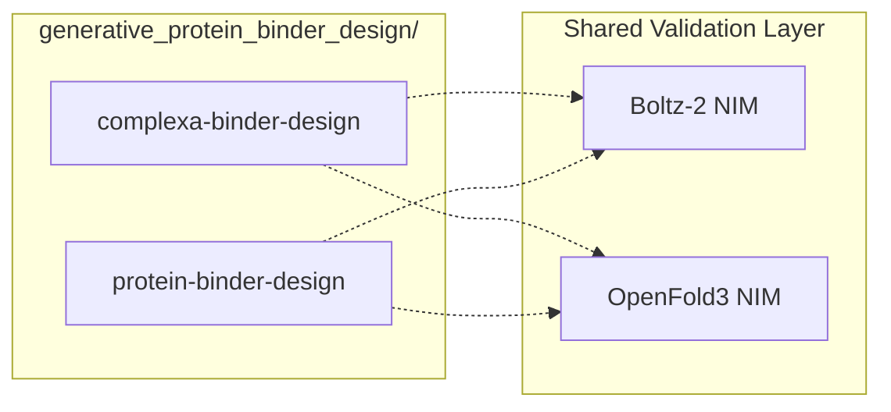

# Workflow Skills: Generative Protein Binder Design

Relevant source files

The following files were used as context for generating this wiki page:

- [README.md](README.md)

The `generative_protein_binder_design` directory provides two distinct, composable agent skills for the *de novo* design of protein binders. These workflows orchestrate multiple underlying models—either through NVIDIA Inference Microservices (NIMs) or local open-model containers—to move from a target protein structure to a validated binder candidate.

## Overview of Design Approaches

The toolkit supports two primary methodologies for binder design, categorized by their underlying compute and modeling paradigms:

| Workflow | Primary Engine | Strategy | Validation Method |
| :--- | :--- | :--- | :--- |
| **complexa-binder-design** | Proteina-Complexa | Reward-guided co-design & optimization | AF2-reward gating + Boltz2/OpenFold3 |
| **protein-binder-design** | RFdiffusion & ProteinMPNN | Backbone diffusion + Inverse folding | Self-consistency (RMSD) + Boltz2/OpenFold3 |

### 1. Complexa-Binder-Design Workflow
This workflow utilizes the **Proteina-Complexa** open-model suite. It is characterized by an iterative optimization approach where binders are generated and refined based on complex interaction rewards. It includes sophisticated hotspot strategy selection (using PDB interface data or literature fallbacks) and orchestrates the design process via a dedicated CLI.

For technical details on the reward-guided optimization and CLI orchestration, see **[complexa-binder-design Workflow](#5.1)**.

### 2. Protein-Binder-Design Workflow
This workflow provides a "NIM-native" pipeline. it chains **RFdiffusion NIM** for generating the binder backbone around a target, **ProteinMPNN NIM** for sequence design (inverse folding), and **Boltz2/OpenFold3 NIMs** for structural validation. It focuses on "self-consistency" metrics, such as Kabsch CA-RMSD, to ensure the designed sequence folds into the predicted backbone.

For details on the diffusion-based pipeline and NIM orchestration, see **[protein-binder-design Workflow](#5.2)**.

## High-Level Architecture

The following diagram illustrates how an Agent interacts with these workflow skills to navigate from Natural Language requirements to executable code entities.

### Agent-to-Workflow Mapping

**Sources:** [README.md:41-56](), [README.md:62-64]()

## Skill Composition and Discovery

Both workflows are registered in the toolkit's skill catalog and are discoverable by agents through the standard `.skillsource.json` manifest and `SKILL.md` instructions. Each workflow directory contains a manifest that defines the inputs (e.g., target PDB, hotspot residues) and outputs (e.g., ranked binder sequences, co-folded structures).

### Workflow Interconnectivity

**Sources:** [README.md:43-43](), [README.md:46-46](), [README.md:53-53]()

## Integration and Usage

These workflows are intended to be used by scientific agents (such as Claude Code or Codex) to automate the "Design-Build-Test" cycle in protein engineering.

*   **Installation:** Use the `skills` CLI to add these workflows to an agent environment: `npx skills add NVIDIA-BioNeMo/bionemo-agent-toolkit --skill protein-binder-design`.
*   **Execution:** Agents follow the instructions in the `SKILL.md` files located within each workflow directory to prepare input manifests and trigger the underlying Python scripts or NIM endpoints.

**Sources:** [README.md:15-31](), [README.md:62-64]()

---