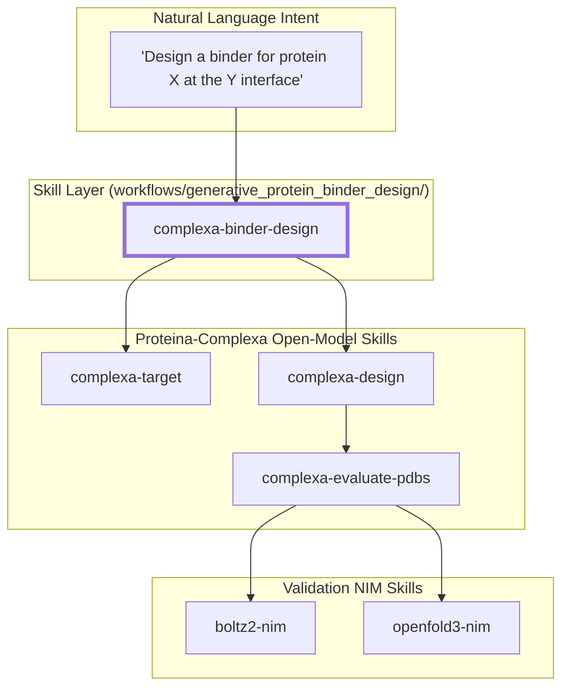
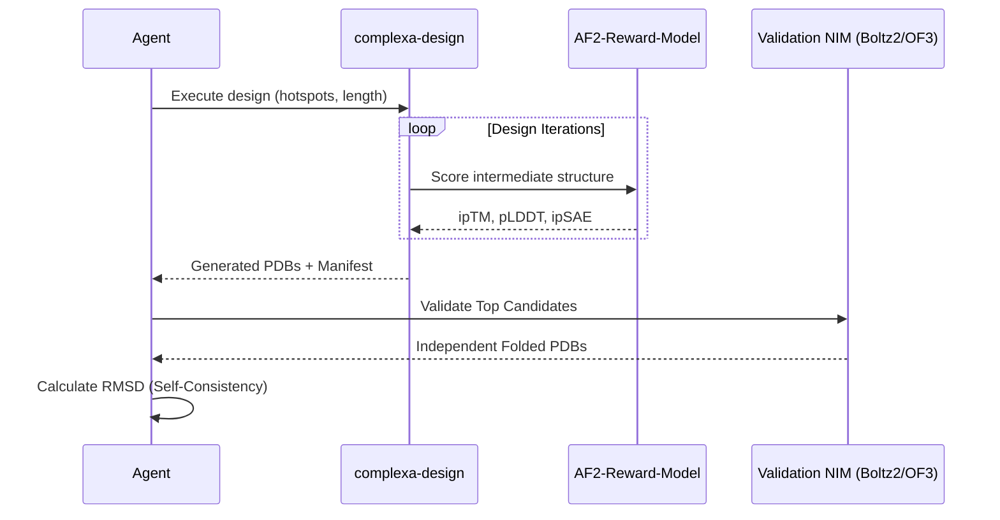

# 5.1. complexa-binder-design Workflow

Relevant source files

The following files were used as context for generating this wiki page:

- [README.md](README.md)

The `complexa-binder-design` workflow provides a high-level agentic interface for de novo protein binder design using the **Proteina-Complexa** suite. This workflow orchestrates a reward-guided co-design process that integrates target resolution, hotspot identification, generative optimization via the `complexa` CLI, and multi-model validation using AlphaFold2 (AF2) rewards and independent Boltz2/OpenFold3 folding [workflows/generative_protein_binder_design/complexa-binder-design/SKILL.md:1-40]().

### Workflow Architecture

The workflow follows a tiered execution model where natural language requests are translated into specific design constraints and passed to the Proteina-Complexa engine. It leverages "vendored" science-skills tooling—a set of shared Python utilities—to handle PDB manipulation and metric extraction [workflows/generative_protein_binder_design/complexa-binder-design/SKILL.md:42-55]().

#### Data Flow and Orchestration

The design process is structured into four primary phases:

1.  **Target Resolution & Hotspot Strategy**: The agent resolves the target protein structure and identifies critical residues (hotspots) for binding.
2.  **Complexa CLI Orchestration**: Invokes the `complexa design` command with specified rewards (e.g., AF2-based) and constraints.
3.  **Gated Validation**: Initial designs are filtered using internal AF2-reward metrics (ipTM, pLDDT).
4.  **Independent Cross-Validation**: Top candidates are validated using external structure prediction NIMs (Boltz2 or OpenFold3) to calculate RMSD and self-consistency metrics.

#### System Entity Mapping

The following diagram maps the high-level workflow steps to the specific code entities and skills defined in the toolkit.

**Diagram: Natural Language to Code Entity Mapping**

Sources: [workflows/generative_protein_binder_design/complexa-binder-design/SKILL.md:1-60](), [README.md:56-56]()

### Implementation Details

#### 1. Target and Hotspot Strategy
The workflow prioritizes evidence-based hotspot selection. If hotspots are not explicitly provided by the user, the agent is instructed to:
-   Analyze PDB interface files to identify contacting residues.
-   Fallback to literature-based residue identification via internal knowledge or search.
-   Use the `complexa-target` skill to prepare the `.pdb` and `.json` target definitions [open-models-skills/proteina-complexa/complexa-target/SKILL.md:1-20]().

#### 2. Complexa Orchestration
The core generative step utilizes the `complexa design` CLI. This tool combines a pretrained flow-based generative model (La-Proteina) with inference-time optimization [README.md:56-56](). The workflow configures:
-   **Backbone Generation**: Guided by the target geometry.
-   **Sequence Design**: Optimized via ProteinMPNN or similar internal routines.
-   **Reward Gating**: AF2 rewards are used during the design loop to steer the generative process toward high-confidence interfaces.

#### 3. Metrics and Validation
Validation is performed using a "Run Manifest" approach, where every design is tracked with its associated metrics:
-   **ipTM / pLDDT**: Confidence scores from the internal AF2 reward model.
-   **ipSAE**: Interface Predicted Structural Alignment Error.
-   **RMSD**: Root Mean Square Deviation between the designed binder and its folded structure (calculated via `Boltz2` or `OpenFold3` NIMs) [nim-skills/boltz2-nim/SKILL.md:1-15]().

**Diagram: Design and Validation Pipeline**

Sources: [workflows/generative_protein_binder_design/complexa-binder-design/SKILL.md:60-120](), [README.md:43-43](), [README.md:56-56]()

### Key Skills and Components

| Skill / Component | Role | Source |
| :--- | :--- | :--- |
| `complexa-setup` | Initializes the environment and downloads weights. | [open-models-skills/proteina-complexa/complexa-setup/SKILL.md]() |
| `complexa-design` | The main CLI entry point for running the design pipeline. | [open-models-skills/proteina-complexa/complexa-design/SKILL.md]() |
| `complexa-evaluate-pdbs` | Post-processing utility for ranking and filtering results. | [open-models-skills/proteina-complexa/complexa-evaluate-pdbs/SKILL.md]() |
| `science-skills` | Vendored Python utilities for structural bioinformatics. | [workflows/generative_protein_binder_design/complexa-binder-design/SKILL.md]() |

### Execution Manifest
The workflow generates a `run_manifest.json` in the design directory. This file serves as the source of truth for the campaign, containing:
1.  **Input Parameters**: Target PDB, hotspots, binder length range.
2.  **Model Metadata**: Checkpoint versions and reward configurations.
3.  **Candidate Table**: A list of generated PDB filenames mapped to their validation metrics (ipTM, pLDDT, RMSD) [workflows/generative_protein_binder_design/complexa-binder-design/SKILL.md:130-150]().

Sources: [README.md:43-56](), [workflows/generative_protein_binder_design/complexa-binder-design/SKILL.md:1-150]()

---