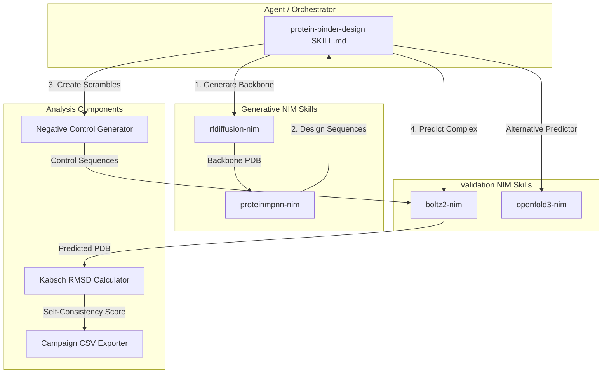
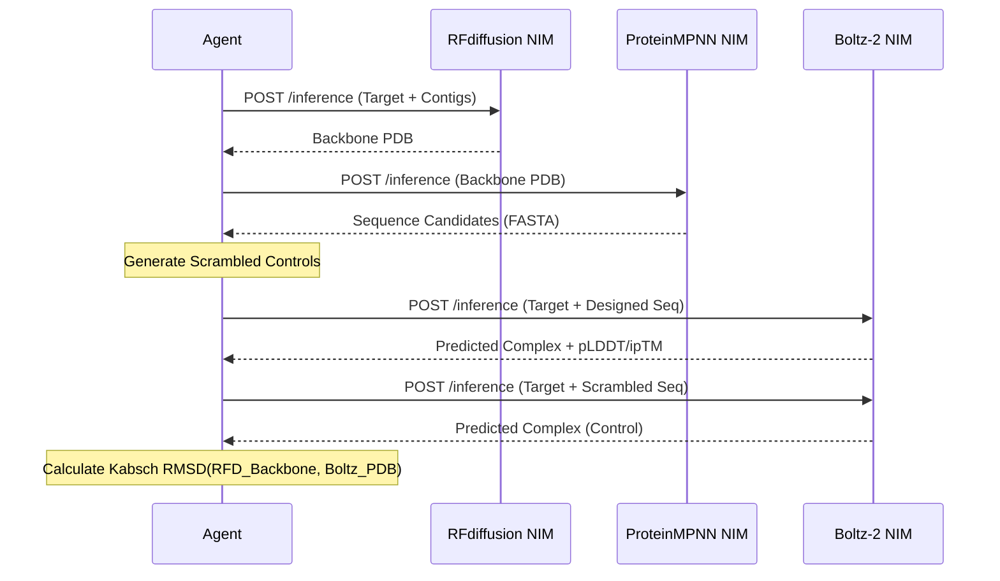

# protein-binder-design Workflow

<details>
<summary>Relevant source files</summary>

The following files were used as context for generating this wiki page:

- [README.md](README.md)

</details>


The `protein-binder-design` workflow is a generative protein design pipeline that orchestrates multiple NVIDIA Inference Microservices (NIMs) to perform de novo binder design. It implements a "Diffusion-Folding-Validation" loop, combining **RFdiffusion** for backbone generation, **ProteinMPNN** for sequence design (inverse folding), and **Boltz-2** or **OpenFold3** for structural validation and self-consistency checking.

## Workflow Orchestration

The workflow follows a rigorous computational biology protocol to ensure the generated binders are both physically plausible and likely to bind the target protein at the specified interface.

### Data Flow and Logic
1.  **Target Registry**: The user provides a target protein (PDB) and specifies hotspots or contigs for the binder interface.
2.  **Backbone Diffusion (RFdiffusion NIM)**: Generates multiple diverse protein backbones that satisfy the geometric constraints of the target interface.
3.  **Inverse Folding (ProteinMPNN NIM)**: For each generated backbone, ProteinMPNN designs multiple candidate amino acid sequences.
4.  **Scrambled Controls**: The workflow generates "scrambled" sequence versions of the best candidates to serve as negative controls during validation.
5.  **Co-fold Validation (Boltz-2/OpenFold3 NIM)**: The target and candidate sequences are co-folded to predict the complex structure.
6.  **Self-Consistency (Kabsch CA-RMSD)**: The predicted structure is compared against the original RFdiffusion backbone using the Kabsch algorithm. Low CA-RMSD indicates high "self-consistency."
7.  **Campaign Manifest**: All results, including metrics like pLDDT, ipTM, and RMSD, are aggregated into a run manifest and a final campaign CSV.

### System Entity Mapping
The following diagram maps the logical workflow steps to the specific NIM skills and code entities involved in the orchestration.

**Diagram: Binder Design System Mapping**

**Sources:** [README.md:43-55](), [workflows/generative_protein_binder_design/protein-binder-design/SKILL.md:1-50]()

---

## Technical Implementation Details

The workflow is designed to be executed by an agent that manages state across multiple microservice calls.

### 1. Target Specification & RFdiffusion
The workflow begins by defining the target protein and the binding site. RFdiffusion uses a "contig" string to define which parts of the target are fixed and which parts (the binder) should be diffused.
*   **Skill:** `rfdiffusion-nim`
*   **Inputs:** Target PDB, contig map, hotspot residues, number of designs.
*   **Outputs:** A set of PDB files containing the target-binder backbone complex.

### 2. Sequence Design with ProteinMPNN
Once backbones are generated, they lack specific amino acid identities (usually represented as Poly-Alanine or Poly-Glycine). ProteinMPNN performs inverse folding to find sequences that minimize the energy of that specific backbone fold.
*   **Skill:** `proteinmpnn-nim`
*   **Process:** The agent iterates through RFdiffusion outputs, providing them as templates to ProteinMPNN.
*   **Output:** Multi-FASTA file containing potential sequences for each backbone.

### 3. Validation and Self-Consistency
The "Self-Consistency" check is the gold standard for backbone diffusion. If a structure prediction model (like Boltz-2) can recover the diffused backbone structure starting only from the sequence designed by ProteinMPNN, the design is considered "self-consistent."

| Metric | Description | Threshold (Typical) |
| :--- | :--- | :--- |
| **CA-RMSD** | Root Mean Square Deviation of Alpha-Carbons between RFdiffusion backbone and Boltz-2 prediction. | < 2.0 Å |
| **pLDDT** | Confidence score from the folding NIM for the binder chain. | > 80 |
| **ipTM** | Interface predicted Template Modeling score. | > 0.7 |

### 4. Negative Controls
To ensure the binding is not an artifact of the folding model's bias, the workflow generates "scrambled" sequences. These have the same amino acid composition as the binder but in a randomized order. A successful design should show high binding affinity/confidence for the designed sequence and low/no binding for the scrambled control.

**Diagram: Validation Data Flow**

**Sources:** [README.md:43-55](), [workflows/generative_protein_binder_design/protein-binder-design/SKILL.md:55-120]()

---

## Run Manifest and Output Schema

The workflow produces a structured directory for every "campaign." This allows for reproducibility and easy ranking of the best binders.

### Campaign CSV Schema
The final output is a `campaign_results.csv` containing:
*   `design_id`: Unique identifier for the backbone-sequence pair.
*   `backbone_source`: Path to the RFdiffusion PDB.
*   `sequence`: The amino acid sequence designed by ProteinMPNN.
*   `is_control`: Boolean indicating if the row is a scrambled negative control.
*   `rmsd_to_backbone`: The Kabsch CA-RMSD result.
*   `plddt`: Mean confidence score of the binder.
*   `iptm`: Interface confidence score.

### Directory Structure
```text
campaigns/
└── [campaign_id]/
    ├── backbones/          # RFdiffusion PDBs
    ├── sequences/          # ProteinMPNN FASTAs
    ├── predictions/        # Boltz-2/OpenFold3 predicted PDBs
    ├── manifest.json       # Metadata and step-by-step logs
    └── campaign_results.csv # Final ranked designs
```

**Sources:** [workflows/generative_protein_binder_design/protein-binder-design/SKILL.md:121-150]()

---