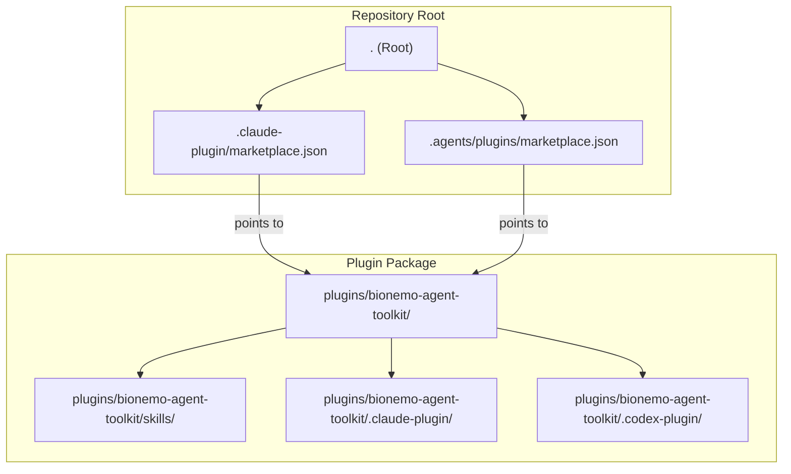
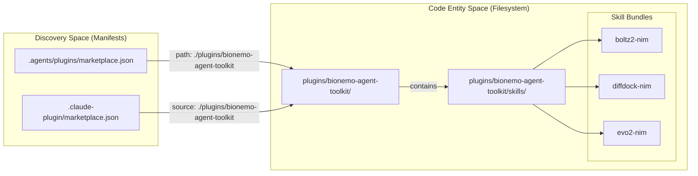

# Plugin Distribution & Agent Integration

Relevant source files

The following files were used as context for generating this wiki page:

- [.agents/plugins/marketplace.json](.agents/plugins/marketplace.json)
- [.claude-plugin/marketplace.json](.claude-plugin/marketplace.json)
- [README.md](README.md)

The NVIDIA BioNeMo Agent Toolkit is distributed through two primary mechanisms: the `skills` CLI for granular installation and native agent plugins for platform-specific integration. This architecture allows agents like **Claude Code** and **Codex** to discover, authenticate, and load life science skills directly from the repository.

The toolkit centralizes its distribution logic in the `plugins/bionemo-agent-toolkit/` directory, which acts as the staging area for all packaged skills [README.md:62-64]().

### Distribution Architecture

The toolkit uses a "marketplace" manifest pattern to describe its capabilities to different agent platforms. This allows the same set of skills to be consumed by multiple agent ecosystems while adhering to their specific manifest requirements.

**Toolkit Distribution Flow**

**Sources:** [.agents/plugins/marketplace.json:1-20](), [.claude-plugin/marketplace.json:1-18](), [README.md:33-37]()

---

### Codex / OpenAI Agents Plugin

The toolkit integrates with Codex and OpenAI-compatible agents via a manifest located in the `.agents/` directory. This configuration defines how the agent discovers the local plugin source and manages installation policies.

*   **Installation Policy**: Set to `AVAILABLE`, allowing the agent to present the toolkit as an optional extension [.agents/plugins/marketplace.json:14]().
*   **Authentication**: Requires `ON_INSTALL` authentication, ensuring that necessary API keys (such as `NGC_API_KEY`) are configured before the skills are invoked [.agents/plugins/marketplace.json:15]().
*   **Category**: Classified under "Science" to assist in agent discovery [.agents/plugins/marketplace.json:17]().

For details, see [Codex / OpenAI Agents Plugin](#6.1).

**Sources:** [.agents/plugins/marketplace.json:1-20]()

---

### Claude Code Plugin

Integration with **Claude Code** is managed via the `.claude-plugin/` manifest. This platform-specific configuration includes metadata such as the version (currently `0.1.0`) and the owner information for NVIDIA BioNeMo [.claude-plugin/marketplace.json:1-10]().

*   **Plugin Metadata**: Includes a high-level description of the toolkit's capabilities, covering protein folding, docking, and genomics [.claude-plugin/marketplace.json:7-10]().
*   **Source Mapping**: Maps the `bionemo-agent-toolkit` name to the local directory structure for skill loading [.claude-plugin/marketplace.json:13-15]().

For details, see [Claude Code Plugin](#6.2).

**Sources:** [.claude-plugin/marketplace.json:1-18]()

---

### The `skills` CLI

In addition to native plugins, the toolkit supports the `skills` CLI (via `@vercel-labs/skills`). This provides a developer-centric way to add specific skills to an existing agent project.

| Command | Action |
| :--- | :--- |
| `npx skills add ...` | Interactive selection of skills and destination [README.md:20]() |
| `--skill <name>` | Installs a specific skill (e.g., `boltz2-nim`) [README.md:23]() |
| `--agent <type>` | Targets a specific agent environment (e.g., `claude-code`, `codex`) [README.md:26-27]() |
| `--list` | Lists all available skills in the toolkit catalog [README.md:30]() |

**Sources:** [README.md:15-31]()

---

### Code-to-Space Mapping

The following diagram bridges the relationship between the marketplace manifests (Natural Language/Discovery Space) and the actual file entities (Code Entity Space) used by the agents.

**Manifest-to-Entity Mapping**

**Sources:** [.agents/plugins/marketplace.json:11](), [.claude-plugin/marketplace.json:14](), [README.md:41-60]()

---