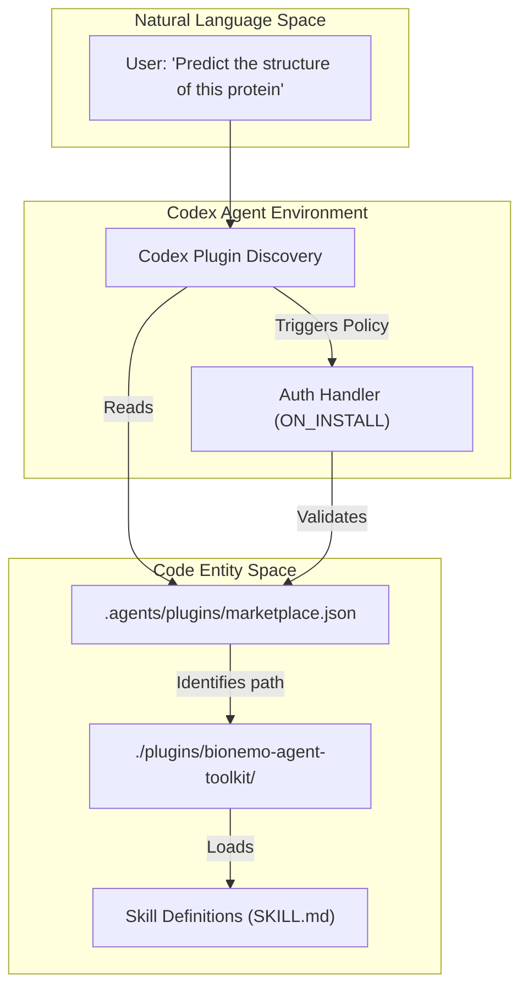
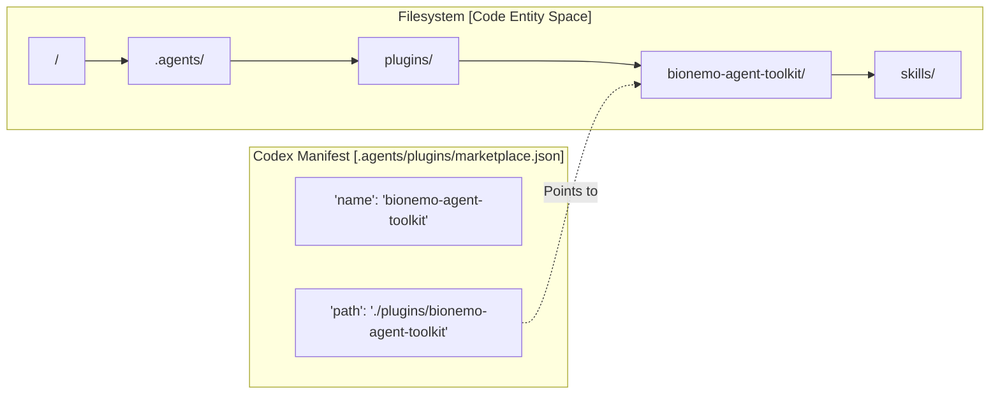

# Codex / OpenAI Agents Plugin

Relevant source files

The following files were used as context for generating this wiki page:

- [.agents/plugins/marketplace.json](.agents/plugins/marketplace.json)

This page provides a technical deep dive into the integration between the NVIDIA BioNeMo Agent Toolkit and the Codex/OpenAI agent environment. It details the manifest structures, installation policies, and discovery mechanisms that allow the Codex agent to load and utilize the toolkit's biological and chemical intelligence skills.

## Plugin Discovery and Manifest

The Codex agent discovers the toolkit through a standardized manifest file located at the root of the `.agents/` directory. This file acts as the entry point for the agent's plugin subsystem, defining where the toolkit's logic resides and how the agent should interact with it during the lifecycle of a session.

### The Marketplace Manifest
The core configuration is defined in [.agents/plugins/marketplace.json:1-20](). This JSON structure informs the Codex environment about the toolkit's identity and its location within the repository.

| Key | Value | Description |
| :--- | :--- | :--- |
| `name` | `bionemo-agent-toolkit` | The unique identifier for the plugin within the Codex ecosystem [.agents/plugins/marketplace.json:2-2](). |
| `displayName` | `NVIDIA BioNeMo Agent Toolkit` | The human-readable name displayed in the Codex agent's interface [.agents/plugins/marketplace.json:4-4](). |
| `source.source` | `local` | Indicates that the plugin source code is bundled within the current repository [.agents/plugins/marketplace.json:10-10](). |
| `source.path` | `./plugins/bionemo-agent-toolkit` | The relative filesystem path where the plugin implementation and skill definitions are stored [.agents/plugins/marketplace.json:11-11](). |
| `category` | `Science` | Categorizes the toolkit for discovery in the agent's plugin library [.agents/plugins/marketplace.json:17-17](). |

**Sources:**
- [.agents/plugins/marketplace.json:1-20]()

## Installation and Authentication Policies

The Codex integration utilizes a specific set of policies to manage how the toolkit is activated and how sensitive credentials (such as `NGC_API_KEY`) are handled.

### Installation Policy: `AVAILABLE`
The `installation` policy is set to `AVAILABLE` [[.agents/plugins/marketplace.json:14-14]()]. This signifies that while the plugin is present in the repository, it is not forced upon every agent instance. Instead, the agent can dynamically choose to "install" or activate the toolkit when biological or chemical tasks are identified in the natural language prompt.

### Authentication Policy: `ON_INSTALL`
The `authentication` policy is set to `ON_INSTALL` [[.agents/plugins/marketplace.json:15-15]()]. This is a critical security and functional requirement for the BioNeMo Agent Toolkit:
1.  **Trigger:** When the user or the agent attempts to enable the plugin, the Codex environment triggers an authentication flow.
2.  **Requirement:** This flow typically validates the presence of environment variables or secrets required by the underlying skills (e.g., the API keys needed for NIM-based skills).
3.  **Scope:** By requiring authentication at the install phase, the toolkit ensures that all downstream skill invocations (like calling a structure prediction NIM) have the necessary authorization headers ready.

**Sources:**
- [.agents/plugins/marketplace.json:13-16]()

## Data Flow and Plugin Loading

The following diagram illustrates the transition from the "Natural Language Space" (user intent) to the "Code Entity Space" (plugin manifests and skill execution) within the Codex environment.

### Codex Plugin Activation Flow
"This diagram shows how the Codex Agent uses the marketplace.json manifest to resolve and load the BioNeMo toolkit."

**Sources:**
- [.agents/plugins/marketplace.json:1-20]()

## Plugin Directory Structure

Once the Codex agent resolves the path from the manifest [[.agents/plugins/marketplace.json:11-11]()], it expects a specific layout within the `plugins/bionemo-agent-toolkit` directory. This structure bridges the Codex-specific plugin metadata with the universal toolkit skills.

### Mapping Manifest to Filesystem
The Codex agent utilizes the `path` defined in the marketplace manifest to locate the skill logic.

**Sources:**
- [.agents/plugins/marketplace.json:6-12]()

---