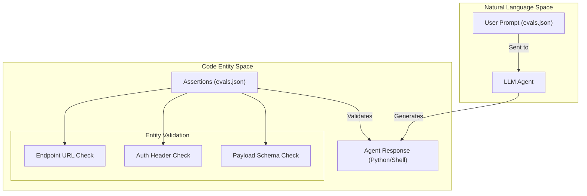
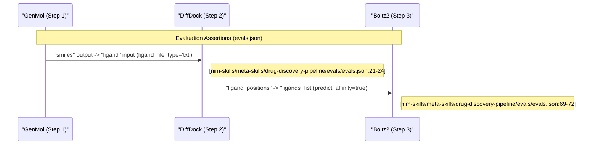

# Skill Evaluation Framework

Relevant source files

The following files were used as context for generating this wiki page:

- [nim-skills/boltz2-nim/evals/evals.json](nim-skills/boltz2-nim/evals/evals.json)
- [nim-skills/boltz2-nim/evals/trigger_evals.json](nim-skills/boltz2-nim/evals/trigger_evals.json)
- [nim-skills/diffdock-nim/evals/evals.json](nim-skills/diffdock-nim/evals/evals.json)
- [nim-skills/diffdock-nim/evals/trigger_evals.json](nim-skills/diffdock-nim/evals/trigger_evals.json)
- [nim-skills/meta-skills/drug-discovery-pipeline/evals/evals.json](nim-skills/meta-skills/drug-discovery-pipeline/evals/evals.json)
- [nim-skills/meta-skills/msa-structure-prediction-pipeline/evals/evals.json](nim-skills/meta-skills/msa-structure-prediction-pipeline/evals/evals.json)

The **Skill Evaluation Framework** provides a standardized methodology for benchmarking and validating the behavior of agent skills within the BioNeMo Agent Toolkit. It ensures that both individual NIM skills and complex meta-skill pipelines perform reliably across different LLM backends (Claude, GPT-4, Nemotron) by using a "Natural Language to Assertion" validation pattern.

## Core Evaluation Components

Every skill directory follows a strict convention for its `evals/` subdirectory, containing task definitions and trigger descriptions.

### 1. Task Definitions (`evals.json`)
The `evals.json` file defines the ground-truth benchmarks for a skill. Each entry maps a natural language prompt to a set of technical assertions that the agent's output must satisfy.

*   **Prompt**: The user query designed to test specific skill features (e.g., local vs. hosted deployment, specific parameter handling).
*   **Expected Output**: A high-level description of the correct agent behavior.
*   **Assertions**: A list of programmatic or string-based checks used by the grading engine to verify the agent's response.

| Field | Role | Example |
| :--- | :--- | :--- |
| `id` | Unique identifier for the test case | `1`, `eval-1-de-novo-hit-discovery` |
| `check` | The logic/string used to validate the output | `Script contains 'health.api.nvidia.com/v1/biology/mit/boltz2/predict'` |
| `description` | Human-readable criteria | "Uses the correct hosted endpoint URL" |

**Sources:** [nim-skills/boltz2-nim/evals/evals.json:1-41](), [nim-skills/meta-skills/drug-discovery-pipeline/evals/evals.json:1-41]()

### 2. Trigger Descriptions (`trigger_evals.json`)
The `trigger_evals.json` file is used to evaluate the agent's **routing accuracy**. It contains a list of queries and a boolean `should_trigger` flag. This allows the framework to measure:
*   **Sensitivity**: Does the agent invoke the skill when relevant?
*   **Specificity**: Does the agent avoid the skill for irrelevant queries (e.g., general Python questions)?

**Sources:** [nim-skills/boltz2-nim/evals/trigger_evals.json:1-22](), [nim-skills/diffdock-nim/evals/trigger_evals.json:1-22]()

---

## Evaluation Data Flow

The framework bridges the gap between the **Natural Language Space** (user intent) and the **Code Entity Space** (API endpoints, parameter types, and shell commands).

### Logic Flow: Natural Language to Code Assertions

The following diagram illustrates how a user prompt is processed through the evaluation framework to validate code-level entities.

**Diagram: Eval Logic Flow**

**Sources:** [nim-skills/boltz2-nim/evals/evals.json:9-40](), [nim-skills/meta-skills/msa-structure-prediction-pipeline/evals/evals.json:9-40]()

---

## Benchmarking Methodology

The framework supports two primary benchmarking modes to quantify the "value-add" of the BioNeMo Agent Toolkit:

### Baseline vs. With-Skill
1.  **Baseline**: The LLM is given the prompt without access to the skill's documentation or tools. This often results in hallucinations regarding API endpoints or outdated parameter names.
2.  **With-Skill**: The LLM is provided with the skill's `SKILL.md` and reference materials. The evaluation measures the delta in assertion pass rates.

### Grading Assertions
Assertions are specifically designed to catch common "hallucination points" identified in BioNeMo NIMs:
*   **Endpoint Correctness**: Validating the transition from old paths (e.g., `/v1/molecular-docking/`) to new unified paths (e.g., `/v1/biology/mit/diffdock`). [nim-skills/meta-skills/drug-discovery-pipeline/evals/evals.json:64-67]()
*   **Type Strictness**: Ensuring parameters like `temperature` or `noise` are passed as strings if the NIM schema requires it. [nim-skills/meta-skills/drug-discovery-pipeline/evals/evals.json:16-19]()
*   **Data Pre-processing**: Verifying the agent knows to strip `HETATM` records from PDBs before calling DiffDock. [nim-skills/diffdock-nim/evals/evals.json:21-24]()

---

## Meta-Skill Pipeline Evaluation

Evaluation for meta-skills (pipelines) focuses on the **handoff logic** between multiple NIMs.

**Diagram: Pipeline Entity Mapping**

### Key Meta-Skill Assertions
*   **SAFE Notation**: Validating that agents convert SMILES to SAFE notation before calling `genmol-nim`. [nim-skills/meta-skills/drug-discovery-pipeline/evals/evals.json:11-14]()
*   **Case Sensitivity**: Ensuring database names like `Uniref30_2302` maintain correct casing across `msa-search` and `openfold3` calls. [nim-skills/meta-skills/msa-structure-prediction-pipeline/evals/evals.json:16-19]()
*   **Nested Structures**: Checking that the `msa` field in OpenFold3 is correctly nested (3-level: `db > format > alignment`) rather than passed as a flat string. [nim-skills/meta-skills/msa-structure-prediction-pipeline/evals/evals.json:54-57]()

**Sources:** [nim-skills/meta-skills/drug-discovery-pipeline/evals/evals.json:1-100](), [nim-skills/meta-skills/msa-structure-prediction-pipeline/evals/evals.json:1-112]()

---