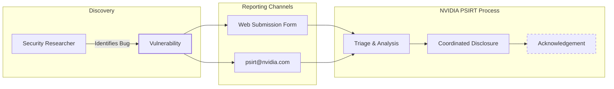

# Contributing, Licensing & Security

<details>
<summary>Relevant source files</summary>

The following files were used as context for generating this wiki page:

- [CONTRIBUTING.md](CONTRIBUTING.md)
- [LICENSE](LICENSE)
- [NOTICE](NOTICE)
- [SECURITY.md](SECURITY.md)

</details>


The BioNeMo Agent Toolkit is an open-source project designed to bridge the gap between Large Language Models and specialized biological discovery tools. This page provides a high-level overview of the legal framework, community contribution workflows, and security protocols governing the repository.

The project utilizes a dual-licensing strategy to accommodate both functional source code and creative skill content, while enforcing strict contribution standards through the Developer Certificate of Origin (DCO).

### Project Governance Overview

The following diagram illustrates the relationship between the legal frameworks and the codebase entities.

**Legal and Contribution Framework**
```mermaid
graph TD
    subgraph "Legal Framework"
        ["Apache-2.0"] -- "Governs" --> ["Source Code"]
        ["CC-BY-4.0"] -- "Governs" --> ["Creative Content"]
        ["SPDX-License-Identifier"] -- "Dual License" --> ["Apache-2.0 OR CC-BY-4.0"]
    end

    subgraph "Codebase Entities"
        ["Source Code"] --> B["scripts/"]
        ["Source Code"] --> C["tests/"]
        ["Creative Content"] --> D["SKILL.md"]
        ["Creative Content"] --> E["workflow definitions"]
    end

    subgraph "Contribution Flow"
        F["Contributor"] --> G["git commit --signoff"]
        G --> H["DCO Certification"]
        H --> I["Pull Request"]
    end

    I -- "Must align with" --> ["SPDX-License-Identifier"]
```
Sources: [LICENSE:1-14](), [NOTICE:1-16](), [CONTRIBUTING.md:31-47]()

---

## Contributing Guide

We welcome community contributions, including bug reports, feature requests, and new biological skills. The project follows a **fork-and-pull** model. All contributors are required to sign off on their work to certify compliance with the Developer Certificate of Origin (DCO) version 1.1.

Key requirements for contributions include:
*   **Branch Naming**: Use prefixes like `feat/`, `fix/`, or `docs/` [CONTRIBUTING.md:21-29]().
*   **DCO Sign-off**: Every commit must include a `Signed-off-by` line, generated via `git commit -s` [CONTRIBUTING.md:37-47]().
*   **Code Style**: New skills must follow existing directory conventions (e.g., including `SKILL.md` and appropriate metadata) [CONTRIBUTING.md:14-16]().

For details on the PR lifecycle and environment setup, see **[Contributing Guide](#8.1)**.

Sources: [CONTRIBUTING.md:1-55]()

---

## Licensing

The BioNeMo Agent Toolkit is dual-licensed under **Apache License, Version 2.0** and **Creative Commons Attribution 4.0 International (CC-BY-4.0)**. This ensures that the technical infrastructure remains robustly open-source while the scientific content (skills and workflows) is easily shareable and attributable.

| Component Type | License | Example Files |
| :--- | :--- | :--- |
| **Source Code** | Apache-2.0 | Python scripts, test suites, build tooling [LICENSE:3-4]() |
| **Content/Skills** | CC-BY-4.0 | `SKILL.md`, YAML workflow definitions, READMEs [LICENSE:6-8]() |

All redistributions or adaptations of the skill content must include the specific attribution notice defined in the `NOTICE` file [NOTICE:18-29]().

For the full license texts and attribution requirements, see **[Licensing](#8.2)**.

Sources: [LICENSE:1-14](), [NOTICE:1-29]()

---

## Security Policy

NVIDIA prioritizes the security of the BioNeMo Agent Toolkit. Vulnerabilities should **not** be reported via GitHub Issues. Instead, they must be funneled through the NVIDIA Product Security Incident Response Team (PSIRT).

**Vulnerability Reporting Pipeline**

Sources: [SECURITY.md:7-21]()

Reports should include the product version, vulnerability type, and a Proof-of-Concept (PoC) [SECURITY.md:14-19](). Secure communication is supported via the NVIDIA public PGP key [SECURITY.md:13]().

For detailed reporting instructions and policy links, see **[Security Policy](#8.3)**.

Sources: [SECURITY.md:1-26]()

---