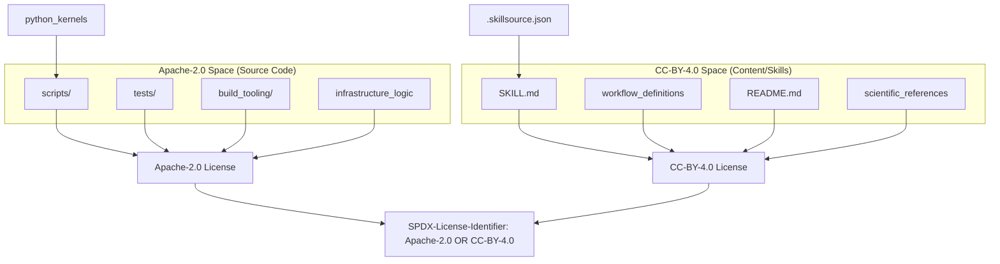
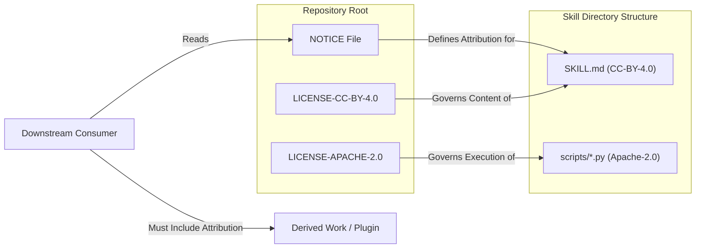

# Licensing

Relevant source files

The following files were used as context for generating this wiki page:

- [LICENSE](LICENSE)
- [LICENSE-APACHE-2.0](LICENSE-APACHE-2.0)
- [LICENSE-CC-BY-4.0](LICENSE-CC-BY-4.0)
- [NOTICE](NOTICE)

The BioNeMo Agent Toolkit employs a dual-licensing strategy to accommodate both the technical software components and the creative/scientific content required for agentic workflows. This approach ensures that the executable source code remains under a standard permissive software license (Apache-2.0), while the skill definitions, scientific documentation, and workflow logic are also available under a content-focused license (CC-BY-4.0) [LICENSE:1-11]().

## Dual-Licensing Model

The repository is partitioned by license type based on the nature of the file content. This distinction is summarized in the root `LICENSE` and `NOTICE` files [LICENSE:1-14](), [NOTICE:1-15]().

### Apache License, Version 2.0
This license applies to the **Source Code** of the toolkit. It covers the functional machinery required to build, test, and run the agent infrastructure [LICENSE:3-4]().
*   **Scope**: Python scripts, test suites (`pytest`), build tooling, and infrastructure code [NOTICE:6-8]().
*   **Key Rights**: Perpetual, worldwide, non-exclusive, no-charge, royalty-free, irrevocable copyright license to reproduce, prepare derivative works, and distribute [LICENSE-APACHE-2.0:66-71]().
*   **Patent Grant**: Includes a reciprocal patent license grant from contributors [LICENSE-APACHE-2.0:73-87]().

### Creative Commons Attribution 4.0 International (CC-BY-4.0)
This license applies to the **Skills and Documentation**. It is designed for the high-level definitions that agents consume to understand how to perform biological tasks [LICENSE:6-9]().
*   **Scope**: `SKILL.md` files, workflow definitions (YAML/JSON), and all `README` documentation [NOTICE:10-13]().
*   **Key Rights**: Allows for sharing (copying/redistributing) and adapting (remixing/transforming) the material for any purpose, including commercially [LICENSE-CC-BY-4.0:135-145]().
*   **Requirement**: Requires appropriate attribution as specified in the `NOTICE` file [NOTICE:18-29]().

### License Application Mapping

The following diagram illustrates how the codebase entities are mapped to their respective licenses.

**Code Entity to License Mapping**

**Sources:** [LICENSE:1-11](), [NOTICE:4-15]()

## SPDX Identifiers and Metadata

To facilitate automated license compliance and scanning, the project uses standard SPDX (Software Package Data Exchange) identifiers.

| Identifier | Application | Reference |
| :--- | :--- | :--- |
| `Apache-2.0` | Software Source & Logic | [LICENSE-APACHE-2.0:1-2]() |
| `CC-BY-4.0` | Skill Definitions & Docs | [LICENSE-CC-BY-4.0:57-66]() |
| `Apache-2.0 OR CC-BY-4.0` | Project-wide Manifests | [LICENSE:11]() |

The primary identifier `SPDX-License-Identifier: Apache-2.0 OR CC-BY-4.0` is present in the root `LICENSE` and `NOTICE` files to indicate the dual-nature of the repository [LICENSE:11](), [NOTICE:15]().

## Attribution Requirements

When redistributing or adapting content covered by the `CC-BY-4.0` license (specifically skills and documentation), users must provide attribution to NVIDIA.

### Required Attribution String
The following block must be included in a manner reasonable to the medium used for distribution [NOTICE:21-23]():

> **BioNeMo Agent Toolkit**
> Copyright (c) 2025 NVIDIA CORPORATION & AFFILIATES.
> Licensed under CC-BY-4.0 (https://creativecommons.org/licenses/by/4.0/)
> Source: https://github.com/NVIDIA-BioNeMo/bionemo-agent-toolkit

**Sources:** [NOTICE:18-29]()

## Implementation Flow: License Enforcement

The toolkit manages licensing through a combination of file-level declarations and a central `NOTICE` file that acts as the legal source of truth for downstream consumers.

**License Data Flow**

**Sources:** [LICENSE:1-14](), [NOTICE:1-29](), [LICENSE-APACHE-2.0:94-121]()

### Notice File Retention
Under Section 4(d) of the Apache License, if the Work includes a `NOTICE` text file, any derivative works must include a readable copy of the attribution notices contained within that file [LICENSE-APACHE-2.0:106-115](). This ensures that the NVIDIA copyright and the dual-license notice persist as the toolkit is integrated into various agent platforms (e.g., Claude Code or Codex).

**Sources:** [LICENSE:1-14](), [LICENSE-APACHE-2.0:1-129](), [LICENSE-CC-BY-4.0:1-146](), [NOTICE:1-29]()

---